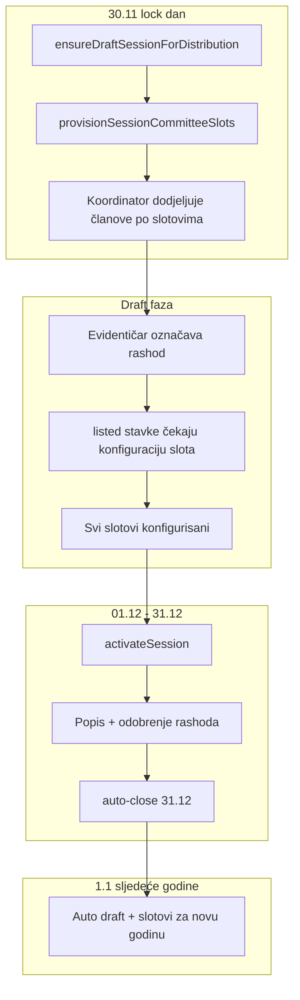

# Auto slotovi popisa + rashod scope

## Problem i cilj

Danas [`createSession`](backend/src/modules/inventory-count/inventory-count.service.ts) kreira prazan `draft` bez `InventoryCommittee` zapisa. Komisije (skladište + kategorija + članovi) dolaze tek kroz 5-korak wizard. To stvara operativne rupe:

- evidentičar može označiti rashod, ali aktivacija blokira `listed` stavke bez komisije
- dialog za rashod prikazuje sve draft sesije → greška „Oprema nije u opsegu sesije popisa” (grad mismatch)
- nakon 31.12. nema draft sesije do sljedećeg lock dana

**Cilj:** sesija odmah ima pun opseg; koordinator na lock danu (30.11.) samo popunjava članove; rashod i aktivacija rade predvidivo; 1.1. auto draft za novu godinu.



---

## Dizajn odluka

| Odluka | Izbor |
|--------|-------|
| Model slotova | Proširiti postojeći `InventoryCommittee` — **bez** novog modela |
| Flag | `membersConfigured Boolean @default(false)` na `InventoryCommittee` |
| Kategorije | Sve roditeljske `ASSET` kategorije × sva skladišta u opsegu distribucije (i s 0 opreme, kao u matrici) |
| Kreiranje komisije | `POST .../committees` **zabranjen** za nove kombinacije; samo `PATCH .../committees/:id` na pending slot |
| Brisanje slota | Zabranjeno za auto-provisioned slotove; dozvoljen samo „reset članova” (admin) |
| Rashod prije članova | Stavka ostaje `listed` dok slot nema `membersConfigured=true`; na konfiguraciji pokreće postojeći [`assignListedDisposalItemsToCommissionInTx`](backend/src/modules/inventory-count/utils/assign-disposal-list-to-commission.util.ts) |
| Post-close | **1.1. auto draft** za `year = currentYear` po distribuciji (odabrano) |

---

## Faza 1 — Šema i provisioning util

### Prisma migracija

U [`backend/prisma/schema.prisma`](backend/prisma/schema.prisma):

```prisma
model InventoryCommittee {
  // ...
  membersConfigured Boolean @default(false)
}
```

- Backfill: postojeće komisije s članovima → `membersConfigured = true`
- Draft sesije bez članova ostaju `false` (ako postoje)

### Novi util

[`backend/src/modules/inventory-count/utils/provision-session-committee-slots.util.ts`](backend/src/modules/inventory-count/utils/provision-session-committee-slots.util.ts):

1. Učitaj `session.orgUnitId` i provjeri distribuciju
2. Skladišta: reuse logike [`listWarehousesForSessionOrgUnit`](backend/src/modules/inventory-count/inventory-count.service.ts) (org tree + `cityId` fallback)
3. Kategorije: `parentId IS NULL AND categoryKind = ASSET`
4. Za svaki par `(warehouseId, categoryId)`:
   - ako ne postoji `@@unique([sessionId, warehouseId, categoryId])` → kreiraj `DisposalCommission` + `InventoryCommittee` (bez članova, `membersConfigured=false`)
5. Idempotentno — sigurno za ponovni poziv (lock day, jan 1, ručno kreiranje)

### Integracija u servis

U [`inventory-count.service.ts`](backend/src/modules/inventory-count/inventory-count.service.ts):

- `createSession` → nakon create, pozovi provisioning u istoj transakciji
- `ensureDraftSessionForDistribution` → provisioning i kad `created: false` (za stare prazne draft sesije)
- Nova metoda `reconcileSessionSlots(sessionId)` (admin-only) za ručni backfill

---

## Faza 2 — API i poslovna pravila

### Konfiguracija članova (umjesto kreiranja)

| Endpoint | Promjena |
|----------|----------|
| `POST /inventory-sessions/:id/committees` | Odbij ako kombinacija već postoji kao slot; dozvoli samo ako slot ne postoji **i** `features.inventory_manual_committee_create` (novi registry ključ, default `false`) — ili potpuno ukloniti za produkciju |
| `PATCH /inventory-sessions/committees/:id` | Primarni tok: postavi članove na pending slot; `warehouseId`/`categoryId` read-only; na uspjeh `membersConfigured=true` + `assignListedDisposalItemsToCommissionInTx` |
| `DELETE .../committees/:id` | Zabrani za `membersConfigured=false` slotove; za konfigurisane — samo admin, i samo ako nema linija |

### Aktivacija sesije

U [`activateSession`](backend/src/modules/inventory-count/inventory-count.service.ts):

- Zamijeni `committeeCount === 0` sa:
  ```ts
  pendingSlots = count({ sessionId, membersConfigured: false })
  if (pendingSlots > 0) throw ...
  ```
- Zadrži `countUnassignedListed > 0` guard (evidentičar označio rashod, koordinator nije konfigurisao taj slot)

### Rashod — stroži scope

U [`equipment-disposal-list.service.ts`](backend/src/modules/inventory-count/equipment-disposal-list.service.ts) `markForDisposal`:

1. Zadrži provjeru grada (postojeća)
2. **Dodaj:** mora postojati `InventoryCommittee` za `(sessionId, warehouseId, parentCategoryId)` — jasnija poruka: „Nema definisanog opsega popisa za ovo skladište i kategoriju”
3. Novi endpoint: `GET /inventory-sessions/eligible-for-equipment/:equipmentId` — vraća draft sesije gdje grad + slot match

### Brisanje sesije

[`deleteSession`](backend/src/modules/inventory-count/inventory-count.service.ts): ukloni guard „Remove all committees” — cascade delete slotova je OK ako nema `listed`/`assigned` stavki i linija (dodati provjeru).

---

## Faza 3 — Scheduler (1.1. draft)

U [`inventory-scheduler.service.ts`](backend/src/modules/inventory-scheduler/inventory-scheduler.service.ts):

- Na `today.month === 1 && today.day === 1` (postojeći rollover log):
  - ako `inventory.auto_create_draft_session` (postojeći ključ):
  - za svaku distribuciju pozovi `ensureDraftSessionForDistribution(orgUnitId, today.year)` + provisioning
- Lock day (30.11.) ostaje nepromijenjen — isti provisioning hook

Opcionalno: notifikacija koordinatorima „N konfigurisanih / M slotova” nakon lock dana.

---

## Faza 4 — Frontend

### Popis stranica

[`InventoryCountPage.tsx`](frontend/src/components/InventoryCountPage.tsx) + [`inventory-committee-list-panel.tsx`](frontend/src/components/inventory-count/inventory-committee-list-panel.tsx):

- Grupisanje po skladištu; badge **„Čeka članove”** / **„Spremno”** po `membersConfigured`
- Summary: `configuredSlots / totalSlots` (ne samo `closedCommittees/totalCommittees`)
- Koordinator vidi samo svoja skladišta (backend već filtrira u `buildSessionCommitteesWhere`)

### Wizard refaktor

[`inventory-committee-wizard.tsx`](frontend/src/components/inventory-count/inventory-committee-wizard.tsx):

- **Novi tok (3 koraka):** odabir pending slota (skladište → kategorija) → popis članovi → rashod članovi
- Ukloni `createInventoryCommitteeApi` za normalan tok; koristi `updateInventoryCommitteeApi` na odabranom `committeeId`
- Edit mode: isti PATCH tok

### Rashod dialog

[`equipment-mark-disposal-dialog.tsx`](frontend/src/components/equipment/equipment-mark-disposal-dialog.tsx):

- Učitaj `GET /inventory-sessions/eligible-for-equipment/:equipmentId`
- Ako 0 sesija → jasna poruka (nema draft popisa za ovu opremu)
- Ako 1 sesija → auto-select

### DTO

[`inventory-api.ts`](frontend/src/api/inventory-api.ts): dodati `membersConfigured` na `InventoryCommitteeDto`

---

## Faza 5 — Postavke, matrice, testovi

### Settings registry

[`settings.registry.ts`](backend/src/modules/settings/settings.registry.ts):

- Dokumentovati da `inventory.auto_create_draft_session` pokriva i lock dan i 1.1.
- (Opcionalno) `features.inventory_manual_committee_create` — samo dev/admin ručni create izvan grida

### Matrice

- [`.cursor/docs/matrices/inventory-count/MATRIX.md`](.cursor/docs/matrices/inventory-count/MATRIX.md) — nova sekcija „Auto slotovi” + ažurirati wizard/kreiranje komisije/rashod scope
- [`.cursor/docs/matrices/inventory-count/CHANGELOG.md`](.cursor/docs/matrices/inventory-count/CHANGELOG.md)
- [`.cursor/docs/matrices/roles-access/MATRIX.md`](.cursor/docs/matrices/roles-access/MATRIX.md) — koordinator = configure slots, ne create

### Testovi

- `provision-session-committee-slots.util.spec.ts` — idempotencija, broj slotova, skip postojećih
- `equipment-disposal-list.service` — scope sa/bez slota
- `activateSession` — blokira pending slotove i unassigned listed
- Scheduler unit test — jan 1 poziva ensure + provision

---

## Migracija postojećih podataka

1. Deploy migracija (`membersConfigured`)
2. SQL backfill: `UPDATE inventory_committees SET membersConfigured = true WHERE EXISTS (SELECT 1 FROM inventory_committee_members ...)`
3. Jednokratni script/endpoint: za sve `draft` sesije bez slotova → `reconcileSessionSlots`
4. Aktivne/zatvorene sesije: **ne dirati** (legacy bez punog grida)

---

## Rizici i mitigacije

| Rizik | Mitigacija |
|-------|------------|
| Veliki broj slotova (N skladišta × M kategorija) | Prihvatljivo za tipičnu distribuciju; list panel paginacija/filter po skladištu |
| Stari draft bez slotova | `ensureDraftSessionForDistribution` provisioning i za `created: false` |
| Auto-activate 1.12. padne na pending slotovima | Očekivano — log u scheduleru već postoji |
| Dupli DisposalCommission | Provisioning kreira commission samo uz novi committee |

---

## Van opsega (ovaj plan)

- Promjena pravila rashoda izvan draft sesije
- Blokada transfera za opremu na `listed` listi
- Nova uloga ili promjena `InventoryCoordinatorAssignment` modela
