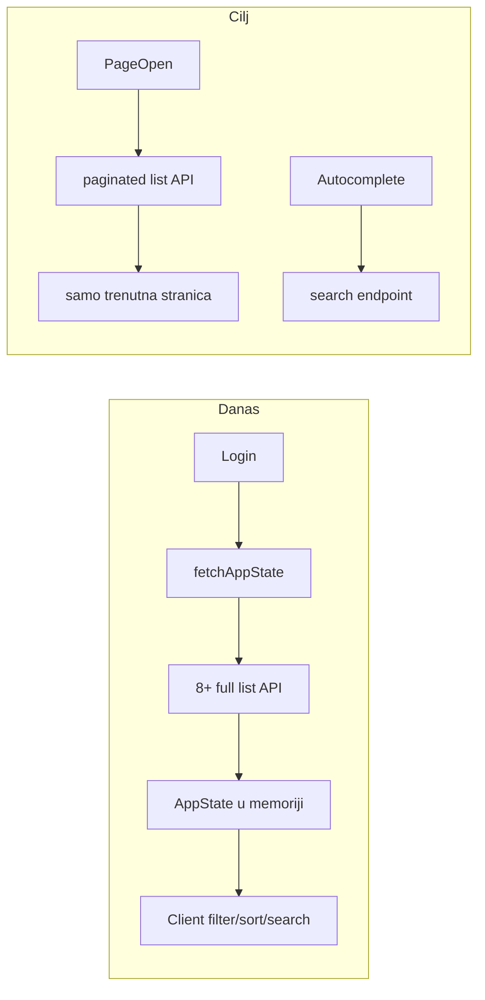

# Plan: performanse i server-side liste

## Dijagnoza (trenutno stanje)

### Glavno usko grlo: globalno učitavanje pri loginu

[`frontend/src/api/data-api.ts`](frontend/src/api/data-api.ts) — `fetchAppState` paralelno povlači **sve** liste:

```64:77:frontend/src/api/data-api.ts
export const fetchAppState = async (role: UserRole): Promise<AppState> => {
  const [orgUnits, employees, categories, equipment, transfers, notifications, cantons, cities, warehouses] =
    await Promise.all([
      apiRequest<OrgUnit[]>('/org-units'),
      apiRequest<Employee[]>('/employees'),
      apiRequest<Category[]>('/categories'),
      apiRequest<Equipment[]>('/equipment'),
      apiRequest<TransferRecord[]>('/transfers'),
      // ...
    ]);
```

[`frontend/src/contexts/DataContext.tsx`](frontend/src/contexts/DataContext.tsx) poziva ovo na svaki login/refresh. Sve tabele filtriraju **client-side** (`useMemo` + `state.*.filter`).

### Backend: filteri postoje, paginacija ne

| Endpoint | DB filter | Paginacija | Sort | Search | Problem |
|---|---|---|---|---|---|
| `GET /equipment` | djelimično | ne | da | ne | učitava sve + **post-filter u petlji** (`canReadEquipment`) |
| `GET /employees` | ne (in-memory) | ne | da | in-memory | učitava sve zaposlenike pa filtrira u JS |
| `GET /transfers` | djelimično | ne | da | ne | teški `include` (equipment, signer, persons…) + post-filter |
| `GET /users` | ne | ne | da | ne | cijela lista |
| `GET /warehouse-stock/*` | ne | ne | da | ne | post-filter za evidentičara |
| `GET /inventory-count/sessions` | orgUnitId | ne | da | ne | **duboki nested include** (committees → lines → equipment) |
| `GET /employee-relocation` | ne | `take:50` | da | ne | djelimičan limit |
| `GET /notifications` | ne | `take:100` | da | ne | hard cap, bez meta |
| `GET /equipment-catalog` | da | `take:50` | da | da | **najbliži ciljanom obrascu** |
| `GET /org-units`, `/categories`, `/locations` | ne | ne | da | ne | reference — prelaze na search API |

### Sekundarna uska grla

- **Dupli rad**: Prisma `findMany` bez limita, zatim JS filter (npr. [`employees.service.ts`](backend/src/modules/employees/employees.service.ts) linije 24–53).
- **Teški list DTO**: transfers koriste isti `transferInclude` za list i detail ([`transfers.service.ts`](backend/src/modules/transfers/transfers.service.ts)).
- **Inventory**: `resolveCommitteeEquipment` učitava svu opremu u kategoriji pa filtrira u petlji ([`inventory-count.service.ts`](backend/src/modules/inventory-count/inventory-count.service.ts) ~597–624).
- **Spec unique check**: učitava sve redove kategorije ([`equipment.service.ts`](backend/src/modules/equipment/equipment.service.ts) ~171–174).
- **Indeksi**: Prisma schema već ima dobre indekse na `Equipment`, `Transfer`, `Employee` — fokus je na query oblik, ne masovne migracije.



---

## Ciljna arhitektura

### 1. Zajednički backend ugovor

Novi fajlovi u [`backend/src/common/dto/`](backend/src/common/dto/) i [`backend/src/common/utils/`](backend/src/common/utils/):

```typescript
// PaginatedQueryDto — base za sve liste
page?: number = 1        // min 1
pageSize?: number = 25   // min 1, max 100
sortBy?: string          // whitelist po resursu
sortDir?: 'asc' | 'desc' = 'asc'
search?: string          // full-text / contains po whitelisted poljima

// PaginatedResponse<T>
{ items: T[]; meta: { page, pageSize, total, totalPages } }
```

Helperi:
- `parsePagination(query)` → `{ skip, take }`
- `buildOrderBy(sortBy, sortDir, allowedFields)`
- `buildSearchWhere(search, fields[])` — Prisma `contains` / `OR`
- `paginate(prismaModel, where, options)` — `Promise.all([findMany, count])`

**Pravilo**: list endpointi vraćaju `PaginatedResponse`; detail endpointi ostaju puni objekti.

### 2. Scope u SQL, ne u petlji

Za evidentičara, dodati u [`RegistrarScopeService`](backend/src/common/services/registrar-scope.service.ts):

- `buildEquipmentWhere(user): Promise<Prisma.EquipmentWhereInput>`
- `buildEmployeeWhere(user): Promise<Prisma.EmployeeWhereInput>`
- `buildTransferWhere(user): Promise<Prisma.TransferWhereInput>`

Ovo je **preduslov** ispravne paginacije — inače `total` i `items` ne odgovaraju stvarnom scope-u.

Za `user` rolu: `where: { currentHolderId: user.employeeId }` direktno u Prisma.

Za `skladistar`: već postoji djelimično u `buildListWhere` — proširiti, ukloniti post-filter petlju.

### 3. List vs detail DTO

- **Transfers list**: lagani select (documentNumber, type, status, date, equipment.inventoryNumber, from/to ime)
- **Transfers detail**: postojeći puni `transferInclude`
- Isti princip za inventory sessions (session list bez `lines`, committee list bez svih lines, line list paginirano)

### 4. Frontend: od globalnog store-a ka page-level fetch

**Faza A** — zadržati `DataContext`, ali `fetchAppState` učitava samo:
- `currentUser`, `notifications` (paginirano), eventualno `settings`

**Faza B** — svaka stranica sa tabelom koristi hook `usePaginatedList<T>`:
- drži `page`, `pageSize`, `sort`, `filters`, `search`, `debouncedSearch`
- poziva paginirani API
- UI komponenta `PaginationControls` (nova, u [`frontend/src/components/ui/`](frontend/src/components/ui/))

**Faza C** — ukloniti `equipment`, `transfers`, `employees`, `users` iz `AppState` kad sve stranice migriraju.

### 5. Server-side search autocomplete (referentni podaci)

Novi search endpointi (limit 20, min 2 znaka):

| Endpoint | Polja |
|---|---|
| `GET /org-units/search?q=` | name, path, type |
| `GET /categories/search?q=` | name, parent path |
| `GET /employees/search?q=` | firstName, lastName, email, title |
| `GET /locations/cantons/search?q=` | name |
| `GET /locations/cities/search?q=` | name, canton |

Ažurirati [`OrgUnitAutocomplete`](frontend/src/components/org-unit-autocomplete.tsx), `employee-multi-autocomplete`, i ostale da koriste debounced API umjesto `state.*`.

---

## Faze implementacije (inkrementalno)

Plan je **kompletan**, implementacija ide **segment po segment** u zasebnim PR-ovima.

### Faza 0 — Baseline i guardrails (~0.5 dana)

- Mjeriti: vrijeme `fetchAppState`, veličina JSON odgovora po endpointu, broj redova u DB (equipment, transfers, employees).
- Dodati setting `lists.default_page_size` (default 25, max 100) u settings registry.
- Dokumentovati u `.cursor/docs/matrices/list-performance/MATRIX.md`.

### Faza 1 — Infrastruktura (~1 dan)

Backend:
- `PaginatedQueryDto`, `PaginatedResponse`, helper utili + unit testovi
- Prvi pilot: proširiti [`SearchCatalogQueryDto`](backend/src/modules/equipment-catalog/dto/search-catalog-query.dto.ts) na puni paginated oblik (0 breaking change za catalog jer već ima `take:50`)

Frontend:
- `usePaginatedList` hook + `PaginationControls` komponenta
- Tip `PaginatedResponse<T>` u [`frontend/src/types/`](frontend/src/types/)

### Faza 2 — Top 3 volumena (~3–4 dana)

Prioritet po uticaju na login payload i veličini tabele:

**2a. Equipment** ([`equipment.service.ts`](backend/src/modules/equipment/equipment.service.ts), [`EquipmentPage.tsx`](frontend/src/components/EquipmentPage.tsx), [`EquipmentByCategoryPage.tsx`](frontend/src/components/EquipmentByCategoryPage.tsx))
- Proširiti `ListEquipmentQueryDto`: `search`, `sortBy`, `sortDir`, `page`, `pageSize`
- `buildEquipmentWhere` + search po inventoryNumber, contractNumber, spec values
- List response uključuje `currentHolder { id, firstName, lastName }` i `category { id, name }` — eliminira lookup iz store-a
- Dashboard stats: novi `GET /equipment/summary` (count po statusu u scope-u)

**2b. Transfers** ([`transfers.service.ts`](backend/src/modules/transfers/transfers.service.ts), [`TransfersPage.tsx`](frontend/src/components/TransfersPage.tsx), [`DocumentsPage.tsx`](frontend/src/components/DocumentsPage.tsx))
- Paginirani list + search (documentNumber, inventoryNumber, employee names)
- Lagani list DTO; detail ostaje pun
- Dashboard recent transfers: `GET /transfers/recent?limit=5`

**2c. Employees** ([`employees.service.ts`](backend/src/modules/employees/employees.service.ts), [`EmployeesPage.tsx`](frontend/src/components/EmployeesPage.tsx))
- Prebaciti `search` i `orgUnitId` filter u Prisma `where`
- Paginacija + sort (lastName, firstName, orgUnit)
- `GET /employees/search` za autocomplete

### Faza 3 — Ostale tabele (~2–3 dana)

| Segment | Backend | Frontend stranica |
|---|---|---|
| Users | paginated list | [`UserManagementPage.tsx`](frontend/src/components/UserManagementPage.tsx) |
| Warehouses | paginated list (admin/skladistar) | [`WarehousesPage.tsx`](frontend/src/components/WarehousesPage.tsx) |
| Warehouse stock lots | paginated + filter status/category | [`registrar-stock-page.tsx`](frontend/src/components/registrar-stock/registrar-stock-page.tsx), warehouse detail |
| Employee relocation | paginated cases + lines | [`employee-relocation-page.tsx`](frontend/src/components/employee-relocation/employee-relocation-page.tsx) |
| Disposal commissions | paginated | [`DisposalCommissionsPage.tsx`](frontend/src/components/DisposalCommissionsPage.tsx) |
| Notifications | paginated + unread filter | Layout/notifications panel |

### Faza 4 — Inventory modul (~2 dana)

Najveći backend refactor — odvojiti endpointe:

- `GET /inventory-count/sessions` — lista sesija (bez committees/lines)
- `GET /inventory-count/sessions/:id/committees` — paginirano
- `GET /inventory-count/committees/:id/lines` — paginirano + filter status
- `GET /inventory-count/committees/:id/equipment-scope` — paginirano umjesto full load

Frontend [`InventoryCountPage.tsx`](frontend/src/components/InventoryCountPage.tsx) već koristi dedicated API — prilagoditi na lazy load po panelu.

### Fase 5 — Reference search + deprecacija globalnog store-a (~1–2 dana)

- Search endpointi za org-units, categories, locations
- Migrirati sve autocomplete/form komponente
- `fetchAppState` → `fetchBootstrap` (samo notifikacije + minimalni kontekst)
- Ukloniti neiskorištene `state.*` nizove i client-side scope helper-e gdje backend preuzima (`equipmentMatchesScope`, `transferMatchesScope` na list stranicama)

### Faza 6 — Brzi backend winovi (paralelno sa fazama 2–5)

- `checkUniqueSpecificationValue`: Prisma raw/filter umjesto load-all
- `resolveCommitteeEquipment`: SQL scope filter prije iteracije
- Transfer list: ukloniti `disposalApproval` iz list include
- Warehouse stock `listForRegistrar`: scope u `where`, ne petlja
- Opciono: response compression (NestJS `compression` middleware) — niski prioritet

---

## API breaking change strategija

Za svaki migrirani endpoint:
1. Backend vraća novi `{ items, meta }` oblik
2. Frontend stranica migrirana u istom PR-u
3. Nema dual-format perioda — manji diff, jasniji review

Dashboard i cross-page lookup:
- Denormalizovani podaci u list DTO (imena, brojevi)
- Dedicated summary/recent endpointi umjesto globalnog niza

---

## Test plan (po segmentu)

- Backend e2e/spec: paginacija (page 1/2), search, sort, filter kombinacije, scope po roli (admin/evidenticar/user/skladistar)
- Regresija: CRUD forme i autocomplete i dalje rade preko search API
- Ručno: login vrijeme, Network tab (payload size), scroll kroz 1000+ redova opreme

---

## Procjena rizika

| Rizik | Mitigacija |
|---|---|
| Evidentičar scope u SQL je kompleksan | Prvo unit testovi za `build*Where`, paralelni test sa starim post-filterom na sample podacima |
| Forme zavise od `state.employees` | Search autocomplete prije uklanjanja iz store-a |
| Inventory duboki include | Lazy endpointi po panelu, ne dirati business logiku u prvom PR-u |
| Dashboard brojači | Dedicated summary endpointi u fazi 2a/2b |

---

## Redoslijed PR-ova (preporuka)

1. Infrastruktura + catalog pilot + PaginationControls
2. Equipment (backend + frontend + summary)
3. Transfers (backend + frontend + recent)
4. Employees (backend + frontend + search)
5. Users + Warehouses
6. Warehouse stock + relocation + disposal
7. Notifications paginacija
8. Inventory lazy endpoints
9. Reference search + fetchBootstrap + store cleanup
