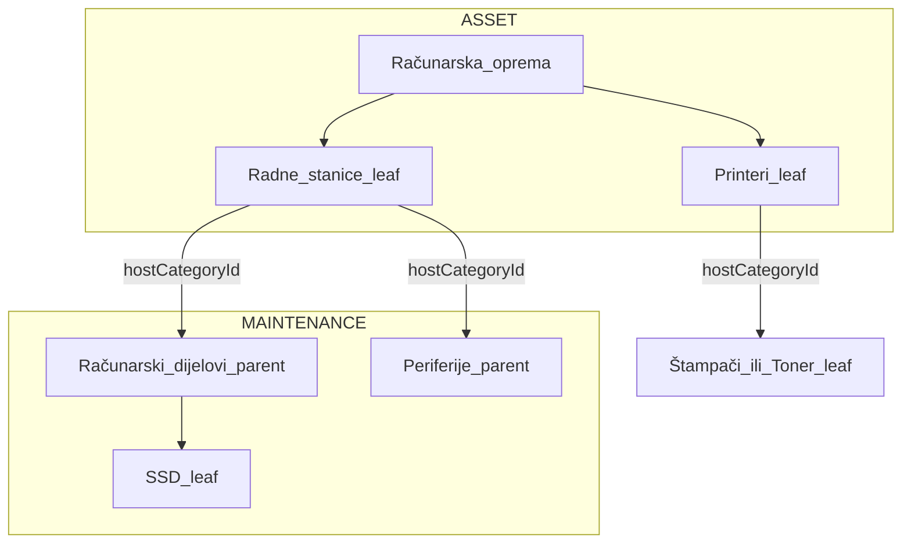

# Plan: Održavanje — veza na child ASSET kategorije

## Cilj

- **Host** = kategorija na kojoj živi `Equipment` (child leaf: Radne stanice, Printeri), **ne** glavni parent.
- **Maintenance** = može biti **parent grupa** (Računarski dijelovi) ili **leaf** (SSD); parent se pri validaciji širi na sve MAINTENANCE leaf-ove ispod.
- **Nema** nasljeđivanja linkova prema gore (Monitor ne vidi SSD samo zato što je link na Računarska oprema).

Korisnik je odabrao **ručnu migraciju** postojećih parent linkova (bez auto-kopiranja na child-e).

---

## Šema podataka

**Bez Prisma migracije** — [`CategoryMaintenanceLink`](backend/prisma/schema.prisma) ostaje `(hostCategoryId, maintenanceCategoryId)`.

Semantička promjena:

| Polje | Prije | Poslije |
|-------|--------|---------|
| `hostCategoryId` | ASSET parent s podkategorijama | ASSET **leaf** (nema djece) |
| `maintenanceCategoryId` | samo MAINTENANCE leaf | MAINTENANCE **parent ili leaf** |

---

## Backend

### 1. Novi util: širenje maintenance kataloga

Novi fajl npr. [`backend/src/modules/maintenance-parts/utils/expand-maintenance-catalog.util.ts`](backend/src/modules/maintenance-parts/utils/expand-maintenance-catalog.util.ts):

- `expandLinkedMaintenanceToLeafIds(prisma, linkedCategoryIds)` → `Set<string>` svih MAINTENANCE leaf ID-eva
- Ako je link na parent MAINTENANCE → svi descendant leaf-ovi; ako je link na leaf → sam taj ID

### 2. [`setCategoryLinks`](backend/src/modules/maintenance-parts/maintenance-parts.service.ts)

Zamijeniti pravila:

- **Host:** `categoryKind === ASSET` + **mora biti leaf** (`assertLeafCategory`); **odbaciti** host koji ima podkategorije (stari parent model).
- **Maintenance:** `categoryKind === MAINTENANCE`; **dozvoliti** parent ili leaf (ukloniti obavezni `assertLeafCategory` na maintenance strani).
- Pri snimanju: normalizovati (dedupe); opcionalno odbiti link host=parent ASSET s jasnom porukom.

### 3. [`assertMaintenanceAllowedForHost`](backend/src/modules/maintenance-parts/maintenance-parts.service.ts) + resolve

Ukloniti/uprostiti [`resolve-host-category.util.ts`](backend/src/modules/maintenance-parts/utils/resolve-host-category.util.ts):

- **Host za opremu** = `equipment.categoryId` (direktno), ne walk-up po lancu.
- Provjera linka: postoji red za `(hostCategoryId = equipment.categoryId, maintenanceCategoryId)` **ili** maintenance parent koji sadrži taj leaf (preko expand util-a).
- Ukloniti `isCategoryUnderHost` iz install putanje (ili ostaviti samo za legacy read — ne koristiti za novu logiku).

### 4. [`getWarehouseConsumptionSummary`](backend/src/modules/maintenance-parts/maintenance-parts.service.ts)

- Agregacija po **`equipment.categoryId`** (ASSET child host), ne po `resolveHostCategoryIdForEquipment`.
- Filter `hostCategoryId` u query = taj child ID.

### 5. API odgovor `getCategoryLinks`

Vratiti raw linkove (parent/leaf maintenance) — frontend grupiše za prikaz.

---

## Frontend

### 6. [`CategoriesPage.tsx`](frontend/src/components/CategoriesPage.tsx)

- **Ukloniti** panel ispod parent reda (linija ~252–255).
- **Dodati** [`CategoryMaintenanceLinksPanel`](frontend/src/components/categories/category-maintenance-links-panel.tsx) ispod svake **podkategorije** (sub) u expand bloku — `hostCategory={sub}`.
- Prikazati samo za `sub` gdje je `(categoryKind ?? 'ASSET') === 'ASSET'` i sub je leaf (nema djece).

### 7. Refaktor [`category-maintenance-links-panel.tsx`](frontend/src/components/categories/category-maintenance-links-panel.tsx)

- Naslov: „Katalog dijelova za **{hostCategory.name}**” (child).
- Maintenance opcije **grupisane po MAINTENANCE parent** (Računarski dijelovi → checkbox na grupi + pojedinačni leaf-ovi ispod).
- Checkbox na **parent grupi** šalje `maintenanceCategoryId` = parent ID (backend expand).
- Leaf checkbox i dalje šalje leaf ID.
- Indikacija ako je host pogrešnog tipa (parent ASSET) — ne prikazivati panel.

### 8. [`equipment-installed-parts-panel.tsx`](frontend/src/components/maintenance-parts/equipment-installed-parts-panel.tsx)

- Ukloniti petlju walk-up + višestruke API pozive po lancu.
- Jedan poziv: `fetchCategoryMaintenanceLinksApi(equipmentCategoryId)`.
- Expand maintenance parent → lista leaf tipova za select (može helper u [`frontend/src/helpers/expand-maintenance-catalog.util.ts`](frontend/src/helpers/expand-maintenance-catalog.util.ts) mirror backend logike za UI).
- Panel se prikazuje samo ako ima linkova na **direktnoj** kategoriji opreme.

### 9. [`warehouse-maintenance-consumption-panel.tsx`](frontend/src/components/maintenance-parts/warehouse-maintenance-consumption-panel.tsx)

- Filter „Host kategorija”: lista ASSET **leaf** kategorija koje imaju bar jedan link (ili sve child pod glavnim parentima), ne parent „Računarska oprema”.

### 10. [`resolve-host-category.util.ts`](frontend/src/helpers/resolve-host-category.util.ts)

- Uprostiti / ukloniti walk-up ako više nije potreban; ažurirati pozive.

---

## Dokumentacija i migracija

### 11. Matrica

Ažurirati [`.cursor/docs/matrices/maintenance-parts/MATRIX.md`](.cursor/docs/matrices/maintenance-parts/MATRIX.md) + [`CHANGELOG.md`](.cursor/docs/matrices/maintenance-parts/CHANGELOG.md):

- Host = ASSET child leaf; maintenance = parent ili leaf; nema nasljeđivanja s parent ASSET.
- **Migracija:** admin ručno premapira linkove s „Računarska oprema” na „Radne stanice”, „Printeri”, itd.

### 12. Ručni koraci nakon deploya (HANDOFF)

U [`.cursor/plans/odrzavanje_i_postavke_meni/HANDOFF.md`](.cursor/plans/odrzavanje_i_postavke_meni/HANDOFF.md) dodati checklist:

1. Obrisati stare linkove na parent ASSET (ako postoje).
2. Na **Radne stanice**: označiti Računarski dijelovi + Periferije (ili pojedinačne leaf-ove).
3. Na **Printeri**: označiti Štampači/Toneri.
4. Registrar dodjele: scope po **child** kategoriji + skladištu (npr. Radne stanice, ne samo parent).

---

## Test plan (ručno)

| Korak | Očekivano |
|-------|-----------|
| Link na Računarska oprema (parent) | API odbija ili UI ne nudi panel |
| Link na Radne stanice + grupa Računarski dijelovi | PC u kategoriji Radne stanice vidi SSD/HDD/RAM u panelu |
| Oprema u Monitori bez linka na Monitori | Nema panela ugradnje |
| Printeri + Toner | Samo toner u katalogu |
| Ugradnja / zamjena | Isto kao prije, scope po child |
| Potrošnja | Redovi po Radne stanice / Printeri, ne po parent |

---

## Fajlovi (fokus)

| Sloj | Fajlovi |
|------|---------|
| Backend util | `expand-maintenance-catalog.util.ts`, `resolve-host-category.util.ts` |
| Backend servis | `maintenance-parts.service.ts` |
| Frontend admin | `CategoriesPage.tsx`, `category-maintenance-links-panel.tsx` |
| Frontend host | `equipment-installed-parts-panel.tsx`, `warehouse-maintenance-consumption-panel.tsx` |
| Docs | `maintenance-parts/MATRIX.md`, `CHANGELOG.md`, `HANDOFF.md` |

**Van opsega:** automatska SQL migracija parent→child linkova; promjena RegistrarAssignment šeme (već podržava leaf `categoryId` kroz postojeće proširenje).
