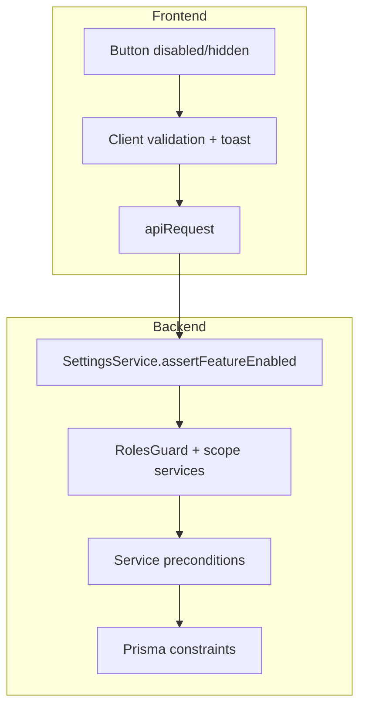
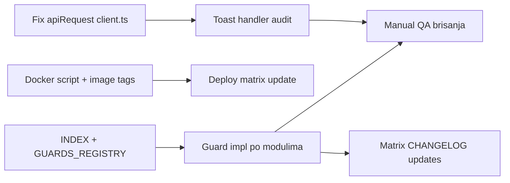

# Compose cleanup, toast fix i matrice/guardovi

## 1. Docker Compose — automatsko brisanje starih image-a

**Problem:** `[docker-compose.prod.yml](docker-compose.prod.yml)` nema mehanizam za uklanjanje dangling image-a nakon `build`. Compose **nema** native post-build hook; svaki rebuild ostavlja `<none>` image-e od prethodnih slojeva.

**Rješenje (kombinacija):**

### A) Eksplicitni image tagovi u compose

Dodati `image:` na oba servisa da se stari tag jasno zamijeni (npr. `inventory-v2-backend:prod`, `inventory-v2-frontend:prod`):

```yaml
backend:
  image: inventory-v2-backend:prod
  build: ...
frontend:
  image: inventory-v2-frontend:prod
  build: ...
```

### B) Wrapper skripta za host deploy

Kreirati `[scripts/docker-prod-build.sh](scripts/docker-prod-build.sh)`:

```bash
#!/usr/bin/env bash
set -euo pipefail
docker compose -f docker-compose.prod.yml build "$@"
docker image prune -f
```

Opcionalno agresivnije (samo dangling, ne sve unused): `docker image prune -f` — uklanja `<none>` image-e nastale rebuild-om.

### C) Dokumentacija

Ažurirati `[.cursor/docs/matrices/deploy-traefik/MATRIX.md](.cursor/docs/matrices/deploy-traefik/MATRIX.md)` + `CHANGELOG.md` s novim deploy korakom:

```bash
./scripts/docker-prod-build.sh
docker compose -f docker-compose.prod.yml up -d
```

**Napomena:** `docker compose build` sam po sebi ne može pokrenuti prune; skripta je jedini pouzdan način bez dodatnih alata.

---

## 2. Lažne error toast poruke — root cause i popravka

### Dijagnoza

U `[frontend/src/api/client.ts](frontend/src/api/client.ts)` `apiRequest` tretira samo **204** kao prazan odgovor:

```107:116:frontend/src/api/client.ts
export const apiRequest = async <T>(path: string, options: RequestInit = {}): Promise<T> => {
  const response = await fetchWithAuthRetry(path, options);
  if (!response.ok) {
    throw await parseApiError(response);
  }
  if (response.status === 204) {
    return undefined as T;
  }
  return (await response.json()) as T;  // ← puca na prazan 200 body
};
```

NestJS DELETE endpointi koji vraćaju `Promise<void>` šalju **200 s praznim tijelom**. `response.json()` baca `SyntaxError` → UI hvata u `catch` i prikazuje „Greška pri brisanju”, iako je brisanje uspjelo.

**Pogođeni backend endpointi** (svi `remove()` bez return body):

- `[org-units.service.ts](backend/src/modules/org-units/org-units.service.ts)` — hijerarhija
- `[employees.service.ts](backend/src/modules/employees/employees.service.ts)` — radnici (korisnik nema DELETE API; brisanje radnika s računom je vjerovatno ono što korisnik vidi)
- `[categories.service.ts](backend/src/modules/categories/categories.service.ts)`
- `[equipment.service.ts](backend/src/modules/equipment/equipment.service.ts)`
- `[equipment-catalog.service.ts](backend/src/modules/equipment-catalog/equipment-catalog.service.ts)`

Inventory DELETE radi jer vraća `{ ok: true }`. Lokacije DELETE vraćaju Prisma objekat (JSON).

### Fix — centralno (prioritet)

U `[client.ts](frontend/src/api/client.ts)`:

```typescript
const text = await response.text();
if (!text.trim()) {
  return undefined as T;
}
return JSON.parse(text) as T;
```

### Fix — sekundarno (UX konzistentnost)

Refaktor handlera koji spajaju mutaciju + `refresh()` u isti `try/catch`:


| Fajl                                                                   | Problem                                            |
| ---------------------------------------------------------------------- | -------------------------------------------------- |
| `[OrganizationPage.tsx](frontend/src/components/OrganizationPage.tsx)` | delete + refresh u istom catch; nema success toast |
| `[EmployeesPage.tsx](frontend/src/components/EmployeesPage.tsx)`       | isto                                               |
| `[CategoriesPage.tsx](frontend/src/components/CategoriesPage.tsx)`     | isto                                               |
| `[LocationsPage.tsx](frontend/src/components/LocationsPage.tsx)`       | refresh failure = lažna greška brisanja            |


**Pattern:**

```typescript
try {
  await deleteXApi(id);
  toastSuccess('…');
  try { await refresh(); await list.refresh(); } catch { /* soft warn ili ignore */ }
} catch (err) {
  toastError(err instanceof ApiError ? err.message : 'Greška pri brisanju');
}
```

### Audit svih mutacija (~35 fajlova s `toastError`)

Proći sve komponente s `toastError(` i provjeriti:

- da koriste `ApiError.message` (backend poruka na BS)
- da success toast postoji nakon uspješne akcije
- da se ne prikazuje error ako je mutacija uspjela a refresh pao

Ključni moduli: `InventoryCountPage`, `EquipmentCard`, `TransfersPage`, `WarehousesPage`, `registrar-stock`, `employee-relocation`, `maintenance-parts`, `settings-page`.

### Opcionalno (belt-and-suspenders na backendu)

Standardizovati sve DELETE da vraćaju `{ ok: true }` ili `@HttpCode(204)` — manje bitno ako se `client.ts` popravi.

---

## 3. Matrice — kompletan spisak i guard implementacija

### 3.1 Indeks svih matrica (19 modula)

Kreirati `[.cursor/docs/matrices/INDEX.md](.cursor/docs/matrices/INDEX.md)` kao centralni katalog:


| Slug                  | Matrica                                                          | Ključne akcije / guard zone                        |
| --------------------- | ---------------------------------------------------------------- | -------------------------------------------------- |
| `auth-session`        | [MATRIX.md](.cursor/docs/matrices/auth-session/MATRIX.md)        | login, refresh, logout, session expiry             |
| `roles-access`        | [MATRIX.md](.cursor/docs/matrices/roles-access/MATRIX.md)        | uloge, registrar scope, coordinator scope          |
| `settings`            | [MATRIX.md](.cursor/docs/matrices/settings/MATRIX.md)            | feature flags, registry enforcement                |
| `org-hierarchy`       | [MATRIX.md](.cursor/docs/matrices/org-hierarchy/MATRIX.md)       | create/update/delete org unit, parent-child tipovi |
| `locations`           | [MATRIX.md](.cursor/docs/matrices/locations/MATRIX.md)           | kantoni/gradovi, brisanje s referencama            |
| `warehouses`          | [MATRIX.md](.cursor/docs/matrices/warehouses/MATRIX.md)          | skladišta, keepers, effective warehouse            |
| `categories-fields`   | [MATRIX.md](.cursor/docs/matrices/categories-fields/MATRIX.md)   | hijerarhija kategorija, polja, brisanje            |
| `equipment-status`    | [MATRIX.md](.cursor/docs/matrices/equipment-status/MATRIX.md)    | statusi opreme, prelazi                            |
| `transfers`           | [MATRIX.md](.cursor/docs/matrices/transfers/MATRIX.md)           | kreiranje, potpis, PDF, generation flags           |
| `warehouse-stock`     | [MATRIX.md](.cursor/docs/matrices/warehouse-stock/MATRIX.md)     | prijem, izdavanje, lotovi                          |
| `maintenance-parts`   | [MATRIX.md](.cursor/docs/matrices/maintenance-parts/MATRIX.md)   | instalirani dijelovi, potrošnja                    |
| `employee-relocation` | [MATRIX.md](.cursor/docs/matrices/employee-relocation/MATRIX.md) | premještaj radnika + oprema                        |
| `inventory-count`     | [MATRIX.md](.cursor/docs/matrices/inventory-count/MATRIX.md)     | sesija, komisije, linije, zatvaranje               |
| `disposal-commission` | [MATRIX.md](.cursor/docs/matrices/disposal-commission/MATRIX.md) | komisija rashoda, glasanje                         |
| `notifications`       | [MATRIX.md](.cursor/docs/matrices/notifications/MATRIX.md)       | in-app, realtime                                   |
| `labels`              | [MATRIX.md](.cursor/docs/matrices/labels/MATRIX.md)              | QR/label generisanje                               |
| `list-performance`    | [MATRIX.md](.cursor/docs/matrices/list-performance/MATRIX.md)    | paginacija, prefetch                               |
| `install-setup`       | [MATRIX.md](.cursor/docs/matrices/install-setup/MATRIX.md)       | first-run setup                                    |
| `deploy-traefik`      | [MATRIX.md](.cursor/docs/matrices/deploy-traefik/MATRIX.md)      | infra, compose                                     |


### 3.2 Guard registry format

Kreirati `[.cursor/docs/matrices/GUARDS_REGISTRY.md](.cursor/docs/matrices/GUARDS_REGISTRY.md)` — za svaku akciju:

```markdown
### org-units.delete
- **Preconditions:** nema djece, nema zaposlenika
- **Backend:** org-units.service.remove + ORG_HIERARCHY_MESSAGES
- **Frontend guard:** disable delete button + confirm (OrganizationPage)
- **UX poruka:** „Jedinica ima podjedinice…” / „Jedinica ima zaposlenike…”
- **Gap:** FE ne provjerava prije API poziva → dodati client-side check
- **Status:** BE ✓ | FE △
```

Svaki red iz matrice mapirati na: preconditions → BE guard → FE guard → poruka → gap → status.

### 3.3 Arhitektura guard slojeva




**Pravilo:** svaka akcija iz matrice mora imati BE guard (obavezno) + FE guard gdje je moguće (disable dugme / inline upozorenje prije API poziva) + ista BS poruka.

### 3.4 Implementacija guardova po modulima (full scope)

Za svaki modul: pročitati MATRIX → ekstrahovati akcije → provjeriti postojeće guardove u servisima → dodati nedostajuće.

**Prioritet implementacije unutar full ciklusa:**

1. **Brisanja i CRUD** — org-hierarchy, employees, categories, locations, warehouses, equipment-catalog
2. **Oprema i transferi** — equipment-status, transfers (generation flags, sign workflow)
3. **Skladište** — warehouse-stock, maintenance-parts
4. **Popis i rashod** — inventory-count, disposal-commission (najviše poslovnih pravila)
5. **Pristup** — roles-access, settings feature flags na FE
6. **Ostalo** — employee-relocation, notifications, labels

**Backend pattern** (postojeći primjer):

```152:162:backend/src/modules/org-units/org-units.service.ts
async remove(id: string): Promise<void> {
  // ... provjere ...
  throw new BadRequestException(ORG_HIERARCHY_MESSAGES.deleteHasChildren);
  await this.prisma.orgUnit.delete({ where: { id } });
}
```

Proširiti na module bez centralizovanih poruka — kreirati `*-messages.util.ts` gdje nedostaje (po uzoru na `[org-hierarchy-messages.util.ts](backend/src/common/utils/org-hierarchy-messages.util.ts)`).

**Frontend pattern** — ekstrahovati reusable guard helper-e:

- `frontend/src/helpers/guards/` — npr. `canDeleteOrgUnit(unit, orgUnits, employees)`, `canDeleteCategory(...)`, `canActivateInventorySession(...)`
- Koristiti u komponentama za disable + tooltip/poruku prije API poziva
- Poruke mapirati 1:1 s backend message util-ima

**Settings enforcement:** svaki modul s `features.`* ključem — provjeriti da FE koristi `isSettingFlagEnabled` / `LayoutNavGate` i da BE ima `assertFeatureEnabled` na write endpointima (vidi [settings registry](backend/src/modules/settings/settings.registry.ts)).

### 3.5 Ažuriranje matrica

Svaka nova/dopunjena guard logika → update odgovarajući `MATRIX.md` + `CHANGELOG.md` (pravilo iz `code-hygiene-and-matrices.mdc`).

---

## Redoslijed izvršavanja




1. **Brzi win:** `client.ts` fix — odmah rješava lažne greške pri brisanju
2. **Docker:** skripta + image tagovi + deploy docs
3. **Dokumentacija:** INDEX + GUARDS_REGISTRY (audit svih 19 matrica)
4. **Guard implementacija:** modul po modul (BE + FE + poruke)
5. **Toast audit:** success poruke, odvojiti refresh od mutacije
6. **QA:** brisanje org unit, radnik, kategorija; inventory lifecycle; transfer sign

---

## Rizici i napomene

- **Korisnik DELETE ne postoji** u `[users.controller.ts](backend/src/modules/users/users.controller.ts)` — samo PATCH (deaktivacija). „Brisanje korisnika” = vjerovatno brisanje radnika ili deaktivacija; nema posebnog endpointa za hard delete user-a.
- **Full guard scope** je velik (~19 modula); implementacija ide modul-po-modul s testiranjem da se ne uvode regresije.
- **Docker prune** briše samo dangling image-e (`prune -f`), ne tagged image-e drugih projekata — sigurno za produkcijski host.
