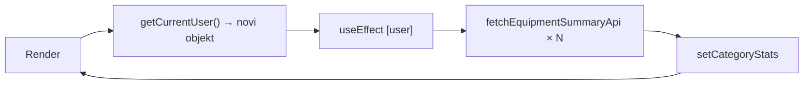

# Plan: Kontrolna tabla, brojači i dijalog radnika

## 1. Beskonačni loop — `GET /equipment/summary?categoryId=`

### Uzrok

U [`frontend/src/components/Dashboard.tsx`](frontend/src/components/Dashboard.tsx) (linija 66–99) `useEffect` ovisi o `user`:

```typescript
}, [state.categories, user]);
```

`user` dolazi iz `getCurrentUser()` (linija 41). U [`frontend/src/store.ts`](frontend/src/store.ts) (linije 52–68), kad `_state.users` ne sadrži trenutnog korisnika (bootstrap uvijek postavlja `users: []` u [`frontend/src/api/data-api.ts`](frontend/src/api/data-api.ts)), funkcija **svaki put vraća novi object literal**:

```typescript
return {
  id: _authUser.id,
  username: _authUser.username,
  // ...
};
```

React vidi novu referencu → effect se ponovo pokrene → `fetchEquipmentSummaryApi(sub.id)` za svaku podkategoriju → `setCategoryStats` → re-render → novi `user` → **beskonačan loop**.

Svaki poll notifikacija (`applyNotificationsLoaded` → `setState`) dodatno ubrzava re-rendere, ali **primarni uzrok** je nestabilan `user`, ne promjena `state.categories`.

### Isti pattern na drugom mjestu

[`frontend/src/components/EquipmentByCategoryPage.tsx`](frontend/src/components/EquipmentByCategoryPage.tsx) (linija 69) ima isti dependency: `[selectedParentId, state.categories, user]` — potencijalno isti problem kad se otvori ta stranica.

### Rješenje (root fix u store)

U [`frontend/src/store.ts`](frontend/src/store.ts) — **cache-irati fallback korisnika** kad `_state.users` ne sadrži auth usera:

- Dodati `_cachedAuthUserView` + `_cachedAuthUserKey` (serializirani `id`, `role`, `employeeId`, `registrarScopes`)
- Rekreirati cached objekt samo kad se `_authUser` promijeni (`setAuthUser`) ili kad se key promijeni
- Invalidirati cache u `setAuthUser(null)` i `syncAppState` ako je potrebno

Ovo stabilizira `user` u svim komponentama koje koriste `getCurrentUser()` u `useEffect` deps, bez potrebe za `useMemo` u svakoj komponenti.

**Dodatna zaštita u Dashboard** (opciono, minimalno): zamijeniti `user` u deps sa primitivima (`user?.id`, `user?.role`, stabilan scopes key) — nije obavezno ako se fixa store.



---

## 2. Brojači na kontrolnoj tabli

### Radnici — uvijek 0

U [`frontend/src/components/Dashboard.tsx`](frontend/src/components/Dashboard.tsx) linija 105:

```typescript
const totalEmployees = 0;  // hardcoded, nikad implementirano
```

Backend već podržava scoped brojanje preko `GET /employees` → `meta.total` ([`backend/src/common/services/registrar-scope.service.ts`](backend/src/common/services/registrar-scope.service.ts) `buildEmployeeWhere`):

| Uloga | Scope |
|-------|-------|
| **admin** | svi radnici (`where: {}`) |
| **evidenticar** | radnici u efektivnom skladištu / org jedinici dodjele |
| **evidenticar bez dodjela** | 0 |

**Fix:** U `useEffect` (mount) pozvati:

```typescript
fetchEmployeesPageApi({ page: 1, pageSize: 1 })
  .then((r) => setTotalEmployees(r.meta.total))
```

API [`frontend/src/api/employees-api.ts`](frontend/src/api/employees-api.ts) već postoji; backend automatski filtrira po ulozi.

### Ukupno prenosa / Čeka potpis — pogrešna logika

Trenutno (linije 106–107):

```typescript
const totalTransfers = recentTransfers.length;  // max 5!
const rawTransfers = recentTransfers.filter(t => t.status === 'raw').length;
```

`fetchRecentTransfersApi(5)` vraća samo zadnjih 5 za listu "Nedavni prenosi" — **ne za brojače**.

**Fix:** Dodati zasebne lightweight pozive (isti pattern kao notifikacije u [`frontend/src/api/notifications-api.ts`](frontend/src/api/notifications-api.ts)):

```typescript
fetchTransfersPageApi({ page: 1, pageSize: 1 })           // → meta.total
fetchTransfersPageApi({ page: 1, pageSize: 1, status: 'raw' })  // → meta.total
```

Backend `GET /transfers` već scope-ira po ulozi ([`backend/src/modules/transfers/transfers.service.ts`](backend/src/modules/transfers/transfers.service.ts)).

### Ostali brojači — audit

| Brojač | Status | Napomena |
|--------|--------|----------|
| Ukupno opreme / Skladište / Zaduženo / Rashodovano | OK | `fetchEquipmentSummaryApi()` — scoped na backendu |
| Oprema po kategorijama | OK nakon loop fixa | per-subcategory summary |
| Dodjele | Provjeriti | Admin: `state.cities.length` (broj gradova), evidenticar: `scopes.length` (broj dodjela). Labela "Dodjele" za admina prikazuje gradove, ne registrar assignments — **nije bug koji ste spomenuli**, ali je semantički nekonzistentno. Ostaviti kao-is osim ako želite drugačiju metriku za admina. |
| Relocation alerti | OK | Samo admin, zaseban API |

---

## 3. Dijalog za novog radnika — zabrana zatvaranja klikom izvan

Trenutno u [`frontend/src/components/EmployeesPage.tsx`](frontend/src/components/EmployeesPage.tsx) (linija 286):

```tsx
<div ... onClick={() => setShowForm(false)}>
```

Projekt već ima [`frontend/src/components/ui/modal-root.tsx`](frontend/src/components/ui/modal-root.tsx) sa `closeOnBackdrop={false}` (koristi se u `EquipmentCard.tsx`).

**Fix:** Zamijeniti inline modal markup (linije 285–405) sa `ModalRoot`:

```tsx
<ModalRoot
  open={showForm}
  onClose={() => { setShowForm(false); setRelocationPreview(null); }}
  closeOnBackdrop={false}
  size="lg"
>
  {/* postojeći sadržaj forme */}
</ModalRoot>
```

- Klik izvan: **ne zatvara** (`closeOnBackdrop={false}`)
- X dugme i uspješan submit: i dalje zatvaraju (postojeća logika)
- Escape: default `enableEscape={true}` — ostaviti (user je tražio samo outside click). Ako želite i Escape onemogućiti, dodati `enableEscape={false}`.

---

## Fajlovi za izmjenu

| Fajl | Promjena |
|------|----------|
| [`frontend/src/store.ts`](frontend/src/store.ts) | Cache stabilnog `getCurrentUser()` fallback objekta |
| [`frontend/src/components/Dashboard.tsx`](frontend/src/components/Dashboard.tsx) | Fetch employee + transfer counts; loop fix benefit iz store-a |
| [`frontend/src/components/EmployeesPage.tsx`](frontend/src/components/EmployeesPage.tsx) | Migracija form modala na `ModalRoot` sa `closeOnBackdrop={false}` |

Nema backend promjena — API-ji već postoje i scope-iraju ispravno.

## Test plan

1. **Loop:** Otvoriti kontrolnu tablu kao admin → Network tab → `equipment/summary?categoryId=` ne smije spamati u beskonačnost
2. **EquipmentByCategory:** Otvoriti stranicu opreme po kategoriji → isti check
3. **Brojač radnika:** Admin vidi ukupan broj; evidenticar vidi scoped broj; evidenticar bez dodjela vidi 0
4. **Brojač prenosa:** "Ukupno prenosa" odgovara listi na Transfers stranici; "Čeka potpis" odgovara filteru `status=raw`
5. **Dijalog:** Otvoriti "Novi radnik" → klik na backdrop ne zatvara; X i submit i dalje rade
