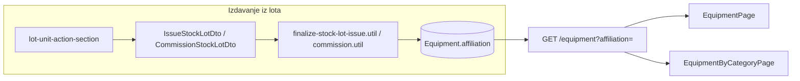

# Plan: Polje pripadnosti opreme (Distribucija / Snabdjevanje)

## Kontekst

`inventoryNumber` je obavezno polje koje se unosi isključivo pri **issue** i **commission** iz skladišnog lota — direktan `POST /equipment` je blokiran. Novo polje treba pratiti isti životni ciklus.



## 1. Prisma šema i migracija

U [`backend/prisma/schema.prisma`](backend/prisma/schema.prisma):

- Novi enum (snake_case, bez dijakritika — kao `EquipmentStatus`):

```prisma
enum EquipmentAffiliation {
  distribucija
  snabdjevanje
}
```

- Na model `Equipment` dodati:

```prisma
affiliation EquipmentAffiliation @default(distribucija)
@@index([affiliation])
```

- Migracija: `NOT NULL DEFAULT 'distribucija'` — sva postojeća oprema automatski dobija **Distribucija**; admin kasnije ručno mijenja kroz edit formu.

Nakon migracije: `prisma generate`.

## 2. Backend — DTO-i i servisi

| Fajl | Promjena |
|------|----------|
| [`issue-stock-lot.dto.ts`](backend/src/modules/warehouse-stock/dto/issue-stock-lot.dto.ts) | Obavezno `@IsEnum(EquipmentAffiliation) affiliation` |
| [`commission-stock-lot.dto.ts`](backend/src/modules/warehouse-stock/dto/commission-stock-lot.dto.ts) | Isto |
| [`update-equipment.dto.ts`](backend/src/modules/equipment/dto/update-equipment.dto.ts) | Opciono `affiliation` (za admin/evidentičar izmjenu) |
| [`list-equipment-query.dto.ts`](backend/src/modules/equipment/dto/list-equipment-query.dto.ts) | Opciono `affiliation` filter |
| [`create-equipment.dto.ts`](backend/src/modules/equipment/dto/create-equipment.dto.ts) | Dodati polje radi konzistentnosti DTO-a (endpoint i dalje 403) |

**Kreiranje opreme** — tri mjesta u:

- [`finalize-stock-lot-issue.util.ts`](backend/src/modules/warehouse-stock/utils/finalize-stock-lot-issue.util.ts) (oba `equipment.create` poziva)
- [`finalize-stock-lot-commission.util.ts`](backend/src/modules/warehouse-stock/utils/finalize-stock-lot-commission.util.ts)

Proširiti input interface s `affiliation` i proslijediti u `data`.

**`warehouse-stock.service.ts`** — iz `dto.affiliation` proslijediti u finalize util-e (issue ~L594, commission ~L712).

**`equipment.service.ts`**:

- `buildListWhere`: dodati `affiliation: query.affiliation` u filters objekt
- `update`: uključiti `affiliation: dto.affiliation` u `data`
- Opciono: dodati `affiliation` u `EQUIPMENT_SORT_FIELDS` (nije obavezno za MVP)

**Nema settings registry** — ovo je core atribut opreme (kao `inventoryNumber`), ne feature flag.

## 3. Frontend — tipovi i API

| Fajl | Promjena |
|------|----------|
| [`frontend/src/types.ts`](frontend/src/types.ts) | `EquipmentAffiliation = 'distribucija' \| 'snabdjevanje'` + `affiliation` na `Equipment` |
| [`frontend/src/helpers.ts`](frontend/src/helpers.ts) | `getEquipmentAffiliationLabel()` → „Distribucija" / „Snabdjevanje" |
| [`frontend/src/api/equipment-api.ts`](frontend/src/api/equipment-api.ts) | `affiliation?: EquipmentAffiliation` u `EquipmentListFilters` |
| [`frontend/src/api/warehouse-stock-api.ts`](frontend/src/api/warehouse-stock-api.ts) | `affiliation` u issue/commission body tipovima |

## 4. UI — izdavanje iz lota (obavezno polje)

[`lot-unit-action-section.tsx`](frontend/src/components/registrar-stock/lot-unit-action-section.tsx):

- Dodati `<select>` **Pripadnost \*** odmah pored inventurnog broja
- Opcije: Distribucija (`distribucija`), Snabdjevanje (`snabdjevanje`)
- Default u formi: `distribucija`

[`registrar-stock-page.tsx`](frontend/src/components/registrar-stock/registrar-stock-page.tsx):

- State `affiliation` (default `'distribucija'`)
- Uključiti u `canSubmitUnitSpecs`, `handleIssue`, `handleCommission`
- Reset pri otvaranju/zatvaranju forme
- U tablici izdatih komada na lotu: nova kolona „Pripadnost"

## 5. UI — liste opreme i filteri

### [`EquipmentPage.tsx`](frontend/src/components/EquipmentPage.tsx)
- Filter dropdown „Sva pripadnost" / Distribucija / Snabdjevanje → `list.setFilters({ affiliation })`
- Kolona u tabeli
- Edit modal: select za pripadnost (admin/evidentičar)

### [`EquipmentByCategoryPage.tsx`](frontend/src/components/EquipmentByCategoryPage.tsx)
- **API filter** (važno zbog paginacije): `affiliation` u `fetchPage` callback i novi dropdown u filter traci
- **Client-side filter builder**: dodati `{ id: 'affiliation', name: 'Pripadnost', type: 'select' }` + grana u `filteredEquipment` useMemo
- Kolona u tabeli + export CSV ako uključuje inventurni broj

### [`MyEquipmentPage.tsx`](frontend/src/components/MyEquipmentPage.tsx)
- Prikaz pripadnosti u kartici/listi (nema filter UI danas — nije potreban jer je lista uvijek personalna i mala)

### [`EquipmentCard.tsx`](frontend/src/components/EquipmentCard.tsx)
- U sekciji specifikacija/osnovni podaci: red „Pripadnost" (pored ugovora/datum ulaza)

### [`registrar-stock-page.tsx`](frontend/src/components/registrar-stock/registrar-stock-page.tsx)
- Kolona u listi komada na lotu (već spomenuto u §4)

**Napomena:** `TransfersPage` i `current-assignments-tab` nisu liste opreme — ne treba im affiliation filter.

## 6. Dokumentacija (matrice)

Ažurirati istog dana:

- [`.cursor/docs/matrices/equipment-status/MATRIX.md`](.cursor/docs/matrices/equipment-status/MATRIX.md) — novo polje `affiliation`, vrijednosti, default, edit pravila
- [`.cursor/docs/matrices/warehouse-stock/MATRIX.md`](.cursor/docs/matrices/warehouse-stock/MATRIX.md) — issue/commission payload uključuje `affiliation` uz `inventoryNumber`
- Odgovarajući `CHANGELOG.md` unosi u oba foldera

## 7. Verifikacija

1. `prisma migrate dev` + `prisma generate`
2. Ručno: izdavanje komada iz lota — obavezno biranje pripadnosti, default Distribucija
3. Ručno: kolaudacija — isto
4. Postojeća oprema: prikazuje Distribucija bez ručne migracije
5. Admin edit: promjena na Snabdjevanje
6. Filter na `EquipmentPage` i `EquipmentByCategoryPage` — API vraća ispravan subset
7. Backend build + frontend build

## Odluke (fiksne)

| Odluka | Vrijednost |
|--------|------------|
| DB/API ime polja | `affiliation` |
| Enum vrijednosti | `distribucija`, `snabdjevanje` |
| UI label | „Pripadnost" |
| Default (DB + forma) | `distribucija` (Distribucija) |
| Obavezno pri issue/commission | Da |
| Izmjenjivo naknadno | Da (admin/evidentičar, kao ostala polja opreme) |
