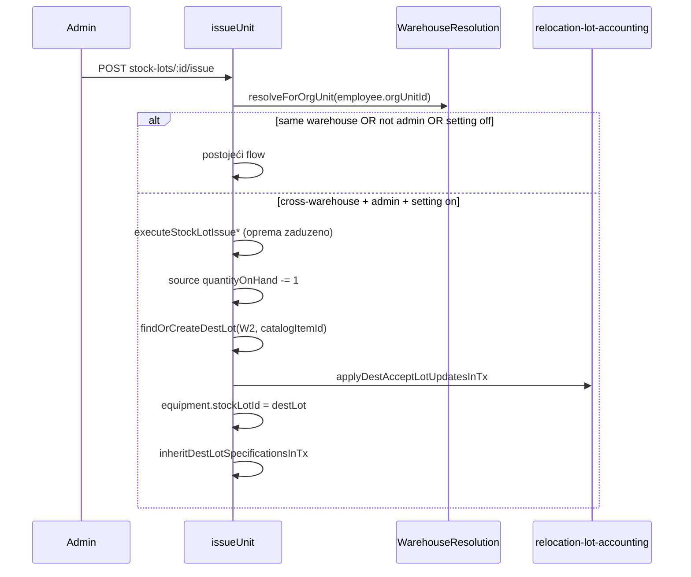

# Plan: Cross-warehouse izdavanje + cross-modul scope evidentičara

Nastavak na [HANDOFF](.cursor/plans/evidenticar-dodjele/HANDOFF.md). Faza validacije A/B dodjela je **završena**; ova sesija pokriva **dvije nove stavke** iz korisničkog zahtjeva.

---

## Kontekst

**Trenutno ponašanje `issueUnit`** ([`warehouse-stock.service.ts`](backend/src/modules/warehouse-stock/warehouse-stock.service.ts)):
- Kreira opremu + (opciono) transfer `zaduzenje` iz lota W1
- `quantityOnHand -= 1` na izvornom lotu
- `equipment.stockLotId` ostaje na **W1** lotu — nema međuskladišnog računovodstva

**Relocation dest-accept** ([`relocation-lot-accounting.util.ts`](backend/src/modules/employee-relocation/utils/relocation-lot-accounting.util.ts)) već implementira željene delte:
- Izvor: `quantityReceived -= 1`
- Dest (za `zaduzeno`): `quantityReceived += 1`, `quantityOnHand += 0` → implicitno izdato `+1`
- `equipment.stockLotId` → dest lot

Korisnik je potvrdio: ako dest lot **ne postoji** → **automatski kreirati** (kao relocation `incomingRelocation` lot).

---

## Funkcionalnost 1 — Admin cross-warehouse izdavanje iz lota

### Postavka (registry)

Novi ključ u [`settings.registry.ts`](backend/src/modules/settings/settings.registry.ts):

| Ključ | Scope | Default | Grupa |
|-------|-------|---------|-------|
| `transfer.allow_admin_cross_warehouse_issue` | `private` | `false` | `transfers` |

- **Label:** „Cross-warehouse izdavanje (admin)“
- **Opis:** Administrator može izdati komad iz lota jednog skladišta na radnika čije efektivno skladište je drugo; oprema automatski prelazi na lot ciljnog skladišta bez odobrenja evidentičara.
- Ažurirati [`.cursor/docs/matrices/settings/MATRIX.md`](.cursor/docs/matrices/settings/MATRIX.md) + `CHANGELOG.md`

### Backend — logika u `issueUnit`



**Pravila:**

1. **Ko:** samo `admin` (evidentičar uvijek odbijen za cross-warehouse, čak i kad je postavka uključena).
2. **Gate:** `settingsService.assertFeatureEnabled('transfer.allow_admin_cross_warehouse_issue')` samo kad `lot.warehouseId !== destWarehouseId`.
3. **Detekcija:** `destWarehouseId = await warehouseResolution.resolveForOrgUnit(holder.orgUnitId)`; ako `null` → `BadRequestException`.
4. **Isti skladište:** postojeći flow bez izmjena.
5. **Cross-warehouse transakcija** (jedna `$transaction`):
   - Postojeći issue (`executeStockLotIssueWithTransferInTx` / `DirectInTx`)
   - `quantityOnHand -= 1` na source lotu (kao sada)
   - **Dest lot:** ekstrahovati shared helper iz relocation logike:
     - `findFirst` po `(warehouseId=dest, catalogItemId, status != zatvoreno)` — preferirati postojeći otvoreni lot
     - ako nema → `create` lot (`incomingRelocation: true`, `ceka_specifikaciju`, `quantityReceived: 0`, `quantityOnHand: 0`) — isti obrazac kao [`executeSourceTransfer`](backend/src/modules/employee-relocation/employee-relocation.service.ts) linije 626–649
   - `applyDestAcceptLotUpdatesInTx` (source received −1, dest received +1)
   - `equipment.update({ stockLotId: destLot.id, catalogItemId })`
   - `inheritDestLotSpecificationsInTx` (reuse iz employee-relocation)
6. **Validacija prije issuea:** `catalogItemId` na source lotu obavezan za cross-warehouse (bez šifrarnika nema smislenog matcha).
7. **Freeze:** poštovati postojeći `inventoryFreeze.assertNoMutationInCity` za **oba** grada/skladišta.
8. **Prenosnica:** transfer `zaduzenje` ostaje iz **W1** (`fromWarehouseId = lot.warehouseId`) — admin zadužuje fizički iz W1.

**Novi fajlovi (preporuka):**

- [`backend/src/modules/warehouse-stock/utils/cross-warehouse-issue.util.ts`](backend/src/modules/warehouse-stock/utils/cross-warehouse-issue.util.ts) — `findOrCreateDestLotInTx`, `applyCrossWarehouseIssueLotUpdatesInTx` (orchestracija oko postojećih utila)
- [`backend/src/modules/warehouse-stock/cross-warehouse-issue.util.spec.ts`](backend/src/modules/warehouse-stock/cross-warehouse-issue.util.spec.ts) — unit testovi delti i edge-caseova

### Frontend — Skladišna roba issue UI

U [`registrar-stock-page.tsx`](frontend/src/components/registrar-stock/registrar-stock-page.tsx):

- Za **admina** s uključenom postavkom (`getBoolean('transfer.allow_admin_cross_warehouse_issue')`):
  - Kad odabrani radnik ima efektivno skladište ≠ lot.warehouseId → informativni banner (npr. „Oprema će preći na skladište {W2}“)
  - Koristiti postojeći [`resolveEffectiveWarehouse`](frontend/src/helpers/effective-warehouse.util.ts)
- Employee picker: admin vidi sve radnike (API već vraća sve za admina); evidentičar ostaje scoped preko `fetchEmployeesPageApi`
- Jasna poruka greške kad postavka isključena a API vrati 403

### Dokumentacija

- [`.cursor/docs/matrices/warehouse-stock/MATRIX.md`](.cursor/docs/matrices/warehouse-stock/MATRIX.md) — novi pododjeljak „Cross-warehouse issue (admin)“
- [`.cursor/docs/matrices/transfers/CHANGELOG.md`](.cursor/docs/matrices/transfers/CHANGELOG.md) — referenca na lot računovodstvo
- Ažurirati [HANDOFF](.cursor/plans/evidenticar-dodjele/HANDOFF.md) nakon implementacije

---

## Funkcionalnost 2 — Evidentičar vidi sve module po dodjelama (A/B OR)

**Status:** Već implementirano u prethodnim fazama ([`registrar-scope.service.ts`](backend/src/common/services/registrar-scope.service.ts) + FE mirror [`registrar-scope.ts`](frontend/src/helpers/registrar-scope.ts)). Ova faza je **verifikacija + dokumentacija**, ne široki refaktor.

### Kanonski cross-modul ugovor (potvrda)

Za evidentičara s N dodjela = **OR unija**:

| Modul | API / servis | Režim A | Režim B |
|-------|--------------|---------|---------|
| Radnici | `employees.service` → `buildEmployeeWhere` | efektivno W | expand(O) ∩ efektivno W |
| Oprema | `equipment.service` → `buildEquipmentWhere` | skladište + zaduženo + rashod | samo zaduženo |
| Prenosnice/transferi | `transfers.service` → `buildTransferWhere` | oprema ILI from/to osoba u scope | isto, suženo |
| Skladišna roba | `warehouse-stock` → `buildStockLotWhere` | lotovi W+Cat | **ne vidi** |
| Kontrolna tabla | `fetchEquipmentSummaryApi` (BE scoped) | scoped kategorije | scoped zaduženo |
| Skladišta (lista) | `warehouses.service` | warehouseIds iz dodjela | isto |
| Org. promjena | `employee-relocation` | samo Režim A redovi | B ne vidi relocation linije |
| Akcije na opremi | `canCreateTransferForEquipment` | pun set | **samo razduženje** → ciljno skladište iz matching dodjele |

### Šta uraditi u ovoj fazi

1. **Ručni QA checklist** (proširiti HANDOFF) — scenarij s 3 reda dodjele (A W1+Cat1 · B W1+Cat2+Org1 · B W2+Cat1+Org2):
   - Dashboard brojevi = unija scope-a
   - Skladišna roba: samo W1+Cat1 (A), ne W1+Cat2 (B)
   - Oprema: Cat1 zaduženo u W1 i W2 prema B pravilima
   - Transfer lista: prenosnice za opremu/radnike u uniji
   - Razduženje B-only opreme → skladište iz matching dodjele (regresija iz HANDOFF tačka 7)

2. **Audit FE stranica** — potvrditi da se oslanjaju na scoped API, ne na client filter koji bi sužio OR uniju:
   - [`EmployeesPage`](frontend/src/components/EmployeesPage.tsx) — `fetchEmployeesPageApi` ✓
   - [`EquipmentPage`](frontend/src/components/EquipmentPage.tsx) — `fetchEquipmentPageApi` + `getScopedCategoryIds` ✓
   - [`TransfersPage`](frontend/src/components/TransfersPage.tsx) — paginated API ✓
   - [`registrar-stock-page.tsx`](frontend/src/components/registrar-stock/registrar-stock-page.tsx) — `fetchAssignedStockLotsPageApi` ✓
   - [`Dashboard.tsx`](frontend/src/components/Dashboard.tsx) — `fetchEquipmentSummaryApi` po scoped kategorijama ✓

3. **Ispravke samo ako QA nađe gap** — očekivano minimalno; kandidati za provjeru:
   - `employeeMatchesScope` import u EmployeesPage (trenutno nekorišten?) — ukloniti dead import ako je orphan
   - Relocation lista za evidentičara s **samo B** dodjelama → treba biti prazna (namjerno)

4. **Matrica** — dopuniti [`.cursor/docs/matrices/roles-access/MATRIX.md`](.cursor/docs/matrices/roles-access/MATRIX.md) sekciju „Cross-modul vidljivost (OR unija)“ s eksplicitnom tabelom iznad.

---

## Redoslijed implementacije

1. Registry postavka + matrica settings
2. Backend util + `issueUnit` cross-warehouse grana + unit testovi
3. FE banner u issue formi (admin)
4. QA checklist + audit FE; fix samo ako treba
5. Ažurirati warehouse-stock + roles-access matrice + HANDOFF

## Test plan

```bash
cd backend && npm run test:unit
cd frontend && npm run build
```

**Ručno:**
- Admin + postavka ON: issue W1 lot → radnik W2 → dest lot auto-kreiran ili postojeći; W1 `received−1`, W2 `received+1`, oprema `zaduzeno`, `stockLotId` na W2
- Admin + postavka OFF: isti scenario → 403
- Evidentičar: cross-warehouse issue → 403 (čak i postavka ON)
- Evidentičar 3-redni primjer: moduli prikazuju uniju A+B prema tabeli
