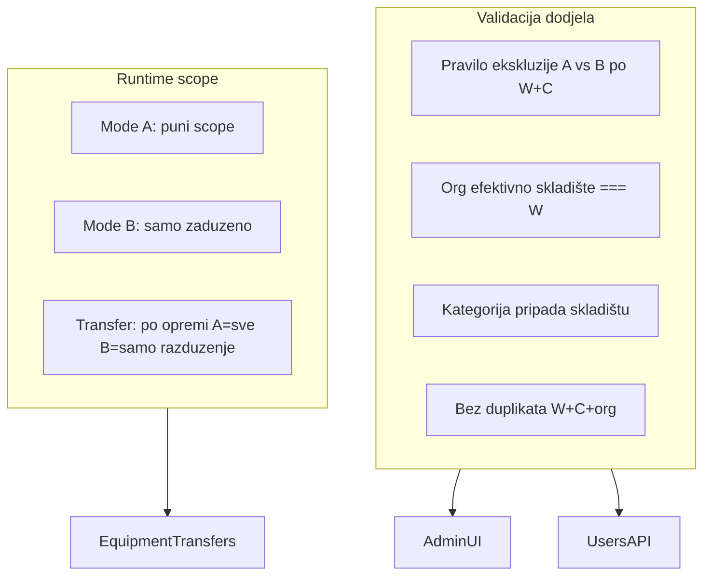

# Plan: Evidentičar dodjele — validacija, scope akcije, UX

## Cilj

Omogućiti sigurnu konfiguraciju više dodjela po uzoru:

| Red | Dodjela | Scope |
|-----|---------|-------|
| A | W1 + Cat1 | Sva oprema Cat1 u W1 (skladište + zaduženo + rashodovano + lotovi) |
| B | W1 + Cat2 + Org1 | Samo `zaduzeno` Cat2 na radnicima Org1 (efektivno W1) |
| B | W2 + Cat1 + Org2 | Samo `zaduzeno` Cat1 na radnicima Org2 (efektivno W2) |

**Unija redova** = ukupan scope (postojeći `OR` u [`registrar-scope.service.ts`](backend/src/common/services/registrar-scope.service.ts)).

Fokus: **funkcionalnost i backend enforcement**; UX refactor je sekundaran (autocomplete gdje ima smisla).



---

## Faza 1 — Shared pravila validacije

Novi modul (frontend + backend mirror):

- [`frontend/src/helpers/registrar-assignment-rules.ts`](frontend/src/helpers/registrar-assignment-rules.ts)
- [`backend/src/modules/users/registrar-assignment-validation.util.ts`](backend/src/modules/users/registrar-assignment-validation.util.ts)

### Pravila (dogovoreno)

1. **Ekskluzivnost po `(warehouseId, categoryId)`**
   - Ili tačno jedan **Režim A** (`orgUnitId = null`), ili jedan ili više **Režima B** — **nikad mix**.
   - Više B za isti `(W, C)` s **različitim** `orgUnitId` — dozvoljeno.
   - Preklapajuća org podstabla — dozvoljeno (redundantno, ne kontradiktorno).

2. **Org ↔ skladište (Režim B)**
   - `resolveEffectiveWarehouse(orgUnitId) === assignment.warehouseId`
   - Koristiti postojeći util: [`resolve-effective-warehouse.util.ts`](backend/src/common/utils/resolve-effective-warehouse.util.ts) / [`org-warehouse.util.ts`](frontend/src/helpers/org-warehouse.util.ts).

3. **Duplikat reda**
   - Isti `(warehouseId, categoryId, orgUnitId)` — odbiti (`orgUnitId null` = poseban ključ za A).

4. **Kategorije koje skladište ima (Opcija A)**
   - Root parent `ASSET` kategorija čiji se leaf pojavljuje u `Equipment` ili `WarehouseStockLot` za to skladište.
   - **Fallback:** ako skladište nema podataka → sve parent `ASSET` kategorije (novo skladište).
   - Backend: Prisma upit pri validaciji. Frontend: derivacija iz `state.equipment` + `state.categories` (store već ima `equipment`).

### Javni API helpera

```typescript
getWarehouseCategoryMode(scopes, warehouseId, categoryId): 'A' | 'B' | null
getAvailableCategoriesForRow(scopes, rowIndex, ctx): Category[]
getAvailableOrgUnitsForRow(scopes, rowIndex, ctx): OrgUnit[]
validateRegistrarScopes(scopes, ctx): ValidationResult // errors[] s jasnim BS porukama
resolveRootCategoryId(categoryId, categories): string
```

Unit testovi: [`registrar-assignment-rules.spec.ts`](frontend/src/helpers/registrar-assignment-rules.spec.ts) (vitest ili node:test) + [`registrar-assignment-validation.util.spec.ts`](backend/src/modules/users/registrar-assignment-validation.util.spec.ts).

Scenariji: A pa B isti W+C (fail), A W1+C1 + B W2+C1 (ok), B s org iz drugog WH (fail), duplikat reda.

---

## Faza 2 — Backend enforcement

Proširiti [`users-validation.util.ts`](backend/src/modules/users/users-validation.util.ts):

- Nakon postojeće provjere ID-eva, pozvati `assertRegistrarScopesValid(prisma, scopes)`.
- `BadRequestException` s porukama tipa:
  - *„Za skladište X i kategoriju Y već postoji Režim A. Režim B za istu kombinaciju nije dozvoljen.“*
  - *„Org jedinica ne pripada odabranom skladištu (efektivno skladište: …).“*

Nema migracije šeme — [`RegistrarAssignment`](backend/prisma/schema.prisma) ostaje isti.

---

## Faza 3 — Scope engine: Režim B i akcije

### 3.1 Mode B — samo `zaduzeno`

U [`registrar-scope.service.ts`](backend/src/common/services/registrar-scope.service.ts) `buildAssignmentEquipmentWhere` za B:

- Zamijeniti `status: { not: 'skladiste' }` sa `status: 'zaduzeno'`.
- Uskladiti `matchesAssignmentEquipment` (B ne matcha `rashodovano`).

Mirror u [`frontend/src/helpers/registrar-scope.ts`](frontend/src/helpers/registrar-scope.ts).

### 3.2 Transferi po opremi (ne po korisniku)

Nova metoda u `RegistrarScopeService`:

```typescript
async canCreateTransferForEquipment(
  user, equipment, holder, transferType
): Promise<boolean>
```

Logika:

- Nađi sve dodjele koje matchaju opremu (`matchesAssignmentEquipment`).
- Ako **bilo koja** matchajuća dodjela je Režim A → primijeni postojeća pravila za taj tip.
- Ako matchaju **samo** Režim B → dozvoliti **samo** `razduzenje`.

Zamijeniti u [`transfers.service.ts`](backend/src/modules/transfers/transfers.service.ts) liniju ~204:

```typescript
await this.registrarScope.assertCanCreateTransferForEquipment(user, equipment, holder, dto.type);
```

Zadržati `canCreateTransferType` za globalne UI gate-ove (npr. dugme „Novi transfer“), ali **create** mora provjeriti opremu.

Proširiti [`registrar-scope.service.spec.ts`](backend/src/common/services/registrar-scope.service.spec.ts).

### 3.3 Fix razduženja — matching dodjela (Cat1 na W1 i W2)

[`transfer-warehouse.util.ts`](frontend/src/helpers/transfer-warehouse.util.ts) `pickAssignmentWarehouse`:

- Umjesto `find` po kategoriji, birati dodjelu gdje `matchesAssignmentEquipment` (export helper iz `registrar-scope.ts` ili novi `findMatchingAssignments`).

Backend: provjeriti [`resolve-document-warehouse.util.ts`](backend/src/modules/transfers/utils/resolve-document-warehouse.util.ts) / signer resolver ako koriste istu pogrešnu logiku.

### 3.4 Frontend akcije

U [`EquipmentCard.tsx`](frontend/src/components/EquipmentCard.tsx) (i transfer forma ako postoji centralni guard):

- Nova funkcija `canRegistrarCreateTransfer(equipment, user, state, transferType)` u `registrar-scope.ts`.
- Sakriti/onemogućiti zaduženje, prenos, rashodovanje kad oprema ulazi samo u Režim B.

---

## Faza 4 — Admin UI (funkcionalnost + lagani UX)

Refaktor [`user-access-fields.tsx`](frontend/src/components/user-management/user-access-fields.tsx):

### Obavezno (funkcionalnost)

- Koristiti `registrar-assignment-rules` za filtrirane opcije po redu.
- Pri promjeni `warehouseId` → reset `categoryId` / `orgUnitId` ako postanu nevalidni.
- Pri odabiru org na redu koji već ima A za isti W+C → inline greška + blok Save u [`user-form-modal.tsx`](frontend/src/components/user-management/user-form-modal.tsx) (client-side `validateRegistrarScopes` prije API poziva).
- Sažetak dodjela ispod liste (koristiti postojeći `formatRegistrarAssignmentLabel`).
- Badge po redu: **Režim A** / **Režim B** + kratki opis akcija.

### Opcionalno (UX, bez blokiranja faze)

- Ekstrahovati `RegistrarScopeRow` komponentu (~80 linija).
- **Skladište** i **Kategorija**: [`SearchableAutocomplete`](frontend/src/components/searchable-autocomplete.tsx) umjesto `<select>`.
- **Org jedinica**: proširiti [`OrgUnitAutocomplete`](frontend/src/components/org-unit-autocomplete.tsx) s opcionalnim `allowedOrgUnitIds?: Set<string>` ili `filterOrgUnit?: (unit) => boolean`; prazna vrijednost = Režim A (`emptyOption`: „— Cijelo skladište (Režim A) —“).
- Proslijediti `equipment` iz store-a: [`UserManagementPage`](frontend/src/components/UserManagementPage.tsx) → `UserFormModal` → `UserAccessFields`.

Ne raditi veliki vizuelni redesign — samo čitljivija struktura i autocomplete.

---

## Faza 5 — Dokumentacija (matrica)

Ažurirati [`.cursor/docs/matrices/roles-access/MATRIX.md`](.cursor/docs/matrices/roles-access/MATRIX.md) + [`CHANGELOG.md`](.cursor/docs/matrices/roles-access/CHANGELOG.md):

- Sekcija **Pravila dodjela** (A/B ekskluzija, org↔WH, kategorije skladišta).
- Tabela akcija po režimu (B = read zaduženo + razduženje).
- Primjer 3-redne konfiguracije.

---

## Manual QA checklist

1. A: W1+Cat1 → vidi skladište, lotove, sve zaduženo Cat1 u W1.
2. B: W1+Cat2+Org1 → vidi samo zaduženo Cat2 radnika Org1; nema skladišne opreme.
3. B: W2+Cat1+Org2 → isto za drugo skladište; ne vidi ostale Org u W2.
4. Admin ne može snimiti A+B za isti W+C (UI + API).
5. Admin ne može B s org čije efektivno skladište ≠ odabrano WH.
6. Evidentičar s A+B: na opremi iz B može samo razduženje; na opremi iz A pun set akcija.
7. Razduženje Cat1 radnika Org2 (W2) ide na **W2**, ne W1.
8. Regresija: ED Zenica / Centralno effective-warehouse scope i dalje radi.

---

## Rizici i napomene

- Frontend kategorije skladišta iz `store.equipment` može propustiti kategorije koje postoje samo kao lotovi dok store nije pun — **backend validacija** je source of truth pri snimanju.
- `canCreateTransferType` ostaje za grube UI gate-ove; fina kontrola je na nivou opreme.
- Nema settings registry promjena — ponašanje je domain pravilo evidentičara, ne feature flag.
