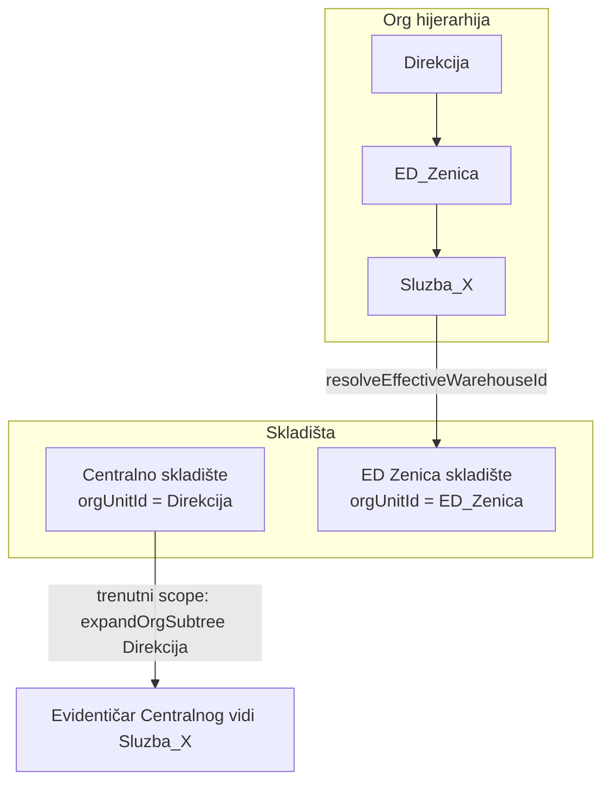

# Plan: Scope evidentičara — efektivno skladište + lot vidljivost

## Problem (potvrđeno)



- **Relocation / warehouse resolution** već koristi [`resolveEffectiveWarehouseId`](backend/src/common/utils/resolve-effective-warehouse.util.ts) — ide **od radnika prema gore**; ED Zenica pobjeđuje prije Direkcije/Centralnog.
- **Registrar scope** u [`registrar-scope.service.ts`](backend/src/common/services/registrar-scope.service.ts) za `zaduzeno` koristi **`expandOrgSubtree(warehouse.orgUnitId)`** — Centralno na Direkciji obuhvata **sve** ispod, uključujući ED Zenica granu → curenje.
- **Lot lista** u [`warehouse-stock.service.ts`](backend/src/modules/warehouse-stock/warehouse-stock.service.ts) filtrira `quantityOnHand > 0` → lotovi nakon relocation-a (`0/1` zaduženo) nevidljivi.

---

## Kanonski ugovor scope-a

**Dodjela evidentičara:** `(warehouseId W, categoryId C, orgUnitId? O)`

| Entitet | Režim A (`O = null`) | Režim B (`O` set) |
|---------|----------------------|-------------------|
| **Kategorija** | `equipment.categoryId ∈ expand(C)` | isto |
| **Oprema skladiste** | `equipment.warehouseId = W` | ne vidi |
| **Oprema zaduzeno** | `resolveEffectiveWarehouse(holder.orgUnitId) = W` | isto **+** `holder.orgUnitId ∈ expand(O)` |
| **Oprema rashodovano** | `equipment.warehouseId = W` | holder u expand(O), nije skladiste |
| **Lot (Skladišna roba)** | `lot.warehouseId = W` + kategorija ∈ expand(C) | ne vidi lotove |
| **Radnik** | `resolveEffectiveWarehouse(employee.orgUnitId) = W` | isto **+** `employee.orgUnitId ∈ expand(O)` |
| **Transfer / prenosnica** | oprema u scope **OR** `fromPerson`/`toPerson` u scope radnika | isto, suženo režimom B |
| **Akcije** | postojeća pravila (`canCreateTransferType`, issue lot, update oprema) + isti scope check | isto |

**Admin:** bez filtera (postojeće `hasFullAccess`).

**Pravilo preklapanja:** Radnik pod ED Zenicom **nikad** ne ulazi u scope Centralnog — iako je ED pod Direkcijom, efektivno skladište = ED Zenica.

---

## Faza 1 — Core util: org jedinice po efektivnom skladištu

Novi fajl: [`backend/src/common/utils/collect-org-units-for-warehouse.util.ts`](backend/src/common/utils/collect-org-units-for-warehouse.util.ts)

```typescript
collectOrgUnitIdsForEffectiveWarehouse(
  warehouseId: string,
  orgUnits: OrgUnitWarehouseRow[],
  warehouses: WarehouseRow[],
  locationResolver?: (orgUnitId: string) => string | null,
): Set<string>
```

- Za svaku org jedinicu: `resolveEffectiveWarehouseId(orgUnitId, …) === warehouseId` → uključi u set.
- Unit test: hijerarhija Direkcija + ED Zenica + Centralno (kao u [`resolve-effective-warehouse.util.spec.ts`](backend/src/common/utils/resolve-effective-warehouse.util.spec.ts)) — ED pod ED Zenica, ostatak Direkcije pod Centralnim.

[`WarehouseResolutionService`](backend/src/common/services/warehouse-resolution.service.ts) ili cache u `RegistrarScopeService` za ponovnu upotrebu org/warehouse snapshot-a.

---

## Faza 2 — Refaktor `RegistrarScopeService`

Fajl: [`backend/src/common/services/registrar-scope.service.ts`](backend/src/common/services/registrar-scope.service.ts)

### 2.1 Zamjena `isEmployeeInWarehouseCoverage`

Ukloniti korištenje `expandOrgSubtree(warehouse.orgUnitId)` za **Mode A zaduzeno/radnike**.

Nova logika (Mode A):
- `collectOrgUnitIdsForEffectiveWarehouse(assignment.warehouseId)` sadrži `holder.orgUnitId` / `employee.orgUnitId`

Nova logika (Mode B — potvrđeno):
- effective warehouse match **+** `orgUnitId ∈ expand(assignment.orgUnitId)`

### 2.2 `buildAssignmentEquipmentWhere`

| Status | WHERE |
|--------|-------|
| skladiste | `warehouseId = W`, category ∈ expand(C) |
| zaduzeno | `currentHolder.orgUnitId ∈ orgIdsFor(W)`, category ∈ expand(C); Mode B dodaje `∈ expand(O)` |
| rashodovano | `warehouseId = W`, category ∈ expand(C) |

**Ukloniti opasni fallback** `{ status: 'zaduzeno' }` kad `warehouse.orgUnitId` null (linije 361–370).

### 2.3 `buildAssignmentEmployeeWhere`

Zamijeniti `cityFilter + orgSubtree(warehouse.orgUnitId)` sa:
- Mode A: `orgUnitId ∈ orgIdsFor(W)`
- Mode B: `orgUnitId ∈ orgIdsFor(W) ∩ expand(O)`

`matchesAssignmentEmployee` / `matchesAssignmentEquipment` — ista logika (runtime check usklađen s WHERE).

### 2.4 `buildTransferWhere`

Proširiti OR u [`buildTransferWhere`](backend/src/common/services/registrar-scope.service.ts):

```typescript
OR: [
  { equipment: equipmentWhere },
  { fromPerson: employeeWhere },
  { toPerson: employeeWhere },
  // postojeći inventory committee clause
]
```

### 2.5 Testovi

Proširiti [`registrar-scope.service.spec.ts`](backend/src/common/services/registrar-scope.service.spec.ts):
- Centralno (Direkcija) vs ED Zenica — radnik pod ED **nije** u scope Centralnog
- Radnik pod Direkcijom (bez međuskladišta) **jeste** u scope Centralnog
- Mode B: effective match + org suženje
- Transfer vidljiv preko `toPerson` u scope-u

---

## Faza 3 — Lot vidljivost (`quantityOnHand`)

### Backend

[`warehouse-stock.service.ts`](backend/src/modules/warehouse-stock/warehouse-stock.service.ts) — `listForRegistrar`:
- **Ukloniti** `quantityOnHand: { gt: 0 }`
- Zadržati: `lotKind`, status (`ceka_specifikaciju` | `spremno_za_izdavanje`), `buildStockLotWhere`

Issue guard ostaje: [`issue`](backend/src/modules/warehouse-stock/warehouse-stock.service.ts) linija ~331 `quantityOnHand <= 0` → reject.

### Frontend

[`registrar-stock-page.tsx`](frontend/src/components/registrar-stock/registrar-stock-page.tsx):
- Lista/detail već prikazuje `{onHand}/{received}`
- Dodati helper u [`warehouse-stock.util.ts`](frontend/src/helpers/warehouse-stock.util.ts):

```typescript
getStockLotAvailabilityLabel(onHand, received)
// → "Nema više na stanju" kad onHand === 0 && received > 0
```

- Badge tone: warning za `0/N`, success za `N/N` ili `>0`
- **Issue dugme** ostaje samo kad `quantityOnHand > 0` (postojeće, linija 281)

---

## Faza 4 — Frontend scope usklađivanje

### 4.1 Mirror backend logike

[`frontend/src/helpers/registrar-scope.ts`](frontend/src/helpers/registrar-scope.ts):
- Dodati `resolveEffectiveWarehouseId` (kopija util-a ili shared types)
- `collectOrgUnitIdsForWarehouse` — ista semantika
- Ažurirati `matchesAssignmentEquipment` / `matchesAssignmentEmployee` / `transferMatchesScope`

### 4.2 Oprema po kategorijama + Dashboard

| Fajl | Promjena |
|------|----------|
| [`EquipmentByCategoryPage.tsx`](frontend/src/components/EquipmentByCategoryPage.tsx) | Tree samo parent/sub kategorije iz `expand(registrarScopes.categoryId)` |
| [`Dashboard.tsx`](frontend/src/components/Dashboard.tsx) | Učitati `fetchEquipmentSummaryApi` po scoped kategorijama (umjesto hardkodiranih nula, linije 86–97) |
| [`EquipmentPage.tsx`](frontend/src/components/EquipmentPage.tsx) | Filter dropdown kategorija → samo scoped |

Helper: `getScopedCategoryIds(user, categories)` u `registrar-scope.ts`.

### 4.3 Navigacija (bez promjene strukture)

Evidentičar već vidi: Dashboard, Oprema, Zaduženja, Prenosnice, Skladišna roba, Radnici, Org. promjena, Popis, Moj profil — potvrditi da sve liste koriste scoped API (većina da).

---

## Faza 5 — Dokumentacija (matrice)

Ažurirati [`.cursor/docs/matrices/roles-access/MATRIX.md`](.cursor/docs/matrices/roles-access/MATRIX.md):
- Zamijeniti zastarjeli `cityId + categoryId` model sa `warehouseId + categoryId + orgUnitId?`
- Sekcija **Efektivno skladište** — nearest-wins, ED Zenica nad Direkcijom
- Tabela po modulima (oprema, lot, transfer, radnik, akcije, dashboard)
- CHANGELOG stavka

Opcionalno cross-ref u [`.cursor/docs/matrices/employee-relocation/MATRIX.md`](.cursor/docs/matrices/employee-relocation/MATRIX.md) — scope nakon Prihvati usklađen s efektivnim skladištem.

---

## Pregled modula — šta evidentičar vidi (finalno)

| Modul | API / izvor | Scope filter |
|-------|-------------|--------------|
| **Sva oprema** | `GET /equipment` | `buildEquipmentWhere` |
| **Po kategorijama** | isto + UI tree | scoped categories |
| **Skladišna roba** | `GET /warehouse-stock/assigned` | `buildStockLotWhere`, bez onHand filter |
| **Zaduženja** | `GET /transfers` | `buildTransferWhere` |
| **Prenosnice** | isti endpoint | isto |
| **Radnici** | `GET /employees` | `buildEmployeeWhere` |
| **Org. promjena** | `GET /employee-relocation` | postojeći warehouse+category po strani |
| **Kontrolna tabla** | summary + recent transfers | scoped API |
| **Akcije** (issue, zaduženje, update) | service guards | `canAccess*` + `canCreateTransferType` |

---

## Manual QA

1. **Centralno vs ED Zenica:** evidentičar Centralnog ne vidi zaduženu opremu radnika pod ED Zenicom; evidentičar ED Zenica vidi.
2. **Relocation accept:** lot na B vidljiv kao `0/1`, status „Nema više na stanju“, issue disabled.
3. **Direkcija bez međuskladišta:** radnik direktno pod Direkcijom — vidljiv Centralnom evidentičaru.
4. **Režim B:** radnik u efektivnom W ali izvan org podstabla dodjele — nije vidljiv.
5. **Transfer:** prenosnica za radnika u scope-u vidljiva i kad oprema trenutno nije u istom filteru.
6. **Dashboard:** brojevi = API summary, kategorije samo iz dodjele.

---

## Rizici / napomene

- `collectOrgUnitIdsForEffectiveWarehouse` je O(broj org jedinica) — prihvatljivo; cache u servisu po requestu ili kratki TTL.
- Postojeći podaci ne zahtijevaju migraciju — samo promjena filter logike.
- Matrica `roles-access` trenutno zastarjela — obavezno ažurirati u istom PR-u.
