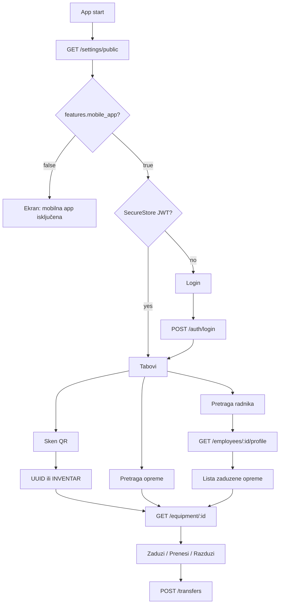

# Expo mobilna app (Android)

Nova aplikacija **Evidens** u `[mobile/](mobile/)` (trenutno ne postoji). Koristi postojeći backend `https://api.evidens.ba101.top` (Coolify subdomena, **bez** `/backend` prefiksa) — **nema novih write endpointa**.

URL-ovi:

- Web / QR linkovi: `https://evidens.ba101.top/equipment/:id`
- API (mobilni klijent): `https://api.evidens.ba101.top` → npr. `POST https://api.evidens.ba101.top/auth/login`

Odluke iz razgovora:

- Pretraga **radnika** (`GET /employees` + `GET /employees/:id/profile`), ne login naloga.
- Android **15+ (API 35)** + **samo `arm64-v8a`**.
- Push **nije** u scope-u (`expo-notifications` se ne instalira).

Projektno pravilo `[00_project.mdc](.cursor/rules/00_project.mdc)` trenutno kaže "no mobile" — ažurira se na `backend/` + `frontend/` + `mobile/`.



---

## Šta mobilna app radi (i šta ne)

Radi:

- Login / refresh / logout (isti JWT kao web).
- QR sken kamere + ručni unos inventarnog broja (isti parser kao `[QRScannerPage.tsx](frontend/src/components/QRScannerPage.tsx)`: URL `/equipment/{uuid}` ili `INVENTAR:broj|id`).
- Detalj opreme vizuelno kao `[public-equipment-page.tsx](frontend/src/components/public-equipment-page.tsx)`: hero po statusu, tabovi Zaduženje / Specifikacije / Historija.
- Akcije prenosa kao `[EquipmentCard.tsx](frontend/src/components/EquipmentCard.tsx)`: **Zaduži / Prenesi / Razduži** + isti payload iz `[create-transfer-payload.util.ts](frontend/src/helpers/create-transfer-payload.util.ts)`.
- Pretraga opreme (`GET /equipment?search=`).
- Pretraga radnika + profil sa zaduženom opremom.

Ne radi (svjesno van scope-a):

- iOS, push, Socket.IO, dokumenti/PDF/potpisivanje, rashod, reaktivacija, lot izdavanje, user-management.

Prenos: backend i dalje sam generiše prenosnicu; mobilni klijent samo `POST /transfers`. Nema print/sign toka.

---

## Dizajn

Prati Evidens Surface tokene iz `[frontend/src/design-system/tokens.ts](frontend/src/design-system/tokens.ts)` (`brand` `#4f46e5`, `canvas` `#f7f9fc`, `ink`, status soft chips) + hero gradijente javne stranice (emerald/indigo/amber/rose po statusu).

- Font: Inter (`@expo-google-fonts/inter`).
- Ikone: `lucide-react-native`.
- Nema dark mode (web ga nema).
- Copy: bosanski, inline kao web.
- Navigacija: bottom tabs (Sken, Oprema, Radnici, Profil) — web nema tab bar, ali je to ispravan mobilni pattern.
- Transfer i picker osobe: **bottom sheet**, ne modal.
- Scanner: full-screen kamera, stakleni okvir, ručni unos kao fallback.

Stil: Apple-linear, čisto, bez vizuelnog šuma. Bez NativeWind (brži EAS, manje Metro rizika) — tema kao `StyleSheet` tokeni + male UI primitive (`Button`, `Card`, `Badge`, `SegmentTabs`, `Sheet`).

---

## Stack i init (Expo)

- **Expo SDK 58** + React Native 0.88 + React 19 + **Expo Router**.
- Init: `npx create-expo-app@latest mobile --template tabs` (TypeScript), zatim čišćenje demo ekrana.
- `npx eas-cli init` u `mobile/` (treba Expo nalog — jednokratno `eas login`).
- Android package: `top.ba101.evidens`.
- Kamera: `expo-camera` (barcode scanning). Ne `expo-barcode-scanner` (deprecated).
- Tokeni: `expo-secure-store` (ne AsyncStorage).
- API: `EXPO_PUBLIC_API_URL` (prod default `https://api.evidens.ba101.top`, bez path prefiksa).

CORS se **ne** dira: native APK ne šalje browser Origin.

---

## EAS: brzi, laki Android APK

[`mobile/eas.json`](mobile/eas.json) — samo `android`, profili `preview` (internal APK) i `production` (APK). Nema `ios` ključa. Oba profila imaju `env.EXPO_PUBLIC_API_URL=https://api.evidens.ba101.top`.

Suženja za veličinu i brzinu:

- `expo-build-properties`: `minSdkVersion: 35`, `targetSdkVersion: 36`, `compileSdkVersion: 37`, R8 minify + shrink resources.
- `reactNativeArchitectures=arm64-v8a` (mali config plugin ako plugin to nema nativno).
- `usePrecompiledHeaders: true` za brži native compile.
- Bez iOS prebuild, bez FCM/notifikacija, bez extra native modula.

Skripta `[mobile/scripts/eas-android.sh](mobile/scripts/eas-android.sh)`:

```bash
#!/usr/bin/env bash
set -euo pipefail
cd "$(dirname "$0")/.."
eas build --platform android --profile preview --non-interactive
```

`package.json`: `"eas:android": "bash scripts/eas-android.sh"`.

---

## API klijent (port, ne share paket)

Mali fetch sloj po uzoru na `[frontend/src/api/client.ts](frontend/src/api/client.ts)`: Bearer, refresh na 401, `ApiError`.

| Poziv                                                                           | Upotreba                                |
| ------------------------------------------------------------------------------- | --------------------------------------- |
| `POST /auth/login`, `POST /auth/refresh`, `POST /auth/logout`, `GET /auth/me`   | sesija                                  |
| `GET /settings/public` + `GET /settings/effective`                              | flagovi                                 |
| `GET /equipment?search=`, `GET /equipment/:id`                                  | pretraga / detalj                       |
| `GET /transfers?equipmentId=`                                                   | historija na detalju                    |
| `POST /transfers`                                                               | zaduži / prenos / razduži               |
| `GET /employees?search=`, `GET /employees/search`, `GET /employees/:id/profile` | radnici                                 |
| `GET /org-units`, `GET /warehouses`                                             | signer + ciljno skladište za razduženje |

Payload prenosa: port `[buildTransferCreatePayload](frontend/src/helpers/create-transfer-payload.util.ts)` + `[resolveTransferWarehousePayload](frontend/src/helpers/transfer-warehouse.util.ts)` + guardovi iz `[transfer-guards.ts](frontend/src/helpers/guards/transfer-guards.ts)`. Dugmad samo `admin` / `evidenticar` (kao EquipmentCard), i samo ako `features.transfers` nije false.

Role `user` nema `GET /employees/search` — pretraga ide preko `GET /employees?search=` (dostupno svim ulogama).

---

## Settings registry

Novi ključ u `[settings.registry.ts](backend/src/modules/settings/settings.registry.ts)`:

- `features.mobile_app` — boolean, `scope: public`, default `true`, grupa `modules`.
- Label: "Mobilna aplikacija". Opis: dozvoljava Evidens Android klijentu da se koristi; isključeno prikazuje poruku na startu.
- Nema novih mutacija — postojeći `features.transfers` / `features.equipment` / `features.employees` / `features.qr_scanner` i dalje važe.
- Matrica `[MATRIX.md](.cursor/docs/matrices/settings/MATRIX.md)` + `CHANGELOG.md`.
- Tab Moduli već pokriva `modules` grupu, nije potreban novi tab.

---

## Struktura (fajlovi ~100–150 linija, max 200)

```
mobile/
  app/
    _layout.tsx
    (auth)/login.tsx
    (tabs)/index.tsx          # skener
    (tabs)/equipment.tsx
    (tabs)/people.tsx
    (tabs)/profile.tsx
    equipment/[id].tsx
    people/[id].tsx
  src/api/  src/theme/  src/ui/  src/auth/  src/features/
  app.json  eas.json  plugins/with-arm64-only.js
  scripts/eas-android.sh
```

Plan dokumenti (jer je >3 faze): `[.cursor/plans/mobile-expo/](.cursor/plans/mobile-expo/)` — `00_overview.md`, `01`–`04` faze, `CHECKLIST.md`, `CHANGELOG.md`, `HANDOFF.md`.

Matrica: `[.cursor/docs/matrices/mobile-app/MATRIX.md](.cursor/docs/matrices/mobile-app/MATRIX.md)`.

---

## Faze

**1 — Scaffold + EAS + tema**
Expo 58 tabs, Android-only config, tokeni, Inter, skripta, `eas.json`. Ažurirati `00_project.mdc`.

**2 — Auth + API + settings flag**
Login UI (brand mark kao `[app-brand.tsx](frontend/src/components/ui/app-brand.tsx)`), SecureStore, refresh, `features.mobile_app` u registry + matrica.

**3 — Sken + detalj opreme**
`expo-camera`, parser QR, detalj sa 3 taba (holder/specs/history) vizuelno kao javna stranica. Fallback: javni DTO nije potreban kad je korisnik ulogovan — koristi se `GET /equipment/:id` + `GET /transfers?equipmentId=`.

**4 — Prenos + pretrage**
Bottom sheet Zaduži/Prenesi/Razduži; employee autocomplete; search opreme i radnika; profil radnika sa held equipment → detalj.

---

## Preduslov

Jednokratno `eas login` (ili `EXPO_TOKEN`) prije prvog EAS builda. Lokalni `npx expo start` radi bez toga.

## Verifikacija

Kamera i EAS se ne mogu potpuno provjeriti u IDE browseru. Provjera: Expo Go / Android emulator za login, pretrage i transfer sheet; parser QR unit testovima; EAS samo ako je nalog dostupan.
