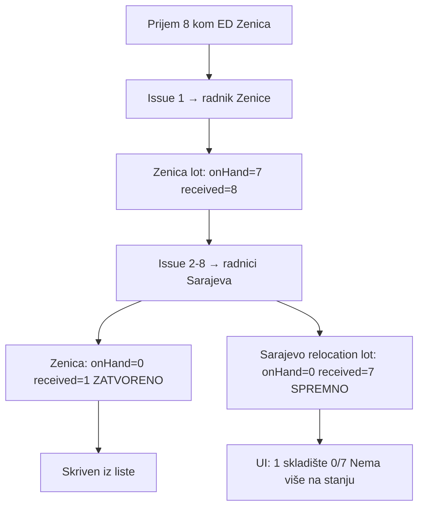

# Fix cross-warehouse lot stanja i prikaza

## Problem (tvoj scenarij)



**Tri uzroka:**

| # | Uzrok | Efekat |
|---|-------|--------|
| 1 | Cross-warehouse **smanjuje** `quantityReceived` na izvornom lotu i **prenosi** na dest | Originalnih 8 više nije vidljivo kao cjelina |
| 2 | Lista evidentičara **isključuje** `zatvoreno` iz default query-ja | Zenica lot (1 kom) nestaje iz grupe |
| 3 | Dest relocation lot ostaje `spremno_za_izdavanje` sa `onHand=0` | Badge „Nema više na stanju" umjesto zatvaranja |

**Očekivano ponašanje (potvrđeno):** kad su svi lotovi zatvoreni, grupa **nestaje** iz aktivne liste; arhiva preko filtera **„Zatvoreno"**.

---

## Faza 1 — Backend: auto-zatvaranje relocation dest lota

**Fajl:** [`backend/src/modules/warehouse-stock/utils/cross-warehouse-issue.util.ts`](backend/src/modules/warehouse-stock/utils/cross-warehouse-issue.util.ts)

Nakon `applyDestAcceptLotUpdatesInTx` + `inheritDestLotSpecificationsInTx`, dodati korak:

- Ako destinacijski lot ima `quantityOnHand === 0` i `quantityReceived > 0` (svi komadi prošli kroz lot direktno na radnike, `destOnHandDelta=0` za `zaduzeno`) → postavi `status: 'zatvoreno'`

Ekstrahovati u mali helper npr. `maybeCloseDispatchedRelocationLotInTx(tx, lotId)` radi hygiene i ponovne upotrebe.

**Test:** proširiti [`cross-warehouse-issue.util.spec.ts`](backend/src/modules/warehouse-stock/cross-warehouse-issue.util.spec.ts) — nakon `applyCrossWarehouseIssueLotUpdatesInTx` dest lot mora biti `zatvoreno` sa `onHand=0`, `received=1`.

**Napomena:** Izvorni lot već zatvara [`issueUnit`](backend/src/modules/warehouse-stock/warehouse-stock.service.ts) kad `nextOnHand === 0` — tu nema promjene.

---

## Faza 2 — Backend: ispravna grupna agregacija

**Fajl:** [`warehouse-stock.service.ts`](backend/src/modules/warehouse-stock/warehouse-stock.service.ts) → `listAssignedGroups`

Trenutno sve metrike dolaze samo iz **aktivnih** lotova (`buildAssignedLotsWhere` default isključuje `zatvoreno`). Zato grupa pokazuje `0/7` i `1 skladište`.

**Novi model agregacije po `groupKey`:**

| Metrika | Izvor lotova |
|---------|--------------|
| `totalOnHand` | samo `ceka_specifikaciju` + `spremno_za_izdavanje` |
| `awaitingSpecCount`, `readyToIssueCount` | samo aktivni |
| `totalReceived` | **svi** lotovi u grupi (uključujući `zatvoreno`) |
| `warehouseCount` | **svi** distinct `warehouseId` u grupi (uključujući zatvorene) |
| Grupa u default listi | postoji barem jedan **aktivan** lot |

**Implementacija:** Dva koraka u `listAssignedGroups`:

1. Query aktivnih lotova (postojeći `where`) → radni redovi, `totalOnHand`, badge countovi
2. Query **svih** lotova istog scope-a bez status filtera, grupisati po `groupKey` → dopuni `totalReceived` i `warehouseCount` za grupe iz koraka 1

Za tvoj scenarij prije potpunog zatvaranja Sarajevo lota: header postaje **`0/8`** i **`2 skladišta`**.

Kad oba lota postanu `zatvoreno`: grupa **ispada** iz default liste (nema aktivnih lotova).

**Test:** novi unit test u `warehouse-stock.service` ili izdvojeni util `build-stock-lot-group-aggregates.util.ts` sa fixture: 1 zatvoren + 1 aktivan lot isti `catalogItemId`.

---

## Faza 3 — Frontend: filter „Zatvoreno" + jasniji labeli

### 3.1 Filter arhive

**Fajl:** [`registrar-stock-page.tsx`](frontend/src/components/registrar-stock/registrar-stock-page.tsx)

Dodati opciju u status dropdown:

```html
<option value="zatvoreno">Zatvoreno</option>
```

Backend već podržava `?status=zatvoreno` u [`list-stock-lots-query.dto.ts`](backend/src/modules/warehouse-stock/dto/list-stock-lots-query.dto.ts).

Kad je filter `zatvoreno`:
- prikazati samo arhivirane lotove u expandu
- grupe se grade samo od zatvorenih lotova
- bez badgeova „Spremno" / „Čeka spec."

### 3.2 Labeli i badge

**Fajl:** [`warehouse-stock.util.ts`](frontend/src/helpers/warehouse-stock.util.ts)

Prilagoditi `getStockLotListBadge`:

- `zatvoreno` → „Zatvoreno" (neutral) — već postoji
- Privremeno stanje `spremno_za_izdavanje` + `onHand=0` + `received>0` (prije auto-close fixa ili edge case): label **„Sve izdato"** umjesto „Nema više na stanju"

**Grupni red** u [`registrar-stock-page.tsx`](frontend/src/components/registrar-stock/registrar-stock-page.tsx):

```
{totalOnHand}/{totalReceived} na stanju
```

Dodati pojašnjenje u sublabelu kad `warehouseCount > 1`: npr. „uključuje zatvorene lotove u ukupno primljeno".

---

## Faza 4 — Matrice

Ažurirati [`warehouse-stock/MATRIX.md`](.cursor/docs/matrices/warehouse-stock/MATRIX.md) + [`CHANGELOG.md`](.cursor/docs/matrices/warehouse-stock/CHANGELOG.md):

- Cross-warehouse dest lot → `zatvoreno` kad `onHand=0` i komadi izdati
- Grupna agregacija: `totalReceived` / `warehouseCount` uključuju zatvorene; default lista samo aktivne
- UI filter „Zatvoreno" za arhivu

---

## Šta se ne mijenja

- Prisma schema
- Cross-warehouse računovodstvo (`quantityReceived` transfer izvor → dest) — ovo je ispravno knjigovodstveno ponašanje
- `transfer.allow_admin_cross_warehouse_issue` postavka
- Employee relocation tok (koristi isti `applyDestAcceptLotUpdatesInTx`; auto-close u cross-warehouse util pokriva admin issue path; relocation dest-accept može dobiti isti helper ako treba u follow-up)

---

## Test plan (ručno — tvoj scenarij)

1. Prijem 8 kom ED Zenica → spec → spremno
2. Admin issue 1 → radnik Zenice → Zenica `7/8`
3. Admin issue 7 → radnici Sarajeva (cross-warehouse)
4. **Grupa (aktivna lista):** nestaje kad su svi lotovi zatvoreni
5. **Prije potpunog zatvaranja** (ako još ima aktivnog): header `0/8`, `2 skladišta`
6. Filter **Zatvoreno** → vidljivi Zenica (`1/1`) i Sarajevo (`0/7` ili `7/7 received`) lotovi, status „Zatvoreno"
7. Svi `Equipment` zapisi i dalje dostupni preko modula Oprema
