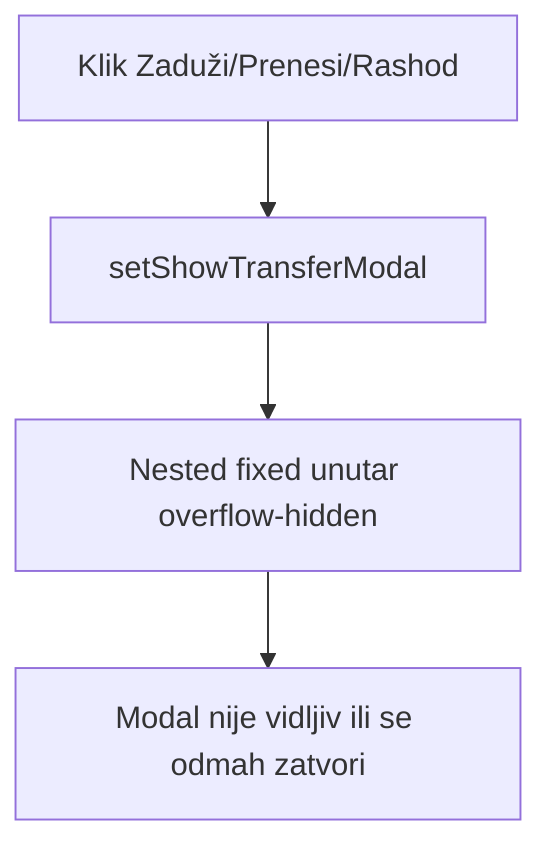

# Follow-up popravke — modali, korisnici, layout, lokacije

## 1. EquipmentByCategoryPage — dijalozi se ne otvaraju na akciju

### Dijagnoza

Prethodni fix (`setViewItemId(null)` na breadcrumb) rješava **stale modal** pri navigaciji, ali ne root cause za “klik → ništa se ne vidi”.

Identificirani problemi u [`frontend/src/components/EquipmentCard.tsx`](frontend/src/components/EquipmentCard.tsx):

- Glavni overlay i **transfer sub-modal** su ugniježđeni (`showTransferModal` unutar `overflow-hidden flex flex-col` roditelja, linija ~209–526).
- Sub-modal koristi `fixed inset-0 z-[60]` ali ostaje **child** glavnog modala — u praksi se ne prikazuje pouzdano (clipping/stacking).
- Modali se renderuju unutar [`Layout.tsx`](frontend/src/components/Layout.tsx) `<main className="overflow-y-auto">`, što dodatno otežava pouzdan `position: fixed`.

### Rješenje

1. **Novi shared komponent** [`frontend/src/components/ui/modal-root.tsx`](frontend/src/components/ui/modal-root.tsx):
   - `createPortal(..., document.body)`
   - props: `open`, `onClose`, `children`, `zIndex` (default 50), `size`
   - `body` scroll lock dok je otvoren
   - `Escape` + backdrop click za zatvaranje

2. **Refaktor `EquipmentCard`**:
   - Glavni overlay prebaciti na `ModalRoot`
   - Transfer formu renderovati u **odvojeni** `ModalRoot` (zIndex 60), ne unutar bijele kartice
   - `type="button"` na svim action dugmadima (spriječiti accidental form submit)

3. **EquipmentByCategoryPage** ([`frontend/src/components/EquipmentByCategoryPage.tsx`](frontend/src/components/EquipmentByCategoryPage.tsx)):
   - `useEffect`: kad se `selectedSubId` promijeni → `setViewItemId(null)` (ne samo breadcrumb)
   - Action dugmad u tabeli: `e.stopPropagation()` + eksplicitno `type="button"`
   - Filter/save modali također prebaciti na `ModalRoot` radi konzistentnog z-indexa

4. **Verifikacija**: klik Detalji otvara EquipmentCard; klik Zaduži/Prenesi/Razduži/Rashod otvara transfer dijalog odmah (ne tek nakon breadcrumb navigacije).

---

## 2. Korisnici — zastarjela kolona “Dodjele (grad + kategorija)”

### Problem

[`frontend/src/components/UserManagementPage.tsx`](frontend/src/components/UserManagementPage.tsx) linije 115–128 koriste **`scope.cityId`** koji više ne postoji na `RegistrarScopeAssignment` (model je `warehouseId + categoryId + orgUnitId?`).

Forma u [`user-access-fields.tsx`](frontend/src/components/user-management/user-access-fields.tsx) već koristi Režim A/B terminologiju.

### Rješenje

- Preimenovati kolonu u **“Evidentičar scope”** ili **“Dodjele (Režim A / B)”**
- Za label koristiti postojeći helper [`formatRegistrarAssignmentLabel`](frontend/src/helpers/org-warehouse.util.ts) iz `org-warehouse.util.ts`
- Badge po dodjeli:
  - **Režim A** — `!orgUnitId` (cijelo skladište + kategorija)
  - **Režim B** — `orgUnitId` set (podstablo org)
- Prikazati max 2 badge-a + `+N` (postojeći pattern)
- Za non-evidenticar uloge: `—`

---

## 3. Komisija rashod i Popis — proširiti content

### Problem

Stranice imaju dodatno sužavanje koje ostale nemaju:

| Stranica | Ograničenje |
|----------|-------------|
| [`DisposalCommissionsPage.tsx`](frontend/src/components/DisposalCommissionsPage.tsx) | root `max-w-5xl` |
| [`InventoryCountPage.tsx`](frontend/src/components/InventoryCountPage.tsx) | root `max-w-6xl` |
| [`EquipmentPage.tsx`](frontend/src/components/EquipmentPage.tsx) / [`WarehousesPage.tsx`](frontend/src/components/WarehousesPage.tsx) | bez root max-width (samo Layout `max-w-[1400px]`) |

### Rješenje

- Ukloniti `max-w-5xl` / `max-w-6xl` sa root wrappera obje stranice
- Zadržati lokalne `max-w-xl` samo na uskim form karticama gdje ima smisla (npr. “Nova sesija”)
- Admin grid na Popisu (`lg:grid-cols-[360px_1fr]`) proširiti na punu širinu kontejnera — command center + paneli koriste `1fr` kolonu kao Equipment/Warehouses

---

## 4. Lokacije — izmjena, brisanje, hijerarhijski prikaz

### Backend (novi endpointi)

Proširiti [`backend/src/modules/locations/locations.controller.ts`](backend/src/modules/locations/locations.controller.ts) i [`locations.service.ts`](backend/src/modules/locations/locations.service.ts):

| Metoda | Ruta | Pravilo |
|--------|------|---------|
| `PATCH` | `/locations/cantons/:id` | admin; `{ name?, code? }` |
| `DELETE` | `/locations/cantons/:id` | admin; odbij ako kanton ima gradove |
| `PATCH` | `/locations/cities/:id` | admin; `{ name?, cantonId? }` |
| `DELETE` | `/locations/cities/:id` | admin; odbij ako grad referencira `OrgUnit`, `Warehouse`, ili `DisposalCommission` |

Novi DTO fajlovi: `update-canton.dto.ts`, `update-city.dto.ts`.

### Frontend

Proširiti [`frontend/src/api/locations-api.ts`](frontend/src/api/locations-api.ts) s `updateCantonApi`, `deleteCantonApi`, `updateCityApi`, `deleteCityApi`.

Refaktor [`frontend/src/components/LocationsPage.tsx`](frontend/src/components/LocationsPage.tsx):

- **Tab “Registar”** → primarni hijerarhijski prikaz (kanton → lista gradova) s inline akcijama Edit/Delete
- Edit: drawer/sheet na mobile, inline modal na desktop (po globalnom UX pravilu)
- Delete: confirm dialog; prikazati backend poruku ako postoje reference
- Tab “Kantoni” / “Gradovi”: zadržati brzo dodavanje ili spojiti u jedan “Upravljanje” tab — preferencija: **Registar kao glavni CRUD view**, create forme ostaju u tabovima ili collapsible sekciji iznad stabla
- Vizuelno: expandable kanton redovi (Chevron), broj gradova, edit/delete ikone

### Matrica

Ažurirati [`.cursor/docs/matrices/locations/MATRIX.md`](.cursor/docs/matrices/locations/MATRIX.md) + [`CHANGELOG.md`](.cursor/docs/matrices/locations/CHANGELOG.md) — PATCH/DELETE API i hijerarhijski UI.

---

## Redoslijed implementacije

1. **ModalRoot + EquipmentCard** (blocker za evidentičara)
2. **UserManagementPage** kolona (brz fix)
3. **Layout width** Disposal + Inventory
4. **Locations** backend → API → UI hijerarhija

## Test checklist

1. Oprema po kategorijama → klik Detalji → EquipmentCard odmah vidljiv
2. Iz EquipmentCard → Zaduži/Prenesi/Razduži/Rashod → transfer modal odmah vidljiv i funkcionalan
3. Korisnici → evidentičar prikazuje skladište · kategorija · Režim A/B (ne grad+cat)
4. Popis i Komisija rashod → content širine kao Oprema/Skladišta
5. Lokacije → edit/delete kanton (prazan) i grad (bez referenci); odbij delete grad s org/skladištem
