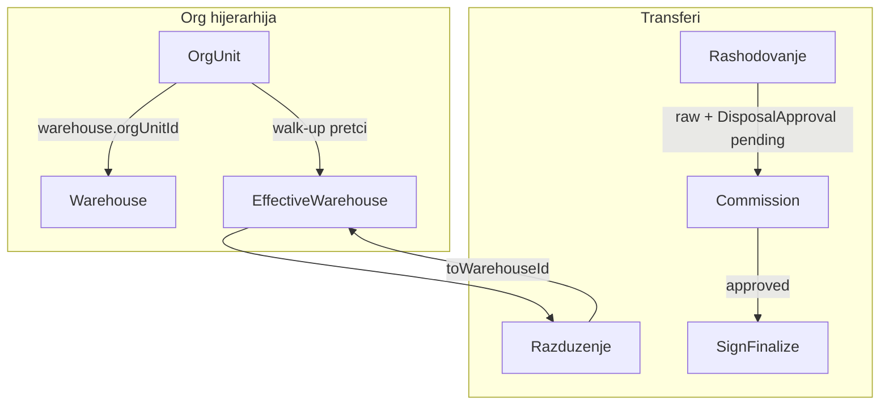

# Plan popravke — inventory-v2 bugovi i nedovršene funkcionalnosti

## Kontekst i arhitektura

Trenutno: **coverage** (parent skladište pokriva child org) postoji u [`warehouse-coverage.util.ts`](backend/src/common/utils/warehouse-coverage.util.ts), ali **auto-resolucija** skladišta od pretka **ne postoji** (osim ograničenog exact-match u [`inventory-count.service.ts`](backend/src/modules/inventory-count/inventory-count.service.ts)). Uzor za implementaciju: [`resolve-effective-location.util.ts`](backend/src/common/utils/resolve-effective-location.util.ts).

---

## Faza 1 — P0: Kritični bugovi (evidentičar + skladištar + transferi)

### 1.1 `EquipmentByCategoryPage` — crash i scope

**Fajl:** [`frontend/src/components/EquipmentByCategoryPage.tsx`](frontend/src/components/EquipmentByCategoryPage.tsx)

- Linija 61: zamijeniti `equipmentMatchesScope(eq, ...)` → `equipmentMatchesScope(e, ...)`.
- Ukloniti bypass `if (e.status === 'skladiste') return true` i `if (!e.currentHolderId) return true`; koristiti isključivo `equipmentMatchesScope(e, state, user)` (isto kao [`EquipmentPage.tsx`](frontend/src/components/EquipmentPage.tsx) linija 67).
- Breadcrumb handleri: dodati `setViewItemId(null)` pri `setSelectedParentId(null)` / `setSelectedSubId(null)` (fix odgođenog modala).

### 1.2 `EquipmentCard` — transferi i toast

**Fajl:** [`frontend/src/components/EquipmentCard.tsx`](frontend/src/components/EquipmentCard.tsx)

- Dodati `const { toastError } = useToast()`.
- Ekstrahovati shared logiku iz [`TransfersPage.tsx`](frontend/src/components/TransfersPage.tsx) u novi helper/hook npr. [`frontend/src/helpers/create-transfer-payload.util.ts`](frontend/src/helpers/create-transfer-payload.util.ts):
  - `resolveTransferWarehousePayload` (već postoji u [`transfer-warehouse.util.ts`](frontend/src/helpers/transfer-warehouse.util.ts))
  - signer resolution
  - cross-service / cross-registrar provjere
  - disposal commission resolve (`resolveDisposalCommissionApi`) pri `rashodovanje`
- U `handleTransfer` slati kompletan payload uključujući `fromWarehouseId` / `toWarehouseId`.
- UI modala: za `razduzenje` prikazati resolved ciljno skladište; za `rashodovanje` prikazati komisiju + blokirati submit bez komisije (kao TransfersPage); za `prenos` filtrirati osobe po `employeeMatchesScope`.
- U historiji transfera: `allowSign` za rashod samo ako postoji approved approval (ili sakriti sign dok je pending) — uskladiti s [`TransferDocumentPanel`](frontend/src/components/TransferDocumentPanel.tsx) i backend [`assertCanSignDisposalTransfer`](backend/src/modules/disposal-commissions/disposal-commissions.service.ts).

### 1.3 Skladištar — učitavanje podataka (Forbidden)

**Root cause:** [`fetchAppState`](frontend/src/api/data-api.ts) koristi `Promise.all` na endpointe bez `@Roles(skladistar)`.

**Backend** — proširiti read-only GET u controllerima:
- [`org-units.controller.ts`](backend/src/modules/org-units/org-units.controller.ts): `skladistar` na GET flat/tree/:id
- [`employees.controller.ts`](backend/src/modules/employees/employees.controller.ts): `skladistar` na GET list/:id
- [`categories.controller.ts`](backend/src/modules/categories/categories.controller.ts): `skladistar` na GET
- [`transfers.controller.ts`](backend/src/modules/transfers/transfers.controller.ts): `skladistar` na GET (scope već filtrira preko equipment read u servisu)

**Frontend** — [`data-api.ts`](frontend/src/api/data-api.ts): opcionalno `Promise.allSettled` + jasna greška samo za obavezne resurse; ili ostaviti `Promise.all` nakon backend fixa.

**Validacija pri kreiranju korisnika:** [`users-validation.util.ts`](backend/src/modules/users/users-validation.util.ts) već traži `employeeId` za skladistar — dokumentirati u HANDOFF da admin mora dodati `WarehouseKeeper` vezu.

### 1.4 `LocationsPage` — missing hook

**Fajl:** [`frontend/src/components/LocationsPage.tsx`](frontend/src/components/LocationsPage.tsx) — dodati `const { toastError } = useToast()`.

---

## Faza 2 — Warehouse inheritance (backend + frontend)

### 2.1 Util + servis (mirroring location pattern)

**Novi fajlovi:**
- [`backend/src/common/utils/resolve-effective-warehouse.util.ts`](backend/src/common/utils/resolve-effective-warehouse.util.ts)
- [`backend/src/common/services/warehouse-resolution.service.ts`](backend/src/common/services/warehouse-resolution.service.ts)

**Algoritam** `resolveEffectiveWarehouseId(orgUnitId, cityId?)`:
1. Walk od `orgUnitId` prema korijenu (kao location util).
2. Na svakom čvoru: `Warehouse.findFirst({ orgUnitId: currentId, isActive: true, cityId? })` orderBy `createdAt asc`.
3. Prvi match = efektivno skladište (child override ako ima vlastito skladište na svom čvoru).
4. Fallback: bilo koje aktivno skladište u `cityId` (holder effective city).

Registrovati servis u [`common.module.ts`](backend/src/common/common.module.ts).

### 2.2 Integracija u postojeće tokove

| Mjesto | Promjena |
|--------|----------|
| [`transfers.service.ts`](backend/src/modules/transfers/transfers.service.ts) `assertWarehouseCoverageForTransfer` | Ako `toWarehouseId` nedostaje na razduženju, auto-resolve iz holder `orgUnitId` |
| [`inventory-count.service.ts`](backend/src/modules/inventory-count/inventory-count.service.ts) `resolveRelocationWarehouseId` | Zamijeniti exact-match s walk-up resolverom |
| [`warehouses.controller.ts`](backend/src/modules/warehouses/warehouses.controller.ts) | Novi `GET /warehouses/resolve?orgUnitId=&cityId=` za UI preview |

**Frontend mirror:** proširiti [`frontend/src/helpers/org-warehouse.util.ts`](frontend/src/helpers/org-warehouse.util.ts) s `resolveEffectiveWarehouseForOrgUnit(orgUnits, warehouses, orgUnitId, cityId?)` — ista logika za offline UX u transfer formama.

Ažurirati [`transfer-warehouse.util.ts`](frontend/src/helpers/transfer-warehouse.util.ts): za evidenticar razduženje, fallback redoslijed: registrar assignment warehouse → effective org warehouse → equipment.warehouseId.

### 2.3 Matrice

- [`/.cursor/docs/matrices/warehouses/MATRIX.md`](.cursor/docs/matrices/warehouses/MATRIX.md) — sekcija Effective warehouse inheritance
- [`/.cursor/docs/matrices/org-hierarchy/CHANGELOG.md`](.cursor/docs/matrices/org-hierarchy/CHANGELOG.md) + warehouses CHANGELOG

---

## Faza 3 — Admin forma opreme: odabir skladišta

**Fajl:** [`frontend/src/components/EquipmentPage.tsx`](frontend/src/components/EquipmentPage.tsx)

- State `fWarehouseId`; u formi select skladišta (obavezno kad `status=skladiste` ili nova oprema).
- Default: `resolveEffectiveWarehouseForOrgUnit` ako admin odabere org kontekst, ili prazno s validacijom.
- `handleSave`: uključiti `warehouseId` u payload; za admin create default `status: 'skladiste'`.
- Skladištar forma: već mora imati warehouse — uskladiti UI s keeper scope (`myWarehouseIds`).

Backend već podržava polje u [`create-equipment.dto.ts`](backend/src/modules/equipment/dto/create-equipment.dto.ts) — bez schema promjene.

---

## Faza 4 — Popis rashod, Moja oprema, Radnici (evidentičar)

### 4.1 Disposal inbox — employee link

**Backend:** [`inventory-count.service.ts`](backend/src/modules/inventory-count/inventory-count.service.ts) `getDisposalInboxForUser`:
- Ako `!actor?.employeeId` i `user.role !== 'admin'` → vratiti `[]` (ne throw).
- Admin bez employeeId: vidi sve pending (postojeća logika predsjednika).

**Frontend:** [`disposal-inbox-panel.tsx`](frontend/src/components/inventory-count/disposal-inbox-panel.tsx):
- Ako korisnik nema employeeId → info poruka umjesto error crvene.
- Ako nema stavki i nije predsjednik → objasniti da inbox vide samo predsjednik komisije rashoda.

### 4.2 Moja oprema — prazan ekran

**Fajl:** [`frontend/src/components/MyEquipmentPage.tsx`](frontend/src/components/MyEquipmentPage.tsx)

- Umjesto `return null` za missing employee: prikazati empty state (“Nalog nije povezan s radnikom — kontaktirajte administratora”).
- Isto za `!currentUser`.

### 4.3 Radnici — evidentičar read-only

**Fajl:** [`frontend/src/components/EmployeesPage.tsx`](frontend/src/components/EmployeesPage.tsx)

- Sakriti “Novi radnik”, edit/delete dugmad kad `!admin`.
- Filter org-jedinica u dropdownu: samo one u evidentičarov scope (`employeeMatchesScope` / subtree).
- Backend već enforce-uje — samo UI.

---

## Faza 5 — UI tabovi (dotjerivanje)

Kreirati reusable [`frontend/src/components/ui/page-tabs.tsx`](frontend/src/components/ui/page-tabs.tsx) (pattern iz [`warehouse-detail-view.tsx`](frontend/src/components/warehouses/warehouse-detail-view.tsx)).

| Stranica | Tabovi |
|----------|--------|
| [`LocationsPage.tsx`](frontend/src/components/LocationsPage.tsx) | Kantoni \| Gradovi \| Registar |
| [`WarehousesPage.tsx`](frontend/src/components/WarehousesPage.tsx) | Lista \| Novo skladište (admin) |
| [`DisposalCommissionsPage.tsx`](frontend/src/components/DisposalCommissionsPage.tsx) | Komisije \| Legacy odobrenja |
| [`EquipmentPage.tsx`](frontend/src/components/EquipmentPage.tsx) | Pretvoriti postojeći toggle u `PageTabs`: Sva oprema \| Po skladištima |

Responsive: na mobile tabovi scroll horizontal ili sheet — po globalnom UX pravilu.

---

## Faza 6 — Verifikacija i HANDOFF

**Manual test checklist:**
1. Evidentičar (režim A i B): vidi opremu u “Sva oprema” i “Po kategorijama”; kategorije ne crashaju.
2. Evidentičar iz detalja opreme: prenos, razduženje (s resolved skladištem), rashod (raw + pending, ne finalize bez odobrenja).
3. Skladištar: login, učitavanje, oprema samo svog skladišta, warehouses detail/destruction.
4. Admin: nova oprema s odabranom skladištem.
5. Org: skladište na Distribuciji → razduženje radnika u child službi ide na to skladište.
6. Popis → Rashod tab: evidentičar bez employee ne vidi error; predsjednik vidi inbox.
7. Moja oprema: poruka kad nema employee veze.
8. Kategorije breadcrumb: modal se ne otvara odgođeno.

Ažurirati [`.cursor/plans/inventory-v2/HANDOFF.md`](.cursor/plans/inventory-v2/HANDOFF.md) i relevantne CHANGELOG-ove matrica.

---

## Redoslijed implementacije

Preporuka: **Faza 1 → 2 → 3 → 4 → 5 → 6**. Faze 1 i 2 su blocker za produkcijsko testiranje evidentičara i skladištara; faza 5 je polish i može ići paralelno s 4 ako treba brže isporučiti funkcionalnost.

## Rizici / napomene

- Warehouse inheritance s **više skladišta na istom čvoru**: biramo `createdAt asc` (konzistentno s popis resolverom). Ako treba “primarno” skladište, to bi bio follow-up (polje `isPrimary`).
- Rashod iz `EquipmentCard` kreira **legacy** transfer (raw), ne popisni — to je ispravno po matrici; UI mora jasno razlikovati “predlog komisiji” od finalnog rashoda.
- Nema Prisma migracije u ovom planu (warehouse inheritance je computed, ne denormalizovano polje na `OrgUnit`).
