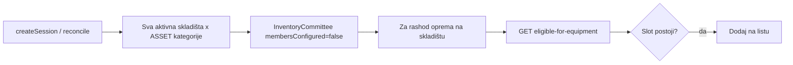

# Fix: slotovi za sva skladišta + rashod + dialog

## Dijagnoza (trenutno stanje)

### 1. Samo jedno skladište ima slotove

[`listWarehousesForSessionOrgUnit`](backend/src/modules/inventory-count/inventory-count.service.ts) filtrira skladišta:

```ts
OR: [
  { orgUnitId: { in: orgUnitIds } },           // org-stablo distribucije
  { orgUnitId: null, cityId: sessionCityId }, // legacy bez org veze
]
```

Drugо skladište je vezano za **vrh hijerarhije** (direkcija/top), pa **nije** u `orgUnitIds` distribucije → nema slotova. Ovo objašnjava i rashod: oprema na tom skladištu nema `(sessionId, warehouseId, categoryId)` slot.

**Napomena:** Na aktivaciji sesije, `createWarehouseCommitteesForSession` već uzima **sva** skladišta u `sessionCityId` — asset slotovi su uži od toga (nekonzistentno).

### 2. „Nema draft sesije u opsegu” za opremu na skladištu

[`findEligibleSessionsForEquipment`](backend/src/modules/inventory-count/equipment-disposal-list.service.ts) vraća `[]` kad:

- nema slota za `(warehouseId, parentCategoryId)` — **najvjerovatnije** zbog tačke 1
- `equipment.category.categoryKind !== 'ASSET'`
- `sessionCityId !== equipmentCityId` (grad distribucije vs grad skladišta)
- `resolveTargetWarehouseId` baci grešku (za `skladiste` + `warehouseId` ovo **ne** bi trebalo)

Status „Na skladištu” / `skladiste` bez `currentHolder` **nije** bug u `resolveTargetWarehouseId` (linija 413–414).

### 3. Dialog se ne može zatvoriti / loš stil

[`equipment-mark-disposal-dialog.tsx`](frontend/src/components/equipment/equipment-mark-disposal-dialog.tsx) prosljeđuje `title` i `footer` na [`ModalRoot`](frontend/src/components/ui/modal-root.tsx), ali **ModalRoot te props ne podržava** — nema headera, nema X dugmeta, `closeOnBackdrop=false`, `enableEscape=false` → korisnik ostaje zaglavljen.

Ispravan obrazac već postoji u [`EquipmentCard.tsx`](frontend/src/components/EquipmentCard.tsx) (transfer/reactivate modali): unutrašnji `div` s `p-6`, `h3`, footer dugmad, opcionalno X.

---

## Predložene izmjene

### A. Provisioning: sva aktivna skladišta

U [`inventory-count.service.ts`](backend/src/modules/inventory-count/inventory-count.service.ts):

- Nova metoda `listWarehousesForSessionSlots()`:
  ```ts
  return prisma.warehouse.findMany({
    where: { isActive: true },
    select: { id: true, name: true, cityId: true },
    orderBy: { name: 'asc' },
  });
  ```
- Koristiti je u `provisionCommitteeSlotsForSession`, `createSession` transakciji i `reconcileSessionSlots`
- **Zadržati** postojeći `listWarehousesForSessionOrgUnit` za wizard filtriranje koordinatora / `assertWarehouseInSessionScope` ako treba — ili uskladiti wizard da prikazuje sva skladišta sa slotovima

**Nakon deploya za postojeću POPIS 2026 sesiju:**

```
POST /inventory-sessions/{sessionId}/reconcile-slots
```

(admin) — idempotentno dodaje slotove za drugo skladište.

### B. Rashod eligible: slot-first logika

U [`equipment-disposal-list.service.ts`](backend/src/modules/inventory-count/equipment-disposal-list.service.ts):

1. Za `skladiste` + `warehouseId`: koristiti direktno `equipment.warehouseId` (bez silent `catch` u eligible)
2. Eligible sesija = `draft` + postoji slot za `(sessionId, warehouseId, parentCategoryId)`
3. Grad provjera za `skladiste`:
   - **Opcija preporučena:** ukloniti strogi `sessionCityId === equipmentCityId` kad slot postoji (slot već definira opseg)
   - ili: uskladiti s matricom ako skladište mora biti u gradu distribucije

4. U [`markForDisposal`](backend/src/modules/inventory-count/equipment-disposal-list.service.ts): ista slot provjera (već postoji) — nakon A bi trebalo raditi

5. (Opcionalno, admin-only debug) vratiti `reason` u praznom odgovoru za lakše testiranje

### C. Dialog: stil + zatvaranje

Refaktor [`equipment-mark-disposal-dialog.tsx`](frontend/src/components/equipment/equipment-mark-disposal-dialog.tsx):

- Ukloniti nepostojeće `title`/`footer` props
- Struktura kao transfer modal u EquipmentCard:
  - `ModalRoot` s `enableEscape`, `closeOnBackdrop`
  - unutrašnji `div.bg-white.rounded-xl.p-6`
  - `h3` + X dugme (`lucide-react`)
  - `labelClass` / `selectClass` iz [`form-styles`](frontend/src/components/ui/form-styles.ts)
  - footer: Odustani + Dodaj na listu
- Kad `sessions.length === 0`: i dalje prikazati Odustani/X (zatvaranje)

### D. UI: reconcile + pregled opsega (admin)

U [`InventoryCountPage.tsx`](frontend/src/components/InventoryCountPage.tsx) / [`session-command-center.tsx`](frontend/src/components/inventory-count/session-command-center.tsx):

- Za `draft` sesiju: dugme **„Osvježi slotove”** → `POST reconcile-slots`
- U command center prikaz: `X/Y slotova konfigurisano` (već postoji `configuredCommittees/totalCommittees`)

### E. Matrica

Ažurirati [`.cursor/docs/matrices/inventory-count/MATRIX.md`](.cursor/docs/matrices/inventory-count/MATRIX.md):

- Auto slotovi: **sva aktivna skladišta** iz tabele `warehouses` (ne samo org-stablo distribucije)
- Rashod eligible: match po slotu `(session, warehouse, parent category)`
- Changelog unos

---

## Tok nakon fixa



---

## Test plan (ručno)

1. `POST reconcile-slots` na POPIS 2026 → drugo skladište dobija kategorije „Čeka članove”
2. Oprema K0152942 (`skladiste`, `warehouseId` na drugom skladištu) → dialog prikazuje POPIS 2026
3. Dialog: Escape, klik izvan, Odustani i X zatvaraju
4. `npm run test:unit` — ažurirati/ dodati test za prošireni warehouse list

---

## Rizik

| Rizik | Mitigacija |
|-------|------------|
| Previše slotova (N skladišta × M kategorija) | Prihvatljivo za single-tenant; kasnije filter po gradu ako treba |
| Skladište u drugom gradu od distribucije | Slot postoji, rashod radi; popisna logika po gradu ostaje na linijama komisije |
| Stara sesija bez slotova | `reconcile-slots` + UI dugme |
