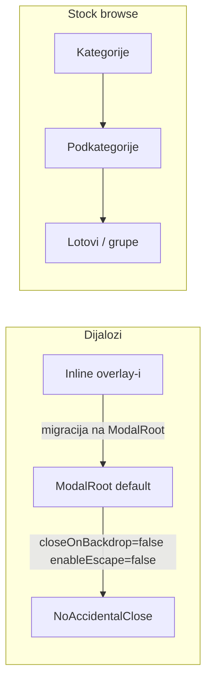

# Frontend: dijalog backdrop/Escape + kategorijsko razvrstavanje

## Kontekst

Aplikacija **nema shadcn `Dialog`** — koristi custom [`ModalRoot`](frontend/src/components/ui/modal-root.tsx) i ~10 inline `fixed inset-0` overlay-a. Referenca za kategorijsko razvrstavanje: [`warehouse-stock-browse-panel.tsx`](frontend/src/components/warehouses/warehouse-stock-browse-panel.tsx) (parent → sub → lotovi). **Isključeno** po zahtjevu: [`EquipmentPage`](frontend/src/components/EquipmentPage.tsx) (Sva oprema) i [`EquipmentByCategoryPage`](frontend/src/components/EquipmentByCategoryPage.tsx) (Po kategorijama).

---

## Faza 1 — Dijalozi: bez zatvaranja na backdrop i Escape

### 1.1 Jedinstvena promjena u `ModalRoot`

U [`frontend/src/components/ui/modal-root.tsx`](frontend/src/components/ui/modal-root.tsx):

- Promijeniti default: `closeOnBackdrop = false`, `enableEscape = false`
- Zatvaranje isključivo preko eksplicitnih dugmadi (`Zatvori`, `Odustani`, X ikona)

Ovo automatski pokriva postojeće `ModalRoot` pozive u:
- [`EquipmentCard.tsx`](frontend/src/components/EquipmentCard.tsx) — ukloniti `closeOnBackdrop={!showTransferModal}` i `enableEscape={!showTransferModal}`
- [`EmployeesPage.tsx`](frontend/src/components/EmployeesPage.tsx) — ukloniti redundantni `closeOnBackdrop={false}`
- [`LocationsPage.tsx`](frontend/src/components/LocationsPage.tsx), [`EquipmentByCategoryPage.tsx`](frontend/src/components/EquipmentByCategoryPage.tsx), [`LabelPrintSheet.tsx`](frontend/src/components/LabelPrintSheet.tsx)

### 1.2 Migracija inline overlay-a na `ModalRoot`

Zamijeniti hand-rolled `fixed inset-0 ... onClick={onClose}` obrasce sa `ModalRoot` (bez dodatnih props — defaulti su ispravni):

| Fajl | Namjena |
|------|---------|
| [`EquipmentPage.tsx`](frontend/src/components/EquipmentPage.tsx) | Forma opreme |
| [`OrganizationPage.tsx`](frontend/src/components/OrganizationPage.tsx) | Forma org. jedinice |
| [`CategoriesPage.tsx`](frontend/src/components/CategoriesPage.tsx) | Forma kategorije |
| [`TransfersPage.tsx`](frontend/src/components/TransfersPage.tsx) | Forma transfera |
| [`transfers/transfer-documents-tab.tsx`](frontend/src/components/transfers/transfer-documents-tab.tsx) | Pregled dokumenta |
| [`categories/category-asset-subcategory-dialog.tsx`](frontend/src/components/categories/category-asset-subcategory-dialog.tsx) | Subkategorija dijalog |
| [`catalog/equipment-catalog-panel.tsx`](frontend/src/components/catalog/equipment-catalog-panel.tsx) | Dodaj stavku šifrarnika |
| [`disposal-commissions/disposal-commission-form-modal.tsx`](frontend/src/components/disposal-commissions/disposal-commission-form-modal.tsx) | Komisija |
| [`user-management/user-form-modal.tsx`](frontend/src/components/user-management/user-form-modal.tsx) | Korisnik |
| [`employee-relocation/employee-relocation-page.tsx`](frontend/src/components/employee-relocation/employee-relocation-page.tsx) | Mapa relokacije |

**Već bez backdrop zatvaranja** (samo provjera da imaju eksplicitno dugme + eventualno wrap u `ModalRoot` radi konzistentnosti Escape ponašanja):
- [`inventory-count/inventory-print-sheet.tsx`](frontend/src/components/inventory-count/inventory-print-sheet.tsx)
- [`inventory-count/disposal-report-sheet.tsx`](frontend/src/components/inventory-count/disposal-report-sheet.tsx)
- [`InventoryCountPage.tsx`](frontend/src/components/InventoryCountPage.tsx) (report overlay)

### 1.3 Isključen iz opsega (nisu form dijalogi)

- Nav drawer: [`app-nav-drawer.tsx`](frontend/src/components/app-nav-drawer.tsx)
- Dropdown backdrop-i: [`NotificationsPanel.tsx`](frontend/src/components/NotificationsPanel.tsx), [`Layout.tsx`](frontend/src/components/Layout.tsx) user menu
- Dekorativni pozadinski slojevi: `premium-auth-layout`, `public-equipment-page`
- Mobile bottom-sheet draweri u [`session-lines-panel.tsx`](frontend/src/components/inventory-count/session-lines-panel.tsx) i [`equipment-installed-parts-panel.tsx`](frontend/src/components/maintenance-parts/equipment-installed-parts-panel.tsx) — navigacijski paneli, ne form dijalog

---

## Faza 2 — Kategorijsko razvrstavanje stock prikaza

### 2.1 Shared browse komponente (DRY)

Ekstrahovati iz [`warehouse-stock-browse-panel.tsx`](frontend/src/components/warehouses/warehouse-stock-browse-panel.tsx) u `frontend/src/components/shared/category-browse/`:

- **`category-browse-breadcrumb.tsx`** — breadcrumb: Kategorije → parent → sub
- **`category-parent-grid.tsx`** — grid parent kartica sa statistikom
- **`category-sub-grid.tsx`** — grid podkategorija sa statistikom
- **`category-browse-stats.util.ts`** — `buildParentStats` / `buildSubStats` iz niza objekata sa `categoryId` + količinskim poljima

Refaktorisati postojeći `warehouse-stock-browse-panel` da koristi shared komponente (bez promjene UX-a).

### 2.2 Skladišna roba — [`registrar-stock-page.tsx`](frontend/src/components/registrar-stock/registrar-stock-page.tsx)

Trenutno: flat accordion po **nazivu proizvoda** + dropdown filter kategorije.

Novi tok (3 nivoa + postojeći detail):

| Nivo | UI | Podaci |
|------|-----|--------|
| `parents` | Parent grid (scoped ASSET) | Stats iz svih `StockLotProductGroup` (fetch via `fetchAllPaginatedItems` + warehouse/status filteri) |
| `subcategories` | Sub grid | Stats filtrirane po `parentId` |
| `groups` | Postojeći accordion proizvoda | `groupList` sa `categoryId: subCategoryId` + search/paginacija |
| expand grupe | Postojeći lot redovi → detail | Bez promjene |

- Ukloniti dropdown **Sve kategorije** (zamijenjen navigacijom); zadržati filtere skladišta i statusa
- Koristiti `getScopedParentCategories` / `getScopedSubCategories` iz [`registrar-scope.ts`](frontend/src/helpers/registrar-scope.ts)
- Breadcrumb reset kaskadno (parent → briše sub i groups)

### 2.3 Zalihe održavanja — [`warehouse-maintenance-stock-panel.tsx`](frontend/src/components/warehouses/warehouse-maintenance-stock-panel.tsx)

Trenutno: flat tabela svih maintenance lotova.

Novi tok (isti pattern, MAINTENANCE kategorije):

| Nivo | UI |
|------|-----|
| `parents` | MAINTENANCE parent kategorije |
| `subcategories` | Podkategorije |
| `lots` | Postojeća tabela lotova filtrirana po `subCategoryId` |

- Stats iz `fetchMaintenanceStockLotsApi` (već učitava sve lotove)
- `getParentCategories` / `getSubCategories` filtrirani na `categoryKind === 'MAINTENANCE'`
- Forma prijema (`showReceive`) ostaje na vrhu, nezavisno od browse nivoa

### 2.4 Backend

**Nema promjena** — postojeći API već podržava `categoryId` filter na [`/warehouse-stock/assigned/groups`](backend/src/modules/warehouse-stock/warehouse-stock.controller.ts).

### 2.5 Dokumentacija

Ažurirati [`.cursor/docs/matrices/warehouse-stock/MATRIX.md`](.cursor/docs/matrices/warehouse-stock/MATRIX.md) + `CHANGELOG.md`:
- UI sekcija: registrar-stock i maintenance browse sada prate parent → sub → lot pattern
- Dijalog pravilo: zatvaranje samo eksplicitnim akcijama

---

## Test plan (ručno)

**Dijalozi**
- Otvoriti formu opreme, transfera, kategorije, korisnika — klik na backdrop i Escape ne zatvaraju; `Odustani`/`Zatvori` rade
- `EquipmentCard` + ugniježđeni transfer modal — isto ponašanje

**Browse**
- Skladišna roba: parent → sub → grupe proizvoda → expand lot → detail/issue
- Skladište → Zalihe održavanja: parent → sub → tabela lotova
- Skladište → Pregled robe (postojeći browse): regresija nakon refaktora shared komponenti
- Filteri skladišta/statusa u Skladišnoj robi rade na svim nivoima
