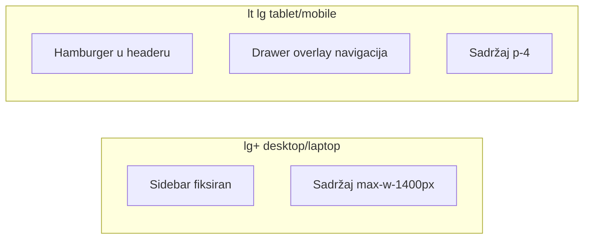

# Plan: Kompletan responsive frontend

## Trenutno stanje

**Najveći gap:** [`frontend/src/components/Layout.tsx`](frontend/src/components/Layout.tsx) — sidebar je uvijek vidljiv (`w-64` / `w-16`), bez breakpointa, bez hamburger dugmeta. Na mobilnom/tabletu sidebar zauzima ~40% ekrana.

**Već djelimično responsivno:**
- [`session-lines-panel.tsx`](frontend/src/components/inventory-count/session-lines-panel.tsx) — card lista `md:hidden` + tabela `hidden md:block` (referentni obrazac)
- [`Dashboard.tsx`](frontend/src/components/Dashboard.tsx), [`EquipmentPage.tsx`](frontend/src/components/EquipmentPage.tsx), [`InventoryCountPage.tsx`](frontend/src/components/InventoryCountPage.tsx) — responsive gridovi
- [`setting-field-row.tsx`](frontend/src/components/settings/setting-field-row.tsx), [`public-equipment-page.tsx`](frontend/src/components/public-equipment-page.tsx) — dobro prilagođeno
- [`DataTable`](frontend/src/components/ui/data-table.tsx) — samo `overflow-x-auto` (horizontalni scroll, nije card UX)

**Nema Radix/shadcn Sheet** — projekat koristi custom overlay (npr. `fixed inset-0 z-[60] md:hidden` u session-lines-panel). Drawer ćemo implementirati istim stilom, bez novih dependencija.



## Breakpoint strategija

Koristiti Tailwind defaulte:

| Uređaj | Breakpoint | Ponašanje |
|--------|------------|-----------|
| Mobilni | `< sm` (640px) | Drawer nav, stack headeri, card liste |
| Tablet | `sm–lg` (640–1024px) | Drawer nav, 1–2 kolone grid |
| Laptop | `lg+` (1024px+) | Sidebar vidljiv, tabele, 2–3 kolone |
| Veliki desktop | `xl/2xl` | Sidebar + `max-w-[1400px]` centriran sadržaj |

**Sidebar vs drawer prag: `lg` (1024px)** — sidebar `hidden lg:flex`, drawer za `< lg`.

---

## Faza 1 — Layout shell (kritično)

**Cilj:** Navigacija u draweru na malim ekranima; ostatak app-a odmah upotrebljiv.

### 1.1 Ekstrahovati navigaciju

Iz [`Layout.tsx`](frontend/src/components/Layout.tsx) izdvojiti `AppSidebarNav` komponentu koja prima:
- `currentPage`, `onNavigate`, `collapsed` (desktop only)
- `onNavigateComplete?` — zatvara drawer nakon klika (mobile)

Postojeći [`SidebarNavButton`](frontend/src/components/sidebar-nav-button.tsx) i `NavSection` ostaju; samo se nav blok dijeli između desktop `<aside>` i mobile drawer-a.

### 1.2 Mobile drawer

Novi fajl: `frontend/src/components/app-nav-drawer.tsx`

- State: `mobileNavOpen` u Layout-u
- Header: hamburger (`Menu` icon) vidljiv `lg:hidden`, pored notifikacija
- Drawer: `fixed inset-0 z-50 lg:hidden` overlay + panel `w-[min(100%,20rem)]` slide-in s lijeve strane
- Zatvaranje: backdrop click, Escape, navigacija, logout
- U draweru: puna navigacija (`collapsed={false}`), user info blok, logout — bez "Smanji meni" toggle-a

### 1.3 Layout prilagodbe

U [`Layout.tsx`](frontend/src/components/Layout.tsx):

```tsx
// Desktop sidebar
<aside className="hidden lg:flex ...">

// Header padding
<header className="... px-4 sm:px-6 ...">

// Main padding
<div className="p-4 sm:p-6 max-w-[1400px] mx-auto w-full">
```

- Desktop collapse toggle (`w-16`/`w-64`) ostaje samo na `lg+`
- Org unit path u headeru: `truncate max-w-[...]` da ne gura notifikacije

---

## Faza 2 — Shared responsive primitivi

### 2.1 Page header toolbar

Proširiti [`page-header.tsx`](frontend/src/components/ui/page-header.tsx) ili dodati `PageHeaderRow`:

```tsx
// flex-col sm:flex-row sm:items-center sm:justify-between gap-4
```

Zamijeniti ~15 duplikata `flex items-center justify-between mb-6` u stranicama.

### 2.2 Responsive table wrapper

Novi `frontend/src/components/ui/responsive-table.tsx`:

```tsx
interface ResponsiveTableProps {
  mobile: ReactNode;   // card lista
  desktop: ReactNode;  // <table> unutar overflow-x-auto
}
```

Obrazac kopiran iz [`session-lines-panel.tsx`](frontend/src/components/inventory-count/session-lines-panel.tsx) linije 439–449.

[`DataTable`](frontend/src/components/ui/data-table.tsx) ostaje za samo-desktop tabele; za list stranice koristiti `ResponsiveTable`.

### 2.3 ModalRoot mobile

U [`modal-root.tsx`](frontend/src/components/ui/modal-root.tsx):
- Na `< sm`: panel pri dnu ekrana (`items-end`, `rounded-t-xl`, `max-h-[90dvh] overflow-y-auto`) umjesto centriranog modala
- Usaglašeno s GlobalResponsiveUX pravilom (drawer/sheet na mobile)

---

## Faza 3 — Stranice po prioritetu

### Tier A — česte list stranice (card + tabela)

| Stranica | Fajl | Promjena |
|----------|------|----------|
| Radnici | [`EmployeesPage.tsx`](frontend/src/components/EmployeesPage.tsx) | Header stack, filteri `flex-col sm:flex-row`, card lista |
| Oprema | [`EquipmentPage.tsx`](frontend/src/components/EquipmentPage.tsx) | Header + card lista za redove |
| Zaduženja | [`TransfersPage.tsx`](frontend/src/components/TransfersPage.tsx) | Header + card lista |
| Skladišta | [`WarehousesPage.tsx`](frontend/src/components/WarehousesPage.tsx) | Koristi `ResponsiveTable` |
| Org. promjena | [`employee-relocation-page.tsx`](frontend/src/components/employee-relocation/employee-relocation-page.tsx) | Card layout (trenutno samo `<table>`) |
| Komisija rashod | [`DisposalCommissionsPage.tsx`](frontend/src/components/DisposalCommissionsPage.tsx) | Card + tabela |

### Tier B — admin/master data

| Stranica | Fajl | Promjena |
|----------|------|----------|
| Organizacija | [`OrganizationPage.tsx`](frontend/src/components/OrganizationPage.tsx) | Header stack; tree node akcije `opacity-100 lg:opacity-0 lg:group-hover:opacity-100`; smanjiti `ml-6` indent na mobile (`ml-3 sm:ml-6`) |
| Kategorije | [`CategoriesPage.tsx`](frontend/src/components/CategoriesPage.tsx) | Header + tabovi (PageTabs već ima scroll) |
| Lokacije | [`LocationsPage.tsx`](frontend/src/components/LocationsPage.tsx) | Split panel → stack na `< lg` |
| Prenosnice | [`DocumentsPage.tsx`](frontend/src/components/DocumentsPage.tsx) | Grid već `md:grid-cols-2`; header stack |
| Korisnici | [`UserManagementPage.tsx`](frontend/src/components/UserManagementPage.tsx) | Već ima `sm:flex-row` — samo tabela/card |
| Postavke | [`settings-page.tsx`](frontend/src/components/settings/settings-page.tsx) | Tab scroll OK; field rows već responsivni |
| Skladišna roba | [`registrar-stock-page.tsx`](frontend/src/components/registrar-stock/registrar-stock-page.tsx) | Form grid već OK; stock tabele |

### Tier C — kompleksni moduli (djelimično gotovi)

| Stranica | Fajl | Promjena |
|----------|------|----------|
| Popis | [`InventoryCountPage.tsx`](frontend/src/components/InventoryCountPage.tsx) | Grid već `lg:` — provjera tabova/segment-tabs na uskom ekranu |
| Oprema po kat. | [`EquipmentByCategoryPage.tsx`](frontend/src/components/EquipmentByCategoryPage.tsx) | Header + equipment table cards |
| Moja oprema | [`MyEquipmentPage.tsx`](frontend/src/components/MyEquipmentPage.tsx) | Grid `lg:grid-cols-3` OK; unutrašnja tabela → scroll/card |
| QR Skener | [`QRScannerPage.tsx`](frontend/src/components/QRScannerPage.tsx) | Već responsivan |
| Skladišni modul | [`warehouse-detail-view.tsx`](frontend/src/components/warehouses/warehouse-detail-view.tsx), stock paneli | Tabele → ResponsiveTable ili scroll |
| Equipment card modal | [`EquipmentCard.tsx`](frontend/src/components/EquipmentCard.tsx) | Full-screen sheet na `< md` |

**Auth/public stranice** ([`LoginPage`](frontend/src/components/LoginPage.tsx), [`setup-wizard-page`](frontend/src/components/setup/setup-wizard-page.tsx), [`public-equipment-page`](frontend/src/components/public-equipment-page.tsx)) — **bez promjena**, već responsivne.

---

## Faza 4 — Verifikacija

Manualni checklist po breakpointima (Chrome DevTools):

1. **375px (mobile):** drawer otvara/zatvara, navigacija radi, nema horizontalnog scroll-a na Layout-u
2. **768px (tablet):** drawer, stranice čitljive, filteri stackaju
3. **1024px (laptop):** sidebar se pojavljuje, drawer nestaje
4. **1440px+ (desktop):** sidebar + centriran sadržaj, tabele pune širine unutar max-w

Build provjera: `cd frontend && npm run build`

---

## Procjena obima

- **Faza 1:** ~2 fajla nova/izmjena, najveći UX dobitak
- **Faza 2:** ~3 shared komponente, smanjuje duplikaciju u Fazi 3
- **Faza 3:** ~15 stranica, repetitivan posao (header + table/card pattern)
- **Ukupno:** srednji refactor, bez backend/DB promjena

## Rizici i ograničenja

- Org tree i TransferDocumentPanel su kompleksni — na mobile minimum je scroll/card, ne potpuni redesign
- `body { overflow: hidden }` u [`index.css`](frontend/src/index.css) je namjerno za app shell; drawer/modal mora koristiti portal + body lock samo dok je otvoren
- Print sheet komponente (`LabelPrintSheet`, `InventoryPrintSheet`) — print layout ne dirati
