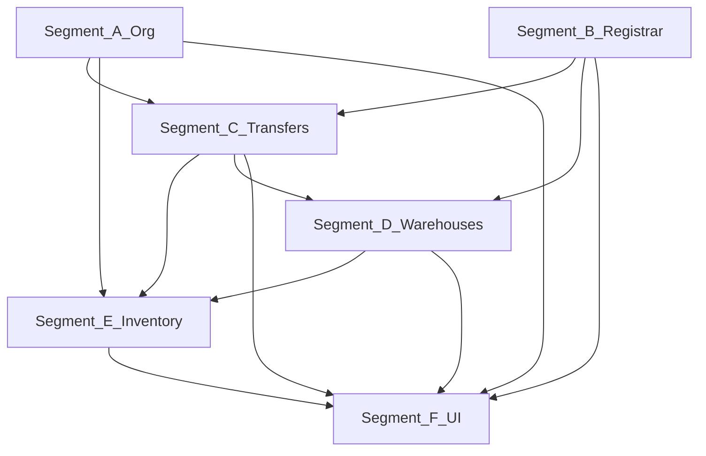

# Full Effect — plan implementacije

## Izvor i odluke

- **Izvor zahtjeva:** [.cursor/docs/full-effect.md](.cursor/docs/full-effect.md)
- **Odluke (potvrđene):**
  - Geografija: **samo `City`** (općina/mjesto — kasnija faza, ne u ovom ciklusu)
  - Org segmenti: **postojeći `OrgUnitType` + matrica parent→child** (bez `OrgUnitKind`)
  - Transferi: **prošireni workflow** (`raw` → `printed`? → `uploaded` → `potpisan`; `cancelled`; `createdBy`/`finalizedBy`; **server-side RAW PDF**)

## Trenutno stanje (gap sažetak)

| Oblast | Postoji | Gap (iz full-effect + kod) |
|--------|---------|----------------------------|
| Effective location | `effectiveLocationCityId` + `LocationResolutionService` | OK |
| Effective signer | `signerId` na `OrgUnit` | Nema `effectiveSignerId` ni backend resolution |
| Org hijerarhija | Stablo + ciklus | Nema enforce parent→child po tipu |
| Evidentičar | `UserRegistrarScope` (city + category) | Nema warehouse/org režim A/B |
| Transferi | `raw` / `potpisan`; `sign()` mijenja opremu odmah | Nema `fromWarehouseId`/`toWarehouseId`, upload ne mijenja status, nema finalize |
| Skladištar | Read samo `status=skladiste` | Nema scope po `warehouseId`, nema uništenje |
| Popis | Sesija v3, pending, close job | Freeze nepotpun; `disposal` apply throws; `sign()` za inventory line preskače freeze; članovi svi moraju user |

Referentni kod: [`transfers.service.ts`](backend/src/modules/transfers/transfers.service.ts) (sign + equipment u istoj transakciji), [`inventory-count.service.ts`](backend/src/modules/inventory-count/inventory-count.service.ts) (`Disposal apply is not implemented`), [`location-resolution.service.ts`](backend/src/common/services/location-resolution.service.ts).

---

## Organizacija plana (GlobalPlanFirst)

Novi folder (ne mijenja historiju faza 0–12):

```
.cursor/plans/full-effect/
├── 00_overview.md          # ovaj dokument (sažetak + dependency graf)
├── CHECKLIST.md            # master checkbox po segmentu/fazi
├── CHANGELOG.md
├── HANDOFF.md              # popuniti na ~80% konteksta
├── segment-a-org-foundation.md
├── segment-b-registrar.md
├── segment-c-transfers.md
├── segment-d-warehouses.md
├── segment-e-inventory-disposal.md
├── segment-f-ui-ux.md
└── phases/
    ├── 13_phase-effective-signer-hierarchy.md
    ├── 14_phase-registrar-assignments.md
    ├── 15_phase-transfer-workflow-v2.md
    ├── 16_phase-warehouse-scope-destroy.md
    ├── 17_phase-inventory-freeze-disposal.md
    └── 18_phase-ui-full-effect.md
```

Povezati s postojećim: ažurirati [.cursor/plans/inventory-v2/CHECKLIST.md](.cursor/plans/inventory-v2/CHECKLIST.md) sekcijom “Full effect (faze 13–18)” i link na `full-effect/`.

---

## Dependency graf



**Kritični put:** A → C → E → F (minimum za “potpisnik + transferi + popis rashod”). B i D mogu paralelno nakon A, prije ili uz C.

---

## Segment A — Org foundation (faza 13)

**Cilj:** Backend source-of-truth za efektivnog potpisnika i validnu hijerarhiju tipova.

### A.1 DB / Prisma

- `OrgUnit.effectiveSignerId` (nullable, FK → `Employee`)
- `@@index([effectiveSignerId])`
- Migracija: `20260603*_org_effective_signer`

### A.2 `SignerResolutionService`

- Analogno [`LocationResolutionService`](backend/src/common/services/location-resolution.service.ts):
  - `refreshOrgUnitEffectiveSigners(orgUnitId?)`
  - `getEffectiveSignerForOrgUnit(orgUnitId)`
  - `getEffectiveSignerForEmployee(employeeId)` (preko `employee.orgUnitId`)
- Poziv refresh nakon: create/update `OrgUnit` (`signerId`, `parentId`, `locationCityId` — lokacija već refresha; dodati signer refresh)

### A.3 Org units API

- `POST /org-units`: prihvatiti `locationCityId` (ako još nije u DTO)
- Nakon create/update: `refreshOrgUnitEffectiveSigners` + postojeći location refresh
- Greška ako proces traži potpisnika a nema ga u stablu: `No signer configured in org hierarchy`

### A.4 Hijerarhijska matrica + validacija

- Ažurirati [.cursor/docs/matrices/org-hierarchy/MATRIX.md](.cursor/docs/matrices/org-hierarchy/MATRIX.md):
  - Tabela dozvoljenih `parent.type → child.type` (prema full-effect § hijerarhija)
  - Edge-case: move subtree, promjena `type`, delete
- Implementirati `assertValidOrgUnitParentChild(parentType, childType)` u [`org-units.service.ts`](backend/src/modules/org-units/org-units.service.ts) na create/update

### A.5 Frontend (minimal u fazi 13)

- [`OrganizationPage.tsx`](frontend/src/components/OrganizationPage.tsx): prikaz **eksplicitni vs efektivni** potpisnik i lokacija (read-only efektivni dok se ne edituje)

### Deliverables faze 13

- Migracija + servis + integracija org-units
- Matrica + CHANGELOG
- Unit/integration: propagacija signer kao location; nedozvoljen parent→child odbijen

---

## Segment B — Evidentičar (Registrar assignments) (faza 14)

**Cilj:** Zamijeniti/proširiti `UserRegistrarScope` modelom **warehouse + category + optional orgUnit** s režimima A/B.

### B.1 Model

Novi entitet npr. `RegistrarAssignment`:

| Polje | Pravilo |
|-------|---------|
| `userId` | evidentičar |
| `warehouseId` | obavezno |
| `categoryId` | root kategorija (expanded descendants) |
| `orgUnitId` | nullable — **null = režim A**, set = **režim B** |

- `cityId` na dodjeli: **izveden** iz `warehouse.cityId` (ne primarni input)
- Migracija: kreirati tabelu; **data migration** iz `UserRegistrarScope` (city+category → warehouse po gradu — definisati mapu u seedu ili admin ručno; dokumentovati u HANDOFF)
- Deprecate/remove `UserRegistrarScope` nakon migracije podataka

### B.2 `EvidenticarScopeService` (ili proširiti `RegistrarScopeService`)

Metode:

- `canAccessEquipment(user, equipment)`
- `canAccessEmployee(user, employee)`
- `canCreateTransferType(user, transferDraft)` — zaduzenje samo režim A, itd.

Pravila iz full-effect §5.4–5.6 (tabela A/B).

### B.3 Integracija

- JWT payload / [`users.service.ts`](backend/src/modules/users/users.service.ts): učitati assignments
- [`equipment-access.util.ts`](backend/src/modules/equipment/equipment-access.util.ts), [`transfers.service.ts`](backend/src/modules/transfers/transfers.service.ts), notifications recipients
- Frontend: [`user-access-fields.tsx`](frontend/src/components/user-management/user-access-fields.tsx), [`registrar-scope.ts`](frontend/src/helpers/registrar-scope.ts) → warehouse picker + orgUnit opcionalno + objašnjenje režima

### B.4 Matrice

- [roles-access/MATRIX.md](.cursor/docs/matrices/roles-access/MATRIX.md)
- [transfers/MATRIX.md](.cursor/docs/matrices/transfers/MATRIX.md) — A/B + warehouse IDs (cross-ref faza 15)
- [equipment-status/MATRIX.md](.cursor/docs/matrices/equipment-status/MATRIX.md)
- [warehouses/MATRIX.md](.cursor/docs/matrices/warehouses/MATRIX.md) — coverage

### Deliverables faze 14

- DB + servis + admin UI + backward-compatible period (ako treba dual-read jednu fazu)

---

## Segment C — Transfer workflow v2 (faza 15)

**Cilj:** RAW → print → upload → finalize; equipment update **samo** na finalize; potpisnik iz hijerarhije; warehouse precision.

### C.1 DB / enum

Proširiti `TransferStatus`:

- `raw`, `printed`, `uploaded`, `potpisan`, `cancelled`

Polja na `Transfer`:

- `fromWarehouseId`, `toWarehouseId` (nullable, FK)
- `createdByUserId`, `finalizedByUserId` (nullable)
- Opcionalno `printedAt` za audit

Validacija: obavezno `fromWarehouseId` kad `fromType=skladiste`, `toWarehouseId` kad `toType=skladiste`.

### C.2 State machine (servis)

| Akcija | Prelaz | Equipment |
|--------|--------|-----------|
| create | → `raw` | ne |
| mark printed | `raw` → `printed` | ne |
| upload scan | → `uploaded` | ne |
| finalize | → `potpisan` | **da** (transakcija) |
| cancel | → `cancelled` | ne (samo raw/printed/uploaded) |

- Refaktor [`sign()`](backend/src/modules/transfers/transfers.service.ts) → `finalize()` s pravilom: **nema finalize bez uploada** (admin override flag u settings ili role)
- Upload endpoint: nakon uspjeha postavi `uploaded` + `scannedDocUrl`
- `signerId` na create: **resolve** preko `SignerResolutionService` po tipu transfera (full-effect §6.5)

### C.3 RAW PDF (server)

- Novi endpoint npr. `GET /transfers/:id/raw-document` (PDF stream)
- Template modul (npr. `transfer-document.pdf.util.ts`) — konzistentan layout; client print ostaje fallback
- Matrica transfers: dokumentovati dva artefakta (RAW server vs client print)

### C.4 Evidentičar + inventory cross-rules

- Enforce B.2 na create/finalize
- Inventory: transfer s `inventoryLineId` — **ne finalize** dok je sesija `active`; upload dozvoljen; equipment update u close job (faza 17)

### C.5 Frontend

- [`TransferDocumentPanel.tsx`](frontend/src/components/TransferDocumentPanel.tsx), [`TransfersPage.tsx`](frontend/src/components/TransfersPage.tsx), [`DocumentsPage.tsx`](frontend/src/components/DocumentsPage.tsx):
  - Koraci: RAW → Print → Upload → Finalize
  - Disable finalize bez uploada; badge statusa

### Deliverables faze 15

- Migracija + API + PDF + UI stepper (van popisa)
- Matrica transfers + CHANGELOG

---

## Segment D — Skladišta (faza 16)

**Cilj:** Keeper scope, rashod/uništenje faze, coverage pravila.

### D.1 Read/write scope skladištara

- [`equipment-access.util.ts`](backend/src/modules/equipment/equipment-access.util.ts): `skladistar` vidi opremu gdje `warehouseId ∈ keeper warehouses` i status:
  - `skladiste` — u svom skladištu
  - `rashodovano` + `warehouseCondition=unisteno` (ili budući status) — samo svoje skladište
- Admin vidi sve

### D.2 Coverage (Warehouse.orgUnitId)

- Dokumentovati u matrici: oprema holder u podstablu `warehouse.orgUnitId` → dozvoljeno razduženje u to skladište
- Enforce u transfer validation (razduzenje target) — uz assignment warehouse (faza 14)

### D.3 Uništenje workflow

- Faze rashoda (full-effect §7.3, §11.9):
  - Nakon odobrenja komisije rashoda: oprema **spremna za uništenje** (marker: `warehouseCondition` ili novi status — **preporuka:** zadržati `status=rashodovano` + `warehouseCondition=unisteno` kao final)
- API: `POST /warehouses/:id/destroy-equipment/:equipmentId` (keeper only)
- Audit: `InventoryLineEvent` pattern ili mala `EquipmentEvent` tabela

### D.4 Frontend

- Warehouse detail (§8.5): tab **Za uništenje** (faza 18 detaljno; stub API u 16)

### Deliverables faze 16

- Access rules + destroy API + matrice warehouses/equipment-status

---

## Segment E — Popis i rashod (faza 17)

**Cilj:** Potpuni freeze, disposal apply, komisija rashoda po opremi, usklađenost s transfer v2.

### E.1 `InventoryFreezeService`

Centralni `assertNoEquipmentMutation(equipmentId, user, action)`:

- Blokirati: prijem `skladiste`, equipment PATCH status/holder/warehouse, transfer finalize (osim inventory pipeline), zaduzenje/razduzenje/prenos van popisa
- **Ne** blokirati: `recordLine`, draft transfer create, upload na transfer s `inventoryLineId`

Integracija: [`equipment.service.ts`](backend/src/modules/equipment/equipment.service.ts), transfers create/finalize, warehouse receive (ako postoji)

### E.2 Članstvo komisije

- `validateCommitteeMembers`: **`requireUserForPresidentOnly`** (članovi mogu biti samo Employee)
- UI wizard: članovi — svi employees; predsjednik — samo users

### E.3 Linije i pending

- `InventoryLineStatus`: dodati `predlozen_rashod` (ili ekvivalent)
- Validacija: rashod samo ako oprema razdužena (na skladištu)
- Close worker: implementirati `disposal` apply → **lista kandidata**, ne odmah rashodovati opremu

### E.4 Komisija rashoda poslije popisa

- Novi model npr. `DisposalInventoryApproval` (`equipmentId`, `disposalCommissionId`, `status`, `approvedBy`, `reason`)
- Inbox predsjednika: approve/odbij po stavci
- Blokirati `rashodovanje` transfer van popisa u gradu sesije

### E.5 Close job redoslijed

1. Validacija uploada za relocate linije
2. mark_present / oštećena / nije_prisutna
3. relocate → **finalize** transfer (ne raniji sign)
4. disposal → kandidati za komisiju
5. Session zapisnik + status `closed`

### E.6 Zapisnici

- Session-level report endpoint (proširiti postojeći committee report)
- Rashod zapisnik PDF/HTML (faza 2 unutar 17 ili 18 ako veliko)

### E.7 Matrice

- [inventory-count/MATRIX.md](.cursor/docs/matrices/inventory-count/MATRIX.md)
- [disposal-commission/MATRIX.md](.cursor/docs/matrices/disposal-commission/MATRIX.md)

### Deliverables faze 17

- Freeze + disposal approvals + close worker + blokada vanpopisnog rashoda
- Test plan §11.11 iz full-effect

---

## Segment F — UI/UX (faza 18)

**Cilj:** Org-centric admin, warehouse-first evidentičar/skladištar, popis command center (§11.12).

Prioritet implementacije UI (iz full-effect §11.12.10):

1. Progress + filter “neevidentirano” na unosu linija
2. Stepper prenosnice (inventory mode) + badge-ovi
3. **Freeze banner** u [`Layout.tsx`](frontend/src/components/Layout.tsx)
4. Admin command center sesije + close job progress/errors
5. Tab **Rashod** na komisiji (kad backend E spreman)
6. Mobile kartice (`< md`) umjesto tabele linija
7. Skladištar “Za uništenje” + warehouse detail tabs

Ostalo iz §8:

- Org node: skladišta child sekcija, efektivni potpisnik/lokacija
- Dashboard evidentičara: “Moje dodjele” (warehouse+category+org)
- Oprema: treći pogled “Po skladištima”
- Socket.IO: refresh close job, disposal approvals (već postoji gateway)

Responsive: sheet/drawer na mobile za prenosnicu i modale.

---

## Redoslijed implementacije (preporučeni sprintovi)

| Sprint | Faza | Segment | Trajanje (orientac.) |
|--------|------|---------|---------------------|
| 1 | 13 | A | 2–3 dana |
| 2 | 14 | B | 3–4 dana |
| 3 | 15 | C | 4–5 dana |
| 4 | 16 | D | 2–3 dana |
| 5 | 17 | E | 5–7 dana |
| 6 | 18 | F | 5–8 dana (može podfaze 18a–18c) |

**Paralelizacija:** Nakon faze 13, faza 14 i početak 15 (schema transfer polja) mogu ići paralelno s različitim developerima; faza 17 **mora** čekati 15 (finalize/upload).

---

## Matrice — master lista izmjena

| Matrica | Segment |
|---------|---------|
| org-hierarchy | A |
| locations | A (samo ako API mijenja create) |
| roles-access | B |
| transfers | B, C, E |
| warehouses | B, D |
| equipment-status | B, D, E |
| inventory-count | E |
| disposal-commission | E |
| notifications | F (event tipovi) |

Svaka logička promjena: `MATRIX.md` + `CHANGELOG.md` (pravilo iz code-hygiene).

---

## Test plan (agregat)

- **§12** full-effect (org, warehouse, transferi)
- **§11.11** popis + rashod
- Regresija: postojeći registrar scope testovi zamijeniti assignment testovima
- E2E scenarij “godišnji popis ED”: activate → linije → upload prenosnica → close → odobrenje rashoda → uništenje

---

## HANDOFF i hygiene

- Na kraju svake faze: upis u `full-effect/CHANGELOG.md` + checkbox u `CHECKLIST.md`
- Na ~80% ukupnog posla: `full-effect/HANDOFF.md` (migracije, seed, known gaps)
- Ne commitovati `.env`; migracije deploy redom kao u postojećem [HANDOFF.md](.cursor/plans/inventory-v2/HANDOFF.md)

---

## Izvan opsega ovog ciklusa (eksplicitno)

- Municipality / Place geografija
- `OrgUnitKind` / novi tipovi za segment vs ED
- Scheduled auto-activate/close popisa 01.12–31.12 (feature flag stub OK)
- Offline unos članova bez user računa (samo employee u komisiji bez app pristupa)
