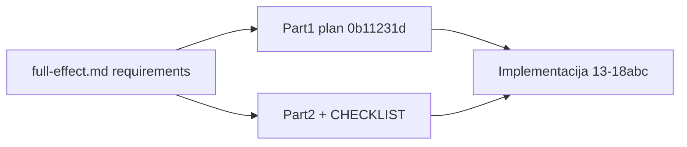

# Full Effect — Part 2 (1:1 pokrivenost + scaffold)

## Odluka

Zadržati [`.cursor/plans/full_effect_implementation_0b11231d.plan.md`](.cursor/plans/full_effect_implementation_0b11231d.plan.md) kao **Part 1** (segmenti A–F, faze 13–18, dependency graf, sprintovi).

Dodati **Part 2** + folder [`.cursor/plans/full-effect/`](.cursor/plans/full-effect/) kao **izvršni** plan: CHECKLIST sa referencama na `§` iz [`.cursor/docs/full-effect.md`](.cursor/docs/full-effect.md), detaljne faze za gapove, i manje izmjene Part 1 (pointer + obavezni deliverables koji su bili “ako veliko”).



---

## Šta kreirati (fajlovi)

| Fajl | Svrha |
|------|--------|
| `.cursor/plans/full-effect/00_overview.md` | Sažetak, dependency graf (kopija/extend Part 1), **matrica § → faza** |
| `.cursor/plans/full-effect/CHECKLIST.md` | Master checkbox lista — **svaka stavka s `full-effect §x.y`** |
| `.cursor/plans/full-effect/CHANGELOG.md` | Po fazi |
| `.cursor/plans/full-effect/HANDOFF.md` | Migracije, seed, known gaps |
| `.cursor/plans/full-effect/part2-gap-coverage.md` | Detaljni gap plan (ovaj sadržaj razrađen) |
| `.cursor/plans/full-effect/phases/13–18.md` | Razrada Part 1 po fazi + **dodatak Part 2** po fazi |
| `.cursor/plans/full-effect/phases/18a_phase-inventory-ui-core.md` | §11.12 prioritet 1–4 + 11.12.7 |
| `.cursor/plans/full-effect/phases/18b_phase-org-warehouse-ui.md` | §8, §9 (org skladišta, warehouse detail pun) |
| `.cursor/plans/full-effect/phases/18c_phase-notifications-polish.md` | §11.12.9, toast, empty states, a11y |
| `.cursor/plans/full_effect_implementation_0b11231d.plan.md` | **Edit:** na vrhu link na Part 2 + “ne duplirati CHECKLIST” |

Ažurirati [`.cursor/plans/inventory-v2/CHECKLIST.md`](.cursor/plans/inventory-v2/CHECKLIST.md): sekcija “Full effect (faze 13–18 + 18a–c)” → link na `full-effect/CHECKLIST.md`.

---

## Matrica 1:1 — `full-effect.md` → faza

| full-effect | Part 1 | Part 2 dopuna |
|-------------|--------|----------------|
| §1 Efektivni potpisnik | 13 | — (već pokriveno) |
| §2 locationCityId create | 13 | DTO/seed provjera u CHECKLIST |
| §3 Geografija općina/mjesto | **Izvan ciklusa** | Registar u `00_overview.md` § Out of scope |
| §4 Hijerarhija tipova | 13 | Edge-case testovi u CHECKLIST |
| §5 Evidentičar A/B | 14 | Data migration playbook u HANDOFF |
| §6 Transferi v2 | 15 | Settings key `transfer.allow_finalize_without_upload` (admin) |
| §6.7 Rashod kroz popis | 15+17 | Cross-ref u transfers matrici |
| §7 Skladišta | 16 | Marker `spremno_za_unistenje` prije `unisteno` (DB ili `warehouseCondition`) |
| §8 UI org-centric | 18 (djelimično) | **18b** puno |
| §9 Frontend signer/lokacija | 13+18 | 18b skladišta centralno vs org |
| §11 Popis/rashod backend | 17 | Snapshot na `activate` (opciono → **obavezno u CHECKLIST** ako želite audit) |
| §11.6–11.8 Zapisnici | 17 “ako veliko” | **Obavezno:** session report + rashod zapisnik (17 ili 18a) |
| §11.12 UI | 18 prioritet 1–7 | **18a–c** sve ostalo |
| §12 + §11.11 Test | agregat | CHECKLIST test sekcija |
| Deliverables footer | todos Part 1 | CHECKLIST duplikat sa § referencama |

---

## Part 2 — segmenti po gapu (detaljno)

### Amendments faza 13–17 (dodati u `phases/NN.md`, ne novi backend segment)

**Faza 13 (§1, §2, §4, §9 minimal)**
- [ ] `POST /org-units` DTO: `locationCityId` + test
- [ ] `OrganizationPage`: eksplicitni + efektivni potpisnik i lokacija (već u Part 1 — potvrditi u CHECKLIST)

**Faza 15 (§6)**
- [ ] Settings registry: admin override finalize bez uploada
- [ ] Dokumentovati u matrici transfers: inventory transfer ne finalize dok `session.status === active`

**Faza 16 (§7.3, §11.9)**
- [ ] Faza rashoda: `rashod_odobren` / `spremno_za_unistenje` (enum ili `warehouseCondition`) — vidljivo skladištaru prije `unisteno`
- [ ] `POST .../destroy-equipment` + audit (`EquipmentEvent` ili reuse pattern)
- [ ] Tab stub “Aktivnosti” (audit read) — implementacija u 18b

**Faza 17 (§11) — proširenje obaveznog opsega**
- [ ] `InventoryFreezeService` (već Part 1) + integracija **warehouse receive** ako postoji poseban endpoint
- [ ] `requireUserForPresidentOnly` + wizard UI (Part 1)
- [ ] `predlozen_rashod` + validacija “samo na skladištu”
- [ ] `DisposalInventoryApproval` + inbox predsjednika API
- [ ] Close job redoslijed (1–5) iz §11.7 — **bez** ranog `sign()` na inventory transfer
- [ ] **Obavezno:** `GET` session-level zapisnik (proširiti report)
- [ ] **Obavezno:** rashod zapisnik (PDF/HTML endpoint)
- [ ] Opciono ali u CHECKLIST: snapshot opreme na `activate` (`InventoryEquipmentSnapshot` ili JSON na sesiji)
- [ ] Blokada `rashodovanje` van popisa u gradu sesije
- [ ] Uključiti opremu “ranije označenu za rashod” u kandidate (query + merge)

**Izvan ciklusa** (ostaje u `00_overview.md`, ne CHECKLIST obavezno):
- §3 Municipality/Place
- `OrgUnitKind`
- Scheduled 01.12–31.12 (stub settings OK)
- Offline članovi bez user računa

---

### Faza 18a — Popis UI core (§11.12.1–4, §11.12.7, §11.12.10 stavke 1–4)

**Komponente:** [`InventoryCountPage.tsx`](frontend/src/components/InventoryCountPage.tsx), [`session-lines-panel.tsx`](frontend/src/components/inventory-count/session-lines-panel.tsx), [`inventory-committee-wizard.tsx`](frontend/src/components/inventory-count/inventory-committee-wizard.tsx), [`TransferDocumentPanel.tsx`](frontend/src/components/TransferDocumentPanel.tsx), [`Layout.tsx`](frontend/src/components/Layout.tsx)

| Zadatak | § ref |
|---------|--------|
| Progress header: `evidentirano/ukupno`, prenosnice čekaju upload, greške | 11.12.3 |
| Filteri: neevidentirano, čeka prenosnicu, failed pending | 11.12.3 |
| Bulk: označi sve prisutne (stranica) | 11.12.3 |
| Mobile `<md`: kartice + status chips (a11y radio group) | 11.12.3, 11.12.9 |
| Guided flow `promjena_lokacije` | 11.12.3 |
| Inventory stepper prenosnice: RAW → Upload → Čeka zatvaranje → Primijenjeno | 11.12.4 |
| Badge: Nema uploada / Upload OK čeka zatvaranje | 11.12.4 |
| Finalize disabled + tooltip dok active | 11.12.4 |
| Prenosnica: Sheet/Drawer na mobile | 11.12.4, responsive rule |
| Global freeze banner u Layout | 11.12.5 |
| Admin command center: agregati, period, progres po komisijama | 11.12.2 |
| Close job: progress bar + lista grešaka (klik → linija/oprema) | 11.12.2 |
| Tabela sesija: kolone Period, Progres, Komisije zatvorene/ukupno | 11.12.2 |
| Wizard: preview broja stavki, kopiraj članove u rashod, kartice Popisna/Rashod | 11.12.2 |
| Modal checklist prije “Zaključi popisnu listu” | 11.12.7 |
| Modal pregled prije “Zatvori sesiju popisa” | 11.12.7 |
| Rename akcija: zaključiti listu vs zatvoriti sesiju | 11.12.7 |
| Ukloniti “Rashod preko Prenosa”; copy za `predlozen_rashod` | 11.12.3 |
| Tab **Rashod** na komisiji (inbox predsjednika — UI na E API) | 11.12.1, 11.12.6 |
| Meni dokumenta: lista \| zapisnik popisa \| zapisnik rashoda | 11.12.6 |
| Stepper tok (admin/član) — breadcrumb ili horizontal steps | 11.12.1 |
| Dashboard člana: progress + CTA Nastavi unos | 11.12.1 |

---

### Faza 18b — Org + warehouse UI (§8, §9)

**Komponente:** [`OrganizationPage.tsx`](frontend/src/components/OrganizationPage.tsx), [`WarehousesPage.tsx`](frontend/src/components/WarehousesPage.tsx), novi `warehouse-detail` (ili proširiti postojeće), [`EquipmentPage.tsx`](frontend/src/components/EquipmentPage.tsx), [`Dashboard.tsx`](frontend/src/components/Dashboard.tsx)

| Zadatak | § ref |
|---------|--------|
| Org čvor: sekcija Skladišta (list, quick-create, link na detail) | 8.2 |
| Org čvor: link oprema u podstablu (read — scope kasnije ako nema API) | 8.2 |
| Warehouses: `orgUnitId` picker, link Oprema/Transferi u kontekstu | 8.2 |
| Warehouse detail zajednički: tabovi Na skladištu, Zaduženja/Razduženja, Rashod/Uništenje, Kontekst | 8.5 |
| Skladištar: Moja skladišta → detail | 8.4 |
| Evidentičar dashboard: Moje dodjele (warehouse+category+org) | 8.3 |
| Oprema: treći pogled Po skladištima | 8.3 |
| Transferi UI: zaduženje/razduženje po assignment (A/B) | 8.3 |
| Skladišta UI: centralno vs org-jedinica (vizuelna oznaka) | 9 |
| Freeze na Oprema/Transferi/Skladište: disabled + link Otvori popis | 11.12.5 |
| Predsjednik: pregled prenosnica tima (read-only lista) | 11.12.8 |
| Evidentičar: read-only predloženi rashod | 11.12.8 |

---

### Faza 18c — Notifikacije i polish (§11.12.9, §6.8 djelomično)

| Zadatak | § ref |
|---------|--------|
| Toast/inline umjesto `alert()` na popisu i transferima | 11.12.9 |
| Socket: close job done, disposal approval pending | 11.12.9, 06_phase |
| In-app notifikacije: `inventory_transfer_upload_pending`, `inventory_session_closed`, `disposal_approval_pending` | 11.12.9 |
| Ažurirati [`notifications` matricu](.cursor/docs/matrices/notifications/MATRIX.md) | — |
| Empty states specifične poruke po ulozi | 11.12.8 |
| `DisposalCommissionsPage`: oznaka Legacy transfer vs Popisni rashod | 11.12.1 |
| Grupisanje linija accordion po radniku/skladištu | 11.12.3 srednji |
| `DocumentsPage` / `TransfersPage`: stepper van popisa (§6.8) — ako nije 100% u 15 | 6.8 |

---

## CHECKLIST struktura (1:1)

`full-effect/CHECKLIST.md` organizacija:

```markdown
## §1 Potpisnik
- [ ] ...

## §5 Evidentičar
- [ ] ...

## §6 Transferi
- [ ] ...

## §7 Skladišta
- [ ] ...

## §11 Popis i rashod (backend)
- [ ] ...

## §11.12 UI/UX
### 18a
- [ ] ...
### 18b
- [ ] ...
### 18c
- [ ] ...

## Out of scope (registar)
- [ ] §3 ...
```

Svaki checkbox: `§x.y` + faza + fajl (backend/frontend) + matrica ako logika.

---

## Redoslijed sprintova (ažurirano)

| Sprint | Faze | Napomena |
|--------|------|----------|
| 1–5 | 13–17 | kao Part 1; 17 uključuje obavezne zapisnike |
| 6a | 18a | ovisi o 17 API (rashod tab, inbox) |
| 6b | 18b | može paralelno s 18a nakon 14+16 |
| 6c | 18c | na kraju |

**Kritični put:** 13 → 15 → 17 → 18a (popis). 14+16 → 18b (skladišta). 18c zadnji.

---

## Matrice (master — bez promjene Part 1)

Svaka logička promjena: `MATRIX.md` + `CHANGELOG.md` u odgovarajućem slug-u. Part 2 CHECKLIST referencira matricu uz svaku backend stavku.

---

## Verifikacija 1:1

Prije zatvaranja projekta full-effect:

1. Proći `full-effect.md` od §1 do Deliverables — svaka bullet mora imati checkbox u `full-effect/CHECKLIST.md` (checked ili označeno Out of scope).
2. Nijedna stavka iz §11.12.3–11.12.9 (osim out of scope) ne smije ostati samo u docs bez faze 18a–c.
3. E2E: scenarij iz Part 1 test plana + UI koraci iz 18a (upload → close → rashod → uništenje).
