# Guard audit i implementacija — matrica po matrici

## Trenutno stanje (provjereno)

`[GUARDS_REGISTRY.md](.cursor/docs/matrices/GUARDS_REGISTRY.md)` ima **sažete tabele** (~60 redova ukupno), ne puni template po akciji. Pokriva ~40% akcija iz matrica.

**Već wire-ani FE guardovi** (10 funkcija u 7 komponenti):

- `OrganizationPage` → `canDeleteOrgUnit`
- `CategoriesPage` → `canDeleteCategory`
- `LocationsPage` → `canDeleteCanton/City`
- `EquipmentPage` → `canSaveEquipmentWarehouse`
- `InventoryCountPage` → `canDeleteInventorySession/Committee`, `canActivateInventorySession`
- `WarehousesPage` → `canCreateWarehouse`

**Helperi postoje, nisu wire-ani** (P1 brzi fix):

- `[employee-guards.ts](frontend/src/helpers/guards/employee-guards.ts)` → `EmployeesPage.handleDelete`
- `[equipment-catalog-guards.ts](frontend/src/helpers/guards/equipment-catalog-guards.ts)` → `equipment-catalog-panel.handleDelete`
- `[transfer-guards.ts](frontend/src/helpers/guards/transfer-guards.ts)` → `TransfersPage.handleSubmit`

**Najveći registry gapovi** (broj akcija u MATRIX vs redova u registry):


| Modul               | MATRIX akcija (procjena) | Registry redova | Gap                |
| ------------------- | ------------------------ | --------------- | ------------------ |
| warehouse-stock     | 8+                       | 3               | Veliki             |
| maintenance-parts   | 5                        | 2               | Veliki             |
| disposal-commission | 6                        | 2               | Veliki             |
| employee-relocation | 6                        | 2               | Veliki             |
| settings            | 20+ enforcement mapa     | 2               | Veliki (referenca) |
| transfers           | 5                        | 3               | Srednji            |
| inventory-count     | 9                        | 6               | Manji              |
| install-setup       | 2                        | 0               | Nedokumentirano    |


---

## Faza A — Kompletan audit (bez koda)

**Cilj:** Zamijeniti sažete tabele u `[GUARDS_REGISTRY.md](.cursor/docs/matrices/GUARDS_REGISTRY.md)` detaljnim blokovima po template-u; dodati appendix za satelite.

### Metodologija po matrici

Za svaku akciju iz `[MATRIX.md](.cursor/docs/matrices/INDEX.md)` (ili BE servisa kad MATRIX nema eksplicitnu akciju):

```markdown
### <slug>.<akcija_slug>
- **Opis:** ...
- **Preconditions:** ...
- **Backend guard:** fajl:metoda — Status: ✓ | △ | ✗
- **Frontend guard:** komponenta/helper — Status: ✓ | △ | ✗
- **UX poruka (BS):** tačan tekst ili ključ iz *-messages.util.ts
- **Gap:** ...
- **Prioritet:** P0 | P1 | P2
- **Napomena:** edge-case iz matrice
```

**Izvori za svaku matricu** (redoslijed čitanja):

1. `.cursor/docs/matrices/<slug>/MATRIX.md`
2. Backend: `backend/src/modules/<modul>/*.service.ts` + `backend/src/common/utils/*-messages.util.ts`
3. Frontend: stranice/komponente + `frontend/src/helpers/guards/`
4. Settings: `[settings.registry.ts](backend/src/modules/settings/settings.registry.ts)` + enforcement u servisu

**Status kriteriji:**

- **BE ✓** — write endpoint poziva guard (uloga, scope, feature flag, biznis validacija)
- **BE △** — guard postoji ali poruka nije centralizovana ili edge-case nedostaje
- **FE ✓** — pre-check prije API + disable/hide + toast s BS porukom
- **FE △** — samo disable ili samo API fallback

### Redoslijed audita (19 + appendix)

```mermaid
flowchart LR
  subgraph wave1 [Wave1_Foundation]
    auth[auth-session]
    roles[roles-access]
    settings[settings]
    install[install-setup]
  end
  subgraph wave2 [Wave2_MasterData]
    org[org-hierarchy]
    loc[locations]
    wh[warehouses]
    cat[categories-fields]
  end
  subgraph wave3 [Wave3_EquipmentOps]
    eqStatus[equipment-status]
    transfers[transfers]
    whStock[warehouse-stock]
    maint[maintenance-parts]
  end
  subgraph wave4 [Wave4_Processes]
    reloc[employee-relocation]
    inv[inventory-count]
    disposal[disposal-commission]
  end
  subgraph wave5 [Wave5_Infra]
    notif[notifications]
    labels[labels]
    perf[list-performance]
    deploy[deploy-traefik]
  end
  subgraph appendix [Appendix]
    emp[employees]
    catalog[equipment-catalog]
  end
  wave1 --> wave2 --> wave3 --> wave4 --> wave5 --> appendix
```




**Očekivani broj redova u registry-u nakon audita:** ~120–150 akcija (vs ~60 sada).

#### Wave 1 — Foundation (4 matrice)

- **auth-session** — 3 akcije; verify login/refresh/logout poruke
- **roles-access** — proširiti s Regime A/B tabelom iz MATRIX (8+ modula scope map)
- **settings** — enforcement mapa: svaki `features.`* / `transfer.`* ključ → servis:metoda (referencna sekcija, ne duplicirati registry UI opise)
- **install-setup** — dodati `setup.initialize` (409 if users exist, SETUP_TOKEN)

#### Wave 2 — Master data (4 matrice)

- **org-hierarchy** — create/update/delete + parent-child matrix
- **locations** — 6 CRUD akcija + feature gate
- **warehouses** — create, keeper assign, template upload/activate, destroy equipment, freeze
- **categories-fields** — create/update/delete + leaf/unique field rules

#### Wave 3 — Equipment ops (4 matrice, najveći gap)

- **equipment-status** — PATCH, reactivate, QR, POST forbidden
- **transfers** — create/sign/upload/cancel + rashodovanje block + cross-service
- **warehouse-stock** — receive, spec PATCH, issue, commission, cross-warehouse (8+ guard redova)
- **maintenance-parts** — receive lot, install, replace, faulty, remove + category-link guard

#### Wave 4 — Processes (3 matrice)

- **employee-relocation** — open case, prebaci/razduzi/accept/reject + state machine + catalogItemId gate
- **inventory-count** — 9 akcija (session, committee, lines, disposal list, activate, close)
- **disposal-commission** — list add/remove, auto-discharge, approve/reject, reactivate link

#### Wave 5 — Infra (4 matrice)

- **notifications** — list/read/mark + realtime gate
- **labels** — QR batch + public view
- **list-performance** — dokumentirati „nema write guardova" (read-only infra)
- **deploy-traefik** — dokumentirati deploy korake (infra, bez user guardova)

#### Appendix — Sateliti (van INDEX-a)

- **employees.*** — delete (5 preconditions), create/update, org change preview; izvor: `[employees.service.ts](backend/src/modules/employees/employees.service.ts)` + `[employee-messages.util.ts](backend/src/common/utils/employee-messages.util.ts)`
- **equipment-catalog.*** — delete in-use, write feature gate; izvor: equipment-catalog servis + `[equipment-catalog-messages.util.ts](backend/src/common/utils/equipment-catalog-messages.util.ts)`

### Deliverable Faze A

- Ažuriran `[GUARDS_REGISTRY.md](.cursor/docs/matrices/GUARDS_REGISTRY.md)` — puni template po akciji
- Sažetak tablica na vrhu (P0/P1/P2 count po modulu) za brzi pregled
- **Bez izmjena koda**; CHANGELOG matrica samo ako audit otkrije grešku u MATRIX tekstu

**Checkpoint:** tvoje odobrenje prije Faze B.

---

## Faza B — Implementacija (P0 → P1 → P2)

Implementacija **nakon odobrenja kompletnog audita**, grupisana po prioritetu kroz cijeli projekat (ne po matrici).

### Val P0 — Sigurnost i lažni uspjeh/greška


| Akcija                     | Fix                                                                                                                                             |
| -------------------------- | ----------------------------------------------------------------------------------------------------------------------------------------------- |
| `employees.delete`         | Wire `canDeleteEmployee` u `[EmployeesPage.tsx](frontend/src/components/EmployeesPage.tsx)`; disable delete btn kad `!allowed`; toast prije API |
| `equipment-catalog.delete` | Wire `canDeleteCatalogItem` u catalog panel; treba `inUseCount` iz list/detail API                                                              |
| Freeze bypass provjera     | Audit BE `InventoryFreezeService` poziva na warehouse-stock issue/receive i relocation resolve — popuniti △ iz audita                           |
| DELETE prazan body         | Već fixano u `[client.ts](frontend/src/api/client.ts)` — verify ostale mutacije                                                                 |


### Val P1 — UX pre-check (API pad bez FE guarda)


| Modul               | Akcije                                                                                                    |
| ------------------- | --------------------------------------------------------------------------------------------------------- |
| transfers           | Wire `canCreateTransferType`; dodati guard za rashodovanje block i cross-service pre-check                |
| warehouse-stock     | Novi `warehouse-stock-guards.ts`: lot status za spec edit, issue qty, cross-warehouse admin+catalogItemId |
| maintenance-parts   | Novi `maintenance-parts-guards.ts`: category-link, host rashodovana, ISSUABLE/MAINTENANCE cross-reject    |
| employee-relocation | Novi guardi: `catalogItemId` za Prebaci, freeze hint (non-admin)                                          |
| disposal-commission | Guardi: draft-only list, predsjednik-only vote, remove admin-only                                         |
| inventory-count     | Dopuniti: keeper employeeId pri activate, admin excluded from line entry                                  |
| warehouses          | Destroy equipment pre-check helper (status + keeper + freeze)                                             |


**BE poruke (gdje nedostaju):** proširiti ili dodati `*-messages.util.ts` za warehouse-stock, maintenance-parts, disposal, transfers — **1:1 s FE guard porukama**.

**Pattern za svaki fix:**

1. Helper guard → disable/hide UI
2. Handler: guard check → `toastError(reason)` → early return
3. API call → `runMutationWithRefresh` (`[run-mutation-with-refresh.util.ts](frontend/src/helpers/run-mutation-with-refresh.util.ts)`)
4. Update odgovarajući red u GUARDS_REGISTRY (FE ✓)
5. Ako se logika mijenja: MATRIX CHANGELOG istog dana

### Val P2 — Konzistentnost i dokumentacija

- Tooltip na disabled dugmadima (gdje guard ima `reason`)
- `TransfersPage` / `warehouse-destruction-panel` → uskladiti s `runMutationWithRefresh`
- Settings enforcement mapa u registry — cross-check da svaki `features.`* ima `assertFeatureEnabled` (bez novih flagova)
- Ukloniti dead guard exports ili wire sve iz `index.ts`

---

## Faza C — Verifikacija

Po svakom valu:

1. Ručni smoke: pokušaj akcije koja bi trebala biti blokirana → FE toast, ne API
2. API test: FE guard zaobiđen (devtools) → BE i dalje odbija s istom BS porukom
3. Registry red ažuriran: BE ✓ FE ✓

---

## Datoteke koje će se dirati (implementacija)


| Sloj          | Fajlovi                                                                                                                                                                                  |
| ------------- | ---------------------------------------------------------------------------------------------------------------------------------------------------------------------------------------- |
| Dokumentacija | `[.cursor/docs/matrices/GUARDS_REGISTRY.md](.cursor/docs/matrices/GUARDS_REGISTRY.md)`, pojedinačni CHANGELOG samo kad logika promijeni                                                  |
| FE guardi     | `[frontend/src/helpers/guards/](frontend/src/helpers/guards/)` — novi: `warehouse-stock-guards.ts`, `maintenance-parts-guards.ts`, `employee-relocation-guards.ts`, `disposal-guards.ts` |
| FE komponente | EmployeesPage, equipment-catalog-panel, TransfersPage, warehouse-destruction-panel, inventory/disposal/relocation panele                                                                 |
| BE poruke     | `[backend/src/common/utils/](backend/src/common/utils/)` — proširenje postojećih + novi moduli                                                                                           |
| BE servisi    | samo ako audit nađe BE ✗ (očekivano rijetko — većina je FE gap)                                                                                                                          |


**Ne dirati:** `[.cursor/plans/compose_toast_matrice_714eeb6d.plan.md](.cursor/plans/compose_toast_matrice_714eeb6d.plan.md)`

---

## Procjena obima


| Faza      | Obim                                                      |
| --------- | --------------------------------------------------------- |
| A — Audit | ~120–150 guard redova u registry; 1–2 sesije čitanja koda |
| B — P0    | ~5–8 fajlova, mali diffovi                                |
| B — P1    | ~15–25 fajlova, novi guard moduli                         |
| B — P2    | polish, bez promjene logike                               |
