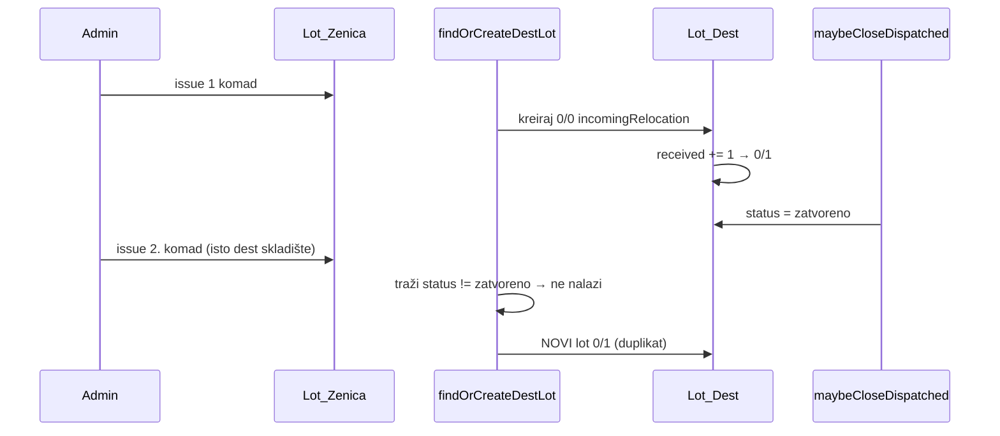
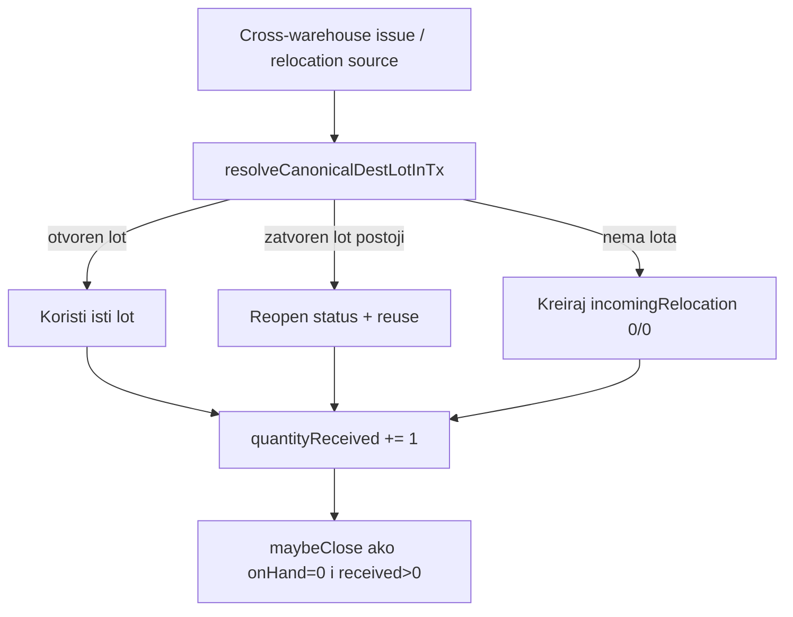

# Plan: Kanonski destinacijski lot (bez duplikata)

## Problem

Trenutni tok cross-warehouse zaduženja ([`cross-warehouse-issue.util.ts`](backend/src/modules/warehouse-stock/utils/cross-warehouse-issue.util.ts)):

Uzrok: `findOrCreateDestLotInTx` gleda samo **otvorene** lotove; nakon prvog dispatch-a `maybeCloseDispatchedRelocationLotInTx` lot zatvara.

Relocation **source transfer** ima sličan rizik jer traži samo `incomingRelocation: true` ([`employee-relocation.service.ts`](backend/src/modules/employee-relocation/employee-relocation.service.ts) ~625), pa ne nađe lot ako je `incomingRelocation` već `false` ili je `zatvoreno`.

## Ciljno ponašanje (tvoja odluka: close + reopen)

| Korak | Dest skladište |
|-------|----------------|
| 1. zaduženje korisnik 1 | lot A: `0/1`, zatvoreno |
| 2. zaduženje korisnik 2 (isto skl.) | **isti lot A**: reopen → `0/2`, zatvoreno |

## 1. Novi shared util: resolve canonical dest lot

Kreirati [`backend/src/modules/warehouse-stock/utils/resolve-canonical-dest-lot.util.ts`](backend/src/modules/warehouse-stock/utils/resolve-canonical-dest-lot.util.ts):

- Koristi postojeći [`findCanonicalStockLotInTx`](backend/src/modules/warehouse-stock/utils/find-canonical-stock-lot.util.ts) (open → zadnji closed → null)
- Ako **nema** lota → `create` kao danas (`incomingRelocation: true`, `0/0`, `ceka_specifikaciju`)
- Ako lot postoji i `status === 'zatvoreno'` → **reopen**:
  - `spremno_za_izdavanje` ako `specDefinedAt` postoji ili spec već kompletna
  - inače `ceka_specifikaciju`
- Vrati `{ lot, created: boolean, reopened: boolean }`

Ovo centralizuje logiku koja je već slična u [`apply-stock-lot-receive.util.ts`](backend/src/modules/warehouse-stock/utils/apply-stock-lot-receive.util.ts) (reopen zatvorenog) — izvući mali helper npr. `resolveReopenedLotStatus(lot)` da se ne duplira.

## 2. Refaktor cross-warehouse issue

U [`cross-warehouse-issue.util.ts`](backend/src/modules/warehouse-stock/utils/cross-warehouse-issue.util.ts):

- Zamijeniti tijelo `findOrCreateDestLotInTx` pozivom na `resolveCanonicalDestLotInTx`
- Zadržati `applyDestAcceptLotUpdatesInTx` (received `+1`, onHand `+0` za `zaduzeno`)
- **Zadržati** `maybeCloseDispatchedRelocationLotInTx` nakon incrementa (close + reopen ciklus po tvom izboru)

## 3. Refaktor employee relocation source transfer

U [`employee-relocation.service.ts`](backend/src/modules/employee-relocation/employee-relocation.service.ts) (~624–649):

- Ukloniti `findFirst` sa filterom `incomingRelocation: true`
- Koristiti isti `resolveCanonicalDestLotInTx` za destinacijsko skladište + `catalogItemId`
- Ako je lot reopen-an iz `zatvoreno`, ponovo postaviti `incomingRelocation: true` dok je linija u `pending_dest` (samo za tracking pending transfera)

`executeDestAccept` ostaje nepromijenjen — već koristi `destStockLotId` sa linije i `applyDestAcceptLotUpdatesInTx`.

## 4. Testovi

Ažurirati/dodati u [`cross-warehouse-issue.util.spec.ts`](backend/src/modules/warehouse-stock/cross-warehouse-issue.util.spec.ts):

1. **Postojeći test** “moves equipment…” — i dalje očekuje `0/1` + `zatvoreno` nakon prvog dispatch-a
2. **Novi test** “second dispatch reuses closed dest lot”:
   - Prvi dispatch → lot `lot-dest-1`, `received=1`, `zatvoreno`
   - Drugi dispatch → **isti id**, `received=2`, opet `zatvoreno`, `lotCreates.length === 1` ukupno

Dodati [`resolve-canonical-dest-lot.util.spec.ts`](backend/src/modules/warehouse-stock/utils/resolve-canonical-dest-lot.util.spec.ts):
- open lot → reuse bez create
- closed lot → reopen + reuse
- nema lota → create

Proširiti [`find-canonical-stock-lot.util.spec.ts`](backend/src/modules/warehouse-stock/utils/find-canonical-stock-lot.util.spec.ts) ako treba.

## 5. Dokumentacija (matrice)

Ažurirati:

- [`.cursor/docs/matrices/warehouse-stock/MATRIX.md`](.cursor/docs/matrices/warehouse-stock/MATRIX.md) — cross-warehouse koristi kanonski lot; zatvoreni se reopen-uje pri sljedećem dispatch-u; nema duplikata po `catalogItemId`
- [`.cursor/docs/matrices/warehouse-stock/CHANGELOG.md`](.cursor/docs/matrices/warehouse-stock/CHANGELOG.md)
- [`.cursor/docs/matrices/employee-relocation/MATRIX.md`](.cursor/docs/matrices/employee-relocation/MATRIX.md) — source transfer koristi isti kanonski lot resolver
- [`.cursor/docs/matrices/employee-relocation/CHANGELOG.md`](.cursor/docs/matrices/employee-relocation/CHANGELOG.md)

## 6. Legacy dupli lotovi (opciono, van scope-a)

Ako u bazi već postoje **više otvorenih/zatvorenih** lotova za isti `(warehouseId, catalogItemId)`, novi tok ide na kanonski (najstariji open / zadnji closed). Konsolidacija starih duplikata — zasebna admin skripta samo ako zatražiš.

## Rizici / napomene

- UI badge “Sve izdato” (`zatvoreno` + `onHand=0`) i dalje važi između dispatch-a; lot će kratko biti `zatvoreno`, pa `reopen` pri sljedećem — očekivano ponašanje.
- `receive-preview` i prijem robe već koriste `findCanonicalStockLotInTx` — nema konflikta; ista pravila match-a.
- Nema novog settings ključa.
