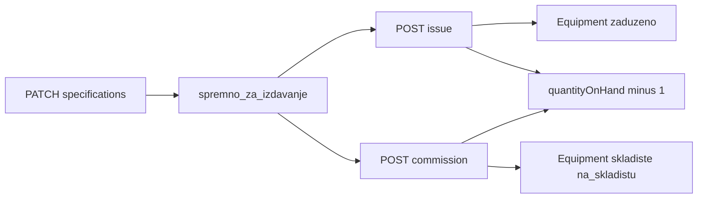

# Kolaudacija opreme iz skladišnog lota

## Kontekst

Trenutni flow evidentičara (`[registrar-stock-page.tsx](frontend/src/components/registrar-stock/registrar-stock-page.tsx)`):

1. Definiše lot specifikaciju (`PATCH /stock-lots/:id/specifications`)
2. Izdaje komad na radnika (`POST /stock-lots/:id/issue`) — obavezni `inventoryNumber` + sva `Category.fields` polja, opciono unique provjere

Nova akcija **kolaudacija** je identična po poljima, ali:

- **nema** `employeeId` / zaduženja
- **nema** `Transfer` zapisa ni generisanja prenosnice (potvrđeno)
- kreira `Equipment` direktno kao `skladiste` + `warehouseCondition: na_skladistu` na skladištu lota
- smanjuje `quantityOnHand` i zatvara lot kad stigne na 0 (isto kao issue)




## Backend

### 1. Novi DTO

`[backend/src/modules/warehouse-stock/dto/commission-stock-lot.dto.ts](backend/src/modules/warehouse-stock/dto/commission-stock-lot.dto.ts)`

```typescript
inventoryNumber: string;          // required, max 120
uniqueSpecifications: Record<string, string>;  // sva Category.fields
```

Bez `employeeId`, `date`, `signerId`.

### 2. Transakcijski util

`[backend/src/modules/warehouse-stock/utils/finalize-stock-lot-commission.util.ts](backend/src/modules/warehouse-stock/utils/finalize-stock-lot-commission.util.ts)`

Nova funkcija `executeStockLotCommissionInTx`:

- `equipment.create` sa:
  - `status: 'skladiste'`
  - `warehouseId: lot.warehouseId`
  - `warehouseCondition: 'na_skladistu'`
  - `currentHolderId: null`
  - `stockLotId`, `inventoryNumber`, `mergedSpecifications` (lot spec + unit spec)
- vraća `{ equipmentId }` (bez `transferId`)

### 3. Service metoda

U `[warehouse-stock.service.ts](backend/src/modules/warehouse-stock/warehouse-stock.service.ts)` dodati `commissionUnit(user, lotId, dto)` — kopija `issueUnit` sa izmjenama:


| Korak            | Issue                                                                 | Commission                                 |
| ---------------- | --------------------------------------------------------------------- | ------------------------------------------ |
| Feature gate     | `features.registrar_stock`                                            | isto                                       |
| Lot status/qty   | `spremno_za_izdavanje`, `quantityOnHand > 0`                          | isto                                       |
| Validacija polja | `validateIssueSpecifications` + `assertUniqueUnitSpecificationValues` | isto                                       |
| Radnik           | provjera scope-a                                                      | **preskočeno**                             |
| Cross-warehouse  | admin logika                                                          | **preskočeno**                             |
| Transfer doc     | opciono `executeStockLotIssueWithTransferInTx`                        | **uvijek** `executeStockLotCommissionInTx` |
| Freeze           | `stock_lot_issue`                                                     | isto (`stock_lot_issue`)                   |
| Lot update       | `quantityOnHand -= 1`, status                                         | isto                                       |


### 4. Controller endpoint

U `[warehouse-stock.controller.ts](backend/src/modules/warehouse-stock/warehouse-stock.controller.ts)`:

```
POST /stock-lots/:id/commission
Roles: admin, evidenticar
```

Enforcement ostaje pod postojećim `features.registrar_stock` — **bez novog settings ključa**.

## Frontend

### 1. API klijent

U `[warehouse-stock-api.ts](frontend/src/api/warehouse-stock-api.ts)`:

```typescript
commissionStockLotUnitApi(id, { inventoryNumber, uniqueSpecifications })
```

### 2. Ekstrakcija forme (code hygiene)

`[registrar-stock-page.tsx](frontend/src/components/registrar-stock/registrar-stock-page.tsx)` je ~785 linija. Izdvojiti:

`[frontend/src/components/registrar-stock/lot-unit-action-section.tsx](frontend/src/components/registrar-stock/lot-unit-action-section.tsx)`

- `mode: 'issue' | 'commission'`
- Zajednički UI: inventurni broj + `issueFields` (uključujući `IssueUniqueFieldInput` za unique polja)
- Issue-only: radnik autocomplete + cross-warehouse hint
- Props: `canSubmit`, `onSubmit`, `onCancel`, `saving`, `isFrozen`

### 3. UI na lot detailu

Kad `detail.status === 'spremno_za_izdavanje' && detail.quantityOnHand > 0`:

```
[ Izdaj 1 komad ]  [ Kolaudiraj 1 komad ]
```

- Samo jedna forma otvorena u isto vrijeme (`unitActionMode: null | 'issue' | 'commission'`)
- `canSubmitCommission` = ista logika kao `canSubmitIssue` **bez** `employeeId`
- Toast: „Komad je kolaudiran i evidentiran na skladištu“
- Page header opis proširiti: „…izdajte komade na radnike ili kolaudirajte na skladište.“

### 4. Tabela „Izdata oprema“

Za kolaudirane komade (`status === 'skladiste'`, bez `currentHolder`):

- kolona **Zadužen na**: prikazati ime skladišta lota (npr. `detail.warehouse.name`) umjesto „—“
- kolona **Status**: već prikazuje „Na skladištu“ preko `getStatusLabel('skladiste')`

## Dokumentacija (matrice)

Ažurirati istog dana:


| Fajl                                                                                                         | Šta                                                                                  |
| ------------------------------------------------------------------------------------------------------------ | ------------------------------------------------------------------------------------ |
| `[.cursor/docs/matrices/warehouse-stock/MATRIX.md](.cursor/docs/matrices/warehouse-stock/MATRIX.md)`         | Nova sekcija **Kolaudacija**; tabela uloga; validacija polja; bez prenosnice; freeze |
| `[.cursor/docs/matrices/warehouse-stock/CHANGELOG.md](.cursor/docs/matrices/warehouse-stock/CHANGELOG.md)`   | Zapis promjene                                                                       |
| `[.cursor/docs/matrices/equipment-status/MATRIX.md](.cursor/docs/matrices/equipment-status/MATRIX.md)`       | **Nastanak opreme**: drugi put — kolaudacija iz lota → `skladiste` + `na_skladistu`  |
| `[.cursor/docs/matrices/equipment-status/CHANGELOG.md](.cursor/docs/matrices/equipment-status/CHANGELOG.md)` | Zapis promjene                                                                       |


## Šta se ne mijenja

- Prisma schema — nema novih enuma/statusa
- Settings registry — koristi postojeći `features.registrar_stock`
- Cross-warehouse — ne primjenjuje se na kolaudaciju
- Transfer generacija — isključena za kolaudaciju

## Test plan (ručno)

1. Lot u `spremno_za_izdavanje` → kolaudiraj komad sa inv. brojem + unit poljima → `Equipment` status „Na skladištu“, nema radnika, nema Transfer
2. `quantityOnHand` se smanji; kad dođe na 0 lot postane `zatvoreno`
3. Unique polja i dupli inv. broj → 400/409 kao kod issue
4. Aktivni inventory freeze u gradu → blokirano
5. Izdavanje na radnika i dalje radi nezavisno
6. U tabeli izdatih komada kolaudirani komad prikazuje skladište umjesto radnika
