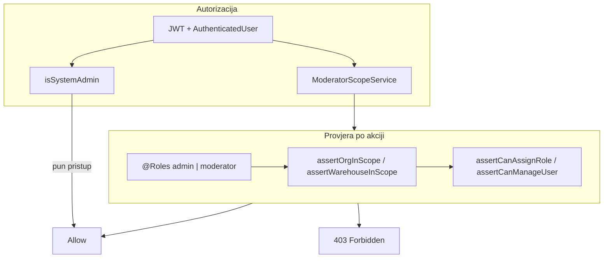

# Plan: Uloga Moderator (hibridni org-scoped operativni admin)

## 1. Cilj i principi

**Poslovni cilj:** Admin centralno drži sistem (settings, globalni popis, taksonomija); moderatori preuzimaju operativno upravljanje regijom (npr. ED Zenica + cijelo podstablo) bez preopterećenja admina hiljadama korisnika.

**Arhitektonski principi (ne pregovarati u implementaciji):**

| Princip | Pravilo |
|---------|---------|
| Dual scope | Org root(ovi) za operativni admin + warehouse dodjela za popisne komisije |
| Eksplicitna dodjela | Nikad automatski iz `employee.orgUnitId` |
| Fiksni paket | Dozvoljeno je definisano pozitivno u matrici — ne „admin minus settings“ |
| Hard deny | Settings, lokacije, kategorije, katalog, session lifecycle popisa — uvijek admin |
| Delegacija uloga | Moderator smije dodjeljivati samo `evidenticar`, `skladistar`, `popis_koordinator`, `user` |
| Jedan warehouse moderator | `@@unique([warehouseId])` na warehouse dodjeli za komisije |
| Više moderatora po regiji | Dozvoljeno na istom org rootu |
| Enforcement | Backend servis-layer scope; FE samo UX gate, ne sigurnost |



---

## 2. Podatkovni model (Prisma)

### 2.1 Enum

U [`backend/prisma/schema.prisma`](backend/prisma/schema.prisma):

```prisma
enum UserRole {
  admin
  moderator      // NOVO
  evidenticar
  popis_koordinator
  user
  skladistar
}
```

Migracija: `prisma migrate dev` (skill: prisma-mysql-workflow).

### 2.2 `ModeratorOrgAssignment`

Operativni scope (regija / distribucija + podstablo).

| Polje | Tip | Pravilo |
|-------|-----|---------|
| `id` | uuid | PK |
| `userId` | FK User | moderator mora imati `role=moderator` |
| `orgUnitId` | FK OrgUnit | root moderacije |
| `createdAt` / `updatedAt` | DateTime | audit |

- `@@unique([userId, orgUnitId])` — isti root ne duplirati
- Više rootova po korisniku = unija podstabala
- Više korisnika na istom rootu = OK
- Validacija tipa roota: dozvoljeni tipovi `distribucija`, `podrucje`, `podruznica` (ne `direkcija` osim ako admin eksplicitno dodijeli — preporuka: **default min tip = distribucija**)

### 2.3 `ModeratorWarehouseAssignment`

Popisne komisije po skladištu.

| Polje | Tip | Pravilo |
|-------|-----|---------|
| `id` | uuid | PK |
| `userId` | FK User | `role=moderator` |
| `warehouseId` | FK Warehouse | **@@unique([warehouseId])** — jedan moderator po skladištu |
| `createdAt` / `updatedAt` | DateTime | audit |

Cross-validacija pri snimanju:
- `warehouse.orgUnitId` mora biti unutar `expandOrgUnitIds(moderatorOrgRoots)` tog korisnika
- Warehouse mora biti aktivan

### 2.4 JWT / AuthenticatedUser

Proširiti [`backend/src/common/types/authenticated-user.type.ts`](backend/src/common/types/authenticated-user.type.ts):

```typescript
moderatorOrgRoots: string[];
moderatorWarehouseIds: string[];
```

U [`backend/src/modules/auth/strategies/jwt.strategy.ts`](backend/src/modules/auth/strategies/jwt.strategy.ts) učitati obje tabele uz postojeće assignment include.

---

## 3. Novi servis: `ModeratorScopeService`

Lokacija: [`backend/src/common/services/moderator-scope.service.ts`](backend/src/common/services/moderator-scope.service.ts)

Paralelan [`InventoryCoordinatorScopeService`](backend/src/common/services/inventory-coordinator-scope.service.ts) i [`OrgScopeService`](backend/src/common/services/org-scope.service.ts).

### 3.1 API metode

| Metoda | Svrha |
|--------|-------|
| `isSystemAdmin(user)` | `role === 'admin'` — zamjena za rasprostranjeni `hasFullAccess` gdje treba globalni pristup |
| `isModerator(user)` | `role === 'moderator'` |
| `hasUnscopedAccess(user)` | admin only |
| `resolveModeratorOrgUnitIds(user)` | admin → `null`; moderator → expanded union org roots; ostali → `[]` |
| `assertOrgUnitInScope(user, orgUnitId)` | 403 ako van scope |
| `assertOrgUnitIsRootOrInScope(user, orgUnitId)` | za create: parent mora biti u scope |
| `assertWarehouseInOrgScope(user, warehouseId)` | warehouse.orgUnitId ∈ scope |
| `canManageInventoryCommittee(user, warehouseId)` | admin OR (moderator AND warehouseId ∈ moderatorWarehouseIds) |
| `assertCanManageInventoryCommittee(user, warehouseId)` | 403 |
| `assertCanAssignRole(actor, targetRole)` | moderator ne smije `admin` / `moderator` |
| `assertCanManageTargetUser(actor, targetUserId)` | target mora biti „u scope“ (vidi §4.2) |
| `filterOrgUnitsForUser(user, units)` | lista/tree filtriranje |

### 3.2 Refaktor `hasFullAccess`

Postojeći stub u [`OrgScopeService`](backend/src/common/services/org-scope.service.ts) i `RegistrarScopeService.hasFullAccess` ostaju **admin-only** (registrar scope se ne miješa s moderatorom). Moderator **ne nasljeđuje** registrar scope osim ako mu se dodijeli i uloga evidentičar (zabraniti u v1 — jedan user = jedna primarna operativna admin uloga).

---

## 4. Kompletna capability matrica (svi moduli)

Legenda: **A** = admin | **M** = moderator (scoped) | **—** = nema pristupa | **R** = read scoped | **E** = postojeća operativna uloga ne dira se

### 4.1 Auth / Setup / Health / Public

| Akcija | admin | moderator | Napomena |
|--------|:-----:|:---------:|----------|
| login / refresh / logout / me | A | M | standardno |
| setup initialize | A | — | jednokratno |
| health / public equipment QR | svi | svi | javno |

### 4.2 Settings

| Akcija | admin | moderator |
|--------|:-----:|:---------:|
| GET public settings | A | M (read) |
| GET private settings | A | — |
| PATCH bilo koji key | A | — |
| Feature flag enforcement | A | po istim public flagovima kao ostale uloge |

Registry: dodati `features.moderator_role` (boolean, scope `private`, default `true`) — globalni kill-switch delegiranja; admin-only PATCH. Ažurirati [`.cursor/docs/matrices/settings/MATRIX.md`](.cursor/docs/matrices/settings/MATRIX.md).

### 4.3 Users (user-management)

| Akcija | admin | moderator | Scope / ograničenje |
|--------|:-----:|:---------:|---------------------|
| LIST / GET users | A | M | samo korisnici „u scope“ |
| CREATE user | A | M | role ∈ {evidenticar, skladistar, popis_koordinator, user} |
| UPDATE user | A | M | ne smije dodijeliti admin/moderator; ne smije mijenjati admin/moderator account |
| PATCH role na admin/moderator | A | — | |
| Dodjela registrarScopes | A | M | warehouse/org moraju biti u moderator scope |
| Dodjela coordinatorAssignments | A | M | warehouse u scope |
| Dodjela warehouse keeper | A | M | preko warehouse CRUD u scope |
| Dodjela moderatorOrgRoots / moderatorWarehouseIds | A | — | samo admin |
| Deaktivacija user | A | M | scoped target |

**Definicija „korisnik u scope“** (OR):
- `target.employee.orgUnitId ∈ expandedOrgRoots`, ili
- bilo koji `registrarAssignment.warehouseId` → warehouse.orgUnitId ∈ scope, ili
- bilo koji `coordinatorAssignment.warehouseId` ∈ scope warehouses u org scope, ili
- `WarehouseKeeper` na skladištu u scope

Controller [`users.controller.ts`](backend/src/modules/users/users.controller.ts): `@Roles(admin, moderator)` + servis filteri.

Validacija: proširiti [`users-validation.util.ts`](backend/src/modules/users/users-validation.util.ts) sa `normalizeModeratorAssignments`, `assertModeratorAssignmentsValid`, cross-check warehouse∈org.

### 4.4 Org hijerarhija

| Akcija | admin | moderator | Scope |
|--------|:-----:|:---------:|-------|
| GET flat / tree / search / one | A | M | **filtrirano** na union podstabala |
| POST create | A | M | `parentId` ∈ scope; child tip validan; ne kreirati iznad roota |
| PATCH update | A | M | čvor ∈ scope; novi parent ∈ scope; ista pravila tipova |
| DELETE | A | M | čvor ∈ scope; postojeća pravila (nema djece/zaposlenika) |
| equipment-subtree-count | A | M | scoped |

Referenca: [`org-units.service.ts`](backend/src/modules/org-units/org-units.service.ts), matrica [org-hierarchy/MATRIX.md](.cursor/docs/matrices/org-hierarchy/MATRIX.md).

**Moderator može reorganizovati stablo unutar ED Zenica** — create/move/delete dozvoljeno samo dok parent i čvor ostaju u expanded roots.

### 4.5 Lokacije (kantoni/gradovi)

| Akcija | admin | moderator |
|--------|:-----:|:---------:|
| GET cantons/cities/search | A | M (read — potrebno za forme skladišta/org) |
| POST/PATCH/DELETE | A | — |

Globalni geo šifrarnik ostaje centralizovan.

### 4.6 Kategorije opreme

| Akcija | admin | moderator |
|--------|:-----:|:---------:|
| GET tree/search/one | A | M (read) |
| POST/PATCH/DELETE | A | — |

### 4.7 Equipment catalog (šifrarnik)

| Akcija | admin | moderator |
|--------|:-----:|:---------:|
| GET | A | M (read) |
| POST/PATCH/DELETE | A | — |

### 4.8 Zaposlenici (employees)

| Akcija | admin | moderator | Scope |
|--------|:-----:|:---------:|-------|
| GET list/search/one/profile | A | M | `employee.orgUnitId ∈ scope` |
| POST create | A | M | `orgUnitId` mora biti u scope |
| PATCH update | A | M | stari i novi orgUnit u scope; relocation preview flow ostaje |
| DELETE | A | M | scoped + postojeći guardi (signer, transferi, zaduženje…) |

Ne dirati registrar read scope za evidentičar.

### 4.9 Oprema (equipment)

| Akcija | admin | moderator | MVP odluka |
|--------|:-----:|:---------:|------------|
| GET list/summary/export/one/qr/checks | A | M | **R** — read u org scope (warehouse + zaduženo u podstablu) |
| POST create | A | — | delegacija na evidentičar |
| PATCH update | A | — | delegacija na evidentičar |
| POST reactivate | A | — | admin-only |
| DELETE | A | — | admin-only |

Implementacija read scope: nova metoda `ModeratorScopeService.buildEquipmentWhere()` ili reuse org-based WHERE (oprema: warehouse.orgUnitId ∈ scope OR holder.orgUnitId ∈ scope). **Faza 6** — ne blokira MVP operativni admin.

### 4.10 Transferi / dokumenti

| Akcija | admin | moderator |
|--------|:-----:|:---------:|
| GET list/recent/one/documents | A | R (scoped read) — faza 6 |
| POST create / sign / finalize / cancel | A | — |
| cross-service | A | — |

### 4.11 Skladišta (warehouses)

| Akcija | admin | moderator | Scope |
|--------|:-----:|:---------:|-------|
| GET list/one/resolve-effective | A | M | warehouse.orgUnitId ∈ scope |
| POST create | A | M | orgUnitId ∈ scope; city postoji; keeper users scoped |
| PATCH update | A | M | scoped |
| ready-for-destruction | A | — | skladistar workflow |
| destroy-equipment | A | — | skladistar workflow |
| transfer-template upload/activate/download | A | — | admin-only (DOCX obrasci) |

### 4.12 Skladišna roba (warehouse-stock)

| Akcija | admin | moderator |
|--------|:-----:|:---------:|
| GET assigned/lots/groups | A | R scoped — faza 6 |
| POST receive/bulk | A | — (skladistar) |
| PATCH specs / issue / commission | A | — (evidenticar) |
| cross-warehouse issue | A | — |

### 4.13 Maintenance parts

| Akcija | admin | moderator |
|--------|:-----:|:---------:|
| GET * | A | R scoped — faza 6 |
| PUT category-links | A | — |
| POST install / PATCH faulty / remove / replace | A | — (evidenticar) |

### 4.14 Employee relocation

| Akcija | admin | moderator |
|--------|:-----:|:---------:|
| GET preview / admin-alerts | A | — |
| GET cases/lines/events | A | R scoped — faza 6 |
| PATCH source/dest resolve | A | — (evidenticar) |
| PATCH map-catalog | A | — |

Org promjena radnika (employees PATCH) moderator radi; relocation case se automatski otvara — OK.

### 4.15 Popis (inventory-count) — kritično

| Akcija | admin | moderator (warehouse dodjela) | popis_koordinator |
|--------|:-----:|:-----------------------------:|:-----------------:|
| POST create session | A | — | — |
| POST ensure-draft / reconcile-slots | A | — | — |
| PATCH activate session | A | — | — |
| PATCH close session | A | — | — |
| DELETE session | A | — | — |
| GET sessions/committees (read) | A | M | E |
| GET setup-options / session-warehouses | A | M | E |
| POST/PATCH/DELETE committees | A | **M** (`canManageInventoryCommittee`) | E |
| POST committee lines / PATCH close committee | — | — | E (evidenticar/user članovi) |
| Inventory warehouse committees (skladistar lines) | skladistar | — | — |

**Odluka:** Moderator **zamjenjuje potrebu za popis_koordinator** na warehouse dodjeli za konfiguraciju komisija. Uloga `popis_koordinator` ostaje za delegaciju (moderator kreira takve korisnike). [`InventoryCoordinatorScopeService.canManageWarehouse`](backend/src/common/services/inventory-coordinator-scope.service.ts) proširiti:

```typescript
return admin || (popis_koordinator && assigned) || (moderator && warehouseInModeratorAssignments);
```

Session visibility za moderatora: sesije gdje `session.orgUnitId ∈ org scope` **ILI** session ima slot na `moderatorWarehouseIds`.

Withdraw disposal list, close session — ostaje admin.

### 4.16 Komisija rashoda / disposal list

| Akcija | admin | moderator |
|--------|:-----:|:---------:|
| GET disposal-commissions registry | A | R (city/org scope) |
| POST disposal-list mark | A | — (evidenticar) |
| DELETE disposal-list withdraw | A | — |
| disposal inbox / review approval | A | — (predsjednik komisije / evidenticar) |

Moderator **konfiguriše članove** disposal komisije kroz inventory committee wizard (POST/PATCH committees) — ne direktan CRUD na `DisposalCommission`.

### 4.17 Uploads / Notifications / Nav / Labels / QR

| Modul | moderator |
|-------|-----------|
| uploads | kao user/evidenticar prema kontekstu akcije — bez novih write puteva u MVP |
| notifications | own user — bez promjene |
| nav/module-badges | proširiti badge logiku za moderator scoped counts |
| labels/QR | read own + scoped equipment read faza 6 |

### 4.18 Dashboard / kontrolna tabla

| Akcija | admin | moderator |
|--------|:-----:|:---------:|
| GET equipment summary | A | R scoped — faza 6 |
| FE dashboard page | A | M (nav + scoped widgets) |

---

## 5. Frontend plan

### 5.1 Tipovi i role helpers

- [`frontend/src/types.ts`](frontend/src/types.ts): dodati `moderator` u `UserRole`
- [`frontend/src/store.ts`](frontend/src/store.ts): `isModerator()`, `getUserRole()`
- [`frontend/src/components/user-management/user-role-config.tsx`](frontend/src/components/user-management/user-role-config.tsx): nova uloga + opis + **dva assignment bloka**:
  1. Org rootovi (multi-select tree, min 1)
  2. Skladišta za popisne komisije (multi-select, prikazati upozorenje „1 moderator po skladištu“)

### 5.2 Navigacija i pristup stranicama

Ažurirati [`frontend/src/routes/role-page-access.ts`](frontend/src/routes/role-page-access.ts):

| Page | moderator |
|------|-----------|
| `organization` | ✅ scoped |
| `employees` | ✅ |
| `warehouses` | ✅ |
| `user-management` | ✅ scoped |
| `inventory-count` | ✅ (committee config only UX) |
| `disposal-commissions` | ✅ read |
| `dashboard`, `equipment`, … | faza 6 read |
| `locations`, `categories`, `settings` | ❌ |

[`frontend/src/components/app-sidebar-nav.tsx`](frontend/src/components/app-sidebar-nav.tsx): nova sekcija **„Regionalna administracija“** ili proširiti Šifarnici za moderator (bez locations/categories/settings).

`LayoutNavGate` + `PAGE_FEATURE_SETTING_KEY`: nema novog public page flag-a osim `features.moderator_role` kill-switch (backend assert na moderator mutacijama).

### 5.3 User management UI (admin + moderator)

- Admin vidi sve; moderator vidi filtrirani list API
- Admin-only polja: moderator assignments, role admin/moderator
- Org tree picker ograničen na moderator roots (FE mirror + BE validacija)
- Warehouse picker za komisije: samo skladišta u org scope; prikaz zauzetih skladišta (unique constraint)

### 5.4 Organization page

- Moderator vidi **samo podstablo** (BE filtriran tree)
- Create/edit/delete omogućeno unutar scope — postojeći FE guardi + BE

### 5.5 Inventory-count page

- Sakriti: create session, activate, close, delete session, reconcile
- Prikazati: committee setup za warehouse slotove u `moderatorWarehouseIds`
- UX label: „Moderator skladišta: {name}“

---

## 6. Faze implementacije

### Faza 0 — Ugovor i matrice (1–2 dana)

**Isporuka:** [`.cursor/docs/matrices/moderator/MATRIX.md`](.cursor/docs/matrices/moderator/MATRIX.md) + CHANGELOG; ažurirati [`roles-access/MATRIX.md`](.cursor/docs/matrices/roles-access/MATRIX.md), [`GUARDS_REGISTRY.md`](.cursor/docs/matrices/GUARDS_REGISTRY.md), [`inventory-count/MATRIX.md`](.cursor/docs/matrices/inventory-count/MATRIX.md).

Sadržaj matrice: copy §4 ove tabele + edge-caseovi (donosi se u implementaciju).

### Faza 1 — Foundation (schema + scope servis)

**Fajlovi:**
- `schema.prisma` — enum + 2 tabele
- `moderator-scope.service.ts` + spec
- `authenticated-user.type.ts`, `jwt.strategy.ts`
- `users-validation.util.ts` — moderator assignment validacija
- `settings.registry.ts` — `features.moderator_role`
- Common helper: `isSystemAdmin()` u jednom mjestu (opciono `authorization.util.ts`)

**Testovi:** unit testovi za expand union roots, warehouse uniqueness, cross org↔warehouse, `assertCanAssignRole`.

### Faza 2 — Users modul (delegiranje korisnika)

**Fajlovi:**
- [`users.controller.ts`](backend/src/modules/users/users.controller.ts) — `@Roles(admin, moderator)`
- [`users.service.ts`](backend/src/modules/users/users.service.ts) — scoped find/create/update, assert target in scope
- DTO: `moderatorOrgRoots`, `moderatorWarehouseIds` (admin-only polja na create/update)

**Testovi:** moderator ne može kreirati admin; ne vidi user van scope; registrar assignment van scope odbijen.

### Faza 3 — Org + Employees + Warehouses

**Backend:**
- [`org-units.controller.ts`](backend/src/modules/org-units/org-units.controller.ts) + service — filter + assert scope na write
- [`employees.controller.ts`](backend/src/modules/employees/employees.controller.ts) + service
- [`warehouses.controller.ts`](backend/src/modules/warehouses/warehouses.controller.ts) + service

**Frontend:**
- OrganizationPage scoped tree
- EmployeesPage / WarehousesPage — write akcije za moderator
- Guards: `canDeleteOrgUnit` ostaje; dodati scope check wrapper

### Faza 4 — Popisne komisije (warehouse moderator)

**Backend:**
- [`inventory-count.controller.ts`](backend/src/modules/inventory-count/inventory-count.controller.ts) — dodati `moderator` na committee endpoints
- [`inventory-count.service.ts`](backend/src/modules/inventory-count/inventory-count.service.ts) — `assertCanManageInventoryCommittee` umjesto samo coordinator
- Proširiti `InventoryCoordinatorScopeService` ili delegirati na `ModeratorScopeService`
- Session list filter za moderatora

**Frontend:**
- Inventory-count: committee panel za moderator; sakriti session lifecycle

**Testovi:** dva moderatora na isto skladište → 409; warehouse van org scope → 400.

### Faza 5 — User management FE + nav

- user-role-config, UserFormModal assignment UI
- role-page-access, app-sidebar-nav
- Moderator badge u nav (opciono)

### Faza 6 — Read-only operativni pregled (opciono, ali preporučeno)

Scoped read: equipment list, transfers list, dashboard summary, disposal-commissions list, employee-relocation list.

`ModeratorScopeService.build*Where` helperi — ne duplirati registrar logiku; org-subtree based read.

### Faza 7 — Hardening

- Audit log tabela `ModeratorAuditLog` (opciono v1.1): actorId, action, entityType, entityId, payload JSON
- E2E smoke: moderator ED Zenica kreira službu → radnika → user evidentičar → warehouse → committee setup
- Security review: grep `UserRole.admin` — svaki endpoint klasificirati admin-only vs moderator-eligible
- Dokumentacija HANDOFF

---

## 7. Edge-caseovi (obavezno u matrici)

| Scenario | Ponašanje |
|----------|-----------|
| Moderator pokuša dodati parent org izvan svog roota | 403 |
| Move org čvor preko granice scope | 403 |
| Drugi moderator već na skladištu | 409 Conflict |
| Warehouse bez orgUnitId | ne može se dodijeliti moderator warehouse dodjeli |
| Admin deaktivira moderatora | assignments ostaju u DB ali JWT ne učitava (isActive check postoji) |
| Globalno otvorena popis sesija | moderator vidi ali ne aktivira |
| `features.moderator_role=false` | svi moderator write API → 403 feature disabled |
| Moderator + evidenticar na istom useru | **zabraniti u v1** (validation) |
| Brisanje org roota koji je moderator assignment | zabrana dok postoji assignment |
| Brisanje warehouse s moderator assignment | cascade ili zabrana — **zabrana brisanja** dok postoji assignment |

---

## 8. Checklist pokrivenosti modula (audit)

Svi backend moduli iz inventure:

- [x] auth, setup, health, public equipment
- [x] settings
- [x] users
- [x] org-units
- [x] locations
- [x] categories
- [x] equipment-catalog
- [x] employees
- [x] equipment
- [x] transfers
- [x] warehouses (+ transfer templates)
- [x] warehouse-stock
- [x] maintenance-parts
- [x] uploads
- [x] notifications
- [x] employee-relocation
- [x] inventory-count (+ list + warehouse committees)
- [x] disposal-commissions
- [x] nav

Svi frontend PageId:

- [x] organization, employees, warehouses, user-management, inventory-count, disposal-commissions
- [x] dashboard/equipment/transfers/documents/registrar-stock/employee-relocation (faza 6 read)
- [x] locations, categories, settings — eksplicitno isključeno

---

## 9. Rizici i mitigacija

| Rizik | Mitigacija |
|-------|------------|
| Propustiti admin-only endpoint | Faza 7 grep audit + guard registry |
| Dupla logika scope | Jedan `ModeratorScopeService`, ne `@Roles(admin)` copy-paste |
| UX konfuzija moderator vs popis_koordinator | Jasne labele; moderator warehouse dodjela = committee config |
| Performanse list filter | Indeksi na `Employee.orgUnitId`, `Warehouse.orgUnitId`; paginacija |
| Scope creep (equipment write) | MVP eksplicitno read-only; write samo kroz evidentičar |

---

## 10. Ključne reference u kodu

- Postojeći coordinator pattern: [`inventory-coordinator-scope.service.ts`](backend/src/common/services/inventory-coordinator-scope.service.ts)
- Org expand: [`org-scope.service.ts`](backend/src/common/services/org-scope.service.ts) `expandOrgUnitIds`
- User validation pattern: [`users-validation.util.ts`](backend/src/modules/users/users-validation.util.ts)
- Role FE gate: [`role-page-access.ts`](frontend/src/routes/role-page-access.ts)
- Popis matrica: [`.cursor/docs/matrices/inventory-count/MATRIX.md`](.cursor/docs/matrices/inventory-count/MATRIX.md)
