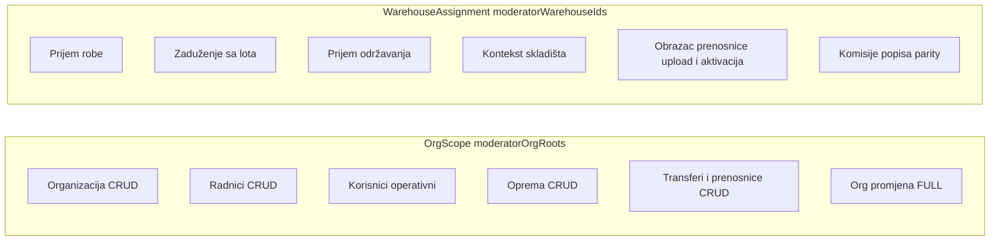

# Moderator — scoped admin prava

## Scope model (dva osa)

| Osa | Izvor | Šta pokriva |
|-----|-------|-------------|
| **Org scope** | `ModeratorOrgAssignment` → expand podstablo | Org jedinice, radnici, korisnici (operativne uloge), oprema, transferi, org promjena |
| **Warehouse assignment** | `ModeratorWarehouseAssignment` (1:1) | Prijem/issue lotova, održavanje, kontekst skladišta, **obrazac prenosnice (upload + aktivacija)**, komisije popisa |

### Pravila opreme (org scope + edge-case)

Kanonski filter (read **i** write) u [`moderator-scope.service.ts`](backend/src/common/services/moderator-scope.service.ts):

- `currentHolder.orgUnitId ∈ expandedOrgRoots` — **bilo koji status** (zaduženo, rashodovano, …)
- **ILI** `equipment.warehouseId ∈ moderatorWarehouseIds` — oprema na dodijeljenom skladištu (npr. `skladiste`)
- **ILI** `equipment.warehouse.orgUnitId ∈ expandedOrgRoots` — oprema na skladištu u org podstablu

**Lotovi:** vidljivi/mutabilni **samo** na `moderatorWarehouseIds`. Radnik u ED Zenica čiji je efektivni skladište drugo dodijeljeno skladište → vidi opremu u „Sva oprema”, ali **ne** vidi lotove tog skladišta ako nije u `moderatorWarehouseIds`.

Centralizovati u:
- `buildEquipmentScopeWhere()` — zamjena za `buildEquipmentReadWhere`
- `assertEquipmentInScope(user, equipmentId | equipment+holder)`
- `assertWarehouseAssigned(user, warehouseId)` — za stock/maintenance/context

---

## Faza 0 — Matrice i registry

Ažurirati [`.cursor/docs/matrices/moderator/MATRIX.md`](.cursor/docs/matrices/moderator/MATRIX.md) i [`CHANGELOG.md`](.cursor/docs/matrices/moderator/CHANGELOG.md):

- Ukloniti „Skladišta CRUD (create)” za moderatora
- Dodati warehouse-assignment operacije (uključujući **transfer template upload/activate** na dodijeljenom skladištu) i equipment/transfer FULL write u org scope
- Ukloniti transfer template iz „hard deny” liste za moderatora (ostaje scoped na `moderatorWarehouseIds`)
- Popis: parity sa `popis_koordinator` (bez session lifecycle)
- Org promjena: FULL unutar scope-a

Provjeriti da [`features.moderator_role`](backend/src/modules/settings/settings.registry.ts) ostaje enforcement gate.

---

## Faza 1 — `ModeratorScopeService` (backend core)

Fajl: [`backend/src/common/services/moderator-scope.service.ts`](backend/src/common/services/moderator-scope.service.ts)

1. `assertWarehouseAssigned()` — `moderatorWarehouseIds.includes(warehouseId)` + org cross-validacija (već postoji u validaciji assignments)
2. `buildEquipmentScopeWhere()` — objedinjeni Prisma `where` (trenutni `buildEquipmentReadWhere` + warehouse assignment grana)
3. `assertEquipmentInScope()` — za write/delete/reactivate
4. `assertEmployeeInScope()` — za issue/transfer ciljeve
5. `canAccessTransfer()` / `assertCanAccessTransfer()` — premjestiti logiku iz `transfers.service.ts` + `registrar-scope` (fix bug: moderator danas vidi listu ali `GET /transfers/:id` vraća 403)

Unit testovi u [`moderator-scope.service.spec.ts`](backend/src/common/services/moderator-scope.service.spec.ts) za edge-case (radnik u scope, efektivno skladište drugdje, lot samo na assigned WH).

---

## Faza 2 — Skladište (samo assigned, bez create)

### Backend

| Fajl | Promjena |
|------|----------|
| [`warehouses.controller.ts`](backend/src/modules/warehouses/warehouses.controller.ts) | Ukloniti `moderator` sa `POST /warehouses`; **dodati `moderator`** na transfer-template endpointe: `GET transfer-templates`, `POST transfer-template`, `PATCH .../activate`, `GET .../download` |
| [`warehouse-transfer-template.service.ts`](backend/src/modules/warehouses/warehouse-transfer-template.service.ts) | U `uploadTemplate` / `activateTemplate` / `listTemplates` / `downloadTemplate`: za moderatora pozvati `assertWarehouseAssigned` prije mutacije |
| [`warehouses.service.ts`](backend/src/modules/warehouses/warehouses.service.ts) | `PATCH` dozvoljen u org scope; context polja samo ako `assertWarehouseAssigned` |
| [`warehouse-stock.controller.ts`](backend/src/modules/warehouse-stock/warehouse-stock.controller.ts) | Dodati `moderator` na GET stock-lots, receive, bulk, preview, issue |
| [`warehouse-stock.service.ts`](backend/src/modules/warehouse-stock/warehouse-stock.service.ts) | `assertCanAccessWarehouse/Lot`: moderator → `assertWarehouseAssigned`; `receive*` role guard proširiti; `issueUnit`: dozvoliti moderator + `assertWarehouseAssigned` + `assertEmployeeInScope` na `toPersonId` (bez registrar assignment) |
| [`maintenance-parts.controller.ts`](backend/src/modules/maintenance-parts/maintenance-parts.controller.ts) + service | `moderator` na read/receive za assigned WH |

### Frontend

| Fajl | Promjena |
|------|----------|
| [`WarehousesPage.tsx`](frontend/src/components/WarehousesPage.tsx) | Ukloniti „Novo skladište” tab za moderatora; `canReceiveStock = admin \|\| skladistar \|\| (moderator && assigned)` |
| [`warehouse-detail-view.tsx`](frontend/src/components/warehouses/warehouse-detail-view.tsx) | Proslijediti `canReceive`/`canEditContext` samo za assigned WH |
| [`warehouse-context-panel.tsx`](frontend/src/components/warehouses/warehouse-context-panel.tsx) | Učitati keepers i za moderatora; **prikazati `WarehouseTransferTemplatePanel`** kada je `canEditContext && isAssignedWarehouse` (ne samo `admin`) |
| [`warehouse-transfer-template-panel.tsx`](frontend/src/components/warehouses/warehouse-transfer-template-panel.tsx) | Bez role guarda unutra (parent prosleđuje vidljivost); upload + activate ostaju dostupni moderatoru na assigned WH |

---

## Faza 3 — Oprema FULL CRUD (org scope)

### Backend

| Fajl | Promjena |
|------|----------|
| [`equipment-access.util.ts`](backend/src/modules/equipment/equipment-access.util.ts) | `assertCanWriteEquipment`: moderator → `assertEquipmentInScope` umjesto hard deny |
| [`equipment.controller.ts`](backend/src/modules/equipment/equipment.controller.ts) | Dodati `moderator` na POST/PATCH/export/check/qr; reactivate+DELETE: moderator u scope (admin-parity unutar scope) |
| [`equipment.service.ts`](backend/src/modules/equipment/equipment.service.ts) | List/find koriste `buildEquipmentScopeWhere`; create provjerava warehouse/holder u scope |

### Frontend

| Fajl | Promjena |
|------|----------|
| [`EquipmentPage.tsx`](frontend/src/components/EquipmentPage.tsx) | `canManage = admin \|\| evidenticar \|\| moderator`; `canReceiveStock` za moderator na assigned WH |
| [`role-page-access.ts`](frontend/src/routes/role-page-access.ts) | Bez promjene stranica (već ima equipment) |

---

## Faza 4 — Transferi i prenosnice FULL (org scope)

### Backend

| Fajl | Promjena |
|------|----------|
| [`transfers.controller.ts`](backend/src/modules/transfers/transfers.controller.ts) | Dodati `moderator` na POST, dokumente, mark-printed, cancel, sign, finalize |
| [`transfers.service.ts`](backend/src/modules/transfers/transfers.service.ts) | `canAccessTransfer` → moderator branch; `create`/mutacije → `assertEquipmentInScope` + employee scope; cross-service: dozvoliti moderatoru ako su obje strane u org scope (inače 403 kao admin) |

### Frontend

| Fajl | Promjena |
|------|----------|
| [`TransfersPage.tsx`](frontend/src/components/TransfersPage.tsx) | `canManage = admin \|\| evidenticar \|\| moderator`; gate na Zaduži/Prenos/Razduži |
| Documents ruta | Već u `MODERATOR_READ_PAGES` — omogućiti akcije ako postoje write kontrole |

---

## Faza 5 — Org promjena FULL (org scope)

### Backend

| Fajl | Promjena |
|------|----------|
| [`employee-relocation.controller.ts`](backend/src/modules/employee-relocation/employee-relocation.controller.ts) | Dodati `moderator` na preview, admin-alerts (scoped), events, source/dest patch, map-catalog |
| [`employee-relocation.service.ts`](backend/src/modules/employee-relocation/employee-relocation.service.ts) | `assertSourceRegistrar`/`assertDestRegistrar`: bypass za moderator u scope; `mapLineCatalog`: moderator + scope check na case; `getAdminAlerts`: filtrirati po org scope |

### Frontend

Org promjena stranica — prikazati admin akcije za moderatora (map-catalog, preview) gdje API dozvoljava.

---

## Faza 6 — Popis i rashod = `popis_koordinator` parity

**Bez** session lifecycle (create/activate/close/delete/reconcile) — potvrđeno.

### Popravke postojećih rupa

| Fajl | Promjena |
|------|----------|
| [`inventory-count.service.ts`](backend/src/modules/inventory-count/inventory-count.service.ts) | `deleteCommittee`: dozvoliti moderator (trenutno route OK, service hardcoded admin) |
| [`inventory-count.controller.ts`](backend/src/modules/inventory-count/inventory-count.controller.ts) | `print-scope`, `report`, `close-job` za moderator na assigned WH |
| [`inventory-count-list.controller.ts`](backend/src/modules/inventory-count/inventory-count-list.controller.ts) | Dodati `moderator` na read endpointe |
| Disposal-list endpointi | **Ne** dodavati moderatora (to je evidenticar workflow; koordinator parity) |

### Frontend

[`InventoryCountPage.tsx`](frontend/src/components/InventoryCountPage.tsx): već `canManageCommittees`; osigurati `canDeleteCommittees` i lifecycle UI ostaju **admin-only**; committee delete omogućiti moderatoru.

---

## Faza 7 — Org / Radnici / Korisnici (već uglavnom OK)

| Modul | Akcija |
|-------|--------|
| Org jedinice | Zadržati: moderator ne kreira root bez `parentId` |
| Radnici | Već CRUD scoped — verifikacija |
| Korisnici | Već scoped + role ceiling (`admin`/`moderator` zabranjeni) — bez promjene |

---

## Faza 8 — Testovi i verifikacija

- Proširiti [`moderator-scope.service.spec.ts`](backend/src/common/services/moderator-scope.service.spec.ts)
- Dodati integracione testove: warehouse-stock issue za moderatora, transfer create, equipment write
- `npm run build` backend + frontend
- Ručni smoke: moderator ED Zenica + Skladište ED Zenica

---

## Šta moderator i dalje NE može (namjerno)

- Kreiranje skladišta
- Lokacije / kategorije / katalog — write
- Settings private
- Transfer template na skladištima **izvan** `moderatorWarehouseIds`
- Session lifecycle popisa
- Disposal-list (evidenticar workflow)
- Kreiranje `admin` / `moderator` korisnika
- `moderator + evidenticar` na istom nalogu (v1)
