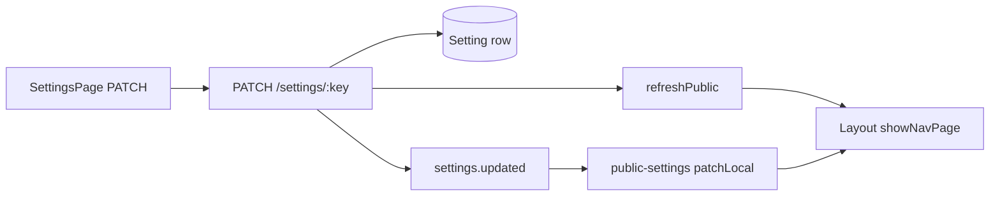
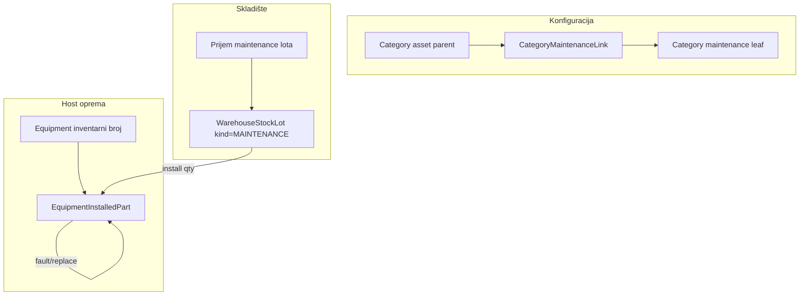
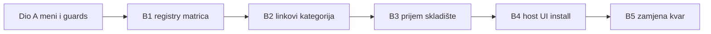

# Plan: Postavke menija + modul opreme za održavanje

## Dio A — Isključeni moduli moraju nestati iz menija

### Šta kod već radi (i gdje je praznina)

Navigacija koristi `showNavPage` → [`isNavPageEnabled`](frontend/src/utils/settings-feature.util.ts) → mapiranje u [`PAGE_FEATURE_SETTING_KEY`](frontend/src/utils/page-feature-settings.util.ts) (`disposal-commissions` → `features.disposal_commissions`, `inventory-count` → `features.inventory_count`). QR skener koristi isti mehanizam; stranica dodatno provjerava flag u [`QRScannerPage.tsx`](frontend/src/components/QRScannerPage.tsx).

**Vjerovatni uzroci** zašto „Komisija rashod” / „Popis” ostaju vidljivi iako QR nestane:

| Uzrok | Objašnjenje |
|--------|-------------|
| Fallback `true` kad ključ nedostaje u mapi | [`isSettingFlagEnabled`](frontend/src/utils/settings-feature.util.ts) vraća `true` ako `settings[key]` nije boolean — prazan kontekst nakon greške učitavanja ili prije `ensureDefaults` tretira modul kao uključen |
| Nema `patchLocal` pri snimanju | [`settings-page.tsx`](frontend/src/components/settings/settings-page.tsx) radi samo `refreshPublic()`; bez socket-a ili sporog refresh-a meni kasni |
| Sekundarni ulazi bez gate-a | [`Dashboard.tsx`](frontend/src/components/Dashboard.tsx), [`inventory-freeze-banner.tsx`](frontend/src/components/inventory-count/inventory-freeze-banner.tsx), [`inventory-freeze-action-hint.tsx`](frontend/src/components/inventory-count/inventory-freeze-action-hint.tsx) zovu `onNavigate('inventory-count')` bez provjere flaga |
| Podmeni Oprema | U [`Layout.tsx`](frontend/src/components/Layout.tsx) stavke „Sva oprema” / „Po kategorijama” imaju `visible={true}` umjesto `showNavPage(...)` |
| Backend read bez guard-a | [`disposal-commissions.service.ts`](backend/src/modules/disposal-commissions/disposal-commissions.service.ts) `findAll` nema `assertFeatureEnabled`; [`inventory-count.service.ts`](backend/src/modules/inventory-count/inventory-count.service.ts) `findSessionsForUser`, `getFreezeBannerForUser`, `findCommittees` također — API i banner ostaju funkcionalni čak i kad je modul „isključen” |

**Napomena za test:** u postavkama su različiti labeli — „Inventurni popis” (`features.inventory_count`, meni **Popis**) vs „Popis skladišta” (`features.warehouse_inventory`, meni skladištara). Provjera treba ići na tačan switch.

### Predložene izmjene (mali, fokusirani diff)

1. **Jači contract za feature flagove**
   - U [`public-settings-context.tsx`](frontend/src/contexts/public-settings-context.tsx) ili util: pri učitavanju spojiti registry defaulte za sve `features.*` ključeve (iz shared konstante ili duplog exporta labela) tako da nedostajući DB red ne znači „uključeno”.
   - U [`settings-page.tsx`](frontend/src/components/settings/settings-page.tsx): nakon uspješnog PATCH-a odmah `patchLocal(row.key, value)` (isto kao socket), pa `refreshPublic()`.

2. **Jedan hook za UI** — npr. `useIsPageEnabled(pageId)` koji koriste Layout, Dashboard, freeze banner/hint, podmeni opreme.

3. **Backend defense-in-depth**
   - `DisposalCommissionsService`: guard na sve javne metode (uključujući `findAll`, `resolve`, inbox).
   - `InventoryCountService`: guard na `findSessionsForUser`, `getFreezeBannerForUser`, `findCommittees` i ostale read/mutate putanje.
   - Ažurirati [`.cursor/docs/matrices/settings/MATRIX.md`](.cursor/docs/matrices/settings/MATRIX.md) + CHANGELOG.

4. **Regresioni test plan (ručno)**
   - Admin: isključi „Komisija za rashod” i „Inventurni popis” → stavke nestanu iz sidebara; direktna navigacija (`handleNavigate`) ne otvara stranicu; `LayoutNavGate` prikaže `ModuleDisabledState`.
   - Evidentičar: isto za Popis; linkovi na dashboardu/freeze hintu nestanu.
   - Uključi QR skener off/on kao referenca ponašanja.

---

## Dio B — Modul opreme za održavanje (evidencija + stvarni događaji)

### Poslovni model (sa vašom odlukom o linku)

- **Host kategorija (asset parent)**, npr. „Računarska oprema”, definiše **katalog maintenance podkategorija** (SSD, RAM, toner…) preko veze **parent asset ↔ leaf maintenance**.
- **Scope**: katalog i akcije vidljive samo evidentičaru koji ima [`RegistrarAssignment`](backend/prisma/schema.prisma) za **(warehouseId, hostCategoryId)** — ista logika kao izdavanje iz [`WarehouseStockLot`](backend/prisma/schema.prisma) / registrar-stock; nema globalnog pristupa svim dijelovima.
- **Kancelarijski namještaj**: bez linka → nema UI za ugradnju; maintenance kategorije se ne nude na tom hostu.
- **Host oprema**: postojeći [`Equipment`](backend/prisma/schema.prisma) sa inventurnim brojem (npr. radna stanica).
- **Roba na skladištu**: količinski lot (bez izdavanja novih `Equipment` komada), legacy polja iz maintenance kategorije (`fields` / `optionalFields`, bez `unique` polja).
- **Ugradnja na host**: skidanje količine sa lota + zapis instalacije na hostu.
- **Zamjena / kvar**: stara instalacija → status defekt/uklonjen; nova instalacija + veza `replacedById` (lanac istorije).
- **Printeri / toneri**: isti pattern preko linka parent „Štampači” ↔ maintenance „Toneri”.

### Šema podataka (Prisma — nova migracija)

| Entitet | Svrha |
|---------|--------|
| `Category.categoryKind` | `ASSET` \| `MAINTENANCE` (default ASSET) |
| `CategoryMaintenanceLink` | `hostCategoryId` (parent asset), `maintenanceCategoryId` (leaf maintenance), unique par |
| `WarehouseStockLot.lotKind` | `ISSUABLE` (postojeće) \| `MAINTENANCE` |
| `EquipmentInstalledPart` | `hostEquipmentId`, `stockLotId?`, `maintenanceCategoryId`, `quantity`, `legacySpecs` Json, `status` (`active` \| `faulty` \| `removed`), `installedAt`, `removedAt?`, `replacedById?`, `notes?` |
| `EquipmentInstalledPartEvent` | audit: `installed`, `marked_faulty`, `removed`, `replaced` (actor, timestamp, payload) |

**Pravila:**
- Prijem maintenance lota: samo `lotKind=MAINTENANCE` + leaf maintenance kategorija; ne kreira `Equipment`.
- Ugradnja: validacija da postoji `CategoryMaintenanceLink` za hostov **parent** kategoriju i odabrani maintenance leaf; `quantityOnHand -= n` u transakciji; zabrana ako host nije u scope-u evidentičara.
- Zamjena: jedna transakcija — stara → `faulty` ili `removed`, nova `active`, `replacedById` link.
- Kvar bez zamjene: samo `faulty` + event.
- Freeze inventure: isti blok kao `stock_lot_create` / transferi (koristiti postojeći [`InventoryFreezeService`](backend/src/common/services/inventory-freeze.service.ts)).

### Backend modul

Novi modul npr. `backend/src/modules/maintenance-parts/`:
- `MaintenancePartsService` — linkovi kategorija, prijem (ili proširenje `WarehouseStockService` sa `lotKind`), install/replace/fault/list.
- `MaintenancePartsController` — REST pod `/maintenance-parts` ili pod `/warehouses/:id/maintenance-stock`.
- Svaka mutacija: `assertFeatureEnabled('features.maintenance_parts')`.
- Scope: reuse [`RegistrarScopeService`](backend/src/common/services/registrar-scope.service.ts).

### Frontend (faze)

| Faza | Šta | Gdje |
|------|-----|------|
| **B1 — Registry + matrica** | `features.maintenance_parts`, tab Moduli, matrica `.cursor/docs/matrices/maintenance-parts/` | registry, settings-ui, MATRIX |
| **B2 — Admin: linkovi kategorija** | Na parent asset kategoriji: multi-select maintenance leaf kategorija | proširenje [`CategoriesPage.tsx`](frontend/src/components/CategoriesPage.tsx) ili podstranica |
| **B3 — Skladište: prijem maintenance** | Tab „Održavanje” u [`warehouse-detail-view.tsx`](frontend/src/components/warehouses/warehouse-detail-view.tsx); prijem kao stock panel ali `lotKind=MAINTENANCE` | warehouse-stock API proširenje |
| **B4 — Host: ugrađeni dijelovi** | Novi tab na [`EquipmentCard`](frontend/src/components/EquipmentCard.tsx) / detail: lista aktivnih, istorija, akcije Zamijeni / Kvar / Ukloni | novi API + komponente |
| **B5 — Zamjena wizard** | Izbor lota na skladištu, količina, legacy polja, potvrda | drawer na mobile |
| **B6 — Izvještaji** | Pregled potrošnje po hostu / kategoriji / skladištu (MVP: filter na listi instalacija) | opcionalno u B4 |

**Navigacija modula:** nema obavezne top-level stavke — ulaz kroz Skladišta + karticu opreme (smanjuje šum u meniju); feature flag gasi API i UI dijelove.

### Primjer SSD zamjene (end-to-end)

1. Skladištar/evidentičar: prijem 10× SSD u lot (`MAINTENANCE`, kategorija SSD).
2. Evidentičar (scope Računarska + skladište): na host PC-001 → „Ugradi” → lot SSD, qty 1 → `EquipmentInstalledPart` active, lot 9.
3. Kvar: status `faulty`.
4. Zamjena: wizard bira novi lot/količinu → stari `removed` + `replacedById` → novi `active`, lot 8.

### Šta namjerno ne ulazi u MVP (kasnije)

- Serijski brojevi maintenance komada (samo legacy polja kategorije).
- Automatski transfer dokument za zamjenu dijela (može faza 2 ako treba potpis).
- Javni QR prikaz ugrađenih dijelova.

### Redoslijed implementacije

---

## Ključni fajlovi

| Oblast | Fajlovi |
|--------|---------|
| Meni / postavke | [`Layout.tsx`](frontend/src/components/Layout.tsx), [`settings-feature.util.ts`](frontend/src/utils/settings-feature.util.ts), [`settings-page.tsx`](frontend/src/components/settings/settings-page.tsx), [`settings.registry.ts`](backend/src/modules/settings/settings.registry.ts) |
| Postojeći skladišni tok | [`warehouse-stock-panel.tsx`](frontend/src/components/warehouses/warehouse-stock-panel.tsx), warehouse-stock servis/modul |
| Scope evidentičara | [`RegistrarAssignment`](backend/prisma/schema.prisma), `RegistrarScopeService` |
| Novi modul | `backend/src/modules/maintenance-parts/*`, `frontend/src/components/maintenance-parts/*`, matrica `maintenance-parts` |

## Rizici i mitigacija

- **Miješanje lotova** — striktno `lotKind`; issue endpoint odbija `MAINTENANCE`.
- **Scope curenje** — svaki upit filtriran po `warehouseId` + `hostCategoryId` iz assignmenta.
- **Performanse** — indeksi na `hostEquipmentId`, `status`, `maintenanceCategoryId`.
- **Kompatibilnost** — postojeći lotovi ostaju `ISSUABLE`; migracija default.
