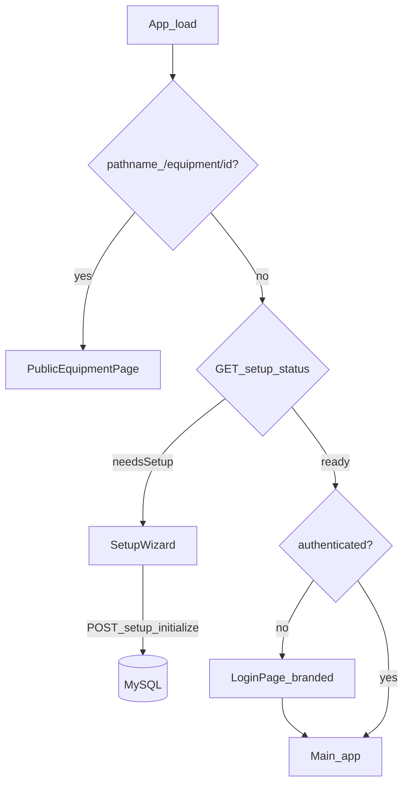

# Onboarding instalacija, čista baza, naljepnice i login

## Trenutno stanje

| Oblast | Stanje |
|--------|--------|
| Seed | [`backend/prisma/seed.ts`](backend/prisma/seed.ts) briše sve tabele i puni demo (korisnici, org, oprema, lokacije) |
| Company u štampama | Hardkodirano `PREDUZEĆE D.D.` u [`frontend/src/components/DocumentsPage.tsx`](frontend/src/components/DocumentsPage.tsx) |
| Settings | Registry u [`backend/src/modules/settings/settings.registry.ts`](backend/src/modules/settings/settings.registry.ts) — samo `app.*`, nema `company.*` |
| QR | Naljepnice: `INVENTAR:broj\|id` ([`LabelPrintSheet.tsx`](frontend/src/components/LabelPrintSheet.tsx)); backend već vraća URL u `getQrPayload` ([`equipment.service.ts`](backend/src/modules/equipment/equipment.service.ts) L187–198) |
| Routing | Nema React Router; SPA `serve -s` podržava deep link, ali [`App.tsx`](frontend/src/App.tsx) ne obrađuje `/equipment/:id` |
| Login | Generički gradient + dev hint ([`LoginPage.tsx`](frontend/src/components/LoginPage.tsx)) |

## Ciljna arhitektura

---

## Faza 1 — Potpuno čišćenje baze i seed strategija

**Cilj:** Default seed ne kreira demo podatke.

1. Zamijeniti [`backend/prisma/seed.ts`](backend/prisma/prisma/seed.ts) no-op ili minimalni init koji **ne** kreira korisnike/org/opremu (settings i dalje dolaze iz `ensureDefaults()` u [`SettingsModule`](backend/src/modules/settings/settings.module.ts)).
2. Izdvojiti postojeći demo sadržaj u **`backend/prisma/seed-demo.ts`** + npm skripta `db:seed:demo` (eksplicitno za lokalno testiranje).
3. Dokumentovati u [`backend/README.md`](backend/README.md) i root [`README.md`](README.md):
   - `npm run db:migrate:dev` / `db:migrate` na praznoj bazi
   - `prisma migrate reset` za potpuni wipe (dev)
   - Produkcija: deploy migracija → otvori app → setup wizard

**Operativno (jednokratno u implementaciji):** `prisma migrate reset` na dev bazi nakon promjena.

---

## Faza 2 — Backend: setup modul + company settings + admin profil

### 2a. Prisma: profil na `User`

Dodati opciona polja na [`User`](backend/prisma/schema.prisma):

- `firstName`, `lastName` (VarChar, obavezna u setup DTO-u)
- `email` (opcionalno, unique nullable)

Nova migracija `20260603xxxx_user_profile`.

### 2b. Company keys u settings registry

Proširiti [`settings.registry.ts`](backend/src/modules/settings/settings.registry.ts) (sve **`public`** scope):

| Key | Opis |
|-----|------|
| `company.name` | Naziv preduzeća (header štampa) |
| `company.address` | Ulica i broj |
| `company.city` | Grad |
| `company.postalCode` | Poštanski broj (opc.) |
| `company.phone` | Telefon (opc.) |
| `company.email` | Email (opc.) |
| `company.taxId` | ID/JIB (opc.) |
| `app.initialized` | boolean, **private** — postavlja se na `true` nakon setup-a |

Ažurirati [`.cursor/docs/matrices/settings/MATRIX.md`](.cursor/docs/matrices/settings/MATRIX.md) + CHANGELOG.

### 2c. `SetupModule` (novi)

| Endpoint | Auth | Pravilo |
|----------|------|---------|
| `GET /backend/setup/status` | — | `{ needsSetup: boolean }` — `true` ako `user.count() === 0` |
| `POST /backend/setup/initialize` | — | Jednokratno; 409 ako već postoji korisnik |

**DTO** (`initialize-setup.dto.ts`):

- **Company:** `name`, `address`, `city` (obavezno); opcionalno `postalCode`, `phone`, `email`, `taxId`
- **Admin:** `firstName`, `lastName`, `email?`, `username`, `password` (min 8)
- Opcionalno: `setupToken` ako je `SETUP_TOKEN` u env postavljen (zaštita na produkciji)

**Transakcija:**

1. Provjera `user.count() === 0`
2. `bcrypt.hash` + `user.create` (`role: admin`, profilna polja)
3. Upsert company `public` settings + `app.name` = `company.name`
4. `app.initialized = true`
5. Vratiti `{ success: true }` (bez auto-login tokena — korisnik ide na login)

Registrovati modul u [`app.module.ts`](backend/src/app.module.ts). Endpointi **izvan** JwtAuthGuard (kao `settings/public`).

---

## Faza 3 — Backend: javni pregled opreme (QR)

Novi kontroler npr. `PublicEquipmentController` pod `GET /backend/public/equipment/:id` (bez auth).

**DTO** (samo read-only, bez akcija):

- `inventoryNumber`, `status`, `categoryName`
- `displayName` — iz kategorije + specifications (ista logika kao [`inventory-print-sheet.tsx`](frontend/src/components/inventory-count/inventory-print-sheet.tsx) `buildEquipmentName`)
- `uniqueField` — `{ label, value } | null` (prvo polje kategorije sa `unique: true` iz [`category-fields.util.ts`](backend/src/common/utils/category-fields.util.ts))
- `specifications` — mapa labela (human-readable imena polja)
- **Ne izlagati:** `notes`, `contractNumber`, interni user ID-jevi osim UUID u URL-u

Ažurirati [`.cursor/docs/matrices/labels/MATRIX.md`](.cursor/docs/matrices/labels/MATRIX.md) — QR payload = puni URL (`APP_URL/equipment/{id}` ili konzistentan path).

---

## Faza 4 — Frontend: routing, setup wizard, public stranica

### 4a. Path parsing (bez React Router)

U [`App.tsx`](frontend/src/App.tsx) (ili tanak `app-shell.tsx`):

1. Ako `pathname` match `/equipment/:uuid` → render **`PublicEquipmentPage`** (van auth/data gate-a)
2. Inače: `GET setup/status` → wizard ili login/app

### 4b. `PublicSettingsContext` / hook

- `fetchPublicSettings()` na `GET /settings/public` (već postoji)
- Koristiti na: Setup, Login, print header helper

### 4c. `SetupWizardPage` (multi-step, responsive)

Koraci:

1. **Preduzeće** — name, address, city + opcionalna polja
2. **Administrator** — ime, prezime, email, username, password + confirm
3. **Pregled i potvrda** → `POST /setup/initialize` → redirect na login sa success toast/porukom

Dizajn: Apple-linear, sheet na mobilnom (postojeći `ModalRoot`/UI pattern).

### 4d. `PublicEquipmentPage`

- Fetch `GET /public/equipment/:id`
- Prikaz: naziv, inventurni broj, unikatno polje, kategorija, status badge, specifikacije
- Bez dugmadi/transfera; company mini-header iz public settings (opc.)

### 4e. `AppProviders` / `DataProvider`

- Setup i public rute ne pozivaju `fetchAppState`
- `DataProvider` ostaje samo za authenticated flow (već uvjetovan `user`)

---

## Faza 5 — Naljepnice (modernizacija)

### Helper

[`frontend/src/helpers/equipment-display.util.ts`](frontend/src/helpers/equipment-display.util.ts) (i mirror na backendu za public API):

- `buildEquipmentDisplayName(category, specifications)`
- `getUniqueFieldDisplay(category, specifications)`

### `LabelPrintSheet` redesign

- Layout: horizontalna kartica (QR lijevo ~40%, tekst desno)
- QR vrijednost: **`${window.location.origin}/equipment/${id}`** (ili `VITE_APP_URL` u buildu)
- Tekst: display name (bold), unique field (ako postoji), inventurni broj (mono), kategorija (muted)
- Print CSS: fiksna visina naljepnice, `break-inside-avoid`

Ista QR logika u [`EquipmentCard.tsx`](frontend/src/components/EquipmentCard.tsx) print/download.

---

## Faza 6 — Login i štampani headeri

### Login ([`LoginPage.tsx`](frontend/src/components/LoginPage.tsx))

- Učitati `app.name`, `company.name` iz public settings (fallback na env `VITE_APP_NAME`)
- Ukloniti generički “IN” placeholder kad postoji company name
- Apple-linear: svijetla pozadina, suptilan border card, bez dev hint-a izvan `import.meta.env.DEV`
- Ako `needsSetup` → ne prikazivati login, redirect na wizard (u `App.tsx`)

### Zajednički header za štampu

Novi [`frontend/src/helpers/company-header.util.ts`](frontend/src/helpers/company-header.util.ts) + `useCompanyHeader()`:

- HTML fragment za `printPrenosnica` u DocumentsPage
- Preview header u DocumentsPage modalu
- Po potrebi header u [`inventory-print-sheet.tsx`](frontend/src/components/inventory-count/inventory-print-sheet.tsx)

Zamijeniti sve `PREDUZEĆE D.D.` reference.

---

## Faza 7 — Dokumentacija i matrice

| Fajl | Akcija |
|------|--------|
| [`.cursor/docs/matrices/settings/MATRIX.md`](.cursor/docs/matrices/settings/MATRIX.md) | company.* + app.initialized |
| [`.cursor/docs/matrices/labels/MATRIX.md`](.cursor/docs/matrices/labels/MATRIX.md) | novi layout + URL QR + public stranica |
| **Novi** `.cursor/docs/matrices/install-setup/MATRIX.md` | status endpoint, jednokratni POST, polja wizarda |
| [`backend/README.md`](backend/README.md) | setup flow, SETUP_TOKEN, db:seed:demo |
| [`.env.example`](.env.example) | opcioni `SETUP_TOKEN` |

---

## Redoslijed implementacije

1. Prisma User profil + settings registry + setup module + public equipment API
2. Seed refactor (prazan + demo skripta) + db reset
3. Frontend: path routing → public page → setup wizard → login branding
4. LabelPrintSheet + EquipmentCard QR + company headers u štampama
5. Matrice + README

## Test plan (ručno)

- [ ] `migrate reset` → app otvara setup wizard, nema login-a
- [ ] Setup kreira admina → login sa novim kredencijalima → dashboard
- [ ] `GET /setup/status` → `needsSetup: false`; ponovni POST → 409
- [ ] Štampa prenosnice prikazuje company name/adresu iz settings
- [ ] Naljepnica: QR otvara `/equipment/{id}` na mobitelu → public detalji bez login-a
- [ ] `db:seed:demo` i dalje puni demo samo kad eksplicitno pokrenut

## Rizici / napomene

- **Javni endpoint:** bilo ko sa QR linkom vidi osnovne detalje opreme — prihvatljivo za inventar naljepnice; ne izlagati osjetljive napomene/ugovore.
- **`APP_URL` / origin:** QR mora koristiti produkcijski URL iz env-a pri buildu/deployu.
- **Postojeća baza sa podacima:** setup se neće pokrenuti (`needsSetup: false`); za čist start potreban je wipe ili nova baza.
