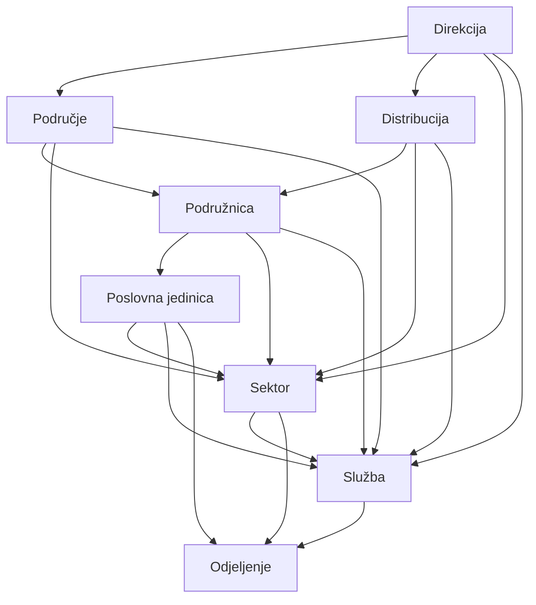

# Plan: Hijerarhija društva, skladište, greške, autocomplete

## Trenutno stanje (prije implementacije)

- **Matrica parent→child**: `[backend/src/common/utils/org-hierarchy-validation.util.ts](backend/src/common/utils/org-hierarchy-validation.util.ts)` + `[.cursor/docs/matrices/org-hierarchy/MATRIX.md](.cursor/docs/matrices/org-hierarchy/MATRIX.md)`
- **Nasljeđivanje skladišta**: `[resolve-effective-warehouse.util.ts](backend/src/common/utils/resolve-effective-warehouse.util.ts)`, `[WarehouseResolutionService](backend/src/common/services/warehouse-resolution.service.ts)`, matrica `[warehouses/MATRIX.md](.cursor/docs/matrices/warehouses/MATRIX.md)`
- **Radnici**: običan `<select>` bez pretrage i putanje (`[EmployeesPage.tsx](frontend/src/components/EmployeesPage.tsx)`)

## 1. Novi tip `poslovna_jedinica` (Prisma + tipovi)


| Sloj      | Promjena                                                                                                                                                    |
| --------- | ----------------------------------------------------------------------------------------------------------------------------------------------------------- |
| Prisma    | `poslovna_jedinica` u `enum OrgUnitType` — `[schema.prisma](backend/prisma/schema.prisma)`                                                                  |
| Migracija | `20260604120000_org_unit_poslovna_jedinica`                                                                                                                 |
| Frontend  | `[types.ts](frontend/src/types.ts)`, `[helpers.ts](frontend/src/helpers.ts)`, boje u `[OrganizationPage.tsx](frontend/src/components/OrganizationPage.tsx)` |


**Pozicija:** samo dijete `podruznica`.

## 2. Matrica parent → child (konačna)


| Parent              | Dozvoljena djeca                               |
| ------------------- | ---------------------------------------------- |
| `direkcija`         | `podrucje`, `distribucija`, `sektor`, `sluzba` |
| `podrucje`          | `podruznica`, `sektor`, `sluzba`               |
| `distribucija`      | `podruznica`, `sektor`, `sluzba`               |
| `podruznica`        | `poslovna_jedinica`, `sektor`, `sluzba`        |
| `poslovna_jedinica` | `sektor`, `sluzba`, `odjeljenje`               |
| `sektor`            | `sluzba`, `odjeljenje`                         |
| `sluzba`            | `odjeljenje`                                   |
| `odjeljenje`        | *(nema)*                                       |


Enforce: `assertValidOrgUnitParentChild` u `[org-units.service.ts](backend/src/modules/org-units/org-units.service.ts)`.

**Bez dodatnih operativnih zabrana** — samo matrica parent→child.

## 3. Jasne greške na bosanskom (toast)

`[org-hierarchy-messages.util.ts](backend/src/common/utils/org-hierarchy-messages.util.ts)` + korištenje u `[org-units.service.ts](backend/src/modules/org-units/org-units.service.ts)`:

- Nedozvoljen tip ispod parenta
- Ciklus / vlastiti parent
- Brisanje s djecom / zaposlenicima
- Djeca nekompatibilna pri promjeni parent/tipa
- Grad / potpisnik ne postoji

## 4. Frontend — Organizacija

- `[org-hierarchy.util.ts](frontend/src/helpers/org-hierarchy.util.ts)` — ista matrica kao backend
- `[OrganizationPage.tsx](frontend/src/components/OrganizationPage.tsx)` — filtrirani tip dropdown po parentu; boje za `poslovna_jedinica`
- `[org-unit-warehouses-section.tsx](frontend/src/components/organization/org-unit-warehouses-section.tsx)` — prikaz efektivnog nasljeđenog skladišta

## 5. Frontend — Autocomplete org. jedinice (radnici)

- `[org-unit-autocomplete.tsx](frontend/src/components/org-unit-autocomplete.tsx)` — naziv + putanja u sub
- `[EmployeesPage.tsx](frontend/src/components/EmployeesPage.tsx)` — zamjena selecta u formi

## 6. Dokumentacija

- `[.cursor/docs/matrices/org-hierarchy/MATRIX.md](.cursor/docs/matrices/org-hierarchy/MATRIX.md)`
- `[.cursor/docs/matrices/org-hierarchy/CHANGELOG.md](.cursor/docs/matrices/org-hierarchy/CHANGELOG.md)`

## 7. Verifikacija

```bash
cd backend && npm run test:unit && npm run build
cd frontend && npm run build
npx prisma migrate deploy   # na okruženju s DB
```




## Implementirano (checklist) — faza zatvorena 2026-06-04

- `prisma-poslovna` — enum, migracija, frontend tipovi i labele
- `hierarchy-matrix` — `ALLOWED_CHILD_TYPES`, unit testovi (89 ukupno)
- `org-service` — BS poruke, validacija djece `nextType`, optimizovan refresh effective polja
- `org-ui` — forma, inherit autocomplete, save UX, stablo (samo krov expanded)
- `employee-autocomplete` — `OrgUnitAutocomplete` + `EmployeesPage`
- `docs-verify` — matrice/CHANGELOG/HANDOFF, build, migrate deploy
- skladište inherit — walk-up bez grada (`warehouses` matrica)

