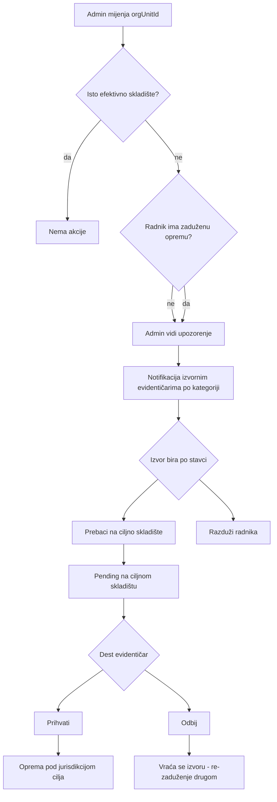

# Promjena org. jedinice radnika i oprema — analiza i plan

## Šta već postoji u kodu (važno za usklađenje)

| Koncept | Trenutno stanje |
|---------|----------------|
| Org jedinica radnika | [`Employee.orgUnitId`](backend/prisma/schema.prisma) — promjena je trivijalna (`EmployeesService.update`), **bez side-effecta** |
| Skladište za org jedinicu | [`resolveEffectiveWarehouseId`](backend/src/common/utils/resolve-effective-warehouse.util.ts) — walk-up po stablu + city fallback |
| Kategorije | **Globalne** ([`Category`](backend/prisma/schema.prisma)), ne po skladištu |
| Evidentičar po skladištu/kategoriji | [`RegistrarAssignment`](backend/prisma/schema.prisma) `(warehouseId, categoryId, orgUnitId?)` |
| Zadužena oprema | `status=zaduzeno`, `currentHolderId` set, `warehouseId=null`; scope evidentičara preko **holder org + warehouse coverage** ([`matchesAssignmentEquipment`](backend/src/common/services/registrar-scope.service.ts)) |
| Ulaz robe | [`WarehouseStockLot`](backend/prisma/schema.prisma) sa slobodnim `productName` — **nema šifrarnika** |
| Transferi | [`TransferType`](backend/prisma/schema.prisma): zaduzenje/razduzenje/prenos/rashod — **nema skladište→skladište**; svi idu kroz prenosnicu |
| Notifikacije | In-app + Socket.IO; nema tipa za org-promjenu |

**Vaš slučaj „ista služba / druga služba, isto skladište“** već se može detektovati: `resolveEffectiveWarehouse(oldOrg) === resolveEffectiveWarehouse(newOrg)` → nema akcije (oprema ostaje zadužena, evidentičari ne diraju ništa).

---

## Procjena vašeg workflowa — šta je dobro



- Logika „isto skladište = nema posla“ usklađena je sa [`warehouses/MATRIX.md`](.cursor/docs/matrices/warehouses/MATRIX.md) (effective warehouse inheritance).
- Grupisanje notifikacija po **kategoriji + evidentičar** odgovara `RegistrarAssignment`.
- Šifrarnik tipova opreme rješava problem mapiranja `productName` između skladišta.
- Admin upozorenje za kategorije bez evidentičara direktno nadovezuje se na postojeći model (nije nova hijerarhija kategorija).

---

## Rupe, rizici i edge-caseovi (prije implementacije)

### 1. Knjigovodstvo stocka za zaduženu opremu (kritično)

Kad se komad **izda** iz lota, `quantityOnHand` na izvornom lotu se već smanjio ([`warehouse-stock/MATRIX.md`](.cursor/docs/matrices/warehouse-stock/MATRIX.md)). Zadužena oprema **nije** na polici.

Vi ste odabrali: **virtualni pending lot na cilju, `quantityOnHand +1` tek na prihvat**.

To zahtijeva jasnu definiciju u planu implementacije:

- Na **izvoru**: ne dirati stari lot `quantityOnHand` (već izdano); smanjiti **jurisdikcijski brojač** „zaduženo pod skladištem X“ (novi agregat ili derivacija iz `stockLotId` + holder coverage).
- Na **cilju**: pending lot (`status=ceka_specifikaciju` ili novi `pending_incoming_transfer`); na prihvat `quantityOnHand += 1` i **prevezati** `Equipment.stockLotId` na ciljni lot (ili shadow lot samo za accounting).
- Dashboard „ukupno / zaduženo“ mora računati po **efektivnom skladištu holdera**, ne po fizičkom `warehouseId` opreme.

Bez ovoga lako nastane bug: dvostruko smanjenje/povećanje `quantityOnHand`.

### 2. Razduženje — administrativno ili prenosnica?

Za opciju „razduži radnika“ niste eksplicitno rekli da li ide **bez prenosnice** (kao međuskladišni transfer) ili kroz postojeći `razduzenje` transfer sa PDF-om.

**Preporuka:** administrativno razduženje unutar istog workflowa (konzistentno s vašim odgovorom), ali sa audit zapisom (`EquipmentEvent` ili novi `EmployeeRelocationEvent`). Ako kasnije zatreba papir, može se dodati opciono generisanje.

### 3. Djelomično rješavanje opreme

Evidentičar Računarske opreme može prebaciti laptop, a evidentičar Namještaja razdužiti stolicu — **asinhrono, po stavci**.

Rizik: radnik privremeno „visi“ između dva skladišta (djelomično prebačeno). To je OK ako UI jasno prikazuje **pending stavke po opremi**, ne samo po radniku.

Potreban model: **jedan case po radniku**, **N line-items po equipmentId** sa statusima (`pending_source`, `pending_dest`, `accepted`, `rejected`, `discharged`).

### 4. Odbijanje na cilju

Nakon odbijanja oprema ostaje **zadužena istom radniku**, ali radnik je već u novoj org jedinici (drugo skladište).

- Izvorni evidentičar mora moći **zadužiti drugog radnika** u svom podstablu (postojeći `zaduzenje` tok) ili ponovo pokrenuti transfer.
- Dest evidentičar više ne vidi tu opremu u scope-u (holder više nije u njegovom coverage-u) — OK.

### 5. Nema evidentičara na izvoru ili cilju

| Scenario | Predloženo ponašanje |
|----------|---------------------|
| Nema evidentičara za kategoriju na **izvoru** | Admin upozorenje + case ostaje blokiran za tu stavku; notifikacija adminu |
| Nema evidentičara na **cilju** | Pending transfer; admin upozorenje na dashboardu (vaš zahtjev) |
| Nema šifrarnika/lota na cilju | Pending lot + admin upozorenje da konfiguriše evidentičara; **ne** nova kategorija |

### 6. Ugrađeni dijelovi održavanja

[`EquipmentInstalledPart`](backend/prisma/schema.prisma) prati se na host opremi. **Ne treba zaseban transfer** — dijelovi putuju s hostom. Potrošnja i lotovi dijelova ostaju na izvornom skladištu (istorijski); to je prihvatljivo za MVP.

### 7. Aktivni popis (inventory freeze)

Tokom aktivne inventure u gradu, postojeći freeze blokira stock/issue ([`warehouse-stock/MATRIX.md`](.cursor/docs/matrices/warehouse-stock/MATRIX.md)). Treba odluka:

- **Blokirati** org-promjenu s pending opremom dok traje popis u dotičnom gradu, ili
- Dozvoliti org-promjenu ali blokirati finalize transfera/razduženja do kraja popisa.

### 8. Ponovna promjena org jedinice prije završetka

Ako admin opet promijeni org jedinicu dok case traje:

- Otkazati pending stavke koje više nisu relevantne
- Preračunati ciljno skladište za neobrađene stavke
- Zapisati audit „superseded by newer relocation“

### 9. Migracija postojećih podataka (šifrarnik)

Postojeći lotovi imaju slobodan `productName`. Plan migracije:

- Faza 1: šifrarnik opcionalan (autocomplete + ručno mapiranje pri ulazu)
- Faza 2: admin alat za bulk mapiranje postojećih `productName` → `EquipmentCatalogItem`
- Cross-warehouse transfer **zahtijeva** `catalogItemId` na opremi/lotu; legacy bez mapiranja → admin mora ručno riješiti prije transfera

### 10. Audit bez prenosnica

Bez PDF-a i dalje treba:

- Ko je pokrenuo, ko prihvatio/odbio, timestamp, from/to warehouse
- Vidljivo na kartici opreme i u admin izvještaju

### 11. UI admina pri promjeni org jedinice

Prije save-a prikazati:

- Broj zaduženih komada po kategoriji
- Da li mijenja skladište (da/ne)
- Upozorenje ako nedostaju evidentičari na izvoru/cilju

---

## Predložena arhitektura (implementacija)

### Novi modeli (Prisma)

```text
EquipmentCatalogItem
  id, code (unique), name, categoryId (leaf), isActive

WarehouseStockLot (proširenje)
  catalogItemId? (FK), incomingRelocationStatus? (opciono)

EmployeeRelocationCase
  id, employeeId, fromOrgUnitId, toOrgUnitId
  fromWarehouseId, toWarehouseId
  status: open | resolved | cancelled
  createdByUserId, createdAt

EmployeeRelocationLine
  id, caseId, equipmentId, categoryId
  status: pending_source | pending_dest | accepted | rejected | discharged
  sourceAction: transfer | discharge | null
  sourceResolvedByUserId, destResolvedByUserId, resolvedAt
  destStockLotId? (pending virtual lot)
```

### Novi notification tipovi

- `employee_relocation_action_required` — izvorni evidentičar
- `employee_relocation_incoming` — ciljni evidentičar (prihvati/odbij)
- `employee_relocation_admin_alert` — admin (nema evidentičara / pending predugo)
- `employee_relocation_resolved` — admin + radnik (info)

### Backend modul

Novi `employee-relocation` modul u [`backend/src/modules/`](backend/src/modules/):

1. **Hook** na `EmployeesService.update` kad se mijeni `orgUnitId`
2. `detectRelocationScope(old, new)` — effective warehouse compare
3. `openCaseIfNeeded(employeeId)` — kreira case + line items za svu `zaduzeno` opremu
4. API za evidentičare: list pending, `resolveSource(lineId, transfer|discharge)`, `resolveDest(lineId, accept|reject)`
5. Integracija sa `NotificationsService` + realtime

### Šifrarnik + ulaz robe

- CRUD `EquipmentCatalogItem` (admin)
- [`warehouse-stock`](backend/src/modules/warehouse-stock/warehouse-stock.service.ts): `createStockLot` — autocomplete po `categoryId` + code/name; snimiti `catalogItemId`
- Issue opreme: naslijediti `catalogItemId` na equipment (preko lota)

### Admin dashboard

Proširiti [`Dashboard.tsx`](frontend/src/components/Dashboard.tsx):

- Widget: **Kategorije bez evidentičara** — `(warehouseId, categoryId)` iz aktivnih skladišta gdje nema `RegistrarAssignment` (MAINTENANCE nasljeđuje host evidentičara preko postojećeg linka)
- Widget: **Otvoreni relocation case-ovi** i pending incoming transfers

### Frontend stranice

- Admin: preview pri editu zaposlenika ([employees UI])
- Evidentičar: **Akcije po promjeni org. jedinice** (lista case-ova filtrirana po registrar scope)
- Dest: inbox **Nova oprema za prihvat**

---

## Faze implementacije

| Faza | Opis |
|------|------|
| **0** | Matrica `.cursor/docs/matrices/employee-relocation/MATRIX.md` + CHANGELOG |
| **1** | `EquipmentCatalogItem` + autocomplete na prijemu lota |
| **2** | `EmployeeRelocationCase/Line` + hook na promjenu org jedinice |
| **3** | Source actions (transfer/discharge) + notifikacije |
| **4** | Dest accept/reject + virtual pending lot + stock accounting |
| **5** | Admin dashboard upozorenja + preview pri promjeni |
| **6** | Edge-caseovi: freeze, re-org, legacy bez catalogItem |

---

## Otvorena odluka (jedna)

**Razduženje** unutar relocation workflowa: potvrdite da i ono ide **administrativno bez prenosnice** (preporučeno, u skladu s vašim odgovorom za međuskladišni transfer). Ako treba PDF, faza 4 se komplikuje značajno.

---

## Sažetak: da, workflow funkcioniše — uz gore navedene dopune

Vaša ideja je **usklađena** s postojećom hijerarhijom skladišta i registrar modelom. Najveći rizici za bugove su: **stock accounting za već izdanu opremu**, **djelomično rješavanje po kategorijama**, i **jasno razgraničenje „kategorija“ (globalna) vs „evidentičar na skladištu“ (RegistrarAssignment)** — što ste već razjasnili.
