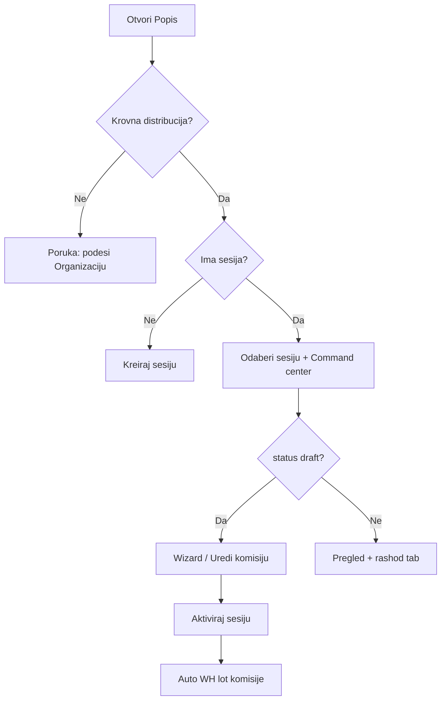

# HANDOFF — Godišnji popis po skladištu

**Datum:** 2026-06-05  
**Plan (referenca):** [popis_po_skladištu_c27111e1.plan.md](file:///C:/Users/m.ceric/.cursor/plans/popis_po_skladištu_c27111e1.plan.md) (Cursor plan, van repoa)  
**Matrica:** [`.cursor/docs/matrices/inventory-count/MATRIX.md`](../../docs/matrices/inventory-count/MATRIX.md) (v4)  
**Status:** Implementacija **završena u kodu**; migracija primijenjena na dev DB; **nije commitovano**; **E2E ručni test djelimičan** (tsc/build OK).

---

## Za novu sesiju (copy-paste)

```
Nastavi iz HANDOFF: .cursor/plans/popis-po-skladistu/HANDOFF.md

Prioritet:
1) Ručno proći E2E checklist (admin + član komisije + skladištar lotovi).
2) Commit ako korisnik traži (veliki necommitovan diff).
3) Po potrebi: coverage report pri aktivaciji, više distribucija u org stablu.

Dev:
cd backend && npm run dev
cd frontend && npm run dev
Login: admin / admin123 (seed)

Migracija (ako fresh DB):
cd backend && npx prisma migrate deploy
```

---

## Sažetak promjena (2 vala)

### Val 1 — Komisije po skladištu + kategoriji

| Oblast | Promjena |
|--------|----------|
| Model | `InventoryCommittee.warehouseId` (nullable za legacy); `@@unique([sessionId, warehouseId, categoryId])` |
| Opseg opreme | Sužen na skladište: `skladiste` na tom WH + `zaduzeno` u warehouse coverage; samo `ASSET` |
| Wizard | 5 koraka: skladište → kategorija → popis → rashod → potvrda |
| API | `GET .../session-warehouses`, `GET .../committees/setup-options?warehouseId=` |
| UI admin | Empty state, lista sesija, command center, komisije grupisane po skladištu, detail panel |
| Lot popis | **Nepromijenjen** — `InventoryWarehouseCommittee` auto pri aktivaciji; stranica `warehouse-inventory-page.tsx` |

### Val 2 — Admin UX (ista sesija, 2026-06-05 b)

| Oblast | Promjena |
|--------|----------|
| Distribucija | **Nema dropdowna** — automatski `resolveRootDistributionOrgUnit()` |
| Nema distribucije | Poruka: definisati organizaciju (jedna krovna distribucija pod direkcijom) |
| Brisanje sesije | `DELETE /inventory-sessions/:id` — samo `draft` **i** `committees.length === 0` |
| Brisanje komisije | `DELETE /inventory-sessions/committees/:id` — samo dok je sesija `draft` |
| Izmjena komisije | `PATCH /inventory-sessions/committees/:id` + wizard u **Uredi** modu |

---

## Donesene odluke

1. **Jedna komisija = jedno skladište + jedna roditeljska kategorija** (wizard se ponavlja po kategoriji).
2. **Legacy** komisije bez `warehouseId` (active/closed): opseg ostaje city-wide, read-only.
3. **Draft komisije bez skladišta** obrisane migracijom (nema pouzdane auto-mape).
4. **Krovna distribucija**: jedina `distribucija` u stablu, ili jedina direktno pod `direkcija` ([`resolve-root-distribution.util.ts`](../../../frontend/src/helpers/resolve-root-distribution.util.ts)).
5. **Eligible članovi**: isti grad kao skladište + (warehouse org coverage **ili** `RegistrarAssignment` za to skladište).
6. **Aktivacija sesije** blokirana ako nema nijedne popisne komisije (`InventoryCommittee`).

---

## Ključni fajlovi

### Backend

| Fajl | Uloga |
|------|--------|
| [`backend/prisma/migrations/20260605120000_inventory_committee_warehouse/`](../../../backend/prisma/migrations/20260605120000_inventory_committee_warehouse/) | `warehouseId`, unique, rollback |
| [`backend/src/modules/inventory-count/utils/resolve-warehouse-committee-scope.util.ts`](../../../backend/src/modules/inventory-count/utils/resolve-warehouse-committee-scope.util.ts) | Opseg opreme + warehouse coverage |
| [`backend/src/modules/inventory-count/inventory-count.service.ts`](../../../backend/src/modules/inventory-count/inventory-count.service.ts) | CRUD sesija/komisija, setup-options, delete/update |
| [`backend/src/modules/inventory-count/inventory-count.controller.ts`](../../../backend/src/modules/inventory-count/inventory-count.controller.ts) | REST endpointi |
| [`backend/src/modules/disposal-commissions/disposal-commissions.service.ts`](../../../backend/src/modules/disposal-commissions/disposal-commissions.service.ts) | Warehouse-aware scope za rashod |

### Frontend

| Fajl | Uloga |
|------|--------|
| [`frontend/src/components/InventoryCountPage.tsx`](../../../frontend/src/components/InventoryCountPage.tsx) | Glavna stranica (admin + član) |
| [`frontend/src/helpers/resolve-root-distribution.util.ts`](../../../frontend/src/helpers/resolve-root-distribution.util.ts) | Auto distribucija |
| [`frontend/src/components/inventory-count/inventory-committee-wizard.tsx`](../../../frontend/src/components/inventory-count/inventory-committee-wizard.tsx) | Kreiranje + **Uredi** mod |
| [`frontend/src/components/inventory-count/inventory-committee-list-panel.tsx`](../../../frontend/src/components/inventory-count/inventory-committee-list-panel.tsx) | Komisije po skladištu + edit/delete |
| [`frontend/src/components/inventory-count/inventory-committee-detail-panel.tsx`](../../../frontend/src/components/inventory-count/inventory-committee-detail-panel.tsx) | Detalj, uredi/obriši |
| [`frontend/src/components/inventory-count/session-command-center.tsx`](../../../frontend/src/components/inventory-count/session-command-center.tsx) | Obriši sesiju |
| [`frontend/src/api/inventory-api.ts`](../../../frontend/src/api/inventory-api.ts) | DTO + API pozivi |

---

## API (novo / promijenjeno)

```
POST   /inventory-sessions/:id/committees          { warehouseId, categoryId, name?, inventoryMembers, disposalMembers }
PATCH  /inventory-sessions/committees/:id          (isto body — samo draft sesija)
DELETE /inventory-sessions/committees/:id          (draft sesija)
DELETE /inventory-sessions/:id                     (draft, bez komisija)

GET    /inventory-sessions/:id/session-warehouses
GET    /inventory-sessions/:id/committees/setup-options?warehouseId=&excludeCommitteeId=
```

---

## Admin tok (trenutno u UI)



1. Distribucija se **automatski** uzima iz org stabla (prikaz imena, bez selecta).
2. Nema sesija → centrirani empty state + forma.
3. `draft` → wizard (nova) ili **Uredi** (postojeća); brisanje komisije u listi ili detalju.
4. Nema komisija → **Obriši sesiju** u command centeru.
5. Aktivacija → freeze + auto `InventoryWarehouseCommittee` (lotovi, odvojena stranica).

---

## Test status

| Provjera | Rezultat |
|----------|----------|
| `backend`: `npx tsc --noEmit` | OK |
| `backend`: `npm run build` | OK |
| `frontend`: `npx tsc --noEmit` | OK |
| `prisma migrate deploy` (dev DB) | OK — `20260605120000_inventory_committee_warehouse` |
| Ručni E2E checklist iz plana | **Nije sistematski odrađen** |

### E2E checklist (za sljedeću sesiju)

**Admin — draft**

- [ ] Bez distribucije u org → upozorenje na Popisu
- [ ] Kreiraj sesiju → wizard korak 1–5 → komisija pod skladištem
- [ ] Duplikat ista kategorija + isto skladište → 400
- [ ] Ista kategorija, drugo skladište → OK
- [ ] Uredi komisiju (promjena članova) → PATCH OK
- [ ] Obriši komisiju → sesija ostaje, može dodati novu
- [ ] Obriši sesiju **sa** komisijama → odbijeno; **bez** komisija → OK
- [ ] Aktiviraj bez komisija → odbijeno

**Opseg**

- [ ] Komisija WH-A / kategorija X ne uključuje opremu iz WH-B
- [ ] MAINTENANCE kategorije nisu u wizardu koraka 2
- [ ] Član izvan skladišta nije u listi; ručni POST odbijen

**Aktivna sesija**

- [ ] Auto warehouse lot komisije
- [ ] Freeze banner
- [ ] Član komisije: „Moje komisije“ prikaz `Skladište — Kategorija`
- [ ] Unos linija, zaključavanje, zatvaranje sesije

**Legacy** (ako postoji stara active sesija bez `warehouseId`)

- [ ] Opseg city-wide, read-only

---

## Otvorena pitanja / rizici

| Tema | Napomena |
|------|----------|
| Više distribucija u org | `resolveRootDistributionOrgUnit` vraća `null` ako nije jednoznačno — namjerno; nema UI za izbor |
| Partial coverage | Aktivacija ne provjerava da su sve kategorije/skladišta pokrivene — samo `committees.length > 0` |
| Edit wizard UX | Pri editu sakriven je „Dodaj“ wizard; prikazan samo „Uredi“ — OK, ali nema inline edit u detail panelu |
| Necommitovan diff | Cijeli feature + `backend/dist/` može biti u working tree — **ne commitovati dist** |
| Stari HANDOFF | [`inventory-v2/HANDOFF.md`](../inventory-v2/HANDOFF.md) opisuje **popis v3 po kategoriji** — djelimično zastarjelo; ova datoteka je source-of-truth za skladišni tok |

---

## Next steps (prioritet)

1. **Ručno E2E** — checklist gore na dev seed podacima (ED/distribucija + skladišta + oprema).
2. **Commit** — kad korisnik traži; poruka tipa: `feat(inventory-count): komisije po skladištu, admin CRUD draft sesija/komisija`.
3. **Opcionalno follow-up:**
   - Coverage report pri aktivaciji („koje kategorije/skladišta nemaju komisiju“)
   - Unit testovi za `resolve-warehouse-committee-scope.util.ts`
   - Ažurirati [`inventory-v2/HANDOFF.md`](../inventory-v2/HANDOFF.md) sa linkom na ovaj handoff

---

## Brzi debug

| Simptom | Gdje gledati |
|---------|--------------|
| Prazan wizard korak 2 (kategorije) | `GET setup-options` — nema opreme u opsegu WH; provjeri `equipment` + `categoryKind` |
| „Remove all committees before deleting session“ | `_count.committees` > 0 |
| Aktivacija pada na lot komisijama | Skladištari bez `User.employeeId` — [`inventory-warehouse-committees.util.ts`](../../../backend/src/modules/inventory-count/utils/inventory-warehouse-committees.util.ts) |
| Distribucija nije prepoznata | Org: tačno jedna `distribucija` ili jedna pod `direkcija` |

---

## Changelog

Vidi [`.cursor/docs/matrices/inventory-count/CHANGELOG.md`](../../docs/matrices/inventory-count/CHANGELOG.md) — unosi `2026-06-05` i `2026-06-05 (b)`.
