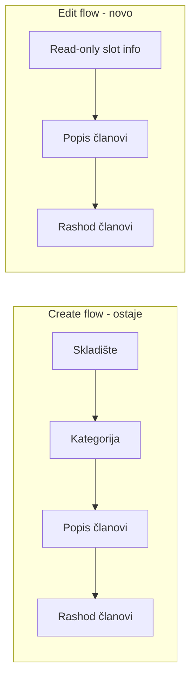

# Popis: uređivanje komisije + popisna lista

## Problem 1 — "Uredi komisiju" otvara pun create wizard

**Stanje:** `[inventory-committee-wizard.tsx](frontend/src/components/inventory-count/inventory-committee-wizard.tsx)` koristi isti 4-korakovni tok i za create i za edit. Pri edit-u `setStep(1)` resetuje na skladište/kategoriju, iako su slotovi već auto-kreirani (`membersConfigured: false` → badge "Čeka članove").

**Cilj:** Edit = samo dodavanje/izmjena članova (popisna + rashod komisija), bez ponovnog biranja slota.




### Izmjene u wizardu

Fajl: `[frontend/src/components/inventory-count/inventory-committee-wizard.tsx](frontend/src/components/inventory-count/inventory-committee-wizard.tsx)`

1. **Edit mode počinje na koraku 3** — u `useEffect` za `editCommittee`: `setStep(3)` umjesto `setStep(1)`.
2. **Koraci 1–2 sakriveni u edit modu** — prikazati read-only sažetak (skladište, kategorija, opcionalni naziv komisije) iznad koraka 3.
3. **Blokirati "Nazad" ispod koraka 3** u edit modu (`Math.max(isEdit ? 3 : 1, step - 1)`).
4. **Tekst koraka** — edit: `Korak 1 / 2` (članovi popisa) i `Korak 2 / 2` (članovi rashoda); create ostaje `Korak X / 4`.
5. **Ukloniti misleading info banner** u edit modu ("odaberite slot koji čeka...").
6. **Naslov** — npr. "Dodaj članove komisije" kad `membersConfigured === false`, inače "Uredi članove komisije".

Create flow u lijevom panelu (`[InventoryCountPage.tsx](frontend/src/components/InventoryCountPage.tsx)`) ostaje nepromijenjen.

---

## Problem 2 — Popisna lista (štampa)

Glavni fajl: `[frontend/src/components/inventory-count/inventory-print-sheet.tsx](frontend/src/components/inventory-count/inventory-print-sheet.tsx)`

Backend: `[inventory-count.service.ts](backend/src/modules/inventory-count/inventory-count.service.ts)` → `getPrintScopeForUser` / `resolveCommitteeEquipment`

### 2a. Naziv opreme iz lota + serijski broj

**Format:**

- Ima polje "Serijski broj" u definiciji kategorije (`/serijsk/i` na `field.name`) **i** vrijednost u `equipment.specifications` → `{lot.productName} — {serial} — {category}`
- Nema takvog polja u kategoriji → `{lot.productName} — {category}`
- Nema lota (`stockLotId = null`) → `—` (potvrđeno)

**Backend** — proširiti include samo za print scope:

```typescript
// PRINT_SCOPE_EQUIPMENT_INCLUDE
stockLot: { select: { id: true, productName: true } }
```

Koristiti u `getPrintScopeForUser` (ne nužno globalno `EQUIPMENT_SCOPE_INCLUDE`).

**Frontend** — novi helper u `[equipment-display.util.ts](frontend/src/helpers/equipment-display.util.ts)`:

```typescript
buildInventoryPrintEquipmentName(category, stockLot, specifications)
```

- Koristiti `getAllCategorySpecFields` + `/serijsk/i` provjeru da li polje **postoji u kategoriji** (bez unique-field fallbacka za štampu).
- Serijski iz `equipment.specifications` (unit-level), ne iz lot specifikacije.

Ažurirati `[PrintScopeEquipmentDto](frontend/src/api/inventory-api.ts)` sa `stockLot?: { id: string; productName: string }`.

### 2b. Količina — prazna ćelija

- Ukloniti `quantity: 1` iz reda; `<td>` za Kol. ostaje prazan (ručni upis pri štampi).
- Ukloniti `quantity` iz `PrintRow` interface-a ili ostaviti neiskorišten.

### 2c. Zaglavlje — ukloniti Grad/Godina

Ukloniti red:

```tsx
<p>Grad: {cityLabel} · Godina: {year}</p>
```

Ostaje: firma, naziv komisije, skladište, "Popisuje se: {kategorija}".

Ukloniti nekorištene `cityLabel` / `year` varijable.

### 2d. Footer — 3 potpisne linije na **svakoj** stranici

**Trenutno:** footer samo na zadnjoj stranici, sa imenima predsjednika/članova.

**Novo:** na svakoj `.inventory-print-page`:

- Label: "Potpisi komisije:" (opcionalno)
- 3 prazne horizontalne linije (`border-b`, `h-8`) — bez imena (ručni potpis na terenu)
- Ukloniti `page.pageNumber === totalPages` uvjet

**Paginacija:** smanjiti `ROWS_PER_PAGE` sa 18 na ~14 da footer stane na A4 bez preliva.

---

## Dokumentacija

Ažurirati matricu i changelog istog dana:

- `[.cursor/docs/matrices/inventory-count/MATRIX.md](.cursor/docs/matrices/inventory-count/MATRIX.md)` — sekcije UI wizard + print-scope format
- `[.cursor/docs/matrices/inventory-count/CHANGELOG.md](.cursor/docs/matrices/inventory-count/CHANGELOG.md)`

---

## Test plan (ručno)

1. **Edit komisije "Čeka članove":** klik na olovku u listi ili "Uredi komisiju" u detalju → odmah forma za članove (bez skladišta/kategorije); snimi → status "Spremno".
2. **Create flow:** lijevi wizard i dalje 4 koraka za nove slotove.
3. **Štampa:** oprema sa lotom + serijskim → `Laptop Dell — SN123 — Računari`; bez serijskog polja u kategoriji → `Laptop Dell — Računari`; bez lota → `—`.
4. **Štampa layout:** nema Grad/Godina; Kol. prazna; svaka stranica ima 3 potpisne linije.
