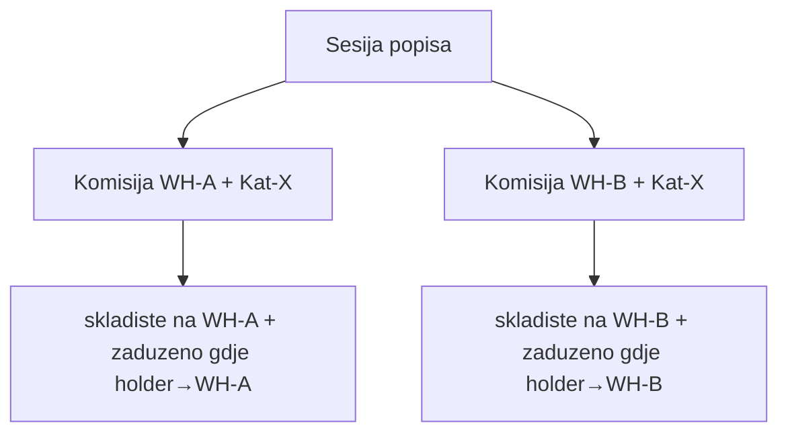

# Popis: opseg opreme + print/PDF (ažurirani plan)

## Šta je već urađeno (ne dirati)

Prethodna implementacija (`[popis_komisija_i_štampa](.cursor/plans/popis_komisija_i_štampa_5453418b.plan.md)`):

- Edit wizard → samo članovi (koraci 3–4)
- Print-scope API uključuje `stockLot.productName`
- `buildInventoryPrintEquipmentName` (lot + serijski + kategorija)
- Uklonjen Grad/Godina, prazna Kol., footer 3 linije

---

## Problem A (NOVO, kritično) — Ista oprema na svim skladištima

### Simptom

Dvije komisije (različita skladišta, ista ili slična kategorija) prikazuju **gotovo iste nosioce** i sličan broj stavki (~726 vs ~681). Oprema nije ograničena na `skladište + kategorija` slot.

### Uzrok

`[buildCommitteeEquipmentWhere](backend/src/modules/inventory-count/inventory-count.service.ts)` za `zaduzeno` opremu koristi:

```typescript
currentHolder: { orgUnitId: { in: coverageOrgUnitIds } }
// coverageOrgUnitIds = expand(warehouse.orgUnitId)
```

`[matchesWarehouseEquipmentScope](backend/src/modules/inventory-count/utils/resolve-warehouse-committee-scope.util.ts)` ima istu logiku.

Kada dva skladišta dijele isti `warehouse.orgUnitId` (npr. root distribucije), **oba slotova dobiju isti set zadužene opreme** — i iste grupe nosilaca na popisnoj listi.

**Nekonzistentnost:** članovi komisije se već filtriraju preko efektivnog skladišta zaposlenika (`[resolve-eligible-committee-members.util.ts](backend/src/modules/inventory-count/utils/resolve-eligible-committee-members.util.ts)`: `resolveForEmployee(id) === warehouseId`), ali oprema ne.

### Ispravno pravilo (source of truth)

```
Komisija (session, warehouseId, categoryId):
  isAccountingTracked = true
  AND inventoryNumber IS NOT NULL
  AND status ∉ { rashodovano, za_rashod }
  AND categoryKind = ASSET
  AND categoryId ∈ expand(committee.categoryId)
  AND (
    (status = skladiste AND equipment.warehouseId = committee.warehouseId)
    OR
    (status = zaduzeno AND resolveForEmployee(currentHolderId) = committee.warehouseId)
  )
```




### Implementacija

**1. Util** — `[resolve-warehouse-committee-scope.util.ts](backend/src/modules/inventory-count/utils/resolve-warehouse-committee-scope.util.ts)`:

- Dodati `resolveEmployeeWarehouseId(employeeId)` u `CommitteeScopeDeps`
- `matchesWarehouseEquipmentScope`: za `zaduzeno` koristiti `resolveEmployeeWarehouseId(holder.id) === warehouseId` (ne org-unit podstablo)
- `WarehouseScopeEquipment.currentHolder` proširiti sa `id` (employeeId) gdje nedostaje

**2. Service** — `[inventory-count.service.ts](backend/src/modules/inventory-count/inventory-count.service.ts)`:

- Nova privatna metoda `resolveEmployeeIdsForWarehouse(warehouseId)` — iterira zaposlenike, filtrira gdje `warehouseResolutionService.resolveForEmployee(id) === warehouseId` (cache po pozivu komisije)
- `buildCommitteeEquipmentWhere`: zamijeniti org-unit OR sa `currentHolderId: { in: employeeIds }`
- Wiring `evaluateEquipmentInCommitteeScope` / `countEquipmentInWarehouseCategoryScope` deps — inject `resolveForEmployee`

**3. Testovi** — `[resolve-warehouse-committee-scope.util.spec.ts](backend/src/modules/inventory-count/utils/resolve-warehouse-committee-scope.util.spec.ts)`:

- Ažurirati postojeće testove (mock `resolveEmployeeWarehouseId`)
- Novi test: dva skladišta, isti orgUnit root — holder efektivno na WH-A ulazi samo u WH-A komisiju

**4. Matrica** — `[.cursor/docs/matrices/inventory-count/MATRIX.md](.cursor/docs/matrices/inventory-count/MATRIX.md)` sekcija "Opseg opreme": zamijeniti `holder.orgUnitId u podstablu warehouse.orgUnitId` sa `resolveForEmployee(holder) === committee.warehouseId`

**Pogođeni API-ji** (svi koriste isti scope):

- `GET .../print-scope`
- `GET .../equipment-scope`
- `GET .../report`
- `POST .../lines` (validacija opsega)
- setup-options brojač opreme u wizardu

---

## Problem B — Print/PDF (još nije implementirano)

### B1. Kompaktni potpisi

`[inventory-print-sheet.tsx](frontend/src/components/inventory-count/inventory-print-sheet.tsx)`: footer `space-y-6 h-8` → `space-y-2 h-4`, manji margin.

### B2. Štampa svih stranica

**Uzrok:** `window.print()` unutar `[ModalRoot](frontend/src/components/ui/modal-root.tsx)` (`max-h-[90dvh] overflow-y-auto`) + visibility hack → browser štampa samo vidljivi dio.

**Fix:** obrazac iz `[disposal-report-sheet.tsx](frontend/src/components/inventory-count/disposal-report-sheet.tsx)` — generisati HTML u **novom prozoru** (`window.open` → `document.write` → `print()`).

Novi util: `[inventory-print-document.util.ts](frontend/src/components/inventory-count/inventory-print-document.util.ts)`:

- `buildInventoryPrintPages` — ekstrahovati paginaciju iz sheet komponente
- `buildInventoryPrintHtml` — A4 CSS, `page-break-after` po stranici
- `openInventoryPrintWindow`

### B3. PDF download (A4)

Dependency u `[frontend/package.json](frontend/package.json)`: `jspdf` + `jspdf-autotable`.

- `downloadInventoryPrintPdf` u istom utilu
- `didDrawPage` hook: header + 3 kompaktne linije + broj stranice
- Dugme **Preuzmi PDF** u toolbaru modala

---

## Redoslijed implementacije

1. **Opseg opreme (backend + testovi + matrica)** — mora biti prije validacije print liste
2. **Print util + new-window štampa + PDF**
3. **Kompaktni footer** u preview i HTML/PDF
4. **CHANGELOG** — jedan unos za scope fix + print/PDF

---

## Test plan


| #   | Scenarij                            | Očekivano                                                       |
| --- | ----------------------------------- | --------------------------------------------------------------- |
| 1   | WH-A i WH-B, ista parent kategorija | Različiti nosioci po efektivnom skladištu; nema 726/681 overlap |
| 2   | Oprema `skladiste`                  | Samo na `committee.warehouseId`                                 |
| 3   | Oprema `zaduzeno`                   | Samo holderi čije efektivno skladište = komisija WH             |
| 4   | Print 40+ str                       | Print dialog prikazuje sve stranice                             |
| 5   | Preuzmi PDF                         | A4, isti sadržaj, kompaktan footer                              |
