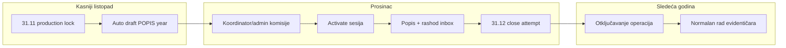

# Plan: Faza 5 — Produkcijska automatizacija popisa i rashoda

**Preduvjet:** Faze 1–4 ([popisni rashod workflow](../popisni_rashod_workflow_fdca4f4e.plan.md)) deployane i migracija primijenjena.

**Cilj:** U produkcijskom režimu automatski voditi godišnji ciklus popisa/rashoda (31.11 lock → draft sesija → komisije → aktivacija → 31.12 zatvaranje → otključavanje), uz opcionalnu ulogu koordinatora popisa.

---

## Kalendar (ciljno ponašanje)



| Datum | Događaj | Ko |
|-------|---------|-----|
| **31.11.** | `production_mode` lock: blok prijema/izdavanja, označavanja van liste (ako sesija postoji) | Sistem |
| **31.11.** | Kreiranje `InventorySession` `draft` `POPIS {year}` po distribuciji (ako ne postoji) | Sistem |
| **01.12.–31.12.** (default period) | Definisanje komisija, aktivacija, unos linija, rashod | Admin / koordinator / članovi |
| **31.12.** | Pokušaj zatvaranja sesije (ako nema pending rashoda) | Sistem + notifikacija adminu |
| **01.01.** | Sesija `closed` → uklanjanje production lock-a za tu distribuciju/godinu | Sistem |

*Napomena:* U dev okruženju `inventory.production_mode = false` — sve ostaje ručno kao danas.

---

## Odluke prije implementacije

Prihvatiti ili eksplicitno promijeniti:

| ID | Odluka | Default |
|----|--------|---------|
| D1 | Lock datum | `11-30` 23:59 Europe/Sarajevo |
| D2 | Auto activate 01.12 | **Isključeno** — admin/koordinator activate ručno |
| D3 | Force close 31.12 | **Ne** ako `DisposalInventoryApproval.pending > 0` |
| D4 | Distribucije | Svi `OrgUnit.type = distribucija` |
| D5 | Nova uloga | `UserRole.popis_koordinator` |
| D6 | Scheduler | `@nestjs/schedule` u Nest procesu |

---

## Faza 5.1 — Postavke (registry + enforcement)

### Novi ključevi (`settings.registry.ts`)

| Ključ | Tip | Default | Opis |
|-------|-----|---------|------|
| `inventory.production_mode` | boolean | `false` | Uključuje kalendar i jobove |
| `inventory.lock_date` | string | `11-30` | MM-DD zaključavanja (bez godine) |
| `inventory.session_end_date` | string | `12-31` | MM-DD kraja popisa |
| `inventory.auto_create_draft_session` | boolean | `true` | Job kreira draft na lock datum |
| `inventory.auto_close_session` | boolean | `true` | Job pokušava close na end datum |
| `inventory.auto_activate_session` | boolean | `false` | Opcionalno auto activate 01.12 |
| `inventory.scheduler_timezone` | string | `Europe/Sarajevo` | TZ za cron |

**Matrica:** ažurirati `settings/MATRIX.md` + `CHANGELOG.md`.

### Enforcement

- `InventoryProductionModeService` (novi util ili metode na `SettingsService`):
  - `isProductionLockActive(orgUnitId, date?)` — da li je danas ≥ lock datum i sesija za tu godinu nije `closed`
  - Koristi se u: `warehouse-stock` (prijem/issue), `equipment-disposal-list` (mark samo draft), `transfers` (opciono dodatna poruka)

---

## Faza 5.2 — Scheduler infrastruktura

### Paket

```bash
cd backend && npm install @nestjs/schedule
```

### Modul

- `backend/src/modules/inventory-scheduler/inventory-scheduler.module.ts`
- `inventory-scheduler.service.ts` — cron handleri
- Registracija u `app.module.ts` samo ako `INVENTORY_SCHEDULER_ENABLED=true` (env) **ili** `inventory.production_mode` (runtime check u handleru)

### Jobovi (idempotentni)

| Job | Cron (default) | Akcija |
|-----|----------------|--------|
| `handleInventoryLockDay` | `0 0 1 12 *` ili dinamički iz `lock_date` | Za svaku distribuciju: ensure draft sesija; postavi lock flag (settings cache / DB audit) |
| `handleInventoryEndDay` | `59 23 31 12 *` | Za aktivne sesije te godine: `closeSession` ako nema pending rashoda; inače notifikacija |
| `handleInventoryYearRollover` | `0 0 1 1 *` | Očisti production lock; log year rollover (bez migracije opreme) |

**Idempotencija:** prije create provjeri `@@unique([orgUnitId, year])`; prije close provjeri `status === active`.

### Audit

- Nova tablica opcionalno: `InventorySchedulerRun` (`jobName`, `ranAt`, `payload`, `result`) — ili log + `Notification` adminu.

---

## Faza 5.3 — Auto draft sesija

### Servis: `ensureDraftSessionForDistribution(orgUnitId, year)`

1. Ako postoji sesija za `(orgUnitId, year)` — return (bilo koji status osim deleted).
2. Inače `createSession({ name: 'POPIS {year}', orgUnitId, year })`.
3. Notifikacija adminu + koordinatorima (ako postoje): „Kreirana draft sesija — definirajte komisije”.

### Integracija

- Poziv iz `handleInventoryLockDay`.
- Ručni admin endpoint (opciono): `POST /inventory-sessions/ensure-draft?year=` za test.

---

## Faza 5.4 — Production freeze (proširenje)

### Trenutno

`InventoryFreezeService` blokira transfer/equipment mutacije kada postoji `active` sesija u gradu (osim admin / inventory line context).

### Dodati

| Akcija | Pravilo u production lock |
|--------|----------------------------|
| `stock_lot_create` / `stock_lot_issue` | Blok ako `isProductionLockActive` i nema izuzetka |
| `equipment-disposal-list` mark | Dozvoljeno samo dok je sesija `draft` (već postoji) |
| `commission` / `issue` iz lota | Blok u lock periodu |
| Admin | Uvijek bypass (kao danas) |

### UX

- `GET /inventory-sessions/freeze-banner` proširiti porukom production lock vs active session.
- Frontend banner na Skladištu, Oprema, Transferi.

---

## Faza 5.5 — Uloga `popis_koordinator`

### Prisma

```prisma
enum UserRole {
  admin
  evidenticar
  popis_koordinator  // novo
  user
  skladistar
}
```

Migracija + seed demo user (opciono).

### Scope koordinatora

Nova tablica (preporuka):

```prisma
model InventoryCoordinatorAssignment {
  id          String @id @default(uuid())
  userId      String
  warehouseId String
  orgUnitId   String?  // distribucija
  createdAt   DateTime @default(now())
  @@unique([userId, warehouseId])
}
```

**Dozvole `popis_koordinator`:**

| Akcija | Dozvoljeno |
|--------|------------|
| `GET /inventory-sessions` | Da (svoje distribucije/skladišta) |
| `POST/PATCH/DELETE committees` | Da, samo za dodijeljena skladišta, sesija `draft` |
| `PATCH activate` | **Ne** (samo admin) |
| `PATCH close` | **Ne** (samo admin) |
| Označavanje liste rashoda | Ne (evidentičar) |
| Unos linija popisa | Ne (član komisije) |

### Backend

- `InventoryCoordinatorScopeService` (slično `RegistrarScopeService`)
- Guards na `createCommittee`, `updateCommittee`, `deleteCommittee`
- JWT payload: `coordinatorAssignments[]`

### Frontend

- User management: dodjela skladišta koordinatoru
- `InventoryCountPage`: prikaži wizard komisija za koordinatora (bez create/delete sesije)
- Nav: `features.inventory_count` + role gate

---

## Faza 5.6 — Auto-close i otključavanje (31.12)

### Close politika

```
Za svaku InventorySession gdje year = currentYear AND status = active:
  IF disposalApprovals.pending.count > 0:
    notify admin + predsjednike rashoda
    NE pozivati closeSession
  ELSE IF sve committees isClosed (opciono):
    closeSession(adminSystemUser)
  ELSE:
    notify "Popis nije završen"
```

### System user

- Postavka `inventory.system_user_id` (private) ili `resolveCloseJobActorUserId()` već postoji — **uskladiti** s jobom.

### Nakon `closed`

- Production lock za tu godinu se skida (operacije normalne).
- `EquipmentDisposalListItem` ostaju historijski; nova godina = nova sesija, prazna lista.

### „Razdužena mapira na novu godinu”

- **Bez šeme:** oprema `skladiste` nakon razduženja ostaje aktivna; jedina veza na godinu je preko `InventorySession.year` na listi.
- Dokumentovati u matrici: nema automatskog kopiranja stavki liste.

---

## Faza 5.7 — Frontend i notifikacije

| Stavka | Detalj |
|--------|--------|
| Settings UI | Tab Inventura: production_mode, datumi, auto flags |
| Dashboard | Kartica „Popis {year}” — status sesije, broj komisija, pending rashod |
| Notifikacije | `inventory_draft_created`, `inventory_close_blocked`, `inventory_auto_closed` |
| Socket | Refresh sesije na scheduler event (opciono) |

---

## Faza 5.8 — Testovi i dokumentacija

### Testovi

- Unit: `isProductionLockActive` (granični datumi, timezone)
- Unit: `ensureDraftSessionForDistribution` idempotencija
- Unit: coordinator scope guards
- Integracija: mock cron → draft created once

### Matrice

- `inventory-count/MATRIX.md` — sekcija Production mode
- `disposal-commission/MATRIX.md` — kalendar rashoda
- `roles-access/MATRIX.md` — `popis_koordinator`
- `settings/MATRIX.md` — novi ključevi

---

## Predloženi redoslijed implementacije

| # | Zadatak | Zavisi od |
|---|---------|-----------|
| 1 | Postavke registry + `InventoryProductionModeService` | — |
| 2 | `@nestjs/schedule` + prazan modul | 1 |
| 3 | `ensureDraftSessionForDistribution` + lock day job | 1, 2 |
| 4 | Production freeze proširenje (warehouse-stock) | 1 |
| 5 | Prisma `popis_koordinator` + assignments | — |
| 6 | RBAC backend + frontend user admin | 5 |
| 7 | Koordinator UI na InventoryCountPage | 5, 6 |
| 8 | End day job + notifikacije | 2, 3 |
| 9 | Matrice + testovi + E2E checklist | sve |

**Procjena:** 2–3 fokusirane sesije (scheduler + RBAC + UI).

---

## E2E checklist (nakon implementacije)

- [ ] `production_mode=false` — ponašanje kao danas (ručno)
- [ ] `production_mode=true`, simulirani lock datum — draft sesija kreirana jednom
- [ ] Koordinator kreira komisiju za dodijeljeno skladište; ne može za drugo
- [ ] Admin activate nakon komisija; evidentičar ne može issue lota u lock periodu
- [ ] 31.12 s pending rashodom — sesija ostaje active, admin dobija notifikaciju
- [ ] 31.12 bez pending — sesija closed, operacije otključane
- [ ] Nova godina — nova draft sesija, stara lista se ne prenosi

---

## Reference

- [HANDOFF.md](./HANDOFF.md) — kontekst Faza 1–4
- [.cursor/docs/full-effect.md](../../docs/full-effect.md) §11.3 — životni ciklus sesije (scheduled stub)
- [popis-po-skladistu/HANDOFF.md](../popis-po-skladistu/HANDOFF.md) — komisije po skladištu
