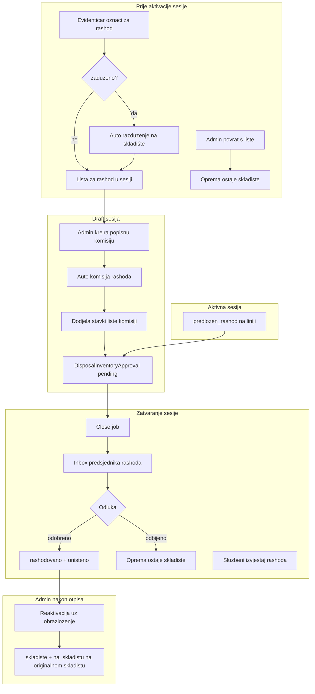

# Plan: Popisni rashod — lista, komisija, otpis

## Kontekst (šta već postoji)

| Dio | Stanje |
|-----|--------|
| Komisija rashoda uz popisnu | Postoji — auto u [`createCommittee`](backend/src/modules/inventory-count/inventory-count.service.ts) (linije 274–301) |
| `predlozen_rashod` na popisu | Postoji — close job → `DisposalInventoryApproval` |
| Predsjednik odobrava inbox | Postoji — `reviewDisposalApproval` |
| Legacy transfer `rashodovanje` + glasanje | Postoji — **uklanjamo za nove slučajeve** |
| Samostalna komisija po gradu | Postoji u [`DisposalCommissionsService.create`](backend/src/modules/disposal-commissions/disposal-commissions.service.ts) — **blokirati** |
| Pre-popisna lista za rashod | **Ne postoji** |

Vaše odluke ugrađene u plan:
- Zadužena oprema → **auto razduženje** na skladište (prenosnica `razduzenje` ako je `transfer.generation.*` uključeno)
- Konačno stanje → **`status=rashodovano` + `warehouseCondition=unisteno`** (komisija, bez koraka skladištara)
- Godina → vezana za **`InventorySession`**; dodjela komisiji pri **`createCommittee`**
- Admin može vratiti s liste **samo dok je sesija `draft`**; reaktivacija **nakon službenog otpisa** uz obrazloženje

---

## Ciljni tok



---

## Faza 1 — Model i backend jezgro

### 1.1 Prisma: `EquipmentDisposalListItem`

Novi model u [`schema.prisma`](backend/prisma/schema.prisma):

```prisma
enum EquipmentDisposalListStatus {
  listed
  withdrawn
  assigned
  approved
  rejected
}

model EquipmentDisposalListItem {
  id                   String @id @default(uuid())
  sessionId            String
  equipmentId          String
  warehouseId          String
  categoryId           String
  status               EquipmentDisposalListStatus @default(listed)
  note                 String? @db.Text
  markedByUserId       String
  markedAt             DateTime @default(now())
  withdrawnByUserId    String?
  withdrawnAt          DateTime?
  withdrawalNote       String? @db.Text
  razduzenjeTransferId String?
  disposalCommissionId String?
  approvalId           String? @unique

  session   InventorySession @relation(...)
  equipment Equipment @relation(...)
  // ...

  @@unique([sessionId, equipmentId])
  @@index([sessionId, warehouseId, categoryId, status])
}
```

### 1.2 Servis: označavanje za rashod

Novi util/modul (npr. [`equipment-disposal-list.service.ts`](backend/src/modules/inventory-count/equipment-disposal-list.service.ts)):

**`POST /inventory-sessions/:sessionId/disposal-list`** (evidentičar, admin)

Validacije:
- Sesija postoji i `status === 'draft'` (prije zvaničnog popisa)
- Oprema u registrar scope-u; `status !== rashodovano`; nije već na listi
- Oprema u opsegu sesije (grad distribucije + ASSET kategorija)
- Ako `zaduzeno`:
  - Odredi `warehouseId` (skladište iz assignment-a / coverage)
  - Ako `transfer.generation.enabled` + `on_razduzenje` → kreiraj transfer `razduzenje` (RAW, bez disposal approval)
  - Inače direktno `status=skladiste`, `warehouseCondition=na_skladistu`, `currentHolderId=null`
- Kreiraj `EquipmentDisposalListItem` (`listed`)

**`DELETE /inventory-sessions/:sessionId/disposal-list/:equipmentId`** (samo admin, sesija `draft`)

- Status → `withdrawn`, audit polja
- Oprema ostaje `skladiste` (već razdužena)

**`GET /inventory-sessions/:sessionId/disposal-list`** (evidentičar u scope-u, admin)

### 1.3 Hook u `createCommittee`

Nakon kreiranja `DisposalCommission` u postojećoj transakciji ([`inventory-count.service.ts`](backend/src/modules/inventory-count/inventory-count.service.ts) ~274):

1. Pronađi `EquipmentDisposalListItem` gdje `sessionId + warehouseId + categoryId ∈ expand(parentCategory)` i `status=listed`
2. Za svaku stavku: `DisposalInventoryApproval.create` (`pending`, `inventoryLineId=null`)
3. Ažuriraj stavku: `status=assigned`, `disposalCommissionId`, `approvalId`

### 1.4 Izmjena `reviewDisposalApproval`

U [`reviewDisposalApproval`](backend/src/modules/inventory-count/inventory-count.service.ts) (linija ~1758):

- **Approve** → `status=rashodovano`, `warehouseCondition=unisteno`, `currentHolderId=null`
- Ažuriraj povezani `EquipmentDisposalListItem` → `approved`
- **Reject** → list item → `rejected`; oprema ostaje `skladiste`

### 1.5 Admin reaktivacija

**`POST /equipment/:id/reactivate`** (admin):

- Samo ako `status=rashodovano` && `warehouseCondition=unisteno`
- Obavezno `reason` (tekst)
- Vrati na `skladiste` + `na_skladistu` na **originalnom** `warehouseId` (čuvati pri otpisu ili iz zadnjeg poznatog)
- `EquipmentEvent` ili novi audit zapis (`reaktivirano`)

---

## Faza 2 — Ukidanje / modifikacija legacy toka

### 2.1 Komisija rashoda samo uz popis

- [`DisposalCommissionsService.create`](backend/src/modules/disposal-commissions/disposal-commissions.service.ts): odbij ako nema `inventoryCommitteeId` konteksta (ili ukloni endpoint iz controllera)
- [`DisposalCommissionsPage`](frontend/src/components/DisposalCommissionsPage.tsx): ukloni formu kreiranja + tab „Legacy odobrenja“
- `findCommissionForCityAndEquipment`: koristi **samo** komisiju vezanu uz aktivnu sesiju + committee scope

### 2.2 Transfer `rashodovanje`

- U [`transfers.service.ts`](backend/src/modules/transfers/transfers.service.ts): ukloni auto-kreiranje `DisposalApproval` i blokadu sign-a za rashod
- `transfer.generation.on_rashodovanje`: ostaje u registry-ju ali **novi rashodovanje transferi se blokiraju** (poruka: koristiti listu za rashod)
- Postojeći historijski zapisi ostaju read-only

### 2.3 Skladištar `destroy-equipment`

- [`warehouses.service.ts`](backend/src/modules/warehouses/warehouses.service.ts): deprecate ili ograniči na legacy zapise (`spremno_za_unistenje` bez novog toka)
- UI tab „Za uništenje“: sakriti ili prikazati samo legacy

---

## Faza 3 — Frontend

| Lokacija | Promjena |
|----------|----------|
| [`EquipmentPage.tsx`](frontend/src/components/EquipmentPage.tsx) / detalj | Akcija „Označi za rashod“ (evidentičar) — bira sesiju (`draft` za distribuciju) ili auto-odabir jedine otvorene |
| Nova komponenta `disposal-list-panel.tsx` | U [`InventoryCountPage`](frontend/src/components/InventoryCountPage.tsx) za admin/evidentičara: pregled liste, admin povrat |
| [`session-disposal-tab.tsx`](frontend/src/components/inventory-count/session-disposal-tab.tsx) | Izvještaj uključuje i pre-popisne stavke (`source: registrar_list` vs `inventory_line`) |
| [`disposal-inbox-panel.tsx`](frontend/src/components/inventory-count/disposal-inbox-panel.tsx) | Bez promjene API-ja; prikaz izvora stavke |
| Admin na opremi | „Reaktiviraj“ modal s obrazloženjem (samo `rashodovano+unisteno`) |
| [`inventory-api.ts`](frontend/src/api/inventory-api.ts) | Novi endpointi za disposal-list |

Guard UX:
- Dok sesija `draft` → evidentičar može dodavati na listu
- Od `active` → samo popisna komisija (`predlozen_rashod`)
- Freeze banner ostaje za ostale mutacije

---

## Faza 4 — Matrice, postavke, testovi

### Matrice (obavezno isti dan)

- [`.cursor/docs/matrices/disposal-commission/MATRIX.md`](.cursor/docs/matrices/disposal-commission/MATRIX.md) — novi tok, uklonjen legacy
- [`.cursor/docs/matrices/inventory-count/MATRIX.md`](.cursor/docs/matrices/inventory-count/MATRIX.md) — lista za rashod, draft-only označavanje
- [`.cursor/docs/matrices/equipment-status/MATRIX.md`](.cursor/docs/matrices/equipment-status/MATRIX.md) — `unisteno` postavlja komisija; reaktivacija

### Postavke (registry)

- `features.disposal_pre_list` (boolean, default `true`) — gate za novi tok
- Opcionalno u Fazi 5: `inventory.auto_session_enabled`, `inventory.lock_date` (31.11.)

### Testovi

- Unit: mark zaduzeno → razduzenje (s/bez prenosnice), assign on committee create, approve → unisteno, admin withdraw, reactivate
- Proširiti [`cross-warehouse-issue.util.spec.ts`](backend/src/modules/warehouse-stock/cross-warehouse-issue.util.spec.ts) pattern za disposal list util

---

## Faza 5 — Produkcijska automatizacija (odvojeno, nakon jezgrenog toka)

Prema vašem opisu za produkciju (ne blokira Fazu 1–4):

- Postavka `inventory.production_mode`: 31.11. zaključavanje skladišta, auto-kreiranje `POPIS {year}` sesije
- Nova uloga npr. `popis_koordinator` — definisanje komisija za dodijeljena skladišta (bez punog admina)
- Nakon 31.12. auto-zatvaranje / otključavanje i rollover liste (nova godina = nova sesija, stavke se ne prenose)

Ovo zahtijeva zaseban plan za scheduler/cron + RBAC.

---

## Rizici i edge caseovi

| Slučaj | Rješenje |
|--------|----------|
| Oprema na listi, ali nema komisije za tu kategoriju/skladište do aktivacije | Admin mora kreirati komisiju prije `activate`; validacija pri aktivaciji: upozorenje ako lista ima nedodijeljene stavke |
| Razduzenje transfer ostane RAW | Lista se kreira tek nakon finalize razduzenja ILI lista + pending dok transfer nije finaliziran (preporuka: **finalize odmah** ako generation off; ako on → evidentičar mora završiti prenosnicu prije potvrde) |
| Legacy `spremno_za_unistenje` u bazi | Migracija/skripta: ostaviti skladištarski destroy samo za te zapise |
| Odbijena stavka na popisu | Oprema ostaje aktivna; evidentičar može ponovo označiti u sljedećoj godini |

---

## Redoslijed implementacije

1. Prisma migracija + `equipment-disposal-list` servis
2. Hook `createCommittee` + izmjena `reviewDisposalApproval`
3. Legacy deprecation (transfer rashod, standalone commission)
4. Frontend (Equipment + InventoryCount + reaktivacija)
5. Matrice + testovi
6. (Kasnije) Faza 5 produkcijska automatizacija
