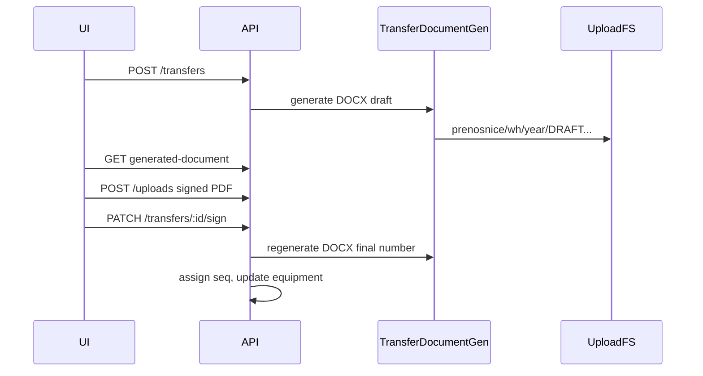

# Plan: Prenosnice — postavke, template, generisanje

## Kontekst (šta već postoji)

- Transfer workflow: [`backend/src/modules/transfers/transfers.service.ts`](backend/src/modules/transfers/transfers.service.ts) — statusi `raw` → `uploaded` → `potpisan`, broj `PRN-{godina}-{seq}` pri potpisu ([`document-number.util.ts`](backend/src/common/utils/document-number.util.ts)).
- RAW štampa: HTML [`transfer-raw-document.util.ts`](backend/src/modules/transfers/utils/transfer-raw-document.util.ts) + `GET /transfers/:id/raw-document`.
- Sken upload: [`uploads.service.ts`](backend/src/modules/uploads/uploads.service.ts) → `uploads/transfers/{godina}/{transferId}.ext`.
- Registry (djelimično): `features.transfers`, `transfer.require_upload_before_sign`, `transfer.allow_finalize_without_upload` u [`settings.registry.ts`](backend/src/modules/settings/settings.registry.ts).
- Automatski transfer pri izdavanju iz lota: [`finalize-stock-lot-issue.util.ts`](backend/src/modules/warehouse-stock/utils/finalize-stock-lot-issue.util.ts) (odmah `potpisan`).
- Matrica: [`.cursor/docs/matrices/transfers/MATRIX.md`](.cursor/docs/matrices/transfers/MATRIX.md).

## Vaše odluke (zaključano)

| Tema | Odluka |
|------|--------|
| Template | Samo **.docx** (docxtemplater) |
| Glavni prekidač | **Blokirati Transfer API** kad je isključeno (init/seed bez prenosnica) |
| PDF | **Generisani** DOCX (+ opcioni PDF za štampu) + **obavezan upload** potpisanog PDF-a prije finalizacije |
| Brojač | **Po skladištu** (`warehouseId`), reset na kraju godine |
| Org na skladištu | **`orgUnitId` obavezan** prije generisanja (validacija, ne fallback) |

Napomena: u zahtjevu je spomenut folder po org. ID-u; po dogovoru brojač i fajlovi idu po **`warehouseId`** (jasnije uz template po skladištu). `orgUnitId` ostaje obavezan na entitetu skladišta.

---

## 1. Registry postavke (source of truth)

Proširiti grupu `transfers` u [`settings.registry.ts`](backend/src/modules/settings/settings.registry.ts) i ažurirati [`.cursor/docs/matrices/settings/MATRIX.md`](.cursor/docs/matrices/settings/MATRIX.md) + `CHANGELOG.md`.

| Ključ | Default | Namjena |
|-------|---------|---------|
| `transfer.generation.enabled` | `true` | Master: ako `false` → `POST /transfers`, stock-lot issue transfer, inventory draft transfer — **odbij** (init faza) |
| `transfer.generation.on_stock_lot_issue` | `true` | Prvo izdavanje komada iz lota (auto-transfer u lot issue) |
| `transfer.generation.on_zaduzenje` | `true` | Skladište → osoba (roba već u sistemu, status skladište) |
| `transfer.generation.on_prenos` | `true` | Osoba → osoba |
| `transfer.generation.on_razduzenje` | `true` | Osoba → skladište |
| `transfer.generation.on_rashodovanje` | `true` | Rashod |
| `transfer.generate_print_pdf` | `true` | Nakon DOCX, generiši PDF za štampu (server) |
| `transfer.require_signed_pdf_upload` | `true` | Obavezan upload potpisanog PDF-a prije `sign` (zamjenjuje/deprecira semantiku `transfer.require_upload_before_sign` — jedan ključ, stari ostaje alias ili se ukloni iz UI) |

Postojeći ključevi ostaju: `transfer.allow_finalize_without_upload` (admin izuzetak), `features.transfers` (modul), `upload.max_mb`.

**Helper** (novi fajl ~80 linija): `backend/src/modules/transfers/utils/transfer-generation-policy.util.ts`

- `assertTransferCreationAllowed(type, context: 'api' \| 'stock_lot' \| 'inventory')`
- Mapiranje tipa → setting ključ (npr. `zaduzenje` + `stock_lot` → `on_stock_lot_issue` vs `on_zaduzenje` preko konteksta)

**Enforcement tačke:**

- [`TransfersService.create`](backend/src/modules/transfers/transfers.service.ts)
- [`executeStockLotIssueInTx`](backend/src/modules/warehouse-stock/utils/finalize-stock-lot-issue.util.ts)
- [`inventory-count.service.ts`](backend/src/modules/inventory-count/inventory-count.service.ts) (draft transferi)
- Frontend: disable akcije u [`create-transfer-payload.util.ts`](frontend/src/helpers/create-transfer-payload.util.ts) / EquipmentCard uz `useAdminSettings` + public flag za read-only poruku

---

## 2. Prisma — template, sekvenca, putanje na transferu

Nove tabele u [`schema.prisma`](backend/prisma/schema.prisma):

```prisma
model WarehouseTransferTemplate {
  id              String   @id @default(uuid())
  warehouseId     String
  label           String   @db.VarChar(120)  // npr. "Službeni 2026"
  templatePath    String   @db.VarChar(500) // uploads/templates/warehouses/{warehouseId}/...
  isActive        Boolean  @default(false)
  uploadedByUserId String
  createdAt       DateTime @default(now())
  warehouse       Warehouse @relation(...)
  uploadedBy      User      @relation(...)
  @@index([warehouseId, isActive])
}

model TransferDocumentSequence {
  warehouseId String
  year        Int
  lastNumber  Int      @default(0)
  @@id([warehouseId, year])
}
```

Proširenje `Transfer`:

- `documentWarehouseId String?` — skladište za brojač/putanju (popunjava se pri kreiranju)
- `generatedDocxPath String?`
- `generatedPdfPath String?`

Migracija + `prisma generate`.

**Broj dokumenta:** novi format `{n}/{godina}` (npr. `42/2026`), sekvenca atomično iz `TransferDocumentSequence` **po `documentWarehouseId` + godina**. Rashod: opcija `R/{n}/{godina}` ili isti brojač — u planu implementacije predložiti **zaseban rashod brojač po skladištu** (kao danas odvojeno od običnih).

Zamjena [`document-number.util.ts`](backend/src/common/utils/document-number.util.ts) + unit testovi za parse/increment.

---

## 3. Skladište ↔ template (UI + API)

**Backend** — modul ili podmodul u `warehouses`:

- `POST /backend/warehouses/:id/transfer-template` — multipart `.docx`, max `upload.max_mb`
- `GET .../transfer-template` — meta aktivnog templatea
- `PATCH .../transfer-template/:templateId/activate` — jedan aktivan po skladištu
- Validacija pri uploadu: warehouse mora imati `orgUnitId` (vaša odluka)

**Storage templatea:** `uploads/templates/warehouses/{warehouseId}/{templateId}.docx` (ne miješati s generisanim prenosnicama).

**Frontend** — u [`warehouse-detail-view.tsx`](frontend/src/components/warehouses/warehouse-detail-view.tsx) (admin):

- Upload .docx, label verzije, lista verzija, aktiviraj
- Info panel sa **obaveznim placeholderima** (copy za korisnika):

| Placeholder | Izvor |
|-------------|--------|
| `{broj_prenosnice}` | `documentNumber` pri potpisu / `DRAFT-...` u RAW |
| `{predao}` | from skladište / osoba |
| `{preuzeo}` | to skladište / osoba / rashod |
| `{potpisnik}` | signer |
| `{inv_broj}` | `equipment.inventoryNumber` |
| `{naziv_opreme}` | kategorija + specifikacije (kratki label) |
| `{obrazlozenje}` | `reason` + `notes` |

Opis istih placeholdera u **Postavke → Prenosi** (registry `description` na novom string ključu `transfer.template_placeholders_help` ili statički blok u UI).

**Postavke tab** [`settings-ui-tabs.ts`](frontend/src/constants/settings-ui-tabs.ts): proširiti opis taba „Prenosi”; svi novi boolean switch-evi u tom tabu.

---

## 4. Generisanje dokumenta (DOCX + PDF)

Novi servis: `backend/src/modules/transfers/transfer-document-generation.service.ts`

- Zavisnost: **`docxtemplater` + `pizzip`** (bez legacy `.doc`)
- Ulaz: aktivni `WarehouseTransferTemplate` za `documentWarehouseId`
- Izlaz find/replace u DOCX
- **Kada generisati:**
  - Pri `create` (RAW): DOCX s `DRAFT-...` u `{broj_prenosnice}` (štampa prije potpisa)
  - Pri `sign`: regeneracija s finalnim `{n}/{godina}`, ažuriranje putanja
- **PDF za štampu** (ako `transfer.generate_print_pdf`): faza 1a — **LibreOffice headless** u Docker image (`soffice --convert-to pdf`) ili faza 1b (manji scope) — samo DOCX download, PDF u sljedećoj iteraciji. Preporuka u implementaciji: DOCX odmah, PDF kad je LibreOffice u deployu (dokumentovati u HANDOFF).

**Putanja generisanih fajlova:**

```
{UPLOAD_DIR}/prenosnice/{warehouseId}/{year}/{documentNumber}.docx
{UPLOAD_DIR}/prenosnice/{warehouseId}/{year}/{documentNumber}.pdf   # opciono
```

**Resolve `documentWarehouseId`:**

| Tip | Pravilo |
|-----|---------|
| zaduzenje | `fromWarehouseId` |
| razduzenje | `toWarehouseId` |
| rashodovanje | `fromWarehouseId` ili `equipment.warehouseId` |
| prenos | `equipment.warehouseId` ili warehouse evidentičara/holdera (koristiti postojeći [`WarehouseResolutionService`](backend/src/common/services/warehouse-resolution.service.ts)) |

Ako nema skladišta / nema aktivnog templatea / nema `orgUnitId` → jasna `BadRequestException` pri generisanju (ne pri svakom transferu ako je generisanje za taj tip isključeno u settings).

**Upload potpisanog PDF-a:** proširiti [`UploadsService`](backend/src/modules/uploads/uploads.service.ts):

- Dozvoljeni MIME ostaje PDF za „potpisani“ korak (slike opciono zadržati za inventar?)
- Relativna putanja skena: `prenosnice/{warehouseId}/{year}/{documentNumber}-signed.pdf` (umjesto `transfers/{year}/{id}.ext`)
- `assertCanFinalizeUpload` koristi `transfer.require_signed_pdf_upload`

---

## 5. API i frontend workflow



Novi endpointi:

- `GET /transfers/:id/generated-document?format=docx|pdf` — stream fajla
- Zadržati `raw-document` HTML kao **fallback** ako nema templatea (ili ukloniti nakon migracije — u matrici zapisati)

[`TransferDocumentPanel.tsx`](frontend/src/components/TransferDocumentPanel.tsx):

- Preuzmi generisani DOCX/PDF umjesto HTML raw (fallback na HTML)
- Upload samo PDF ako je `require_signed_pdf_upload`
- Korak „Štampa“ / „Potpisani PDF“

[`DocumentsPage.tsx`](frontend/src/components/DocumentsPage.tsx): štampa/preuzimanje generisanog dokumenta.

---

## 6. Inicijalizacija aplikacije

- Setup / seed dokumentacija: postaviti `transfer.generation.enabled = false` pri masovnom uvozu opreme.
- [`app.initialized`](backend/src/modules/settings/settings.registry.ts): nakon setupa admin uključuje generisanje.
- Matrica transfers: sekcija „Init mode“ — nema Transfer API dok je master off.

---

## 7. Dokumentacija i testovi

| Fajl | Šta |
|------|-----|
| [`.cursor/docs/matrices/transfers/MATRIX.md`](.cursor/docs/matrices/transfers/MATRIX.md) | Settings, broj `n/godina`, putanje, template, PDF workflow |
| [`.cursor/docs/matrices/settings/MATRIX.md`](.cursor/docs/matrices/settings/MATRIX.md) | Novi ključevi |
| [`.cursor/docs/matrices/warehouses/MATRIX.md`](.cursor/docs/matrices/warehouses/MATRIX.md) | Template po skladištu, obavezan orgUnit |
| `document-number.util.spec.ts` | Brojač po skladištu/godini |

Unit testovi bez LibreOffice: mock FS + docxtemplater sa minimalnim .docx fixture.

---

## Predlozi (opciono, nije blokirajuće)

1. **Pregled generisanog PDF u UI** (iframe) prije uploada potpisanog.
2. **Notifikacija** kad transfer čeka upload (`transfer_complete` već postoji — proširiti za pending upload).
3. **Verzionisanje templatea** — arhiva starih .docx, samo jedan `isActive`.
4. **Bulk export** prenosnica po skladištu/godini (zip) — kasnija faza.

---

## Redoslijed implementacije (faze)

1. Registry + policy helper + enforcement na create (bez DOCX) + matrice
2. Prisma (sequence, template, transfer polja) + broj `n/godina`
3. Warehouse template API + admin UI + placeholder help
4. docxtemplater generisanje + putanje `prenosnice/` + download endpoint
5. Upload PDF obavezan + putanja skena + TransferDocumentPanel
6. PDF iz DOCX (LibreOffice) ako deploy dozvoljava; inače HANDOFF
7. Ukloniti/deprecirati stari `PRN-` format u migraciji postojećih brojeva (jednokratni SQL skript ili ostaviti stare, nove po pravilu)

---

## Rizici

- **Docker + LibreOffice** za PDF — planirati u [`docker-compose`](docker-compose.yml) / deploy docs.
- **Stock lot issue** danas kreira odmah `potpisan` transfer — mora poštovati settings i i dalje generisati dokument + eventualno PDF u istom toku.
- **Prenos bez warehouseId na opremi** — mora se riješiti u `resolveDocumentWarehouseId` prije generisanja.
