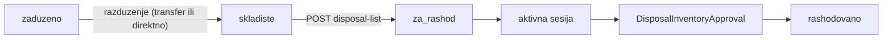

# Rashod samo sa skladišta

## Problem

Pre-popisna lista (`POST /inventory-sessions/:id/disposal-list`) za `**zaduzeno**` opremu pokušava auto-razduženje u istom koraku (`[equipment-disposal-list.service.ts](backend/src/modules/inventory-count/equipment-disposal-list.service.ts)` + `[execute-disposal-mark-razduzenje.util.ts](backend/src/modules/inventory-count/utils/execute-disposal-mark-razduzenje.util.ts)`). To se sudara s postavkama potpisanog PDF-a i daje obmanjujuću grešku (transfer ID koji ne postoji nakon rollback-a).

**Aktivni popis** već ima ispravno pravilo — `predlozen_rashod` zahtijeva `skladiste`:

```1647:1650:backend/src/modules/inventory-count/inventory-count.service.ts
if (status === 'predlozen_rashod') {
  if (equipment.status !== 'skladiste' || !equipment.warehouseId) {
    throw new BadRequestException('Proposed disposal requires equipment on warehouse (razduženo)');
```

Cilj: **isti princip** za pre-listu i UI.




---

## Faza 1 — Backend: striktna provjera skladišta

**Fajl:** `[equipment-disposal-list.service.ts](backend/src/modules/inventory-count/equipment-disposal-list.service.ts)`

1. U `markForDisposal`, odmah nakon provjere statusa `rashodovano`/`za_rashod`, dodati:

```ts
if (equipment.status !== 'skladiste' || !equipment.warehouseId) {
  throw new BadRequestException(DISPOSAL_MESSAGES.disposalRequiresWarehouse);
}
```

1. **Ukloniti** cijelu granu `zaduzeno` (linije ~151–181):
  - import i poziv `executeRazduzenjeForDisposalMarkInTx`
  - `createTransfer`, `finalizeWithoutUpload`, `signerId`, `getDefaultSignerId` (ako više nema drugih poziva)
  - `razduzenjeTransferId` u create/update list itema → uvijek `null` (kolona ostaje u Prisma za historijske zapise)
2. Pojednostaviti `skladiste` granu: koristiti `equipment.warehouseId` kao `warehouseId` (validirati da odgovara slotu komisije; opciono uskladiti warehouse ako se razlikuje od ciljnog slot skladišta — trenutno već postoji update).
3. U `findEligibleSessionsForEquipment`: early return `[]` ako `equipment.status !== 'skladiste' || !equipment.warehouseId`.

**Poruka:** nova konstanta u `[disposal-messages.util.ts](backend/src/common/utils/disposal-messages.util.ts)`, npr.:

> `Oprema mora biti razdužena na skladište prije dodavanja na listu za rashod.`

**Dead code:** obrisati `[execute-disposal-mark-razduzenje.util.ts](backend/src/modules/inventory-count/utils/execute-disposal-mark-razduzenje.util.ts)`.

**DTO cleanup (opciono u istom PR-u):** ukloniti nekorišteni `signerId` iz `[mark-disposal-list.dto.ts](backend/src/modules/inventory-count/dto/mark-disposal-list.dto.ts)` i FE API tipa.

---

## Faza 2 — Frontend: ne nuditi rashod za zaduženo


| Fajl                                                                                                         | Promjena                                                                                                                                                                                              |
| ------------------------------------------------------------------------------------------------------------ | ----------------------------------------------------------------------------------------------------------------------------------------------------------------------------------------------------- |
| `[EquipmentCard.tsx](frontend/src/components/EquipmentCard.tsx)`                                             | `canMarkForDisposal` zahtijeva `eq.status === 'skladiste'`                                                                                                                                            |
| `[disposal-guards.ts](frontend/src/helpers/guards/disposal-guards.ts)`                                       | Proširiti `canMarkDisposalList` (ili novi helper) s `equipmentStatus`; poruka ako nije `skladiste`                                                                                                    |
| `[equipment-mark-disposal-dialog.tsx](frontend/src/components/equipment/equipment-mark-disposal-dialog.tsx)` | Ažurirati copy: objasniti da je potrebno prethodno razduženje; prazan state razlikovati „nema sesije“ od „oprema nije na skladištu“ (ako dialog može otvoriti admin — guard na dugmetu već sprječava) |
| `[guards/index.ts](frontend/src/helpers/guards/index.ts)`                                                    | Export ažuriranog guarda                                                                                                                                                                              |


Za `zaduzeno` opremu: dugme **„Za rashod“** se ne prikazuje; ostaje **„Razduži“** (`canRazduzenje`).

---

## Faza 3 — Postavka `transfer.generation.on_rashodovanje`

Trenutno **mrtva** za novi tok — BE uvijek blokira create (`TRANSFER_MESSAGES.rashodovanjeBlocked`), rashod ide kroz `DisposalInventoryApproval`.


| Akcija                           | Fajl                                                                                                                                                                                                    |
| -------------------------------- | ------------------------------------------------------------------------------------------------------------------------------------------------------------------------------------------------------- |
| `display: 'deprecated'` + detail | `[settings-ui-metadata.ts](backend/src/modules/settings/settings-ui-metadata.ts)`                                                                                                                       |
| Napomena u matrici               | `[.cursor/docs/matrices/transfers/MATRIX.md](.cursor/docs/matrices/transfers/MATRIX.md)` + `[.cursor/docs/matrices/disposal-commission/MATRIX.md](.cursor/docs/matrices/disposal-commission/MATRIX.md)` |
| CHANGELOG                        | oba modula + `[settings/CHANGELOG.md](.cursor/docs/matrices/settings/CHANGELOG.md)`                                                                                                                     |


**Ne brisati** ključ iz registry-ja (kompatibilnost sa starim transferima u bazi koji se eventualno potpisuju).

**Opcionalno (mali cleanup):** ukloniti opciju `rashodovanje` iz create forme na `[TransfersPage.tsx](frontend/src/components/TransfersPage.tsx)` umjesto disabled dugmeta — već je blokirano guardom.

---

## Faza 4 — Testovi

Novi spec (preporuka: čisti util ili service-level s mock Prisma):

`**assert-disposal-warehouse-eligibility.util.ts`** (novi, ~15 linija) + `.spec.ts`:

- `zaduzeno` → not eligible
- `skladiste` bez `warehouseId` → not eligible
- `skladiste` s `warehouseId` → eligible

Koristiti u `markForDisposal` i `findEligibleSessionsForEquipment` (DRY).

FE: dodati test u postojeći guards spec ili novi `disposal-guards.spec.ts` — `canMarkDisposalList` / status guard.

---

## Faza 5 — Dokumentacija i guard registry


| Dokument                                                                                     | Promjena                                                             |
| -------------------------------------------------------------------------------------------- | -------------------------------------------------------------------- |
| `[disposal-commission/MATRIX.md](.cursor/docs/matrices/disposal-commission/MATRIX.md)`       | Korak 3: ukloniti auto-razduženje; „samo `skladiste`“                |
| `[disposal-commission/CHANGELOG.md](.cursor/docs/matrices/disposal-commission/CHANGELOG.md)` | Datum + razlog                                                       |
| `[inventory-count/MATRIX.md](.cursor/docs/matrices/inventory-count/MATRIX.md)`               | Pre-lista usklađena s `predlozen_rashod`                             |
| `[GUARDS_REGISTRY.md](.cursor/docs/matrices/GUARDS_REGISTRY.md)`                             | `mark_disposal_list` preconditions: `equipment.status === skladiste` |


---

## Verifikacija (ručno)

1. Oprema `**zaduzeno**` → nema dugmeta „Za rashod“; `eligible-for-equipment` → `[]`.
2. Ručno **razduženje** (s ili bez prenosnice prema postavkama) → oprema `skladiste`.
3. **„Dodaj na listu“** → uspjeh, status `za_rashod`.
4. Na aktivnom popisu `**predlozen_rashod`** i dalje radi (regresija).
5. Disposal inbox + predsjednik approve → `rashodovano` (nepromijenjeno).

---

## Procjena


| Faza            | Rizik | Fajlovi            |
| --------------- | ----- | ------------------ |
| 1 BE            | Nizak | 2–3 BE + poruka    |
| 2 FE            | Nizak | 3–4 FE             |
| 3 Settings/docs | Nizak | metadata + matrice |
| 4 Testovi       | Nizak | 1 util + spec      |
| 5 Docs          | Nizak | matrice            |


Jedan fokusirani PR; bez Prisma migracije (`razduzenjeTransferId` kolona ostaje).
