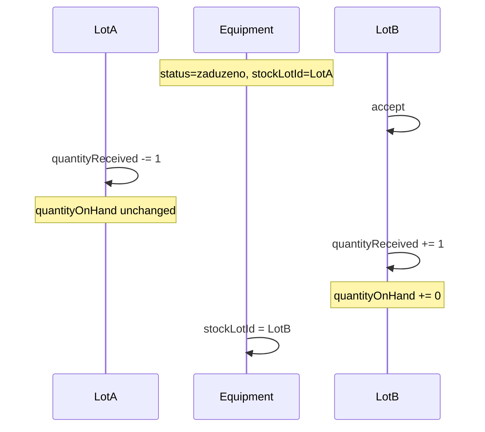

# Plan: Ispravka lot knjigovodstva pri relocation transferu

## Problem

Nakon uspješnog relocation transfera (A → B):

| Skladište | Trenutno (pogrešno) | Očekivano |
|-----------|---------------------|-----------|
| **A** (izvorni lot) | `quantityReceived` se ne dira; oprema nestane iz `issuedUnits` jer `stockLotId` prelazi na B | `quantityReceived -= 1`, `quantityOnHand` **bez promjene** (komad već izdat) |
| **B** (dest lot) | `quantityReceived += 1` **i** `quantityOnHand += 1` | `quantityReceived += 1`, `quantityOnHand += 0` (oprema i dalje **zaduzeno** radniku) |

Primjer iz tvog scenarija:
- Prije: lot A **5/6** (5 na stanju, 6 primljeno, 1 zaduženo)
- Poslije: lot A **5/5** (1 komad napustio skladište A), lot B **0/1** (1 primljen, 0 na polici jer je kod radnika)

Matrica trenutno kaže samo da izvorni `quantityOnHand` ne mijenja — **nema** pravila za `quantityReceived` ni za zaduženu opremu na cilju ([MATRIX.md](.cursor/docs/matrices/employee-relocation/MATRIX.md) linije 48–52).

## Root cause

U [`executeDestAccept`](backend/src/modules/employee-relocation/employee-relocation.service.ts) (~704–745):

```717:723:backend/src/modules/employee-relocation/employee-relocation.service.ts
      await tx.warehouseStockLot.update({
        where: { id: lot.id },
        data: {
          quantityReceived: { increment: 1 },
          quantityOnHand: { increment: 1 },
          incomingRelocation: false,
        },
      });
```

- Nema update-a **izvornog** lota (`equipment.stockLotId` prije promjene)
- Dest uvijek povećava i `quantityOnHand` — pogrešno za `status=zaduzeno`

## Rješenje



### 1. Backend — `executeDestAccept`

Fajl: [`employee-relocation.service.ts`](backend/src/modules/employee-relocation/employee-relocation.service.ts)

Prije update-a opreme, u istoj transakciji:

**a) Izvorni lot (ako postoji `equipment.stockLotId`):**
- Učitaj source lot; provjeri `sourceLot.warehouseId === caseRow.fromWarehouseId`
- `quantityReceived: { decrement: 1 }` (guard: ne smije pasti ispod 0 — `BadRequestException` ako bi)
- **`quantityOnHand` ne dirati**

**b) Dest lot — uvjetno po statusu opreme:**
- Ako `equipment.status === 'zaduzeno'`:
  - `quantityReceived: { increment: 1 }`
  - **ne** incrementati `quantityOnHand`
- Inače (edge case, npr. legacy `skladiste`):
  - oba `+= 1` (postojeće ponašanje)

**c) Ostalo ostaje:**
- `equipment.stockLotId` → dest lot
- `incomingRelocation: false` na dest lotu
- audit event proširiti payloadom `{ sourceStockLotId, quantityReceivedDelta: -1 }`

**d) Edge case — oprema bez `stockLotId`:**
- Preskočiti source decrement (logirati u event payload `sourceStockLotId: null`)
- Dest accept i dalje radi

### 2. Helper util (mali, testabilan)

Novi fajl: [`backend/src/modules/employee-relocation/utils/relocation-lot-deltas.util.ts`](backend/src/modules/employee-relocation/utils/relocation-lot-deltas.util.ts)

```typescript
export const resolveDestAcceptLotDeltas = (equipmentStatus: string) => ({
  destOnHandDelta: equipmentStatus === 'zaduzeno' ? 0 : 1,
  destReceivedDelta: 1,
  sourceReceivedDelta: -1,
});
```

Koristi se u servisu + unit testovi.

### 3. Dest reject — bez promjene

[`executeDestReject`](backend/src/modules/employee-relocation/employee-relocation.service.ts) ne dira lotove — ispravno, jer transfer nije finaliziran.

### 4. Unit testovi

Novi spec: `employee-relocation-lot-accounting.spec.ts`

- `zaduzeno` → dest deltas `{ received: +1, onHand: 0 }`
- `skladiste` → dest deltas `{ received: +1, onHand: +1 }`
- source delta uvijek `-1` received

Proširiti ili dodati integration-style mock test za `executeDestAccept` transakciju (source decrement + dest increment bez onHand).

Dodati u [`backend/package.json`](backend/package.json) `test:unit` script.

### 5. Matrica + changelog

Ažurirati [`.cursor/docs/matrices/employee-relocation/MATRIX.md`](.cursor/docs/matrices/employee-relocation/MATRIX.md):

**Stock pravila (revizija):**
- Izvorni lot na **prihvatu na cilju**: `quantityReceived -= 1`; `quantityOnHand` ne mijenja se
- Dest lot na prihvatu (zaduzeno): `quantityReceived += 1`, `quantityOnHand` ostaje 0
- Dest lot na prihvatu (skladiste): oba `+= 1`

[CHANGELOG.md](.cursor/docs/matrices/employee-relocation/CHANGELOG.md) — nova stavka.

### 6. Van scope-a

- Retroaktivna korekcija postojećih lotova u bazi (ručni SQL/migration script) — samo ako zatražiš
- UI promjene — display `quantityOnHand/quantityReceived` već ispravan kad su DB brojevi točni
- `executeSourceTransfer` — promjene samo na **accept**, ne na Prebaci

## Manual QA

1. Lot A: 6 primljeno, izdaj 1 komad radniku → **5/6**, 1 u issuedUnits
2. Admin promijeni org. jedinicu → relocation case
3. Mapiraj šifrarnik (ako treba) → Prebaci → Prihvati na B
4. Lot A: **5/5**, issuedUnits bez tog komada
5. Lot B: **0/1**, issuedUnits s tim komadom (zaduzeno)
6. Dest reject scenario: lot A ostaje **5/6** (nema promjene)
