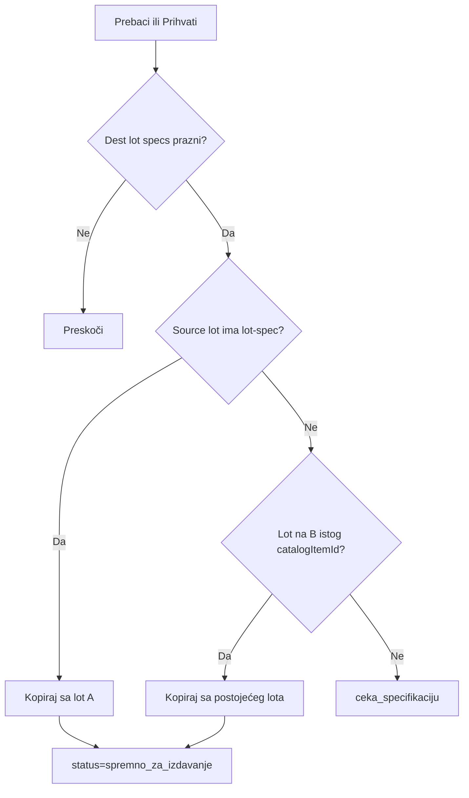

# Plan: Nasljeđivanje lot specifikacije pri relocation transferu

## Cilj

Kad oprema prelazi sa skladišta A na B, dest `WarehouseStockLot` ne smije ostati `ceka_specifikaciju` s praznim `specifications` ako isti tip već ima definisanu lot-spec na izvoru ili na cilju.

**Pravilo:** jedna lot-specifikacija po `catalogItemId` na skladištu — ne duplicirati ručni rad evidentičara.

**Trigger (potvrđeno):** idempotentno na **Prebaci** i **Prihvati** — kopira samo ako dest lot još nema spec.



## Van scope-a

- `mapLineCatalog` — mapira samo `equipment.catalogItemId`, ne lot spec
- Canonical spec na `EquipmentCatalogItem` (schema promjena)
- Merge incoming lot u postojeći lot na B
- Retroaktivna korekcija starih lotova u bazi

---

## Faza 1 — Util za nasljeđivanje

Novi fajl: [`backend/src/modules/employee-relocation/utils/inherit-dest-lot-specifications.util.ts`](backend/src/modules/employee-relocation/utils/inherit-dest-lot-specifications.util.ts)

### 1.1 Helperi

```typescript
// Prazan lot-spec: {} ili svi lot-field vrijednosti prazni (unique polja ignorisati)
isLotSpecificationsEmpty(specs: Record<string, string>, lotFields: CategoryFieldDefinition[]): boolean

// Izvor kandidata (prioritet):
resolveInheritedLotSpecifications(
  sourceLot: { specifications, status } | null,
  destExistingLot: { specifications, status } | null,
): Record<string, string> | null
```

Prioritet izvora:
1. **Izvorni lot opreme** (`equipment.stockLotId`) — ako `specifications` nisu prazne (tipično `spremno_za_izdavanje` na A)
2. **Postojeći lot na ciljnom skladištu** — `findFirst` gdje `warehouseId = toWarehouse`, `catalogItemId` match, `status = spremno_za_izdavanje`, specs nisu prazne, `id !== destLotId`; sort `specDefinedAt desc`

### 1.2 Transakcijska funkcija

```typescript
inheritDestLotSpecificationsInTx(
  tx: Prisma.TransactionClient,
  input: {
    destLotId: string;
    sourceStockLotId: string | null;
    destWarehouseId: string;
    catalogItemId: string | null;
    categoryId: string;
    lotFields: CategoryFieldDefinition[];
    optionalFields: CategoryFieldDefinition[];
    actorUserId: string;
  },
): Promise<{ inherited: boolean; source: 'source_lot' | 'dest_existing' | null }>
```

Logika:
1. Učitaj dest lot; ako specs **nisu** prazni → `{ inherited: false }`
2. Učitaj source lot (ako `sourceStockLotId`); nađi dest existing lot (ako `catalogItemId`)
3. `resolveInheritedLotSpecifications` → ako `null`, return
4. `validateLotSpecifications(inherited, lotFields, optionalFields)` — isti validator kao [`defineSpecifications`](backend/src/modules/warehouse-stock/warehouse-stock.service.ts)
5. `warehouseStockLot.update` na dest:
   - `specifications: inherited`
   - `status: 'spremno_za_izdavanje'`
   - `specDefinedByUserId: actorUserId` (ili source `specDefinedByUserId` ako postoji — prefer actor pri accept)
   - `specDefinedAt: new Date()`

---

## Faza 2 — Hook u relocation servisu

Fajl: [`employee-relocation.service.ts`](backend/src/modules/employee-relocation/employee-relocation.service.ts)

### 2.1 Proširiti `lineInclude`

Na `equipment.stockLot` dodati select:
- `specifications`
- `status`

### 2.2 Hook u `executeSourceTransfer`

Nakon kreiranja/pronalaženja dest lota i prije `employeeRelocationLine.update` (unutar iste `$transaction`):

```typescript
await inheritDestLotSpecificationsInTx(tx, {
  destLotId: lot.id,
  sourceStockLotId: line.equipment.stockLotId,
  destWarehouseId: caseRow.toWarehouseId,
  catalogItemId,
  categoryId: line.categoryId,
  lotFields, optionalFields, // iz categoriesService.getFieldDefinitions
  actorUserId: user.id,
});
```

Field definitions: `categoriesService.assertLeafCategory(line.categoryId)` + `getFieldDefinitions`.

Proširiti event payload `source_transfer` s `specsInherited: boolean`.

### 2.3 Hook u `applyDestAcceptLotUpdatesInTx`

Fajl: [`relocation-lot-accounting.util.ts`](backend/src/modules/employee-relocation/utils/relocation-lot-accounting.util.ts)

Proširiti input s opcionalnim parametrom za spec inheritance (category fields + actorUserId + sourceStockLotId + catalogItemId). Poziv **nakon** dest lot quantity update, idempotentno.

Alternativa (manje coupling): poziv iz `executeDestAccept` odmah nakon `applyDestAcceptLotUpdatesInTx` u istoj transakciji — service već ima `CategoriesService`.

Proširiti `dest_accepted` event payload.

---

## Faza 3 — Testovi

| Fajl | Šta testira |
|------|-------------|
| [`inherit-dest-lot-specifications.util.spec.ts`](backend/src/modules/employee-relocation/utils/inherit-dest-lot-specifications.util.spec.ts) | `isLotSpecificationsEmpty`, `resolveInheritedLotSpecifications` prioritet |
| [`employee-relocation-spec-inheritance.spec.ts`](backend/src/modules/employee-relocation/employee-relocation-spec-inheritance.spec.ts) | Mock tx: inherit iz source; fallback dest existing; skip kad dest već ima spec; skip kad oba prazna |

Dodati oba spec fajla u [`backend/package.json`](backend/package.json) `test:unit`.

---

## Faza 4 — Dokumentacija

Ažurirati [`.cursor/docs/matrices/employee-relocation/MATRIX.md`](.cursor/docs/matrices/employee-relocation/MATRIX.md):

Nova sekcija **Spec nasljeđivanje:**
- Prioritet: izvorni lot → postojeći lot na B (isti `catalogItemId`)
- Idempotentno na Prebaci + Prihvati
- Dest lot prelazi u `spremno_za_izdavanje` bez ručne definicije

[CHANGELOG.md](.cursor/docs/matrices/employee-relocation/CHANGELOG.md) — nova stavka.

---

## Manual QA

1. Lot A ThinkCentre sa definisanom spec → izdaj radniku → relocation A→B
2. **Prebaci** → lot na B već `spremno_za_izdavanje`, ista spec kao A
3. **Prihvati** → brojevi OK (0/1 zaduzeno), spec ostaje
4. Drugi ThinkCentre relocation na B → ne traži ponovnu spec (fallback dest existing)
5. Tip bez spec na A i B → ostaje `ceka_specifikaciju`
6. Dest **Odbij** → lot A nepromijenjen, dest spec nije problem jer transfer nije finaliziran
