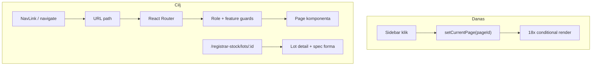

# Klijentsko rutiranje + izmjena lot specifikacija

## Kontekst

Trenutno stanje:
- Navigacija je `useState<PageId>` u [`frontend/src/App.tsx`](frontend/src/App.tsx) — URL se ne mijenja, nema bookmark/deep-link/back osim `/equipment/:uuid`
- Nema `react-router-dom` u [`frontend/package.json`](frontend/package.json)
- Produkcija već podržava SPA fallback (`serve -s` u [`frontend/Dockerfile`](frontend/Dockerfile))

Evidentičar / specifikacije:
- Backend `PATCH /stock-lots/:id/specifications` ([`warehouse-stock.service.ts`](backend/src/modules/warehouse-stock/warehouse-stock.service.ts) `defineSpecifications`) dozvoljava update za sve statuse osim `zatvoreno`
- Frontend prikazuje formu **samo** kad je `detail.status === 'ceka_specifikaciju'` ([`registrar-stock-page.tsx`](frontend/src/components/registrar-stock/registrar-stock-page.tsx) ~436)



---

## Faza 1 — React Router infrastruktura

### 1.1 Dependency

Dodati `react-router-dom` (v7, kompatibilno s React 19).

### 1.2 Route registry (single source of truth)

Novi fajl [`frontend/src/routes/app-routes.ts`](frontend/src/routes/app-routes.ts):

| `PageId` | Path |
|----------|------|
| `dashboard` | `/dashboard` |
| `organization` | `/organization` |
| `locations` | `/locations` |
| `warehouses` | `/warehouses` |
| `employees` | `/employees` |
| `categories` | `/categories` |
| `equipment` | `/equipment` |
| `equipment-by-category` | `/equipment-by-category` |
| `transfers` | `/transfers` |
| `documents` | `/documents` |
| `disposal-commissions` | `/disposal-commissions` |
| `inventory-count` | `/inventory-count` |
| `registrar-stock` | `/registrar-stock` |
| *(nested)* | `/registrar-stock/lots/:lotId` |
| `employee-relocation` | `/employee-relocation` |
| `warehouse-inventory` | `/warehouse-inventory` |
| `my-equipment` | `/my-equipment` |
| `qr-scanner` | `/qr-scanner` |
| `user-management` | `/user-management` |
| `settings` | `/settings` |
| public | `/equipment/:equipmentId` |

Helperi: `pageIdToPath(pageId)`, `pathToPageId(pathname)`, `getDefaultPathForRole()`.

### 1.3 Router bootstrap

- [`frontend/src/main.tsx`](frontend/src/main.tsx): wrap u `<BrowserRouter>`
- Novi [`frontend/src/routes/app-router.tsx`](frontend/src/routes/app-router.tsx): definicija `<Routes>`
- [`frontend/src/App.tsx`](frontend/src/App.tsx): pojednostaviti — setup/login/data loading ostaju; authenticated dio delegira na `AppRouter`

Public ruta `/equipment/:equipmentId` zamjenjuje ručni `parsePublicEquipmentPath` check (fajl [`parse-public-equipment-path.ts`](frontend/src/lib/parse-public-equipment-path.ts) može ostati kao util ili se ukloniti).

---

## Faza 2 — Route guards (RBAC + feature flags)

Ekstrahovati logiku iz `handleNavigate` i `useEffect` redirecta u:

- [`frontend/src/routes/require-auth.tsx`](frontend/src/routes/require-auth.tsx) — redirect na login
- [`frontend/src/routes/require-role.tsx`](frontend/src/routes/require-role.tsx) — mapira postojeće liste iz `App.tsx`:
  - `ADMIN_ONLY_PAGES`
  - `ADMIN_OR_EVIDENTICAR_PAGES`
  - `ADMIN_OR_EVIDENTICAR_INVENTORY_PAGES`
  - `SKLADISTAR_PAGES`
- [`frontend/src/routes/require-page-enabled.tsx`](frontend/src/routes/require-page-enabled.tsx) — zamjena za `LayoutNavGate` na route nivou (komponenta ostaje za backward compat dok se ne ukloni)

Fallback redirect po ulozi (kao danas):
- admin/evidenticar → `/dashboard`
- skladistar → `/warehouses`
- user → `/my-equipment`

Root `/` → `Navigate` na `getDefaultPathForRole()`.

---

## Faza 3 — Navigacija: zamjena `onNavigate` callbacka

Ažurirati sve touchpoint-e da koriste `useNavigate` / `<NavLink>`:

| Fajl | Promjena |
|------|----------|
| [`app-sidebar-nav.tsx`](frontend/src/components/app-sidebar-nav.tsx) | `NavLink` + `useMatch` za active state |
| [`app-nav-drawer.tsx`](frontend/src/components/app-nav-drawer.tsx) | isto |
| [`sidebar-nav-button.tsx`](frontend/src/components/sidebar-nav-button.tsx) | `NavLink` umjesto `onClick` |
| [`Layout.tsx`](frontend/src/components/Layout.tsx) | ukloniti `currentPage`/`onNavigate` props; active page iz `useLocation` |
| [`Dashboard.tsx`](frontend/src/components/Dashboard.tsx) | `navigate(path)` |
| [`NotificationsPanel.tsx`](frontend/src/components/NotificationsPanel.tsx) | `navigate('/employee-relocation')` |
| [`inventory-freeze-banner.tsx`](frontend/src/components/inventory-count/inventory-freeze-banner.tsx) | `navigate` |
| [`EquipmentPage.tsx`](frontend/src/components/EquipmentPage.tsx), [`TransfersPage.tsx`](frontend/src/components/TransfersPage.tsx), [`DocumentsPage.tsx`](frontend/src/components/DocumentsPage.tsx), [`warehouse-detail-view.tsx`](frontend/src/components/warehouses/warehouse-detail-view.tsx) | ukloniti `onNavigate` prop |

`PageId` tip ostaje za feature flags i module badges — ne briše se.

---

## Faza 4 — Registrar stock: deep link + spec edit

### 4.1 Nested ruta

U `app-router.tsx`:

```tsx
<Route path="/registrar-stock" element={<RegistrarStockPage />}>
  <Route path="lots/:lotId" element={null} /> {/* parent čita params */}
</Route>
```

Ili flat sibling ruta `/registrar-stock/lots/:lotId` koja renderuje istu stranicu — oba pristupa rade; preferirati nested layout bez dupliranja shell-a.

### 4.2 `RegistrarStockPage` prilagodba

U [`registrar-stock-page.tsx`](frontend/src/components/registrar-stock/registrar-stock-page.tsx):

1. **`useParams<{ lotId?: string }>()`** — kad je `lotId` u URL-u, automatski `openDetail(lotId)` na mount
2. **`navigate('/registrar-stock/lots/:id')`** umjesto samo `setSelectedId` pri otvaranju lota
3. **Nazad** → `navigate('/registrar-stock')` (zadržati browse state u lokalnom state-u)

### 4.3 Spec forma: dodavanje + izmjena

Proširiti prikaz spec sekcije:

| Status | Ponašanje |
|--------|-----------|
| `ceka_specifikaciju` | Forma + dugme „Sačuvaj specifikaciju" |
| `spremno_za_izdavanje` | Forma (prefill iz `detail.specifications`) + dugme „Sačuvaj izmjene" |
| `zatvoreno` | Read-only prikaz polja (bez save) |

- Ekstrahovati u [`registrar-stock/lot-specification-section.tsx`](frontend/src/components/registrar-stock/lot-specification-section.tsx) radi hygiene (~100 linija)
- Opcionalno prikazati `specDefinedAt` / ko je definisao (ako API vraća u `mapLotDetail`)
- Ispod forme, kad postoje `issuedUnits`: kratka napomena da izmjena lot spec-a **ne mijenja** već izdatu opremu (spec je snapshot pri izdavanju)

### 4.4 Backend

**Bez obaveznih promjena** — `defineSpecifications` već:
- odbija `zatvoreno`
- provjerava registrar scope + inventory freeze
- validira non-unique polja

Opcionalno (mala dorada): u `defineSpecifications` ne resetovati `status` ako je već `spremno_za_izdavanje` (trenutno idempotentno postavlja isti status — OK).

---

## Faza 5 — Dokumentacija

Ažurirati [`.cursor/docs/matrices/warehouse-stock/MATRIX.md`](.cursor/docs/matrices/warehouse-stock/MATRIX.md) + `CHANGELOG.md`:
- Evidentičar može **izmijeniti** lot spec dok lot nije `zatvoreno`
- Izmjena ne retroaktivno ažurira već izdatu opremu
- Frontend URL: `/registrar-stock/lots/:lotId`

Novi matrix entry ili sekcija u postojećem frontend planu za routing pravila (bookmark, back/forward, role redirect).

---

## Test plan (ručno)

**Rutiranje**
- Direktan ulaz na `/dashboard`, `/registrar-stock`, `/warehouses` — učitava ispravnu stranicu
- Browser back/forward radi između stranica
- User bez prava na `/organization` → redirect na default
- Skladistar na `/dashboard` → redirect na `/warehouses`
- Feature flag isključen → redirect s onemogućene stranice
- `/equipment/:uuid` radi bez prijave

**Registrar spec**
- Lot `ceka_specifikaciju`: forma + save → status `spremno_za_izdavanje`
- Lot `spremno_za_izdavanje`: forma vidljiva, izmjena + save uspješna
- Lot `zatvoreno`: samo read-only
- Deep link `/registrar-stock/lots/:id` otvara detail
- Freeze aktivan: save disabled + hint

---

## Rizici i napomene

- **Scope**: browse nivoi (parent/sub) ostaju u lokalnom state-u — samo lot detail u URL-u (po izboru)
- **Breaking**: bookmark stari URL-ovi (samo `/equipment/:id`) i dalje rade; ostali su novi
- **Veličina diffa**: ~15–20 fajlova; centralna logika u `routes/` minimizira regresije
