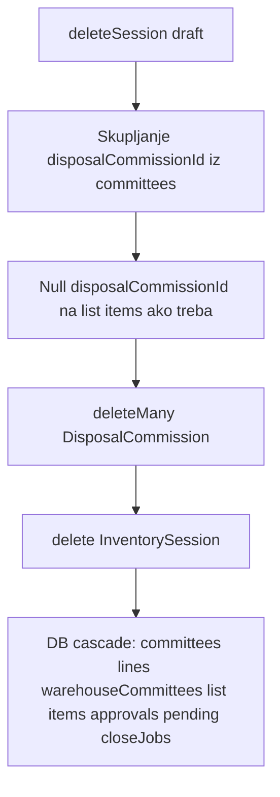
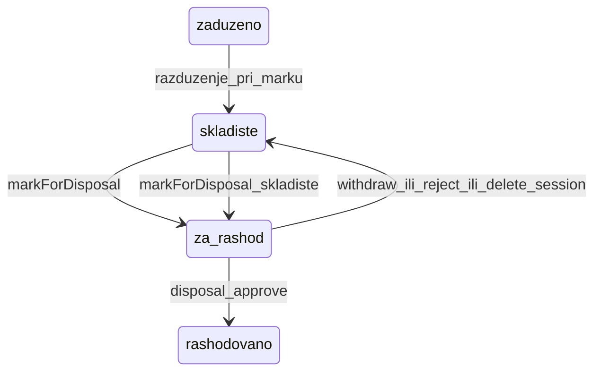

# Plan: brisanje sesije, otvorena sesija, za_rashod, pretraga specifikacije

## Kontekst (trenutno stanje)

- [`deleteSession`](backend/src/modules/inventory-count/inventory-count.service.ts) dozvoljava brisanje samo `draft` sesije, ali **blokira** ako postoje stavke liste rashoda ili inventory linije; `prisma.inventorySession.delete` ne briše vezane `DisposalCommission` zapise (ostaju siroti).
- [`createSession`](backend/src/modules/inventory-count/inventory-count.service.ts) nema provjeru globalno otvorene sesije; unique `(orgUnitId, year)` ne sprječava paralelnu `draft` 2026 + `active` 2025.
- [`markForDisposal`](backend/src/modules/inventory-count/equipment-disposal-list.service.ts) mijenja lokaciju (razduženje), ali **ne mijenja** `equipment.status`; `rashodovano` dolazi tek na approve u [`reviewDisposalApproval`](backend/src/modules/inventory-count/inventory-count.service.ts).
- Pretraga opreme ([`buildListWhere`](backend/src/modules/equipment/equipment.service.ts)) traži samo `inventoryNumber`, `contractNumber`, `notes`; po polju specifikacije postoji samo [`checkUniqueSpecificationValue`](backend/src/modules/equipment/equipment.service.ts) (exact match).

**Potvrđeno od korisnika:** globalno max jedna otvorena sesija; novi status `za_rashod` pri prijedlogu rashoda.

---

## 1. Kaskadno brisanje draft sesije

### Cilj
Admin briše draft sesiju → nestaju svi podaci vezani za sesiju, uključujući auto-kreirane `DisposalCommission` komisije rashoda.

### Implementacija

Ekstrahovati util npr. [`delete-inventory-session-cascade.util.ts`](backend/src/modules/inventory-count/utils/delete-inventory-session-cascade.util.ts) i pozvati iz `deleteSession`:



**Redoslijed u `$transaction`:**
1. Validacija: samo `status === 'draft'` (zadržati).
2. Ukloniti postojeće blokere (`listedOrAssigned`, `lineCount`) — korisnik eksplicitno traži potpuno brisanje.
3. Prikupiti `disposalCommissionId` sa svih `InventoryCommittee` za sesiju.
4. `equipmentDisposalListItem.updateMany` → `disposalCommissionId: null`, `approvalId: null` (izbjeći FK konflikte).
5. `disposalInventoryApproval.deleteMany({ sessionId })` (ili osloniti se na session cascade).
6. `disposalCommission.deleteMany({ id: { in: commissionIds } })` — briše i članove (`onDelete: Cascade`).
7. `inventorySession.delete({ id })` — cascade na committees, warehouse committees, list items, pending actions, close jobs.

**Oprema nakon brisanja sesije:**
- Ako je bila `za_rashod` samo zbog liste → vratiti na `skladiste` prije brisanja liste (vidi tačku 3).
- Razduženja izvršena pri mark-u **ne revertovati** automatski (transfer ostaje u historiji); dokumentovati u matrici.

**Frontend:** [`InventoryCountPage.tsx`](frontend/src/components/InventoryCountPage.tsx) — poruka potvrde jasnije: *„Briše sesiju, sve komisije, slotove, listu rashoda i povezane komisije rashoda.“*

**Test:** unit test util-a (mock tx) + integracioni slučaj: sesija sa slotovima + list item → nakon delete nema committees/commissions/list items.

**Matrica:** [`inventory-count/MATRIX.md`](.cursor/docs/matrices/inventory-count/MATRIX.md) + CHANGELOG.

---

## 2. Globalno: jedna otvorena sesija

### Pravilo
`otvorena` = `status IN (draft, active, closing)`. Dok postoji bilo koja takva sesija u sistemu, **nova sesija se ne može kreirati** (bilo koja distribucija/godina).

### Implementacija

Helper u [`inventory-count.service.ts`](backend/src/modules/inventory-count/inventory-count.service.ts):

```ts
private async assertNoOpenInventorySession(excludeSessionId?: string): Promise<void>
```

Pozivi:
- `createSession` — prije `inventorySession.create`
- `ensureDraftSessionForDistribution` — ako ne postoji sesija za `(orgUnitId, year)` i globalno postoji otvorena → **ne kreirati** (vratiti `{ created: false, skipped: true, reason }` ili throw s jasnom porukom)
- [`inventory-scheduler.service.ts`](backend/src/modules/inventory-count/inventory-scheduler.service.ts) — Jan 1 / lock datum: log + skip umjesto fail cijelog joba

**Frontend:** pri `POST` create — prikazati backend poruku (*„Postoji otvorena sesija POPIS 2026 (draft). Zatvorite je prije kreiranja nove.“*).

**Matrica:** inventory-count — nova sekcija „Globalni lock sesije“.

---

## 3. Novi status `za_rashod`

### Semantika

| Faza | Status opreme |
|------|----------------|
| Prijedlog (lista rashod, draft) | `za_rashod` |
| Povrat s liste (admin, draft) | `skladiste` |
| Odbijen rashod (komisija) | `skladiste` |
| Odobren rashod | `rashodovano` + `warehouseCondition=unisteno` (postojeći tok) |
| Brisanje draft sesije | `skladiste` (ako je bila `za_rashod`) |



### Schema

- Prisma enum [`EquipmentStatus`](backend/prisma/schema.prisma): dodati `za_rashod`
- Migracija `backend/prisma/migrations/..._equipment_status_za_rashod/`

### Backend promjene (ključne tačke)

| Fajl | Promjena |
|------|----------|
| [`equipment-disposal-list.service.ts`](backend/src/modules/inventory-count/equipment-disposal-list.service.ts) | `markForDisposal`: nakon razduženja → `status: 'za_rashod'`; `withdrawFromList` → `skladiste`; blokirati ako već `za_rashod`/`rashodovano` |
| [`delete-inventory-session-cascade.util.ts`](backend/src/modules/inventory-count/utils/delete-inventory-session-cascade.util.ts) | prije brisanja liste: `equipment.updateMany` `za_rashod` → `skladiste` za opremu u toj sesiji |
| [`inventory-count.service.ts`](backend/src/modules/inventory-count/inventory-count.service.ts) | filteri opsega popisa: `status: { notIn: ['rashodovano', 'za_rashod'] }`; reject approval → `skladiste` |
| [`equipment.service.ts`](backend/src/modules/equipment/equipment.service.ts) | summary `byStatus.za_rashod`; blokirati transfer/update kao za rashodovano |
| [`registrar-scope.service.ts`](backend/src/common/services/registrar-scope.service.ts) | scope: `za_rashod` tretirati kao rashodovano (read-only / warehouse-bound) |
| [`disposal-commissions.service.ts`](backend/src/modules/disposal-commissions/disposal-commissions.service.ts) | dozvoliti review ako `za_rashod` |

### Frontend

- [`frontend/src/types.ts`](frontend/src/types.ts), [`helpers.ts`](frontend/src/helpers.ts) — label „Za rashod“, boja (npr. orange)
- [`EquipmentCard.tsx`](frontend/src/components/EquipmentCard.tsx) — `canMarkDisposal`: `!== rashodovano && !== za_rashod`; sakriti transfer akcije za `za_rashod`
- Dashboard summary — uključiti `za_rashod` u statistiku (opciono zaseban broj ili pod „rashod“)

### Matrice

- [`equipment-status/MATRIX.md`](.cursor/docs/matrices/equipment-status/MATRIX.md)
- [`disposal-commission/MATRIX.md`](.cursor/docs/matrices/disposal-commission/MATRIX.md)
- [`inventory-count/MATRIX.md`](.cursor/docs/matrices/inventory-count/MATRIX.md)

---

## 4. Pretraga opreme po specifikaciji

### Cilj
Opcionalna, brza pretraga po atributima specifikacije uz postojeći general `search`.

### Predloženi API ([`ListEquipmentQueryDto`](backend/src/modules/equipment/dto/list-equipment-query.dto.ts))

| Parametar | Ponašanje |
|-----------|-----------|
| `search` (postojeći) | OR: inventoryNumber, contractNumber, notes + **contains u JSON specifikaciji** |
| `specFieldId` + `specValue` (novi, opcionalni par) | exact match jednog polja (`buildSpecificationFieldFilter`) |
| `categoryId` (postojeći) | kada je set + `search`, suziti JSON pretragu na **text polja te kategorije** (fields + optionalFields) |

### Implementacija pretrage

Novi util [`build-equipment-search-where.util.ts`](backend/src/common/utils/build-equipment-search-where.util.ts):

1. **Exact field** — postojeći `buildSpecificationFieldFilter`.
2. **General `search` bez categoryId** — `Prisma.sql` subquery ili `findMany` raw:
   - `LOWER(CAST(specifications AS CHAR)) LIKE LOWER(CONCAT('%', ?, '%'))` — prihvatljivo uz paginaciju i ostale filtere; dokumentovati da nije full-text indeks.
3. **General `search` s categoryId** — učitati field definitions iz [`CategoriesService.getFieldDefinitions`](backend/src/modules/categories/categories.service.ts), za svako `type === 'text'` polje OR `JSON_UNQUOTE(JSON_EXTRACT(specifications, path)) LIKE %term%` (ograničen broj OR-ova = brže od cijelog JSON cast-a).

Integracija u `buildListWhere` — spojiti s `registrarScope` AND logikom.

**Frontend:** [`EquipmentPage.tsx`](frontend/src/components/EquipmentPage.tsx) / [`EquipmentByCategoryPage.tsx`](frontend/src/components/EquipmentByCategoryPage.tsx) — postojeći search box već šalje `search`; na stranici po kategoriji opcionalno dropdown „Polje specifikacije“ + input (koristi `specFieldId`/`specValue`).

**Test:** unit test util-a za exact field + mocked category-bound OR; ne dodavati spor integration test bez DB.

**Matrica:** nova kratka sekcija u equipment-status ili zaseban `equipment-search` slug ako želimo — minimalno CHANGELOG pod equipment-status.

---

## Redoslijed implementacije

1. **Schema + migracija** `za_rashod` (blokira ostalo dok se ne generiše client)
2. **deleteSession cascade** util + test
3. **assertNoOpenInventorySession** + scheduler/frontend poruke
4. **`za_rashod` workflow** (mark/withdraw/approve/reject/delete session)
5. **Pretraga specifikacije** util + DTO + UI po kategoriji
6. **Matrice + CHANGELOG** za inventory-count, equipment-status, disposal-commission
7. `npm run build` (backend + frontend) + `npm run test:unit` (backend)

---

## Rizici i napomene

- **Brisanje sesije s izvršenim razduženjem:** oprema ostaje na skladištu (`skladiste`), transfer se ne poništava — dokumentovati.
- **JSON LIKE pretraga:** bez indeksa; dovoljno za tipične liste s paginacijom; ako kasnije uspori, dodati generated column / FTS.
- **Globalni lock:** scheduler na 1.1. neće kreirati novu godinu dok stara nije `closed` — namjerno po izboru korisnika.
