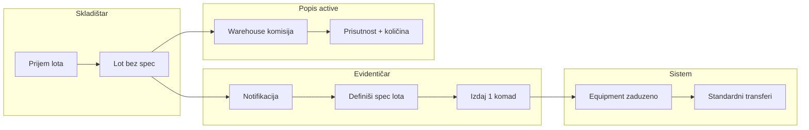

# Skladišni lot, evidentičar i popis skladišta

## Trenutno stanje (gap)

| Oblast | Danas | Cilj |
|--------|-------|------|
| Prijem | Skladištar kreira pun `Equipment` ([`equipment.service.ts`](backend/src/modules/equipment/equipment.service.ts) L68–72) sa inventurnim brojem + svim poljima | Samo **kategorija + naziv robe + količina** |
| Evidentičar | Vidi/uređuje pojedinačnu opremu na skladištu | **Novi tok**: spec lota → izdaj 1 komad (radnik + unikatna polja + inv. broj) |
| Popis | Samo `InventoryCommittee` po **kategoriji** u distribuciji | **+ auto komisija po skladištu** za neizdanu robu (lotovi) |
| DB | 1 red = 1 komad (`inventoryNumber` unique) | **Lot** (količinski) + **Equipment** tek pri izdavanju |

Potvrđeno: DEV podaci se mogu obrisati; kategorijske komisije i dalje popisuju zaduženu / pojedinačnu opremu (`status=skladiste` na skladištu nakon izdavanja u sistem), skladištari **isključivo** neizdanu robu (lotove).

---

## Poslovni tok (cilj)



**Stanja lota** (predlog enum `WarehouseStockLotStatus`):

- `ceka_specifikaciju` — ulaz skladištara, `specifications` prazan
- `spremno_za_izdavanje` — evidentičar popunio obavezna polja kategorije (bez `unique` polja i bez inventurnog broja)
- `zatvoreno` — `quantityOnHand = 0` (sve izdato)

Prikaz evidentičaru: **19/20** = `quantityOnHand` / `quantityReceived`.

---

## 1. Model podataka (Prisma)

Novi entitet u [`schema.prisma`](backend/prisma/schema.prisma):

```prisma
model WarehouseStockLot {
  id                String   @id @default(uuid())
  warehouseId       String
  categoryId        String
  productName       String   // npr. "Računar Dell 3080 SFF"
  quantityReceived  Int
  quantityOnHand    Int
  status            WarehouseStockLotStatus
  specifications    Json     @default("{}")
  contractNumber    String?
  entryDate         DateTime @db.Date
  notes             String?
  receivedByUserId  String
  specDefinedByUserId String?
  specDefinedAt     DateTime?
  createdAt         DateTime @default(now())
  updatedAt         DateTime @updatedAt

  warehouse   Warehouse @relation(...)
  category    Category  @relation(...)
  receivedBy  User      @relation(...)
  issuedUnits Equipment[]
}
```

Na `Equipment` dodati opcionalno `stockLotId` (FK) — veza izdanog komada prema lotu.

**Popis skladišta** — novi entiteti (odvojeno od kategorijske komisije):

- `InventoryWarehouseCommittee`: `sessionId`, `warehouseId`, `isClosed`, članovi
- `InventoryWarehouseLine`: `committeeId`, `stockLotId`, `status` (`prisutna` | `nije_prisutna` | `ostecena`), `quantityCounted` (Int), `note?`

Ograničenje članova: predsjednik + max 2 člana = skladištari (`WarehouseKeeper` → `User.employeeId`; ako keeper nema `employeeId`, sesija ne može aktivirati komisiju za to skladište — jasna greška u admin UI).

Migracija: nova datoteka u `backend/prisma/migrations/`; seed u [`seed.ts`](backend/prisma/seed.ts) prilagoditi demo lot + ukloniti stari “pun” prijem opreme skladištara.

---

## 2. Backend — modul `warehouse-stock`

Novi Nest modul (~100–150 linija servis + controller + DTO):

| Endpoint | Uloga | Akcija |
|----------|-------|--------|
| `POST /warehouses/:warehouseId/stock-lots` | skladistar | Prijem: `categoryId`, `productName`, `quantity`, `entryDate`, opc. `contractNumber` |
| `GET /warehouses/:warehouseId/stock-lots` | skladistar, evidenticar (scope), admin | Lista lotova (keeper vidi bez detalja spec; samo kategorija, naziv, količine, status) |
| `GET /stock-lots/:id` | evidenticar (assignment), admin | Detalj + izdati komadi (`issuedUnits`) |
| `PATCH /stock-lots/:id/specifications` | evidenticar | Validacija polja kategorije **bez** `field.unique === true` |
| `POST /stock-lots/:id/issue` | evidenticar | `employeeId`, `inventoryNumber`, mapa unikatnih polja → kreira `Equipment` + smanji `quantityOnHand` |

**Validacija spec** — novi util npr. [`category-fields.util.ts`](backend/src/common/utils/category-fields.util.ts):

- `validateLotSpecifications()` — required non-unique polja
- `validateIssueSpecifications()` — required **unique** polja + globalni `inventoryNumber`

**Izdavanje** (jedna transakcija):

1. Provjera `quantityOnHand > 0`, assignment evidentičara (`RegistrarAssignment` warehouse+category), freeze grada
2. Kreirati `Equipment`: `status=zaduzeno`, `currentHolderId`, `specifications = lot.specifications ∪ per-unit unique`, `stockLotId`, **bez** `warehouseId` (ili null — komad više nije “neizdan” na lotu)
3. `quantityOnHand -= 1`; ako 0 → `status=zatvoreno`
4. Kreirati i **finalizirati** transfer `zaduzenje` (`fromType=skladiste`, `fromWarehouseId=lot.warehouseId`) radi audita i postojećeg transfer UI — reuse [`finalize-inventory-transfer.util`](backend/src/modules/inventory-count/utils/finalize-inventory-transfer.util.ts) pattern / `transfers.service`

**Notifikacije** — u [`notifications.service.ts`](backend/src/modules/notifications/notifications.service.ts):

- `notifyWarehouseStockReceived(lotId)` → svi `evidenticar` s `RegistrarAssignment` za `(warehouseId, categoryId)`

**Freeze** — proširiti [`InventoryFreezeService`](backend/src/common/services/inventory-freeze.service.ts):

- Blokirati `POST stock-lots` i `POST issue` u gradu aktivne sesije (isto kao prijem opreme danas u planu full-effect)

---

## 3. Prilagodba postojećih modula

### Skladištar

- [`equipment.service.ts`](backend/src/modules/equipment/equipment.service.ts): ukloniti/zabraniti `create` za `skladistar` (samo lot API)
- [`warehouse-keeper-access.util.ts`](backend/src/common/utils/warehouse-keeper-access.util.ts): bez promjene za rashod/uništenje pojedinačne opreme

### Evidentičar

- [`registrar-scope.service.ts`](backend/src/common/services/registrar-scope.service.ts): `canAccessStockLot(assignment, lot)` — warehouse + category match
- Režim B i dalje **ne** vidi lotove (samo režim A sa skladištem) — usklađeno s postojećom matricom

### Popis

U [`inventory-count.service.ts`](backend/src/modules/inventory-count/inventory-count.service.ts):

- Pri `activateSession`: za svako aktivno skladište u `sessionCityId` (isti grad kao distribucija sesije) kreirati `InventoryWarehouseCommittee` + članove iz `WarehouseKeeper`
- `resolveWarehouseCommitteeLots(committeeId)`: lotovi gdje `warehouseId` match i `quantityOnHand > 0`
- `recordWarehouseLine`: samo status prisutnosti + `quantityCounted` (default = očekivana `quantityOnHand`); **bez** relocation/rashod na lotu
- Kategorijske komisije: u `resolveCommitteeEquipment` **isključiti** opremu koja je još na lotu (`stockLotId` null i `status=skladiste` na skladištu ostaje u opsegu kategorije — kako ste potvrdili za već “izdatu” pojedinačnu robu)

---

## 4. Frontend

### Skladištar — [`warehouse-detail-view.tsx`](frontend/src/components/warehouses/warehouse-detail-view.tsx)

Tab **Na skladištu**:

- Tabela lotova: kategorija, naziv robe, `quantityOnHand/received`, status, datum ulaza (bez inventurnog broja/spec)
- CTA **Prijem robe** (sheet na mobile): kategorija (leaf), naziv, količina, datum
- Ukloniti link “kreiraj opremu” koji vodi na puni `EquipmentPage` formular

### Evidentičar — novi modul/stranica

Npr. `frontend/src/components/registrar-stock/RegistrarStockPage.tsx` + ruta u [`Layout.tsx`](frontend/src/components/Layout.tsx):

- **Moje dodjele** (postojeći `registrarScopes`) → lista lotova `ceka_specifikaciju` / `spremno_za_izdavanje`
- Detalj lota: forma spec (dinamička polja iz kategorije, filtrirano)
- Akcija **Izdaj komad**: radnik, inventurni broj, unikatna polja → poziv `POST issue`
- Prikaz izdatih komada i brojača `quantityOnHand/quantityReceived`

### Popis — proširenje [`InventoryCountPage`](frontend/src/components/inventory-count/)

- Admin: pri aktivaciji sesije pregled auto-kreiranih warehouse komisija
- Skladištar: “Moja skladišna komisija” — lista lotova, unos prisutnosti/količine (pojednostavljen UI vs kategorijska komisija)

API klijent: `frontend/src/api/warehouse-stock-api.ts`.

---

## 5. Matrice i dokumentacija

| Fajl | Promjena |
|------|----------|
| [`.cursor/docs/matrices/warehouses/MATRIX.md`](.cursor/docs/matrices/warehouses/MATRIX.md) | Prijem = lot; skladištar bez spec/inv; evidentičar izdavanje |
| Novi `.cursor/docs/matrices/warehouse-stock/MATRIX.md` | Statusi lota, validacije polja, issue, notifikacije |
| [`.cursor/docs/matrices/inventory-count/MATRIX.md`](.cursor/docs/matrices/inventory-count/MATRIX.md) | `InventoryWarehouseCommittee`, scope lotova, auto-create |
| [`.cursor/docs/matrices/equipment-status/MATRIX.md`](.cursor/docs/matrices/equipment-status/MATRIX.md) | Equipment nastaje pri issue; `stockLotId` |
| CHANGELOG po matrici | Svaka logička promjena |

---

## 6. Čišćenje (DEV)

- Ukloniti skladištarski “Nova oprema — prijem na skladište” iz [`EquipmentPage.tsx`](frontend/src/components/EquipmentPage.tsx) za rolu `skladistar`
- Seed/demo: lot + evidentičar issue umjesto direktnog `Equipment` na skladištu
- Po želji: `prisma migrate reset` u DEV prije testa

---

## Redoslijed implementacije

1. **Schema + migracija + util validacije polja**
2. **warehouse-stock API + notifikacije + freeze hookovi**
3. **Issue → Equipment + transfer zaduzenje**
4. **Inventory warehouse committees (activate + lines)**
5. **Frontend skladištar + evidentičar modul + popis UI**
6. **Matrice, seed, uklanjanje starog prijema**

---

## Rizici / napomene

- **Keeper bez `employeeId`**: blok aktivacije warehouse komisije — dokumentovati u admin poruci
- **Unikatna polja po kategoriji**: serijski broj mora biti označen `unique: true` u definiciji kategorije da se traži tek pri issue
- **Rashod na skladištu**: i dalje na pojedinačnoj `Equipment` (nakon izdavanja), ne na lotu — bez promjene destroy workflowa
