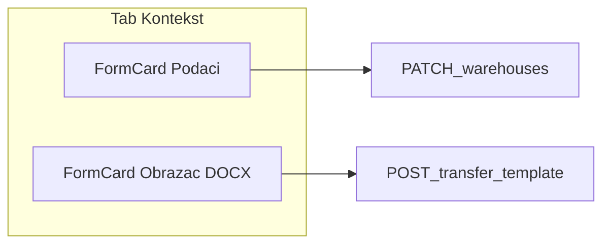

# Plan: Skladište kontekst UI + dopune prenosnica

## Kontekst

Faza 1 plana prenosnica je implementirana ([`warehouse-detail-view.tsx`](frontend/src/components/warehouses/warehouse-detail-view.tsx), [`transfer-document-generation.service.ts`](backend/src/modules/transfers/transfer-document-generation.service.ts)). Tab **Kontekst** danas je vizuelno usklađen slabije od **Na skladištu** / **Prenosi** (miješa template panel + mali read-only blok; uređuje se samo `orgUnitId`). Kreiranje skladišta u [`WarehousesPage.tsx`](frontend/src/components/WarehousesPage.tsx) ne zahtijeva org. jedinicu ni skladištara ([`create-warehouse.dto.ts`](backend/src/modules/warehouses/dto/create-warehouse.dto.ts)).

**Odluka:** pri kreiranju **org. jedinica i bar jedan skladištar obavezni** (nema centralnog skladišta bez org).

---

## Faza A — Tab Kontekst (UI + puni edit)

### Cilj

Isti obrazac kao ostali tabovi: `bg-white rounded-xl border border-gray-100` + [`FormCard`](frontend/src/components/ui/form-card.tsx) sekcije, puna širina sadržaja.

### Frontend

Novi komponent: [`frontend/src/components/warehouses/warehouse-context-panel.tsx`](frontend/src/components/warehouses/warehouse-context-panel.tsx)

**Sekcija 1 — Podaci skladišta** (admin, `canEditContext`):

| Polje | API |
|-------|-----|
| Naziv | `PATCH /warehouses/:id` `name` |
| Grad | `cityId` |
| Adresa | `address` |
| Org. jedinica | `orgUnitId` (**obavezno**, bez opcije prazno) |
| Skladištari | `keeperUserIds` (multi-select, min 1) |
| Napomena | `notes` (opciono) |

- Jedan **Sačuvaj** poziva `updateWarehouseApi` sa svim poljima.
- Validacija prije save: sva obavezna polja + toast ako fali skladištar.
- Read-only prikaz za ne-admin (kao danas, ali u istom layoutu).

**Sekcija 2 — Obrazac prenosnice**

- Premjestiti postojeći [`WarehouseTransferTemplatePanel`](frontend/src/components/warehouses/warehouse-transfer-template-panel.tsx) u drugi `FormCard` unutar istog panela (ne odvojeni `max-w-2xl` wrapper).

Refaktor [`warehouse-detail-view.tsx`](frontend/src/components/warehouses/warehouse-detail-view.tsx): `tab === 'context'` → samo `<WarehouseContextPanel ... />`.

---

## Faza B — Kreiranje skladišta (sva obavezna polja)

### Backend

[`create-warehouse.dto.ts`](backend/src/modules/warehouses/dto/create-warehouse.dto.ts):

- `orgUnitId`: ukloniti `@IsOptional()`, ostaje `@IsUUID()`
- `keeperUserIds`: `@IsArray()`, `@ArrayMinSize(1)`, `@IsUUID('4', { each: true })`

[`warehouses.service.ts`](backend/src/modules/warehouses/warehouses.service.ts) `create`:

- `assertOrgUnitExists(orgUnitId)` (novi helper ili postojeći pattern iz org modula)
- Ako nema `keeperUserIds.length` → `BadRequestException`

### Frontend

[`WarehousesPage.tsx`](frontend/src/components/WarehousesPage.tsx) tab **Novo skladište**:

- Labele na sva polja (`labelClass`), ukloniti „opciono“ kod org.
- Ukloniti opciju `— Centralno skladište —`
- `handleCreate`: validacija `name`, `cityId`, `address`, `orgUnitId`, `keeperIds` (min 1) + `toastError` poruke
- Disabled dugme dok forma nije validna

[`org-unit-warehouses-section.tsx`](frontend/src/components/organization/org-unit-warehouses-section.tsx) brzo kreiranje:

- Dodati izbor skladištara (multi-select) ili automatski prvi aktivni skladištar u gradu — **minimalno**: obavezan multi-select skladištara pri quick create

### Matrica

Ažurirati [`.cursor/docs/matrices/warehouses/MATRIX.md`](.cursor/docs/matrices/warehouses/MATRIX.md) + `CHANGELOG`: org obavezan na create; centralno samo legacy zapisi.

---

## Faza C — Pregled generisanog PDF (iframe)

[`TransferDocumentPanel.tsx`](frontend/src/components/TransferDocumentPanel.tsx):

- Novi state `generatedPrintPreviewUrl` (odvojeno od `previewUrl` za sken).
- Dugme **Pregled za štampu** (kad `status` raw/printed/uploaded):
  - `fetchAuthenticatedBlob(/transfers/:id/generated-document?format=pdf)`
  - Ako 404 → poruka „PDF nije generisan (LibreOffice / postavka generate_print_pdf)“; ponudi DOCX download
- `iframe` ispod dugmadi (visina ~360px, `title` za a11y), `URL.revokeObjectURL` u `useEffect` cleanup.
- Opciono isti preview na [`DocumentsPage.tsx`](frontend/src/components/DocumentsPage.tsx) za red u listi (manji scope: samo panel).

---

## Faza D — Notifikacija: transfer čeka upload potpisanog PDF-a

Danas postoji `transfer_pending` („čeka potpis“) i `inventory_transfer_upload_pending` (samo popis). Potreban tip za **obične** RAW prenose bez `scannedDocUrl`.

### Backend

1. Prisma enum `NotificationType`: dodati `transfer_signed_upload_pending` (migracija ALTER ENUM).
2. [`notifications.service.ts`](backend/src/modules/notifications/notifications.service.ts): `notifyTransferSignedUploadPending(transferId)`:
   - Skip ako `scannedDocUrl` ili notifikacije isključene
   - Recipients: isti kao `notifyTransferPending` ([`collectTransferPendingRecipients`](backend/src/modules/notifications/))
   - `title`: „Prenosnica čeka potpisani PDF“, `message`: broj dokumenta + inventurni broj
3. Poziv iz [`transfers.service.ts`](backend/src/modules/transfers/transfers.service.ts) nakon `create` (uz ili umjesto duplog noise — **samo** ako `transfer.require_signed_pdf_upload` true i status `raw`).
4. Opciono: ponoviti notifikaciju ako upload i dalje nedostaje nakon X dana — **ne** u ovoj fazi (YAGNI).

### Frontend

- Mapiranje tipa u notification list komponenti (ikonica/tekst), ako postoji centralni mapper.

Matrica: [`.cursor/docs/matrices/notifications/MATRIX.md`](.cursor/docs/matrices/notifications/MATRIX.md) + CHANGELOG.

---

## Faza E — Verzionisanje templatea (arhiva)

Već postoji: više redova u `warehouse_transfer_templates`, jedan `isActive`.

### Dopuna

**Backend** [`warehouse-transfer-template.service.ts`](backend/src/modules/warehouses/warehouse-transfer-template.service.ts):

- `GET /warehouses/:id/transfer-template/:templateId/download` — stream `.docx` (admin)
- Upload novog ne briše stare fajlove (već tako)

**Frontend** [`warehouse-transfer-template-panel.tsx`](frontend/src/components/warehouses/warehouse-transfer-template-panel.tsx):

- Sekcija **Arhiva**: neaktivne verzije s datumom, uploaderom, dugmad **Preuzmi** + **Aktiviraj**
- Aktivna verzija vizuelno istaknuta

---

## Faza F — Bulk export (kasnije, izvan scope-a)

`GET /warehouses/:warehouseId/transfer-documents/export?year=2026` → ZIP iz `prenosnice/{warehouseId}/{year}/`. Dokumentovati u transfers MATRIX kao **planirano**, ne implementirati u ovom ciklusu.

---

## Redoslijed i testiranje

| Red | Zadatak |
|-----|---------|
| 1 | Backend create DTO + service validacija |
| 2 | `WarehouseContextPanel` + detail view |
| 3 | `WarehousesPage` + org quick create keepers |
| 4 | PDF preview u TransferDocumentPanel |
| 5 | Notification enum + servis + hook na create |
| 6 | Template download endpoint + UI arhiva |
| 7 | Matrice CHANGELOG |

**Ručni test:** kreiraj skladište bez org → odbij; kontekst save; upload template; kreiraj transfer → notifikacija; pregled PDF; upload signed PDF.
