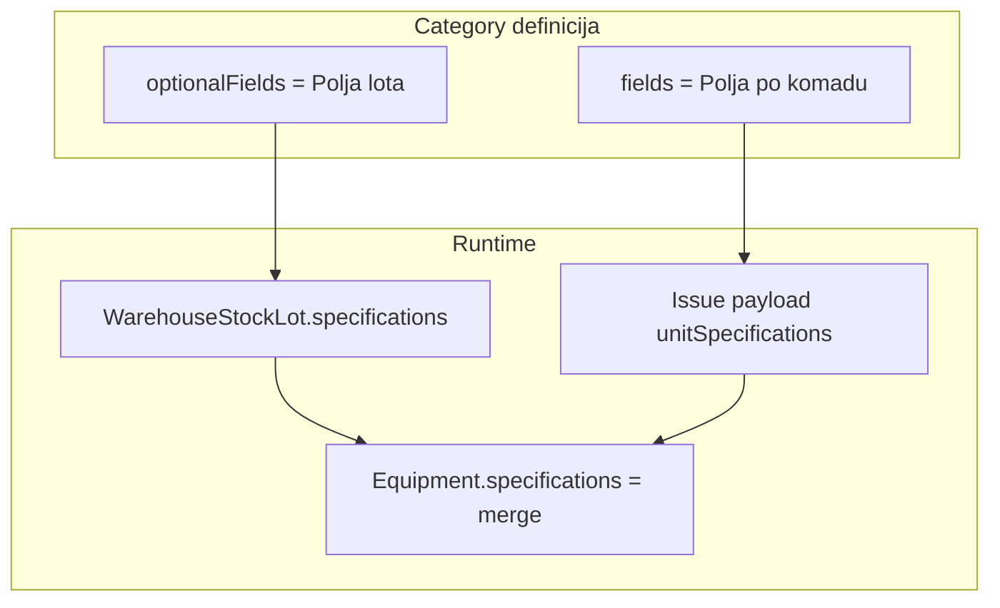

# Plan: Specifikacija — polja po komadu vs polja lota

## Cilj

Zamijeniti današnji split po `unique` flagu preko oba niza jasnom semantikom po odjeljku:

| Odjeljak | DB kolona | UI naziv | Obaveznost | Jedina opcija |
|----------|-----------|----------|------------|---------------|
| 1 | `fields` | Polja po komadu | uvijek obavezno pri izdavanju | **Unikat** |
| 2 | `optionalFields` | Polja lota | checkbox **Obavezno** | nema Unikat |

**Unikat** = globalna jedinstvenost vrijednosti u leaf podkategoriji (samo odjeljak 1).
**Bez Unikat** u odjeljku 1 = vrijednost po komadu, ponavljanje dozvoljeno (npr. vlasnik 15× A, 5× B).

Migracija kategorija: **ručna** (admin nakon deploya). Nema automatskog scripta.

---

## 1. Matrice (source of truth)

Ažurirati prije koda:

- [`.cursor/docs/matrices/categories-fields/MATRIX.md`](.cursor/docs/matrices/categories-fields/MATRIX.md) — nova semantika odjeljaka, shape polja, locking pravila, validacija opreme
- [`.cursor/docs/matrices/warehouse-stock/MATRIX.md`](.cursor/docs/matrices/warehouse-stock/MATRIX.md) — lot spec = `optionalFields`; issue = sva `fields`; prazdan lot spec ako nema obaveznih lot polja
- Oba `CHANGELOG.md` istog dana

**Locking (evidentičar nakon izdavanja):**
- `fields` + `unique: true` → read-only
- `fields` + `unique: false` → može mijenjati
- `optionalFields` (lot snapshot na opremi) → može mijenjati (kao danas za non-unique)

---

## 2. Backend — jezgro validacije

Refaktor [`backend/src/common/utils/category-fields.util.ts`](backend/src/common/utils/category-fields.util.ts):

- Zamijeniti `splitCategoryFieldsForStock` (unique-based) s:
  - `getUnitSpecFields(fields)` → cijeli `fields` niz
  - `getLotSpecFields(optionalFields)` → cijeli `optionalFields` niz
- `validateLotSpecifications(specs, optionalFields)` — validira samo lot polja + `required` flag
- `validateIssueSpecifications(specs, fields)` — **sva** polja iz `fields` su obavezna (ignorisati `required` property)
- `validateEquipmentSpecifications(specs, fields, optionalFields)` — unit polja uvijek obavezna na opremi; lot polja po `required` flagu
- Zadržati `validateSpecifications` kao alias ili zamijeniti pozive eksplicitnim funkcijama

Dodati unit test fajl `category-fields.util.spec.ts` (trenutno ne postoji).

Normalizacija pri save kategorije u [`backend/src/modules/categories/categories.service.ts`](backend/src/modules/categories/categories.service.ts):
- `create` / `update`: strip/normalize — `fields[].required = true`, `fields[].unique` zadržati; `optionalFields[].unique = false`, `required` zadržati
- Opciono odbiti `unique: true` u `optionalFields` (400)

---

## 3. Backend — skladišni lot i izdavanje

[`backend/src/modules/warehouse-stock/warehouse-stock.service.ts`](backend/src/modules/warehouse-stock/warehouse-stock.service.ts):
- `defineSpecifications`: `validateLotSpecifications(dto.specifications, optionalFields)` — bez `fields`
- `issueUnit`: `validateIssueSpecifications(dto.uniqueSpecifications, fields)` — sva unit polja obavezna
- **Novo:** pri issue provjeriti jedinstvenost za `fields` gdje `unique === true` (poziv iste logike kao `checkUniqueSpecificationValue`) — enforcement na backendu, ne samo UI hint
- **UX:** pri `receive` / `receiveBulk`, ako kategorija nema obaveznih lot polja → inicijalni status `spremno_za_izdavanje` umjesto `ceka_specifikaciju` (isto kao maintenance flow)

DTO [`issue-stock-lot.dto.ts`](backend/src/modules/warehouse-stock/dto/issue-stock-lot.dto.ts): zadržati ime `uniqueSpecifications` radi manjeg churna, ali u komentaru/JSDoc dokumentovati da sadrži **sva unit polja**, ne samo unikatna.

---

## 4. Backend — oprema i evidentičar

- [`backend/src/common/utils/registrar-equipment-spec.util.ts`](backend/src/common/utils/registrar-equipment-spec.util.ts): lock pravilo → `field.unique` gdje je polje u `fields` nizu (ekvivalentno starom `required && unique` jer su unit polja uvijek required)
- [`backend/src/modules/equipment/equipment.service.ts`](backend/src/modules/equipment/equipment.service.ts):
  - `update`: koristiti `validateEquipmentSpecifications`
  - `checkUniqueSpecificationValue`: provjeravati samo `fieldId` iz `fields` s `unique: true`
- Ažurirati [`registrar-equipment-spec.util.spec.ts`](backend/src/common/utils/registrar-equipment-spec.util.spec.ts)

---

## 5. Backend — ostali potrošači

| Fajl | Promjena |
|------|----------|
| [`inherit-dest-lot-specifications.util.ts`](backend/src/modules/employee-relocation/utils/inherit-dest-lot-specifications.util.ts) | lot polja = `optionalFields` only |
| [`maintenance-parts.service.ts`](backend/src/modules/maintenance-parts/maintenance-parts.service.ts) | lot polja = `optionalFields` (ukloniti `filter(!unique)`) |
| [`equipment-display.util.ts`](backend/src/common/utils/equipment-display.util.ts) | unique display samo iz `fields` |
| [`routing-lot-spec-api-verify.ts`](backend/prisma/routing-lot-spec-api-verify.ts) | prilagoditi novoj semantici |
| [`seed-demo.ts`](backend/prisma/seed-demo.ts) | Laptop: `Proizvođač` → `optionalFields`, `SN` ostaje u `fields` |

Ažurirati postojeće spec testove: `inherit-dest-lot-specifications.util.spec.ts`, `employee-relocation-spec-inheritance.spec.ts`, `cross-warehouse-issue.util.spec.ts`.

---

## 6. Frontend — admin UI kategorija

[`category-field-editor.tsx`](frontend/src/components/categories/category-field-editor.tsx): dodati prop `mode: 'unit' | 'lot'`:
- **unit**: prikaži samo checkbox **Unikat** (bez Obavezno)
- **lot**: prikaži samo checkbox **Obavezno** (bez Unikat)

[`category-asset-subcategory-dialog.tsx`](frontend/src/components/categories/category-asset-subcategory-dialog.tsx):
- Odjeljak 1: label **Polja po komadu**, `mode="unit"`
- Odjeljak 2: label **Polja lota**, `mode="lot"`

[`category-field-badges.tsx`](frontend/src/components/categories/category-field-badges.tsx): badge logika po odjeljku (unit = Unikat; lot = Obavezno).

Pri save u [`CategoriesPage.tsx`](frontend/src/components/CategoriesPage.tsx): normalizacija isto kao backend (unit `required: true`, lot `unique: false`).

---

## 7. Frontend — evidentičar (skladišna roba)

[`category-lot-spec-fields.util.ts`](frontend/src/helpers/category-lot-spec-fields.util.ts): `return category.optionalFields` (bez unique filtera).

[`registrar-stock-page.tsx`](frontend/src/components/registrar-stock/registrar-stock-page.tsx):
- `lotFields` = `category.optionalFields`
- `issueFields` = `category.fields` (sva, ne samo unique)
- Issue forma: za `field.unique` → `IssueUniqueFieldInput` (availability); inače → `CategoryFieldControl`
- `canSubmitIssue`: sva unit polja moraju biti popunjena; availability samo za unique
- Preimenovati state `uniqueSpecs` → `unitSpecs` (lokalno, bez API breaking change)

[`lot-specification-section.tsx`](frontend/src/components/registrar-stock/lot-specification-section.tsx): opis teksta uskladiti s „polja lota“.

Maintenance panele uskladiti:
- [`warehouse-maintenance-stock-panel.tsx`](frontend/src/components/warehouses/warehouse-maintenance-stock-panel.tsx)
- [`equipment-installed-parts-panel.tsx`](frontend/src/components/maintenance-parts/equipment-installed-parts-panel.tsx)
- [`category-lot-spec-fields.tsx`](frontend/src/components/maintenance-parts/category-lot-spec-fields.tsx)

---

## 8. Frontend — detalj opreme

[`EquipmentPage.tsx`](frontend/src/components/EquipmentPage.tsx):
- Sekcija 1: `category.fields` — „Specifikacije po komadu“
- Sekcija 2: `category.optionalFields` — „Specifikacije lota“
- `isSpecFieldLocked`: unit + `unique` (preko [`registrar-equipment-spec.util.ts`](frontend/src/helpers/registrar-equipment-spec.util.ts))

[`equipment-display.util.ts`](frontend/src/helpers/equipment-display.util.ts) + [`EquipmentCard.tsx`](frontend/src/components/EquipmentCard.tsx): prikazati **sva** unit unikatna polja (`getUniqueFieldsDisplay` pattern s backenda ili novi helper), ne samo prvo.

---

## 9. Tipovi i API

[`frontend/src/types.ts`](frontend/src/types.ts): dokumentovati semantiku; opciono uvesti `UnitCategoryField` / `LotCategoryField` tipove (unit bez `required` u editoru, lot bez `unique`).

[`category-field.dto.ts`](backend/src/modules/categories/dto/category-field.dto.ts): `required` i `unique` ostaju opcioni u DTO radi kompatibilnosti JSON-a; normalizacija u servisu.

---

## 10. Verifikacija

1. Unit testovi: `category-fields.util`, `registrar-equipment-spec.util`
2. Ručno / postojeći verify script: kreiranje kategorije → prijem lota → lot spec → issue 2 komada (SN+IP unique, vlasnik non-unique select s ponavljanjem)
3. Equipment PATCH: unique unit locked za evidentičara; non-unique unit editable
4. Kategorija bez lot polja: lot odmah `spremno_za_izdavanje`

**Napomena za deploy:** admin ručno premjesti polja u postojećim kategorijama (npr. `Proizvođač` iz `fields` u `optionalFields`). Postojeći `Equipment.specifications` snapshoti ostaju validni.
