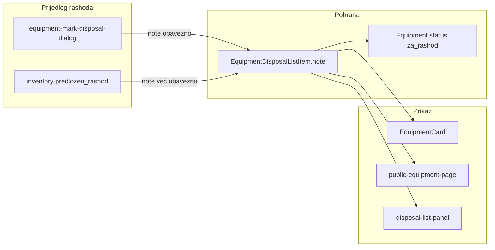
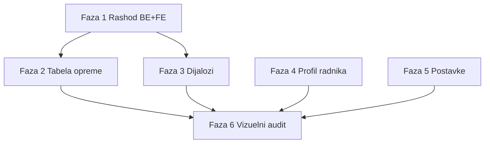

# UI/UX unapređenje — rashod, tabele, dijalogi, radnici, postavke

## Kontekst (trenutno stanje)

| Područje | Problem |
|---|---|
| Public QR stranica | `za_rashod` nema temu ni panel; pada na sivi default i „Nema podataka o zaduženju” ([`public-equipment-page.tsx`](frontend/src/components/public-equipment-page.tsx)) |
| Razlog rashoda | U dijalogu „Označi za rashod” napomena je **opcionalna**; čuva se u `EquipmentDisposalListItem.note`, ali se **ne vraća** na equipment/public API-ju |
| Tabela „Sva oprema” | Ključne spec prikazuje 2 polja; kolona Ugovor postoji; pretraga po specifikaciji može propasti kad je aktivan filter kategorije (samo `type: text` polja) |
| Dijalozi | ~20 `ModalRoot` instanci bez centralnog z-index skale; nekonzistentni `enableEscape` / `closeOnBackdrop` / spacing |
| Radnici | Nema read-only profila; `heldEquipmentCount` nije klikabilan; `phone`, `hasUserAccount`, `isOrgSigner` se ne prikazuju |
| Postavke | 59 ključeva bez UI zavisnosti, bez pretrage, string polja šalju PATCH na svaki keystroke |



---

## Faza 1 — Rashod: obavezan razlog + prikaz svuda

### Backend

1. **Obavezna napomena** u [`mark-disposal-list.dto.ts`](backend/src/modules/inventory-count/dto/mark-disposal-list.dto.ts):
   - `note` → `@IsNotEmpty()`, `@MinLength(3)`, `@MaxLength(2000)`
   - Validacija u [`equipment-disposal-list.service.ts`](backend/src/modules/inventory-count/equipment-disposal-list.service.ts) (`markForDisposal`)

2. **Novo polje `disposalReason`** na equipment odgovorima:
   - Helper u `backend/src/common/utils/` — dohvat aktivne stavke liste (`status IN listed, assigned, approved`) za opremu u statusu `za_rashod`
   - Uključiti u `equipment.service.ts` (`findOne`, list map) i [`public-equipment.service.ts`](backend/src/modules/public-equipment/public-equipment.service.ts)
   - Za `rashodovano`: po želji prikazati zadnju napomenu iz liste ili postojeći `equipment.notes` (rashod transfer)

3. **Poruke** — koristiti postojeći pattern (`disposal-messages.util.ts` / guard poruke)

### Frontend

1. [`equipment-mark-disposal-dialog.tsx`](frontend/src/components/equipment/equipment-mark-disposal-dialog.tsx):
   - Label: „Razlog rashoda” (obavezno), validacija prije submita, disabled dok nema min. 3 znaka

2. [`EquipmentCard.tsx`](frontend/src/components/EquipmentCard.tsx):
   - Orange panel za `za_rashod` (paralelno sa crvenim za `rashodovano`) — prikaz `disposalReason`

3. [`public-equipment-page.tsx`](frontend/src/components/public-equipment-page.tsx):
   - Dodati `za_rashod` u `EquipmentStatusKey` + orange `statusThemes` (usklađeno sa [`helpers.ts`](frontend/src/helpers.ts) badge bojama)
   - `AssignmentPanel`: panel „Na listi za rashod” + razlog
   - Proširiti [`public-equipment-api.ts`](frontend/src/api/public-equipment-api.ts) tip

4. **Matrica** — update [`.cursor/docs/matrices/equipment-status/MATRIX.md`](.cursor/docs/matrices/equipment-status/MATRIX.md) + CHANGELOG (obavezan razlog, public prikaz `za_rashod`)

---

## Faza 2 — Tabela „Sva oprema” ([`EquipmentPage.tsx`](frontend/src/components/EquipmentPage.tsx))

Po potvrdi korisnika — **samo ova stranica**:

| Promjena | Detalj |
|---|---|
| Ključne spec | `cat.fields.slice(0, 1)` — samo prvo polje u nizu, format `"Naziv: vrijednost"` |
| Ukloniti Ugovor | Desktop kolona + mobile card linija „Ugovor: …” |
| Pretraga | Placeholder bez „ugovora”; backend: u [`build-equipment-search-where.util.ts`](backend/src/common/utils/build-equipment-search-where.util.ts) kad je `categoryId` + `search`, **uvijek** uključiti i `specifications: { string_contains }` pored per-field OR (pokriva serijski broj bez obzira na tip polja) |
| Test | Proširiti [`build-equipment-search-where.util.spec.ts`](backend/src/common/utils/build-equipment-search-where.util.spec.ts) |

Napomena: `contractNumber` ostaje u formi/detalju opreme i na ostalim stranicama.

---

## Faza 3 — Audit dijaloga i z-index

### Infrastruktura

Novi [`frontend/src/constants/modal-z-index.ts`](frontend/src/constants/modal-z-index.ts):

```typescript
export const MODAL_Z = {
  base: 50,
  nested: 60,
  destructive: 70,
  toast: 100,
} as const;
```

Opcionalno: `ModalHeader` / `ModalFooter` layout helper u [`modal-root.tsx`](frontend/src/components/ui/modal-root.tsx) ili `modal-layout.tsx` — standard `p-6`, `border-b/t`, footer `gap-3`.

### Audit checklist (svi `ModalRoot` consumeri)

| Fajl | Akcija |
|---|---|
| `EquipmentCard.tsx` | Nested transfer modal → `MODAL_Z.nested`; ujednačiti header/footer |
| `equipment-mark-disposal-dialog.tsx` | Već z-70; uskladiti padding sa layout helperom |
| `EmployeesPage.tsx` | `enableEscape` + `closeOnBackdrop` na formi |
| `LabelPrintSheet`, `inventory-print-sheet`, `disposal-report-sheet` | z-70, backdrop zatvaranje |
| `session-lines-panel`, `equipment-installed-parts-panel` | Provjera da inline z-[60] ne konfliktuje sa modalom |
| Ostali (~15 fajlova) | Proći kroz listu iz grep-a; fiksirati samo odstupanja |

Pravilo: form dijalog = `enableEscape` + `closeOnBackdrop`; destruktivni = z-70; nested unutar EquipmentCard = z-60.

---

## Faza 4 — Profil radnika (Radnici)

### Backend

Novi endpoint `GET /employees/:id/profile` u [`employees.controller.ts`](backend/src/modules/employees/employees.controller.ts):

```typescript
interface EmployeeProfile {
  employee: EmployeeListItem; // postojeći computed counts
  user?: { id: string; email: string; role: string };
  heldEquipment: Array<{ id; inventoryNumber; categoryName; status }>;
  openRelocationCases: number;
}
```

- Scope: admin + evidentičar (`assertCanReadEmployee` već postoji)
- Limit held equipment (npr. 50 + total count)

### Frontend

Novi [`frontend/src/components/employees/employee-profile-dialog.tsx`](frontend/src/components/employees/employee-profile-dialog.tsx):

- Otvara se klikom na red / Eye ikonu / badge opreme
- Sekcije: identitet (inicijali chip), kontakt, org. jedinica (puna putanja), badgeovi (`hasUserAccount`, `isOrgSigner`, `signedTransferCount`, `openRelocationCount`)
- Lista zadužene opreme → klik otvara `EquipmentCard`
- Ako postoji user → link/dugme prema User management (samo admin)
- Evidentičar: read-only; admin zadržava postojeći Edit

Integracija u [`EmployeesPage.tsx`](frontend/src/components/EmployeesPage.tsx) — dodati `Eye` akciju pored Edit (vidljivo adminu i evidentičaru).

---

## Faza 5 — Postavke na profesionalnom nivou

### Registry proširenje

U [`settings.registry.ts`](backend/src/modules/settings/settings.registry.ts) dodati na `SettingDefinition`:

```typescript
dependsOn?: { key: string; equals?: boolean | string | number };
display?: 'default' | 'info' | 'deprecated';
detail?: string; // duži opis ispod kratkog description
```

Mapirati poznate zavisnosti:

| Master | Zavisne postavke |
|---|---|
| `transfer.generation.enabled` | svi `transfer.generation.on_*` |
| `inventory.production_mode` | `lock_date`, `session_end_date`, `auto_*`, `scheduler_timezone`, `system_user_id` |
| `notifications.enabled` | `notifications.realtime` |
| `features.*` moduli | povezani pod-ključevi gdje postoje |

Proširiti `SettingResponse` / `SettingDto` da šalje `dependsOn`, `display`, `detail`.

### UI ([`settings-page.tsx`](frontend/src/components/settings/settings-page.tsx) + [`setting-field-row.tsx`](frontend/src/components/settings/setting-field-row.tsx))

- **Hijerarhija**: child postavke uvučene (`pl-4 border-l-2`), disabled + opacity kad master isključen
- **Info redovi**: `adminEditable: false` prikazati kao read-only (`transfer.template_placeholders_help`) — monospace copy box
- **Deprecated badge** na zastarjelim ključevima
- **Pretraga** po label/description/key unutar aktivnog taba
- **Save na blur** za string/number (debounce 400ms) umjesto svakog keystroke-a
- **Tab opisi** — proširiti `SETTINGS_TAB_META` u [`settings-ui-tabs.ts`](frontend/src/constants/settings-ui-tabs.ts) sa 1–2 rečenice konteksta

### Dokumentacija

Update [`.cursor/docs/matrices/settings/MATRIX.md`](.cursor/docs/matrices/settings/MATRIX.md) + CHANGELOG (dependsOn model, UI ponašanje).

---

## Faza 6 — Vizuelni audit i preporuke (light pass)

Kratki prolaz kroz aplikaciju — implementirati samo jasne, niskorizične fixeve u istom PR-u:

| Pronađeno | Preporuka |
|---|---|
| `heldEquipmentCount` badge u Radnicima | Klik → profil dijalog (Faza 4) |
| Dupli prikaz ugovora u EquipmentCard | Zadržati (ugovor uklonjen samo iz liste) |
| Status `za_rashod` bez konteksta | Faza 1 |
| `EquipmentByCategoryPage` i dalje ima Ugovor | Namjerno — van opsega |
| Nedostajući linkovi | U profilu radnika → oprema; u EquipmentCard holder → profil radnika (ako postoji ruta/dijalog) |
| Konzistentnost badgeova | Koristiti `getStatusLabel` / `getStatusColor` svuda |
| Public vs auth tema | Orange `za_rashod` usklađen sa authenticated UI |

Ne raditi široki redesign u ovom zadatku — samo dokumentirati veće vizuelne ideje (npr. company header preview u Postavkama) kao follow-up.

---

## Redoslijed implementacije



Faze 1–3 su funkcionalno povezane (rashod UX). Faze 4–5 mogu paralelno nakon Faze 1.

## Test plan

- Backend: unit test za `buildEquipmentSearchWhere` (category + broad spec); validacija obaveznog `note` u mark disposal
- Ručno: QR public stranica za `za_rashod` opremu (orange tema + razlog)
- Ručno: mark disposal bez razloga → greška; sa razlogom → vidljiv u EquipmentCard i public
- Ručno: pretraga serijskog broja na „Sva oprema” sa i bez filtera kategorije
- Ručno: nested modal u EquipmentCard (transfer unutar kartice) — z-index OK
- Ručno: Postavke — isključiti `transfer.generation.enabled` → child opcije disabled
- Ručno: Profil radnika — evidentičar vidi, admin edit i dalje radi
