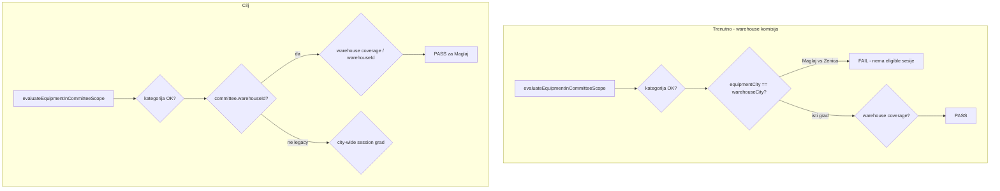

# Popravka opsega komisije: skladište, ne grad

## Problem (potvrđeno)

Za komisiju s `warehouseId` (npr. **Skladište ED Zenica**), [`evaluateEquipmentInCommitteeScope`](backend/src/modules/inventory-count/utils/resolve-warehouse-committee-scope.util.ts) trenutno zahtijeva:

```text
resolveEquipmentCityId(equipment) === warehouse.cityId
```

prije warehouse coverage provjere.

| Nosilac | Efektivna lokacija | Efektivno skladište | Gradska provjera | Coverage |
|---------|-------------------|---------------------|------------------|----------|
| Sektor pod ED Zenicom | Zenica | Skladište ED Zenica | prolazi | prolazi |
| PJ Maglaj / poslovna jedinica | **Maglaj** | Skladište ED Zenica | **pada** | prolazio bi |

Poslovni model (vaš): komisija je po **skladištu**; sve OJ koje nasljeđuju to skladište pripadaju opsegu — **lokacija (Maglaj vs Zenica) nije granica opsega**.

Ironija: [`loadCandidateEquipmentForWarehouse`](backend/src/modules/inventory-count/inventory-count.service.ts) već učitava kandidate ispravno (zaduženo po `orgUnitId in coverageSubtree`), ali [`countEquipmentInWarehouseCategoryScope`](backend/src/modules/inventory-count/utils/resolve-warehouse-committee-scope.util.ts) ih zatim filtrira gradom → wizard prikazuje 0 opreme za kategoriju iako oprema postoji.



---

## Ciljno ponašanje (source of truth)

### A) Komisija **sa** `warehouseId` (v4, sve nove sesije)

Oprema je u opsegu ako:

1. `status` nije `rashodovano` / `za_rashod`
2. `categoryKind === ASSET` i `categoryId` u expand(`committee.categoryId`)
3. **I jedno od:**
   - `status === skladiste` **i** `equipment.warehouseId === committee.warehouseId`
   - `status === zaduzeno` **i** `currentHolder.orgUnitId` u podstablu `warehouse.orgUnitId`

**Bez** usporedbe `effectiveLocationCityId` nosioca i `Warehouse.cityId`.

### B) Legacy komisija **bez** `warehouseId` (read-only)

Zadržati postojeći city-wide opseg:

- `resolveEquipmentCityId(equipment) === effectiveLocationCityId(session.orgUnitId)`

Implementacija već postoji u [`isEquipmentInLegacyCommitteeScope`](backend/src/modules/disposal-commissions/disposal-commissions.service.ts) — treba je konsolidovati u jedan evaluator ili eksplicitno granati u `evaluateEquipmentInCommitteeScope`.

### Šta se **ne** mijenja

- Validacija **članova** komisije („u gradu skladišta“) — [`MATRIX.md`](.cursor/docs/matrices/inventory-count/MATRIX.md) linija 93
- `inventory-freeze` po gradu opreme
- Notifikacije / registrar scope po gradu
- Nasljeđivanje efektivnog skladišta u org hijerarhiji

---

## Implementacija (jedna jezgrena izmjena)

### 1. Refaktor [`resolve-warehouse-committee-scope.util.ts`](backend/src/modules/inventory-count/utils/resolve-warehouse-committee-scope.util.ts)

Zamijeniti tijelo `evaluateEquipmentInCommitteeScope` grananjem:

```ts
// Pseudokod
if (terminal status / MAINTENANCE / category) return false;

if (committee.warehouseId) {
  return matchesWarehouseEquipmentScope(deps, committee.warehouseId, equipment);
}

// Legacy city-wide
const sessionCityId = await deps.getEffectiveLocationForOrgUnit(committee.sessionOrgUnitId);
if (!sessionCityId) return false;
const equipmentCityId = await deps.resolveEquipmentCityId(equipment);
return equipmentCityId === sessionCityId;
```

**Ukloniti** blok linija 74–88 (postavljanje `scopeCityId` iz `warehouse.cityId` + usporedba).

Opcionalno (čistoća): `getWarehouseCityId` više nije potreban u warehouse grani — ostaje u `CommitteeScopeDeps` zbog legacy puta i postojećih call-siteova (bez breaking refactora).

### 2. Novi unit test fajl [`resolve-warehouse-committee-scope.util.spec.ts`](backend/src/modules/inventory-count/utils/resolve-warehouse-committee-scope.util.spec.ts)

Minimalni scenariji (mock `CommitteeScopeDeps`):

| Test | warehouseId | Holder / oprema | Gradovi mock | Očekivano |
|------|-------------|-----------------|-------------|-----------|
| `maglajHolder_zenicaWarehouse` | wh-zenica | zaduzeno, ou-maglaj u coverage | equipment=`maglaj`, warehouse=`zenica` | **true** |
| `holderOutsideCoverage` | wh-zenica | zaduzeno, ou-sarajevo van subtree | bilo koji | **false** |
| `skladiste_match` | wh-1 | skladiste wh-1 | različiti gradovi | **true** |
| `skladiste_mismatch` | wh-1 | skladiste wh-2 | — | **false** |
| `legacy_cityMatch` | null | bilo koji | isti grad | **true** |
| `legacy_cityMismatch` | null | bilo koji | različit grad | **false** |
| `rashodovano` | wh-1 | — | — | **false** |

### 3. Ažurirati [`disposal-session-scope.util.spec.ts`](backend/src/modules/inventory-count/utils/disposal-session-scope.util.spec.ts)

Dodati eksplicitni test **Maglaj scenarija**:

- `resolveEquipmentCityId` → `city-maglaj`
- `getWarehouseCityId` → `city-zenica`
- `expandOrgUnitIds` uključuje `ou-maglaj`
- očekivano: `isEquipmentInDisposalSessionScope` === **true**

Trenutni testovi maskiraju bug jer svi mockovi vraćaju `city-1`.

---

## Potrošači (automatski popravljeni jednom izmjenom)

Svi pozivaju isti `evaluateEquipmentInCommitteeScope`:

| Modul | Metoda | Efekat popravke |
|-------|--------|-----------------|
| [`equipment-disposal-list.service.ts`](backend/src/modules/inventory-count/equipment-disposal-list.service.ts) | `findEligibleSessionsForEquipment`, `markForDisposal` | PJ Maglaj dobija eligible sesiju |
| [`inventory-count.service.ts`](backend/src/modules/inventory-count/inventory-count.service.ts) | `isEquipmentInCommitteeScope`, `countEquipmentInWarehouseCategoryScope`, unos linija | Tačan broj opreme u wizardu; linije za Maglaj |
| [`disposal-commissions.service.ts`](backend/src/modules/disposal-commissions/disposal-commissions.service.ts) | `isEquipmentInCommitteeScope` | Rashod komisija vidi istu opremu |

Nema potrebe za duplim logikama u disposal servisu — [`disposal-session-scope.util.ts`](backend/src/modules/inventory-count/utils/disposal-session-scope.util.ts) ostaje tanak wrapper.

---

## Dokumentacija (obavezno po pravilima projekta)

### [`inventory-count/MATRIX.md`](.cursor/docs/matrices/inventory-count/MATRIX.md) — sekcija „Opseg opreme“

Zamijeniti jedan blok dvije grane:

**Warehouse komisija (`warehouseId` postavljen):**

```text
equipment u opsegu ako:
  status validan, ASSET, kategorija u expand(committee.categoryId)
  AND (
    skladiste: equipment.warehouseId == committee.warehouseId
    OR zaduzeno: holder.orgUnitId u podstablu warehouse.orgUnitId
  )
```

**Legacy (`warehouseId IS NULL`):**

```text
resolveEquipmentCityId(equipment) == effectiveLocationCityId(session.orgUnitId)
```

Ukloniti uvjet `resolveEquipmentCityId == sessionCityId` iz warehouse grane (trenutna linija 115 u matrici je zastarjela/misledeća).

### [`inventory-count/CHANGELOG.md`](.cursor/docs/matrices/inventory-count/CHANGELOG.md)

Zapis 2026-06-17: warehouse opseg bez gradske jednakosti; Maglaj/PJ pod ED Zenica; legacy ne dirati.

---

## Faza 2 (opciono, odvojeni PR — nije blokator za Maglaj)

Ako nakon ove izmjene i dalje postoje problemi za opremu s **centralnim lotom** + nosiocem u Zenica stablu (relokacija nedovršena), razmotriti usklađivanje [`resolve-disposal-target-warehouse.util.ts`](backend/src/modules/inventory-count/utils/resolve-disposal-target-warehouse.util.ts) s [`transfer-warehouse.util.ts`](frontend/src/helpers/transfer-warehouse.util.ts):

- za `zaduzeno`: prvo efektivno skladište nosioca / zadnje `zaduzenje`, pa `stockLot.warehouseId`

**Za vaš Maglaj slučaj (Zenica lot + Zenica skladište) faza 1 je dovoljna.**

---

## Ručna verifikacija (checklist)

1. **PJ Maglaj, zaduženo**, lot na Skladištu Zenica → „Označi za rashod“ prikazuje draft sesiju; `markForDisposal` uspije.
2. **Sektor ED Zenica**, ista sesija → i dalje radi (regresija).
3. **Skladište Zenica**, `status=skladiste` → eligible + mark.
4. **Wizard** `committees/setup-options?warehouseId=zenica` → `equipmentCount` uključuje Maglaj komade (ne 0).
5. **Aktivna sesija** → član komisije može unijeti liniju za opremu zaduženu na Maglaju.
6. **Legacy komisija** (ako postoji u bazi bez `warehouseId`) → ponašanje nepromijenjeno (city-wide).

---

## Rizici i mitigacije

| Rizik | Mitigacija |
|-------|------------|
| Preširok opseg ako je `warehouse.orgUnitId` pogrešno postavljen na Direkciju | To je data problem; ista pretpostavka kao za efektivno skladište u UI |
| Oprema zadužena na Sarajevo nosioca ali Zenica lot bez relokacije | Coverage neće proći (ispravno); riješiti relokacijom ili fazom 2 |
| Legacy sesije | Eksplicitna grana `!warehouseId` |

---

## Procjena obima

- **1 fajl** logike + **2 spec** fajla + **2 doc** fajla
- Bez migracije, bez frontend izmjena, bez API promjena
- Backend build + `node --import tsx --test` na novim/izmijenjenim specovima
