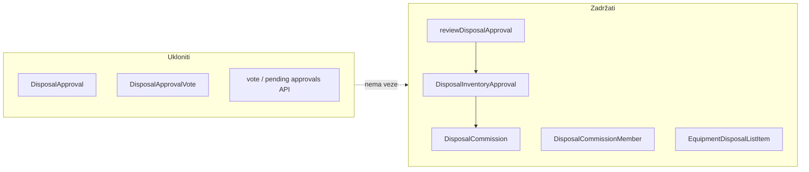
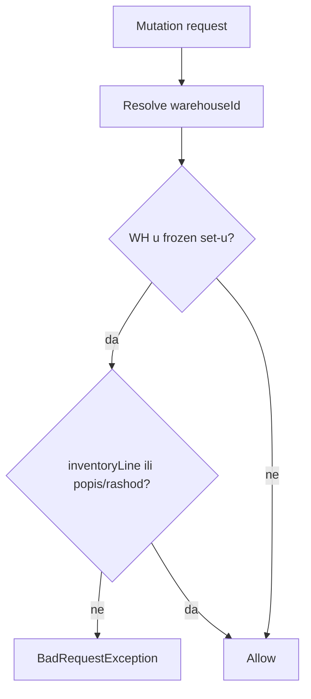

# Warehouse-first: članovi, freeze, legacy rashod

## Kontekst i princip

Poslovno pravilo (potvrđeno ručno):

- **Opseg i pripadnost** = efektivno skladište / warehouse coverage — **ne** usklađivanje grada nosioca i `Warehouse.cityId`.
- **Članovi komisije** = svi radnici čije OJ ima isto efektivno skladište kao komisija (+ `RegistrarAssignment` za to skladište).
- **Freeze** = blokada mutacija za opremu/lotove/transfere koji pripadaju skladištima u aktivnoj sesiji (izuzetak: modul Popis + Komisija rashoda).
- **Rashod** = samo `DisposalInventoryApproval` (predsjednik approve/reject + zapisnik); legacy glasanje članova na transferu se **ukida**.



---

## Faza 1 — Članovi komisije (Maglaj fix)

### Problem

[`resolveEligibleEmployeesForWarehouse`](backend/src/modules/inventory-count/inventory-count.service.ts) (linije ~2450–2454) odbacuje zaposlenike čiji `effectiveLocationCityId !== warehouse.cityId` prije coverage provjere.

### Cilj

```
eligible(employee, warehouse) :=
  resolveForEmployee(employee.id) === warehouse.id
  OR RegistrarAssignment(user, warehouse.id)
```

- Koristiti [`WarehouseResolutionService.resolveForEmployee`](backend/src/common/services/warehouse-resolution.service.ts).
- Zadržati `isEmployeeInWarehouseCoverage` samo ako želimo fallback kad `resolveForEmployee` vrati null (npr. nedostaju podaci) — inače ga ukloniti iz eligible grane da ne duplira pravilo.
- `hasUserAccount` prikaz ostaje kao sada.

### Fajlovi

| Fajl | Akcija |
|------|--------|
| [`inventory-count.service.ts`](backend/src/modules/inventory-count/inventory-count.service.ts) | Refaktor `resolveEligibleEmployeesForWarehouse` |
| Novi `resolve-eligible-committee-members.util.ts` | Izdvojena čista logika + unit testovi (Maglaj: effective WH Zenica, grad Maglaj → eligible) |
| [`.cursor/docs/matrices/inventory-count/MATRIX.md`](.cursor/docs/matrices/inventory-count/MATRIX.md) | Linija 93: zamijeniti „u gradu skladišta“ → efektivno skladište |
| [`CHANGELOG.md`](.cursor/docs/matrices/inventory-count/CHANGELOG.md) | Zapis promjene |

### Verifikacija

- Wizard `setup-options` → eligible employees uključuju PJ Maglaj radnike za Skladište ED Zenica.
- `assertMembersEligibleForWarehouse` prolazi za iste ID-eve.

---

## Faza 2 — Inventory freeze po skladištu

### Problem

[`InventoryFreezeService`](backend/src/common/services/inventory-freeze.service.ts) koristi **grad opreme** (`resolveEquipmentCityId` + `session.orgUnit.effectiveLocationCityId`). Maglaj oprema pod ED Zenica skladištem **nije** zamrznuta dok je aktivna sesija Zenica.

Pozivatelji `assertNoMutationInCity(warehouse.cityId)`:
- [`warehouse-stock.service.ts`](backend/src/modules/warehouse-stock/warehouse-stock.service.ts)
- [`maintenance-parts.service.ts`](backend/src/modules/maintenance-parts/maintenance-parts.service.ts)

Duplikat: [`assertTransfersAllowedForEquipment`](backend/src/modules/inventory-count/inventory-count.service.ts) (~1855).

### Ciljno ponašanje



**Frozen set** za skladište `W`:

1. **Aktivna sesija** (`status = active`): postoji `InventoryCommittee` sa `warehouseId = W` u toj sesiji.
   - Opcionalno poštovati `session.startDate` / `session.endDate` ako su postavljeni (fallback kao u `activateSession`: 01.12–31.12).
2. **Production lock** ([`InventoryProductionModeService`](backend/src/common/services/inventory-production-mode.service.ts)): od `inventory.lock_date` do `closed` sesije distribucije — zamrzni sva skladišta koja imaju komisiju u toj sesiji (ne po gradu distribucije).

**Izuzeci** (zadržati postojeće):
- `admin`
- transfer/akcija vezana uz `inventoryLineId`
- sam modul popisa (linije, disposal inbox, `reviewDisposalApproval`)

### Implementacija

1. Novi util [`resolve-inventory-frozen-warehouses.util.ts`](backend/src/common/utils/resolve-inventory-frozen-warehouses.util.ts):
   - `findFrozenWarehouseIdsForEquipment(equipmentId)` — za `zaduzeno`: `resolveForEmployee`; za `skladiste`: `equipment.warehouseId`; fallback kroz postojeći disposal target resolver gdje treba.
   - `isWarehouseFrozen(warehouseId, date?)` — active session + production lock.
2. Refaktor `InventoryFreezeService`:
   - `assertNoMutationInCity` → **`assertNoMutationInWarehouse(warehouseId, ...)`** (deprecate/remove city metodu).
   - `findActiveSessionForEquipment` → `findFrozenContextForEquipment` (vrati session name + warehouseId).
   - Poruke greške: „skladište X / sesija Y“ umjesto „grad“.
3. Zamijeniti sve `assertNoMutationInCity` pozive sa `assertNoMutationInWarehouse(warehouse.id)`.
4. Ukloniti ili uskladiti `assertTransfersAllowedForEquipment` da delegira na isti freeze servis (jedan izvor istine).
5. **Freeze banner** [`getFreezeBannerForUser`](backend/src/modules/inventory-count/inventory-count.service.ts):
   - `resolveFreezeCityIdsForUser` → `resolveFreezeWarehouseIdsForUser` (registrar assignments, keeper warehouses, effective warehouse zaposlenika).
   - API response: dodati `warehouseId` / `warehouseName` uz sesiju (FE backward compatible: prikazati skladište umjesto grada gdje ima smisla).
6. FE [`inventory-activate-readiness.util.ts`](frontend/src/helpers/inventory-activate-readiness.util.ts): keeper provjera po skladištima u sesiji, ne `warehouse.cityId === sessionCityId`.

### Testovi

- Novi `inventory-freeze.service.spec.ts` ili util spec:
  - Maglaj holder + aktivna sesija ED Zenica WH → **blocked** transfer create.
  - Zenica sektor + ista sesija → blocked.
  - Transfer sa `inventoryLineId` → allowed.
  - Stock lot create na frozen WH → blocked.
  - WH van sesije → allowed.

### Dokumentacija

- [`inventory-count/MATRIX.md`](.cursor/docs/matrices/inventory-count/MATRIX.md) — nova sekcija „Inventory freeze (warehouse)“.
- [`warehouse-stock/MATRIX.md`](.cursor/docs/matrices/warehouse-stock/MATRIX.md) — zamijeniti „grad“ sa skladištem.
- CHANGELOG oba modula.

---

## Faza 3 — Uklanjanje legacy transfer glasanja (taktički)

### Šta se briše (legacy)

| Komponenta | Lokacija |
|------------|----------|
| Prisma modeli | `DisposalApproval`, `DisposalApprovalVote` |
| Relacija na `Transfer` | `disposalApproval` |
| Relacija na `User` | `disposalVotes` |
| API | `GET approvals/pending`, `PATCH approvals/:id/vote`, `GET resolve` (city lookup) |
| Servis metode | `findPendingApprovals`, `vote`, `createApprovalForTransfer`, `findCommissionForTransfer`, `findCommissionForCityAndEquipment`, `assertCanSignDisposalTransfer`, `recalculateApproval` |
| Nav badge | [`nav.service.ts`](backend/src/modules/nav/nav.service.ts) legacy pending count |
| FE API | `fetchPendingDisposalApprovalsApi`, `voteDisposalApprovalApi`, `resolveDisposalCommissionApi` |
| FE UI | `disposalApproval` badge na [`TransfersPage`](frontend/src/components/TransfersPage.tsx), [`EquipmentCard`](frontend/src/components/EquipmentCard.tsx); rashodovanje resolve u formi; [`create-transfer-payload.util.ts`](frontend/src/helpers/create-transfer-payload.util.ts) `hasDisposalCommission` |
| Dead code | [`disposal-commission-form-modal.tsx`](frontend/src/components/disposal-commissions/disposal-commission-form-modal.tsx) (create već blokiran na BE) |

### Šta se NE dira (aktivni rashod)

| Komponenta | Svrha |
|------------|-------|
| `DisposalInventoryApproval` | Predsjednik odluka po opremi |
| `reviewDisposalApproval` | Approve → `rashodovano` + `unisteno` |
| `disposal-inbox-panel.tsx` | UI inboxa |
| `getDisposalReport` / `build-disposal-report.util.ts` | Zapisnik |
| `DisposalCommission` + members | Vezano uz `InventoryCommittee` |
| `DisposalCommissionsPage` | Read-only pregled komisija (`GET /disposal-commissions`) |

### Redoslijed (taktička sigurnost)

1. **Pre-migracija audit**: SQL/count postojećih `disposal_approvals` sa `status=pending` — ako ima, admin zatvara/odbija ili export prije dropa.
2. **Kod prvo**: ukloniti pozive i rute; build mora proći bez referenci na legacy modele.
3. **Prisma migracija**: drop `disposal_approval_votes`, `disposal_approvals`; ukloniti FK sa `transfers`.
4. **Seed/e2e**: ažurirati [`seed-demo.ts`](backend/prisma/seed-demo.ts), smoke testove.
5. **Matrica**: [`disposal-commission/MATRIX.md`](.cursor/docs/matrices/disposal-commission/MATRIX.md) — ukloniti legacy red; naglasiti da je jedini workflow `DisposalInventoryApproval`.
6. **GUARDS_REGISTRY** — ukloniti legacy vote guardove ako postoje.

### Napomena za `rashodovanje` transfer tip

API već baca [`TRANSFER_MESSAGES.rashodovanjeBlocked`](backend/src/modules/transfers/transfers.service.ts) (linija ~222). FE: ukloniti/opciono sakriti tip `rashodovanje` iz create forme ako još postoji u UI.

---

## Faza 4 — Preostali gradski ostaci (manji scope)

Nakon faza 1–3, uskladiti preostale „grad + skladište“ provjere koje nisu registrar scope:

| Lokacija | Promjena |
|----------|----------|
| `createRelocationTransfer` / `resolveRelocationWarehouseId` | Ciljna osoba i skladište u **warehouse coverage** sesije, ne `sessionCityId` |
| `assertWarehouseInSessionScope` fallback | Samo org scope; ukloniti `warehouse.cityId === sessionCityId` kad `orgUnitId` null (ili zahtijevati `orgUnitId` na skladištu) |
| `listWarehousesForSessionOrgUnit` | Ukloniti `{ orgUnitId: null, cityId: sessionCityId }` OR granu ako sva skladišta imaju `orgUnitId` |
| `resolveDisposalTargetWarehouseId` | Faza 2 plana: za `zaduzeno` prvo holder effective WH, pa lot (odvojeni mali PR ako treba) |

**Ne dirati:** `RegistrarScopeService`, notifikacije po gradu evidentičara, `DisposalCommission.cityId` kao atribut (adresa skladišta u zapisniku) — samo ne koristiti za lookup opsega.

---

## Procjena obima

| Faza | Fajlovi (okvirno) | Rizik |
|------|-------------------|-------|
| 1 Članovi | 3–4 BE + matrica | Nizak |
| 2 Freeze | 1 util + freeze service + 3 poziva + banner FE | Srednji |
| 3 Legacy rashod | BE controller/service + Prisma + FE transfers + nav | Srednji (DB drop) |
| 4 Relokacija/misc | 1–2 BE metode | Nizak |

Preporučeni PR redoslijed: **1 → 2 → 3 → 4** (ili 1+2 u jednom PR, 3 odvojeno zbog migracije).

---

## Ručna verifikacija (checklist)

1. PJ Maglaj zaposlenik u eligible listi za ED Zenica komisiju (wizard korak 2/3).
2. Aktivna sesija ED Zenica: transfer opreme zadužene na Maglaju → **blokiran**; unos linije popisa → **dozvoljen**.
3. Stock lot issue na Skladištu ED Zenica tokom aktivne sesije → **blokiran** (non-admin).
4. Freeze banner prikazuje sesiju + skladište (ne samo grad).
5. Disposal inbox: predsjednik approve/reject i dalje radi; zapisnik generisan.
6. Nema UI/API za legacy vote; `TransfersPage` bez `disposalApproval` statusa.
7. Regresija: evidentičar cross-warehouse scope nepromijenjen.
